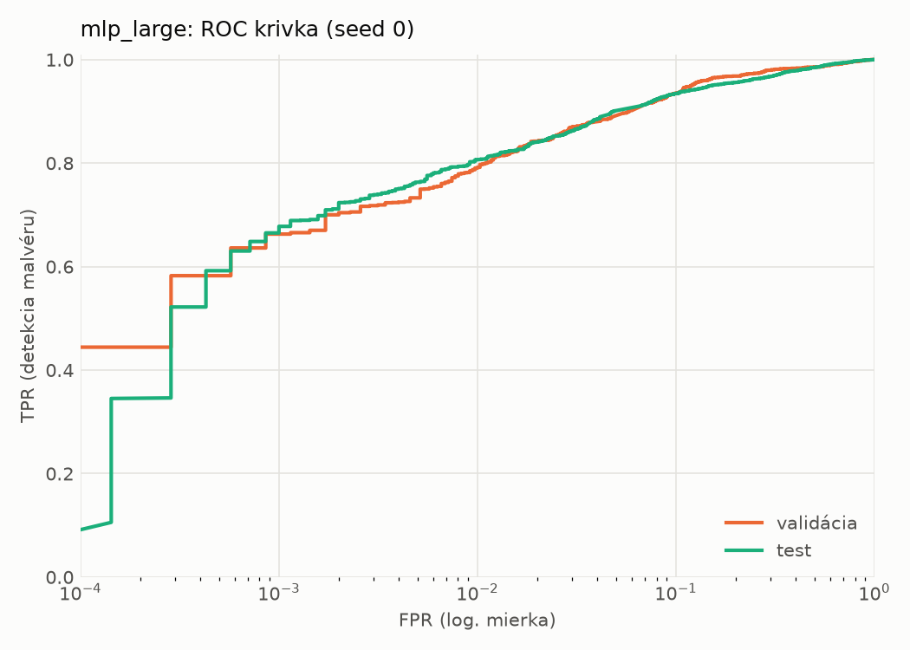
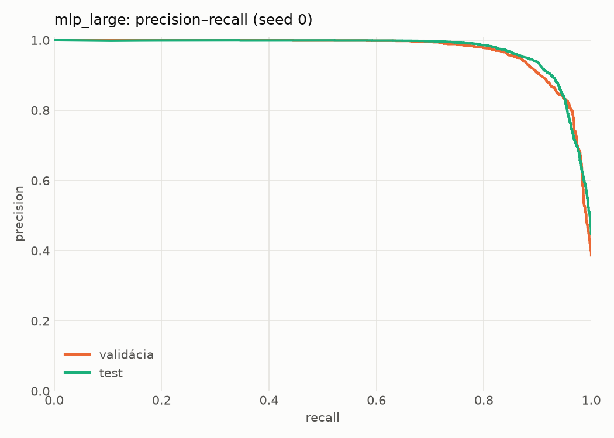
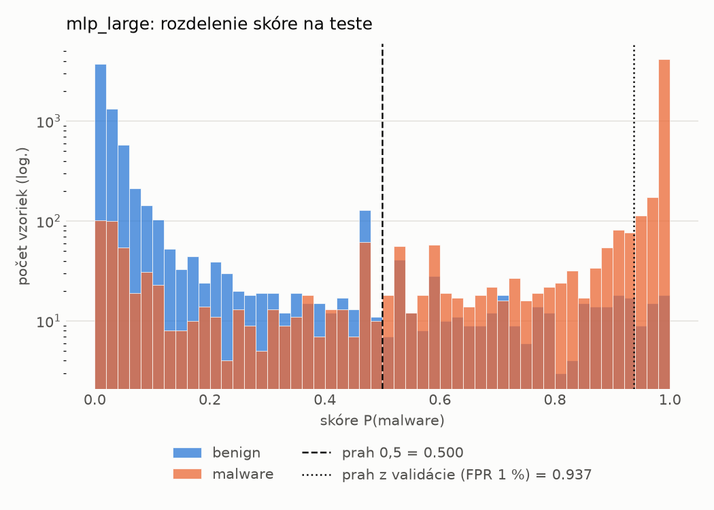
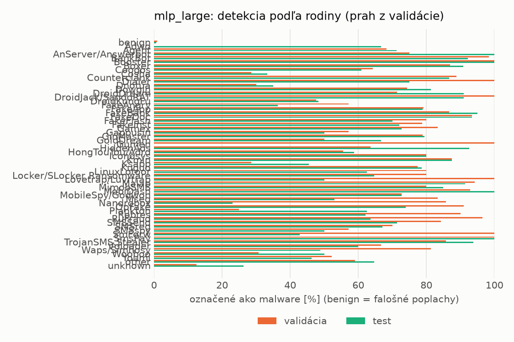
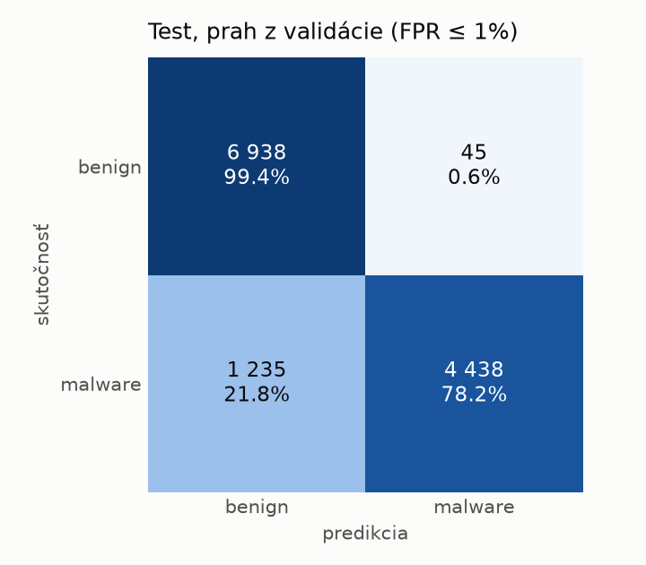
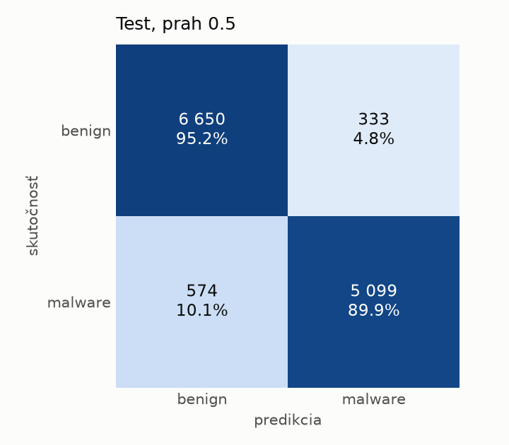
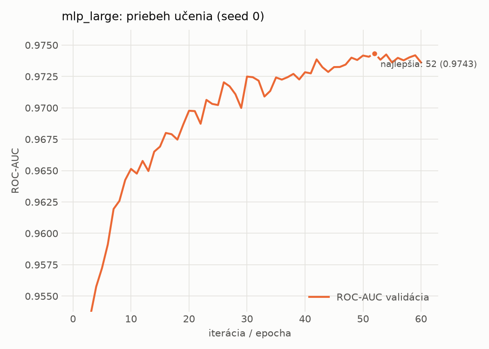

# dynamic/mlp_large – beh `20261123-010721`

> Automaticky generované (`src/training/run_tabular.py`). Konfigurácia: `config.yaml`, protokol: `protocol.yaml`.

- **Model:** `mlp` – veľká neurónová sieť (3–5 skrytých vrstiev, 512–2048 neurónov), kandidát na učiteľa
- **Ladenie:** bez ladenia – hyperparametre prevzaté z `runs_v4/real_p/full/dynamic/mlp_large/20261122-235153`
- **Finálne modely:** seedy [0, 1, 2]; hodnoty sú priemer ± smerodajná odchýlka cez seedy
- **Najlepšie hyperparametre:** `{"max_epochs": 100, "patience": 8, "hidden_layers": 5, "hidden_width": 512, "width_decay": 1.0, "dropout": 0.3998176791356432, "lr": 0.0024125104549951384, "weight_decay": 1.1960883604412328e-06, "batch_size": 1024}`

## Detekčná kvalita (bez prahu)
| metrika | train (podvzorka) | validácia | test |
|---|---|---|---|
| ROC-AUC | 0.9894 ± 0.0015 | 0.9747 ± 0.0004 | 0.9717 ± 0.0004 |
| PR-AUC | 0.9866 ± 0.0016 | 0.9703 ± 0.0005 | 0.9734 ± 0.0001 |
| TPR pri FPR 1 % | 0.8965 ± 0.0113 | 0.7904 ± 0.0048 | 0.8025 ± 0.0075 |
| TPR pri FPR 0,1 % | 0.7572 ± 0.0279 | 0.5973 ± 0.0616 | 0.6587 ± 0.0095 |
| log loss | 0.1167 ± 0.0090 | 0.1912 ± 0.0009 | 0.2042 ± 0.0027 |
| Brier skóre | 0.0327 ± 0.0024 | 0.0548 ± 0.0010 | 0.0572 ± 0.0003 |

Rozdiel ROC-AUC train − validácia: **0.0147** (veľký rozdiel = preučenie).

## Pri prahu z validácie (FPR ≤ 1% na validácii)
| metrika | train (podvzorka) | validácia | test |
|---|---|---|---|
| accuracy | 0.9294 ± 0.0030 | 0.9129 ± 0.0018 | 0.8988 ± 0.0018 |
| balanced accuracy | 0.9077 ± 0.0038 | 0.8903 ± 0.0024 | 0.8880 ± 0.0020 |
| precision | 0.9944 ± 0.0016 | 0.9808 ± 0.0001 | 0.9887 ± 0.0013 |
| recall (TPR) | 0.8182 ± 0.0068 | 0.7904 ± 0.0048 | 0.7832 ± 0.0035 |
| FPR | 0.0028 ± 0.0008 | 0.0097 ± 0.0000 | 0.0073 ± 0.0009 |
| F1 | 0.8978 ± 0.0047 | 0.8754 ± 0.0030 | 0.8740 ± 0.0025 |
| MCC | 0.8540 ± 0.0063 | 0.8208 ± 0.0037 | 0.8064 ± 0.0035 |

## Pri pevnom prahu 0.5
| metrika | train (podvzorka) | validácia | test |
|---|---|---|---|
| accuracy | 0.9563 ± 0.0019 | 0.9235 ± 0.0025 | 0.9273 ± 0.0015 |
| balanced accuracy | 0.9529 ± 0.0019 | 0.9194 ± 0.0021 | 0.9248 ± 0.0014 |
| precision | 0.9453 ± 0.0046 | 0.9011 ± 0.0064 | 0.9351 ± 0.0034 |
| recall (TPR) | 0.9390 ± 0.0035 | 0.9011 ± 0.0035 | 0.9003 ± 0.0019 |
| FPR | 0.0332 ± 0.0030 | 0.0624 ± 0.0046 | 0.0507 ± 0.0029 |
| F1 | 0.9421 ± 0.0025 | 0.9011 ± 0.0029 | 0.9174 ± 0.0016 |
| MCC | 0.9071 ± 0.0040 | 0.8387 ± 0.0050 | 0.8531 ± 0.0031 |

## Výpočtové nároky (seed 0, testovacia množina)
| meranie | hodnota |
|---|---|
| tréning finálneho modelu | 6.2 s (priemer cez seedy) |
| ladenie spolu | 0 s |
| počet parametrov / uzlov | 1 119 745 |
| veľkosť modelu na disku | 4.51 MB |
| transformácia vstupu – latencia (1 vlákno) | 0.014 ms |
| transformácia vstupu – priepustnosť | 751 205 vzoriek/s |
| CPU latencia modelu (batch 1, 1 vlákno) | 0.248 ms (p95 0.572) |
| CPU priepustnosť (24 vlákien) | 374 613 vzoriek/s |
| GPU latencia (batch 1) | 0.717 ms (p95 0.864) |
| GPU priepustnosť | 1 836 652 vzoriek/s |
| GPU špičková pamäť | 111 MB |

## Grafy
| | |
|---|---|
|  |  |
|  |  |
|  |  |
|  |  |

## Súbory
`metrics.json` (všetky metriky po seedoch vrátane rodín), `timing.json`, `hpo_trials.csv`,
`predictions/<časť>_seed<N>.parquet` (sha256, family, label, score), `model/seed_<N>/`, `log.txt`.
