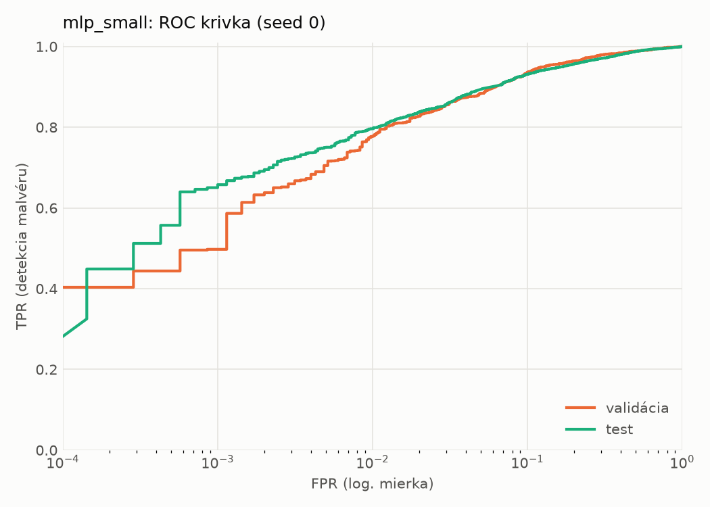
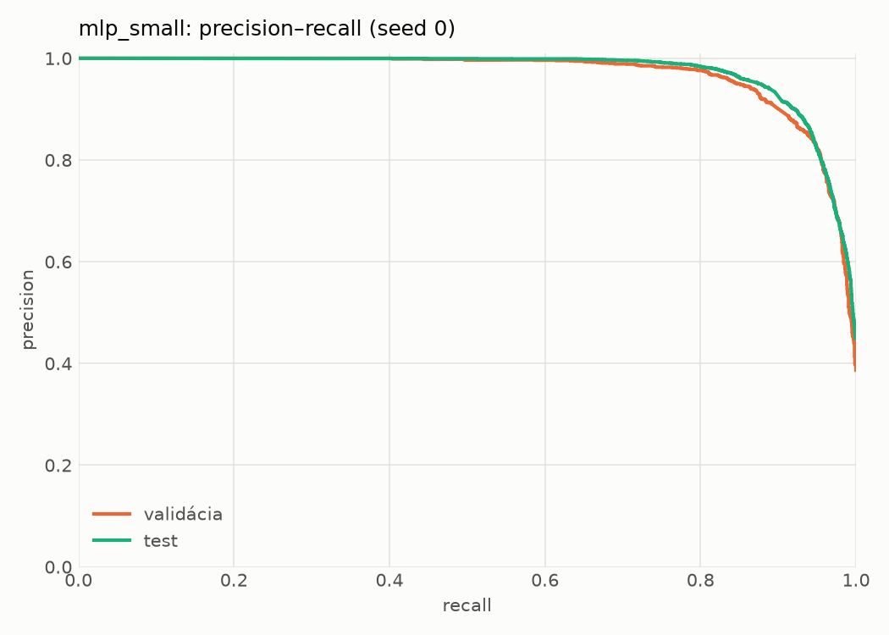
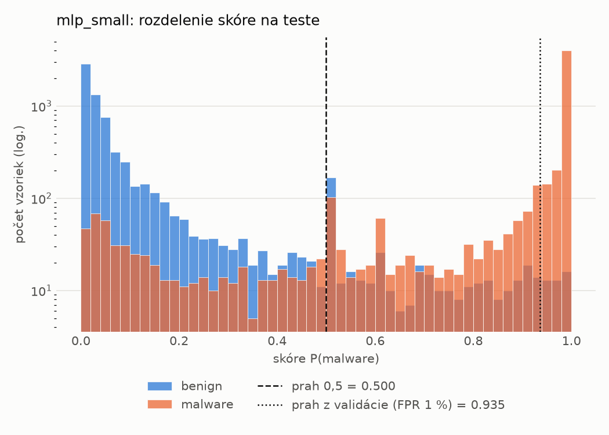
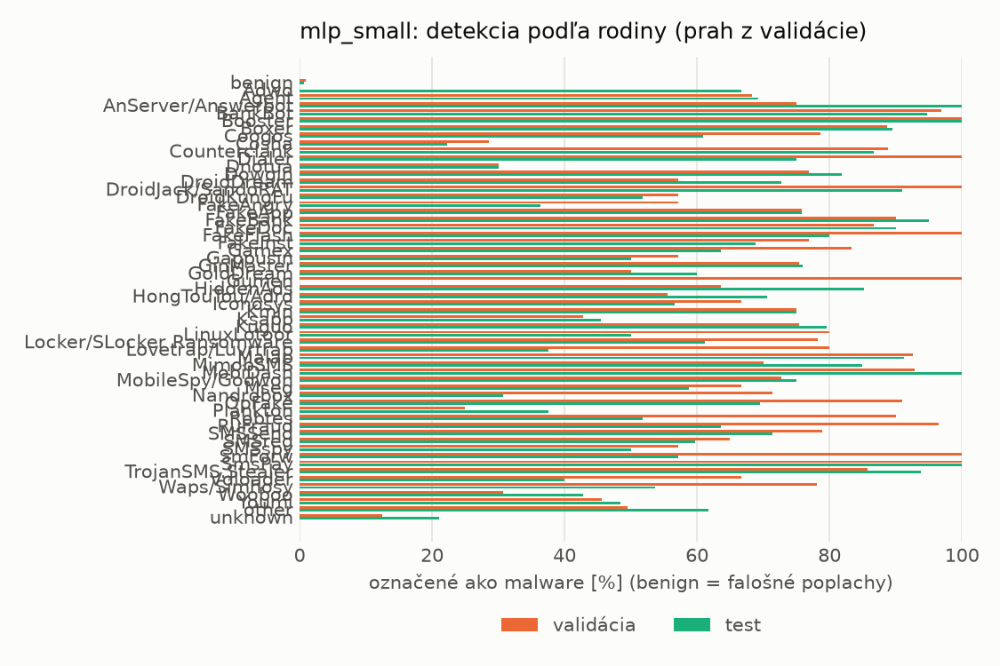
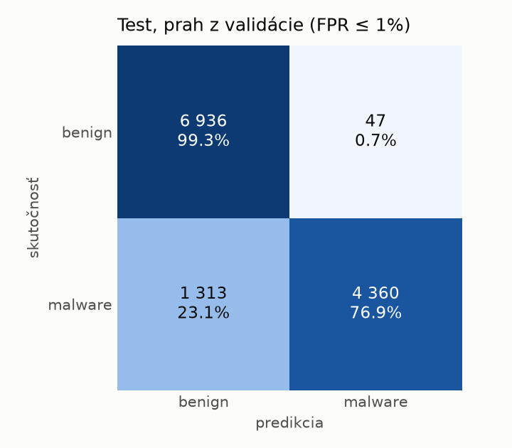
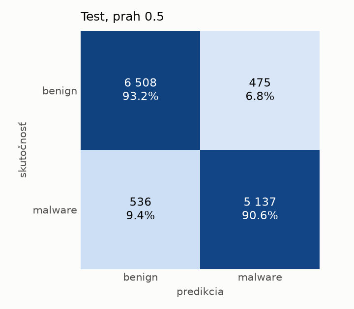
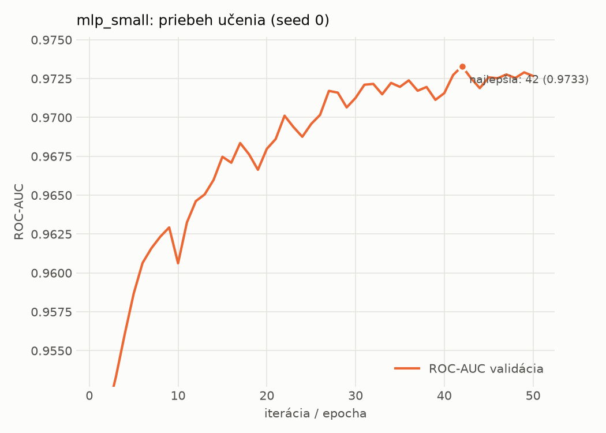

# dynamic/mlp_small – beh `20261123-010626`

> Automaticky generované (`src/training/run_tabular.py`). Konfigurácia: `config.yaml`, protokol: `protocol.yaml`.

- **Model:** `mlp` – malá neurónová sieť (1–2 skryté vrstvy), kandidát na ľahkého študenta
- **Ladenie:** bez ladenia – hyperparametre prevzaté z `runs_v4/real_p/full/dynamic/mlp_small/20261122-234317`
- **Finálne modely:** seedy [0, 1, 2]; hodnoty sú priemer ± smerodajná odchýlka cez seedy
- **Najlepšie hyperparametre:** `{"width_decay": 0.5, "max_epochs": 100, "patience": 8, "hidden_layers": 2, "hidden_width": 256, "dropout": 0.2449160262890371, "lr": 0.002872548733508973, "weight_decay": 4.509331245708397e-06, "batch_size": 256}`

## Detekčná kvalita (bez prahu)
| metrika | train (podvzorka) | validácia | test |
|---|---|---|---|
| ROC-AUC | 0.9897 ± 0.0011 | 0.9740 ± 0.0008 | 0.9719 ± 0.0004 |
| PR-AUC | 0.9869 ± 0.0014 | 0.9691 ± 0.0009 | 0.9737 ± 0.0007 |
| TPR pri FPR 1 % | 0.8966 ± 0.0105 | 0.7881 ± 0.0105 | 0.8043 ± 0.0082 |
| TPR pri FPR 0,1 % | 0.7647 ± 0.0235 | 0.5307 ± 0.0303 | 0.6596 ± 0.0081 |
| log loss | 0.1199 ± 0.0064 | 0.1959 ± 0.0036 | 0.2031 ± 0.0027 |
| Brier skóre | 0.0332 ± 0.0021 | 0.0552 ± 0.0010 | 0.0568 ± 0.0011 |

Rozdiel ROC-AUC train − validácia: **0.0157** (veľký rozdiel = preučenie).

## Pri prahu z validácie (FPR ≤ 1% na validácii)
| metrika | train (podvzorka) | validácia | test |
|---|---|---|---|
| accuracy | 0.9272 ± 0.0046 | 0.9121 ± 0.0041 | 0.8978 ± 0.0047 |
| balanced accuracy | 0.9047 ± 0.0060 | 0.8892 ± 0.0053 | 0.8868 ± 0.0054 |
| precision | 0.9953 ± 0.0010 | 0.9808 ± 0.0003 | 0.9889 ± 0.0015 |
| recall (TPR) | 0.8117 ± 0.0121 | 0.7881 ± 0.0105 | 0.7807 ± 0.0114 |
| FPR | 0.0024 ± 0.0005 | 0.0097 ± 0.0000 | 0.0071 ± 0.0011 |
| F1 | 0.8941 ± 0.0074 | 0.8739 ± 0.0066 | 0.8725 ± 0.0068 |
| MCC | 0.8497 ± 0.0092 | 0.8191 ± 0.0081 | 0.8045 ± 0.0084 |

## Pri pevnom prahu 0.5
| metrika | train (podvzorka) | validácia | test |
|---|---|---|---|
| accuracy | 0.9549 ± 0.0054 | 0.9226 ± 0.0017 | 0.9248 ± 0.0041 |
| balanced accuracy | 0.9529 ± 0.0042 | 0.9195 ± 0.0011 | 0.9227 ± 0.0035 |
| precision | 0.9371 ± 0.0144 | 0.8951 ± 0.0076 | 0.9277 ± 0.0106 |
| recall (TPR) | 0.9446 ± 0.0037 | 0.9061 ± 0.0058 | 0.9028 ± 0.0027 |
| FPR | 0.0388 ± 0.0096 | 0.0671 ± 0.0059 | 0.0573 ± 0.0093 |
| F1 | 0.9408 ± 0.0066 | 0.9005 ± 0.0017 | 0.9150 ± 0.0040 |
| MCC | 0.9044 ± 0.0111 | 0.8372 ± 0.0032 | 0.8479 ± 0.0083 |

## Výpočtové nároky (seed 0, testovacia množina)
| meranie | hodnota |
|---|---|
| tréning finálneho modelu | 17.9 s (priemer cez seedy) |
| ladenie spolu | 0 s |
| počet parametrov / uzlov | 65 537 |
| veľkosť modelu na disku | 0.27 MB |
| transformácia vstupu – latencia (1 vlákno) | 0.006 ms |
| transformácia vstupu – priepustnosť | 776 013 vzoriek/s |
| CPU latencia modelu (batch 1, 1 vlákno) | 0.227 ms (p95 0.240) |
| CPU priepustnosť (24 vlákien) | 3 196 928 vzoriek/s |
| GPU latencia (batch 1) | 0.372 ms (p95 0.405) |
| GPU priepustnosť | 1 417 023 vzoriek/s |
| GPU špičková pamäť | 63 MB |

## Grafy
| | |
|---|---|
|  |  |
|  |  |
|  |  |
|  |  |

## Súbory
`metrics.json` (všetky metriky po seedoch vrátane rodín), `timing.json`, `hpo_trials.csv`,
`predictions/<časť>_seed<N>.parquet` (sha256, family, label, score), `model/seed_<N>/`, `log.txt`.
