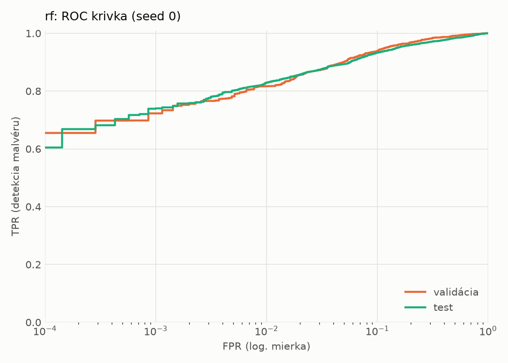
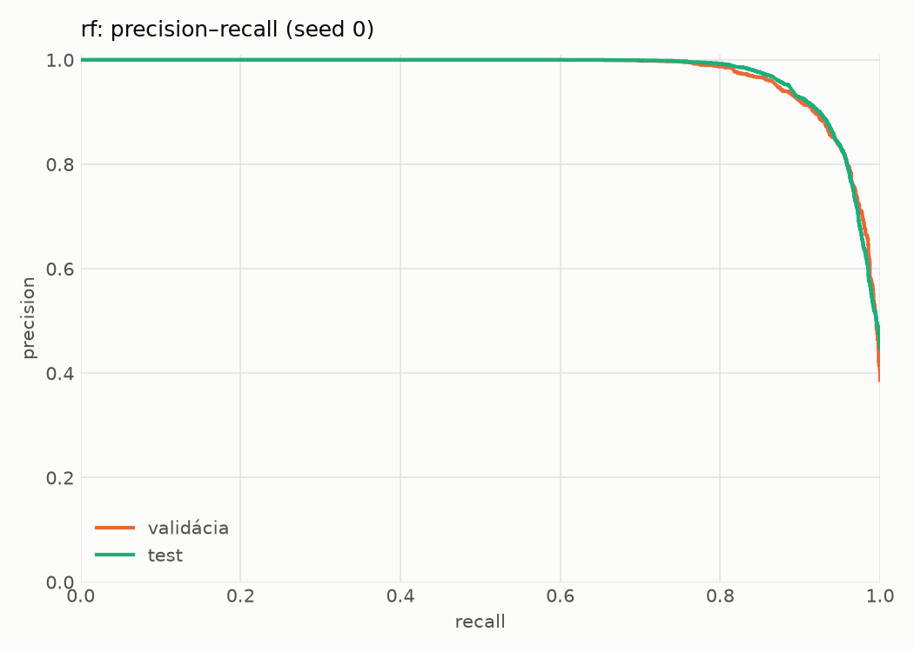
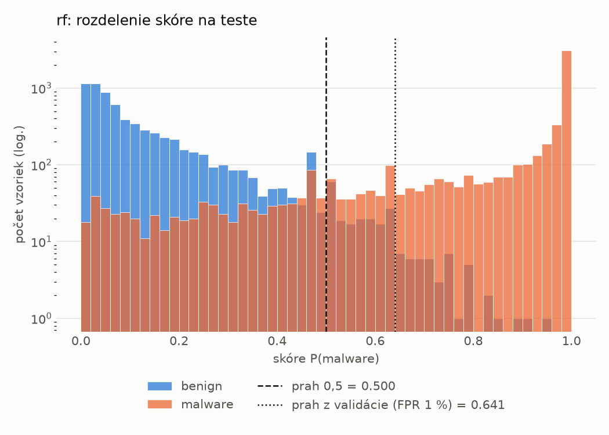
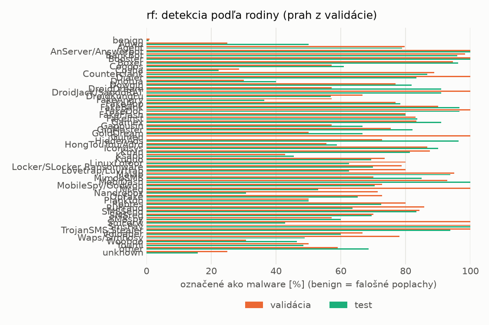
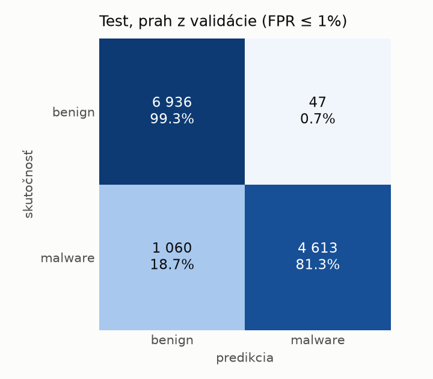
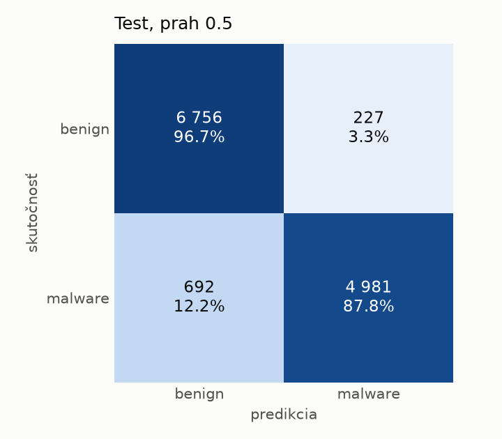

# dynamic/rf – beh `20261123-010529`

> Automaticky generované (`src/training/run_tabular.py`). Konfigurácia: `config.yaml`, protokol: `protocol.yaml`.

- **Model:** `random_forest` – Random Forest (pôvodné hodnoty príznakov)
- **Ladenie:** bez ladenia – hyperparametre prevzaté z `runs_v4/real_p/full/dynamic/rf/20261122-233325`
- **Finálne modely:** seedy [0, 1, 2]; hodnoty sú priemer ± smerodajná odchýlka cez seedy
- **Najlepšie hyperparametre:** `{"n_estimators": 500, "max_depth": 24, "min_samples_leaf": 1, "max_features": "sqrt"}`

## Detekčná kvalita (bez prahu)
| metrika | train (podvzorka) | validácia | test |
|---|---|---|---|
| ROC-AUC | 0.9985 ± 0.0000 | 0.9779 ± 0.0001 | 0.9715 ± 0.0001 |
| PR-AUC | 0.9979 ± 0.0000 | 0.9740 ± 0.0001 | 0.9747 ± 0.0001 |
| TPR pri FPR 1 % | 0.9785 ± 0.0002 | 0.8174 ± 0.0012 | 0.8258 ± 0.0040 |
| TPR pri FPR 0,1 % | 0.9588 ± 0.0007 | 0.7203 ± 0.0023 | 0.7355 ± 0.0056 |
| log loss | 0.0835 ± 0.0003 | 0.1912 ± 0.0002 | 0.2057 ± 0.0003 |
| Brier skóre | 0.0164 ± 0.0001 | 0.0537 ± 0.0001 | 0.0584 ± 0.0001 |

Rozdiel ROC-AUC train − validácia: **0.0206** (veľký rozdiel = preučenie).

## Pri prahu z validácie (FPR ≤ 1% na validácii)
| metrika | train (podvzorka) | validácia | test |
|---|---|---|---|
| accuracy | 0.9843 ± 0.0003 | 0.9241 ± 0.0006 | 0.9124 ± 0.0004 |
| balanced accuracy | 0.9794 ± 0.0004 | 0.9044 ± 0.0007 | 0.9031 ± 0.0005 |
| precision | 0.9998 ± 0.0002 | 0.9836 ± 0.0011 | 0.9898 ± 0.0003 |
| recall (TPR) | 0.9588 ± 0.0007 | 0.8174 ± 0.0012 | 0.8130 ± 0.0008 |
| FPR | 0.0001 ± 0.0001 | 0.0086 ± 0.0006 | 0.0068 ± 0.0002 |
| F1 | 0.9789 ± 0.0004 | 0.8928 ± 0.0009 | 0.8927 ± 0.0006 |
| MCC | 0.9670 ± 0.0006 | 0.8434 ± 0.0014 | 0.8312 ± 0.0009 |

## Pri pevnom prahu 0.5
| metrika | train (podvzorka) | validácia | test |
|---|---|---|---|
| accuracy | 0.9856 ± 0.0000 | 0.9329 ± 0.0012 | 0.9275 ± 0.0001 |
| balanced accuracy | 0.9841 ± 0.0000 | 0.9232 ± 0.0015 | 0.9228 ± 0.0001 |
| precision | 0.9839 ± 0.0001 | 0.9424 ± 0.0008 | 0.9565 ± 0.0005 |
| recall (TPR) | 0.9780 ± 0.0002 | 0.8804 ± 0.0027 | 0.8781 ± 0.0004 |
| FPR | 0.0098 ± 0.0001 | 0.0339 ± 0.0004 | 0.0324 ± 0.0004 |
| F1 | 0.9809 ± 0.0000 | 0.9103 ± 0.0018 | 0.9156 ± 0.0001 |
| MCC | 0.9694 ± 0.0000 | 0.8581 ± 0.0026 | 0.8546 ± 0.0002 |

## Výpočtové nároky (seed 0, testovacia množina)
| meranie | hodnota |
|---|---|
| tréning finálneho modelu | 2.2 s (priemer cez seedy) |
| ladenie spolu | 0 s |
| počet parametrov / uzlov | 3 069 732 |
| veľkosť modelu na disku | 245.94 MB |
| CPU latencia modelu (batch 1, 1 vlákno) | 15.111 ms (p95 15.525) |
| CPU priepustnosť (24 vlákien) | 112 753 vzoriek/s |

## Grafy
| | |
|---|---|
|  |  |
|  |  |
|  |  |
|  |  |

## Súbory
`metrics.json` (všetky metriky po seedoch vrátane rodín), `timing.json`, `hpo_trials.csv`,
`predictions/<časť>_seed<N>.parquet` (sha256, family, label, score), `model/seed_<N>/`, `log.txt`.
