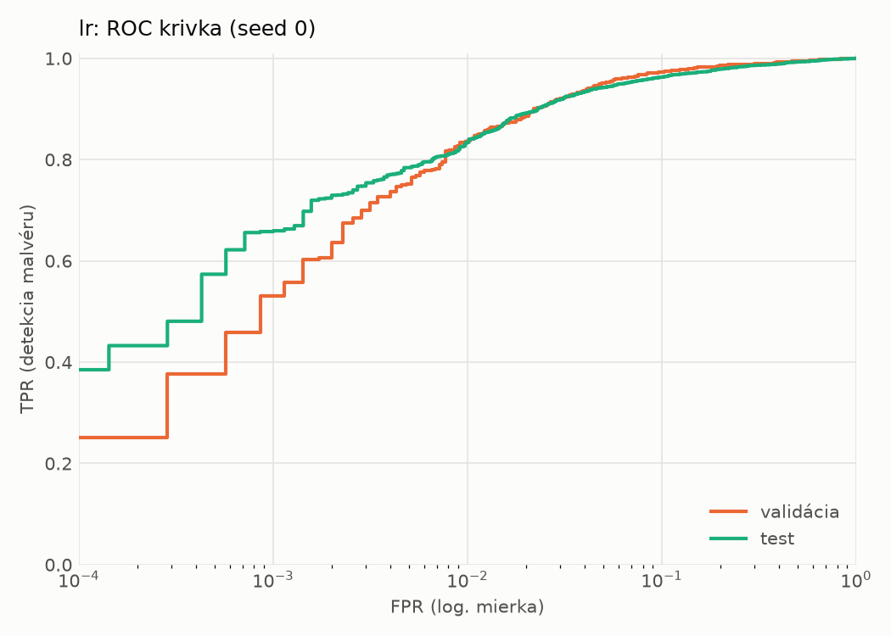
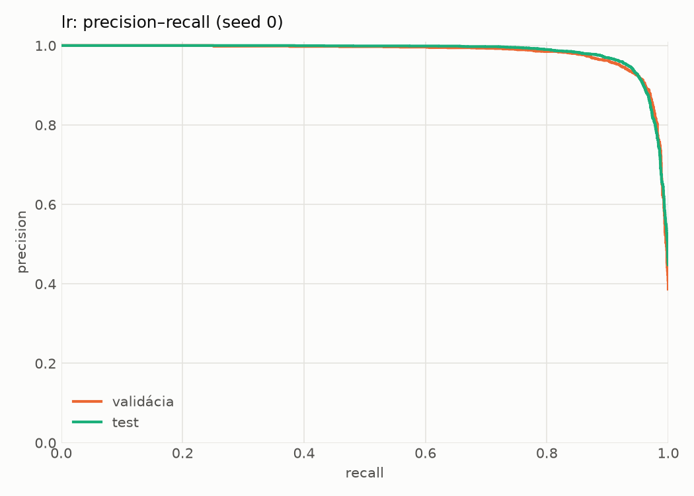
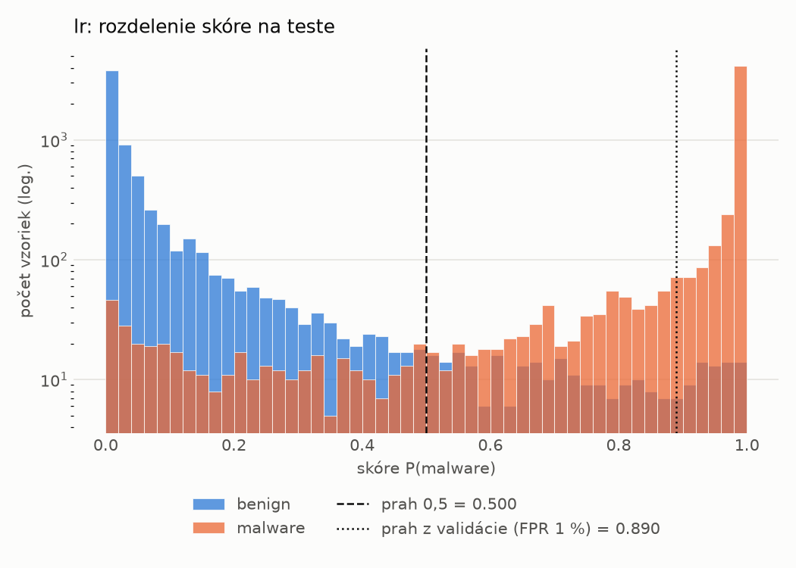
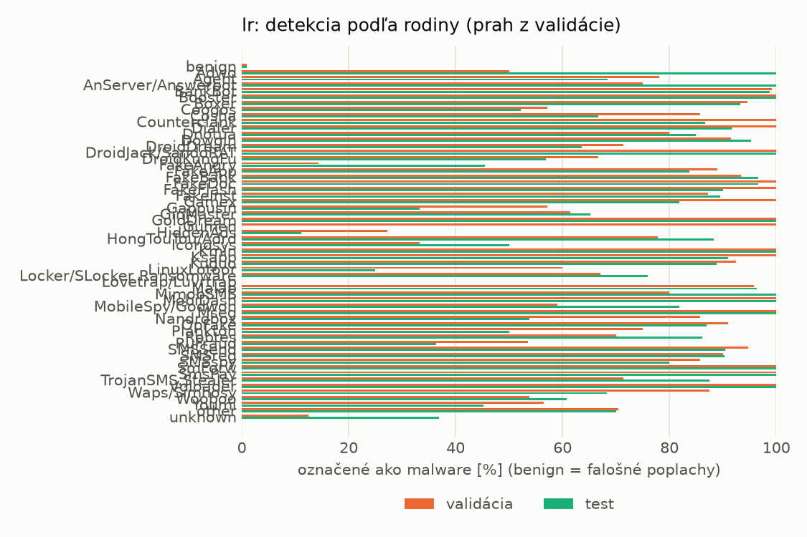
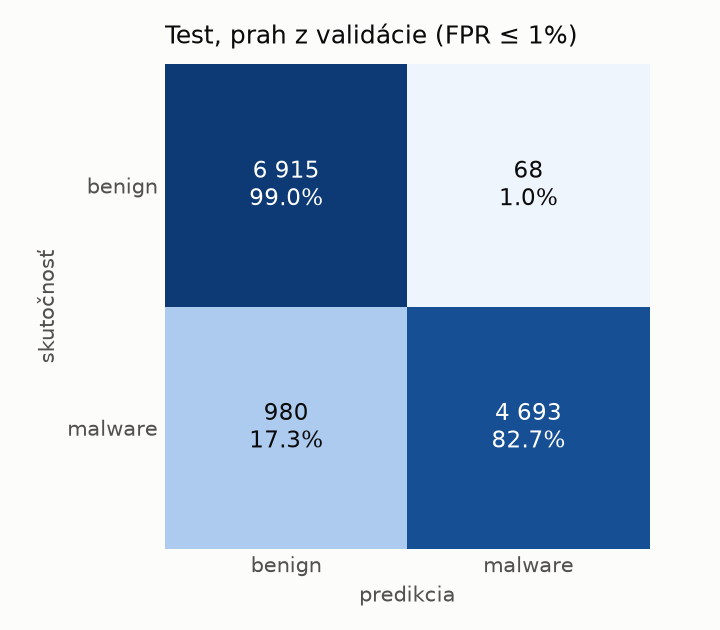
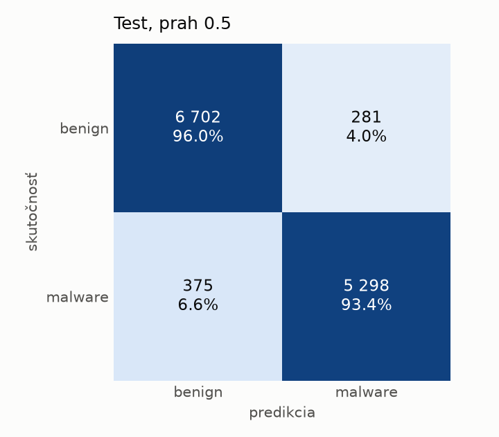

# hybrid/lr – beh `20261123-010746`

> Automaticky generované (`src/training/run_tabular.py`). Konfigurácia: `config.yaml`, protokol: `protocol.yaml`.

- **Model:** `logreg` – logistická regresia s L2 regularizáciou (vstup signed log1p + štandardizácia)
- **Ladenie:** bez ladenia – hyperparametre prevzaté z `runs_v4/real_p/full/hybrid/lr/20261122-235738`
- **Finálne modely:** seedy [0, 1, 2]; hodnoty sú priemer ± smerodajná odchýlka cez seedy
- **Najlepšie hyperparametre:** `{"max_iter": 2000, "C": 0.07124252843547843}`

## Detekčná kvalita (bez prahu)
| metrika | train (podvzorka) | validácia | test |
|---|---|---|---|
| ROC-AUC | 0.9876 ± 0.0000 | 0.9858 ± 0.0000 | 0.9836 ± 0.0000 |
| PR-AUC | 0.9844 ± 0.0000 | 0.9819 ± 0.0000 | 0.9841 ± 0.0000 |
| TPR pri FPR 1 % | 0.8585 ± 0.0000 | 0.8351 ± 0.0000 | 0.8338 ± 0.0000 |
| TPR pri FPR 0,1 % | 0.6213 ± 0.0000 | 0.5311 ± 0.0000 | 0.6579 ± 0.0000 |
| log loss | 0.1287 ± 0.0000 | 0.1411 ± 0.0000 | 0.1517 ± 0.0000 |
| Brier skóre | 0.0346 ± 0.0000 | 0.0381 ± 0.0000 | 0.0413 ± 0.0000 |

Rozdiel ROC-AUC train − validácia: **0.0018** (veľký rozdiel = preučenie).

## Pri prahu z validácie (FPR ≤ 1% na validácii)
| metrika | train (podvzorka) | validácia | test |
|---|---|---|---|
| accuracy | 0.9322 ± 0.0000 | 0.9302 ± 0.0000 | 0.9172 ± 0.0000 |
| balanced accuracy | 0.9126 ± 0.0000 | 0.9127 ± 0.0000 | 0.9088 ± 0.0000 |
| precision | 0.9872 ± 0.0000 | 0.9818 ± 0.0000 | 0.9857 ± 0.0000 |
| recall (TPR) | 0.8319 ± 0.0000 | 0.8351 ± 0.0000 | 0.8273 ± 0.0000 |
| FPR | 0.0066 ± 0.0000 | 0.0097 ± 0.0000 | 0.0097 ± 0.0000 |
| F1 | 0.9029 ± 0.0000 | 0.9025 ± 0.0000 | 0.8996 ± 0.0000 |
| MCC | 0.8588 ± 0.0000 | 0.8555 ± 0.0000 | 0.8393 ± 0.0000 |

## Pri pevnom prahu 0.5
| metrika | train (podvzorka) | validácia | test |
|---|---|---|---|
| accuracy | 0.9554 ± 0.0000 | 0.9511 ± 0.0000 | 0.9482 ± 0.0000 |
| balanced accuracy | 0.9545 ± 0.0000 | 0.9497 ± 0.0000 | 0.9468 ± 0.0000 |
| precision | 0.9329 ± 0.0000 | 0.9314 ± 0.0000 | 0.9496 ± 0.0000 |
| recall (TPR) | 0.9506 ± 0.0000 | 0.9432 ± 0.0000 | 0.9339 ± 0.0000 |
| FPR | 0.0417 ± 0.0000 | 0.0439 ± 0.0000 | 0.0402 ± 0.0000 |
| F1 | 0.9417 ± 0.0000 | 0.9372 ± 0.0000 | 0.9417 ± 0.0000 |
| MCC | 0.9057 ± 0.0000 | 0.8973 ± 0.0000 | 0.8951 ± 0.0000 |

## Výpočtové nároky (seed 0, testovacia množina)
| meranie | hodnota |
|---|---|
| tréning finálneho modelu | 0.2 s (priemer cez seedy) |
| ladenie spolu | 0 s |
| počet parametrov / uzlov | 287 |
| veľkosť modelu na disku | 0.01 MB |
| transformácia vstupu – latencia (1 vlákno) | 0.006 ms |
| transformácia vstupu – priepustnosť | 510 082 vzoriek/s |
| CPU latencia modelu (batch 1, 1 vlákno) | 0.004 ms (p95 0.004) |
| CPU priepustnosť (24 vlákien) | 2 015 832 vzoriek/s |

## Grafy
| | |
|---|---|
|  |  |
|  |  |
|  |  |
|  |  |

## Súbory
`metrics.json` (všetky metriky po seedoch vrátane rodín), `timing.json`, `hpo_trials.csv`,
`predictions/<časť>_seed<N>.parquet` (sha256, family, label, score), `model/seed_<N>/`, `log.txt`.
