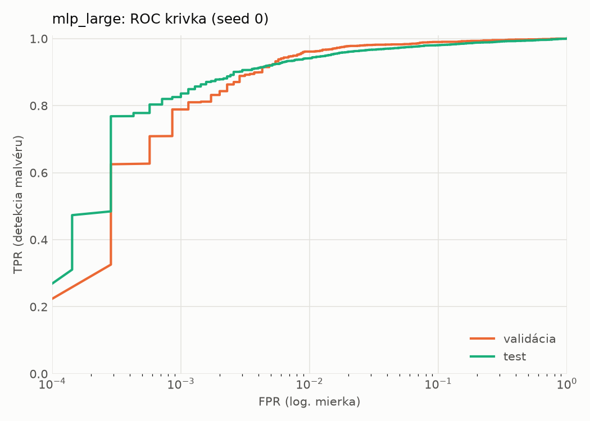
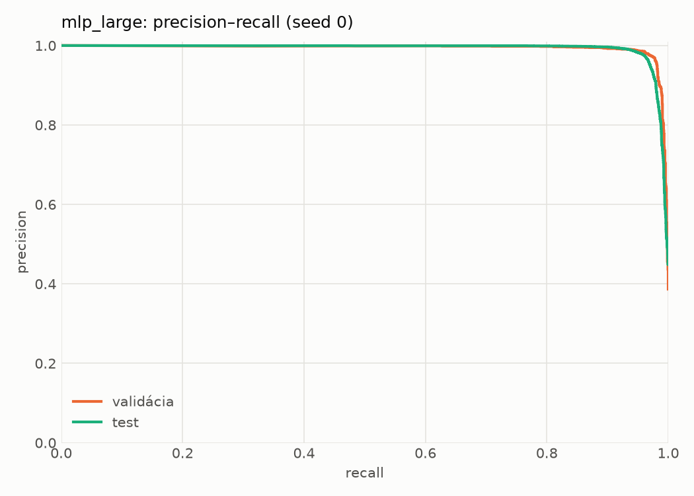
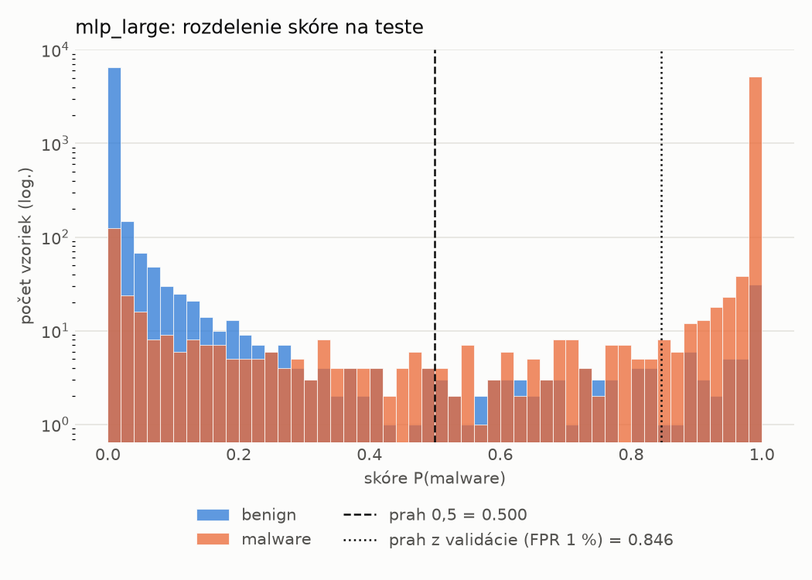
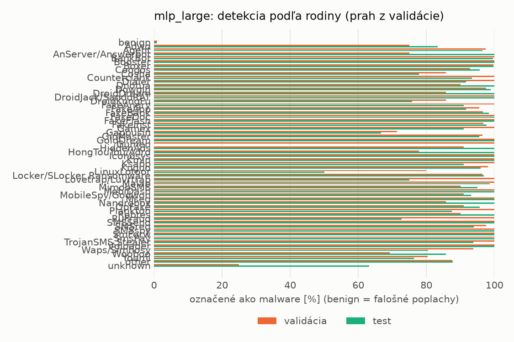
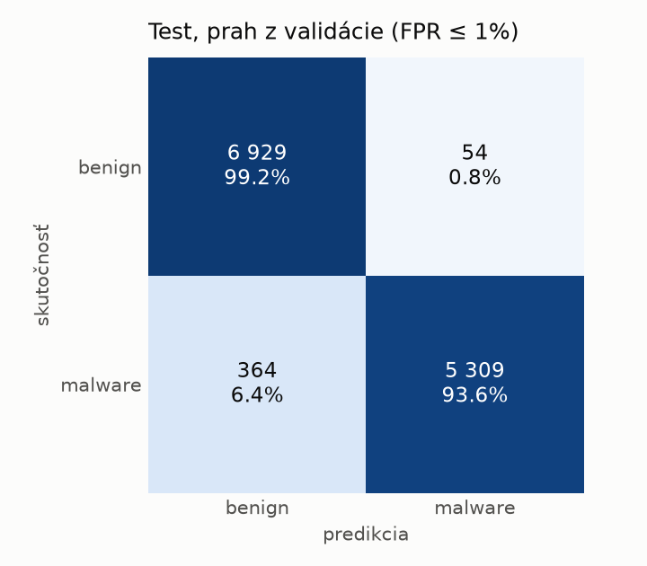
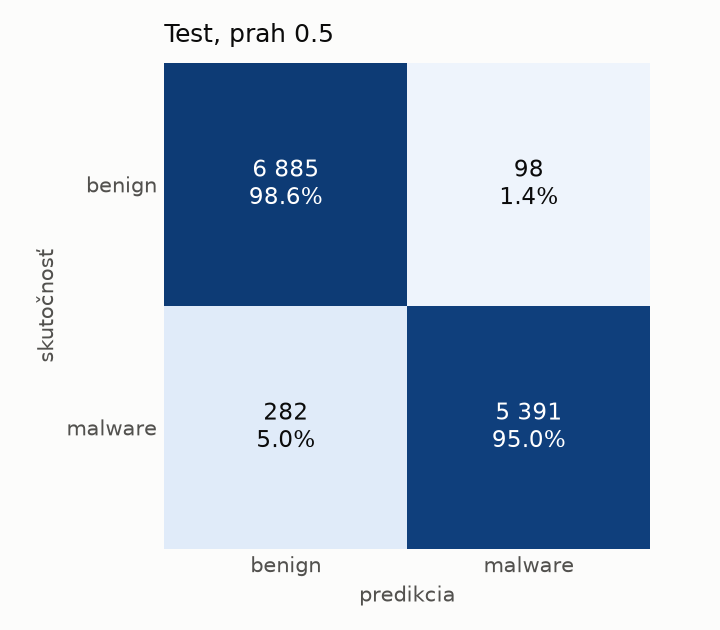
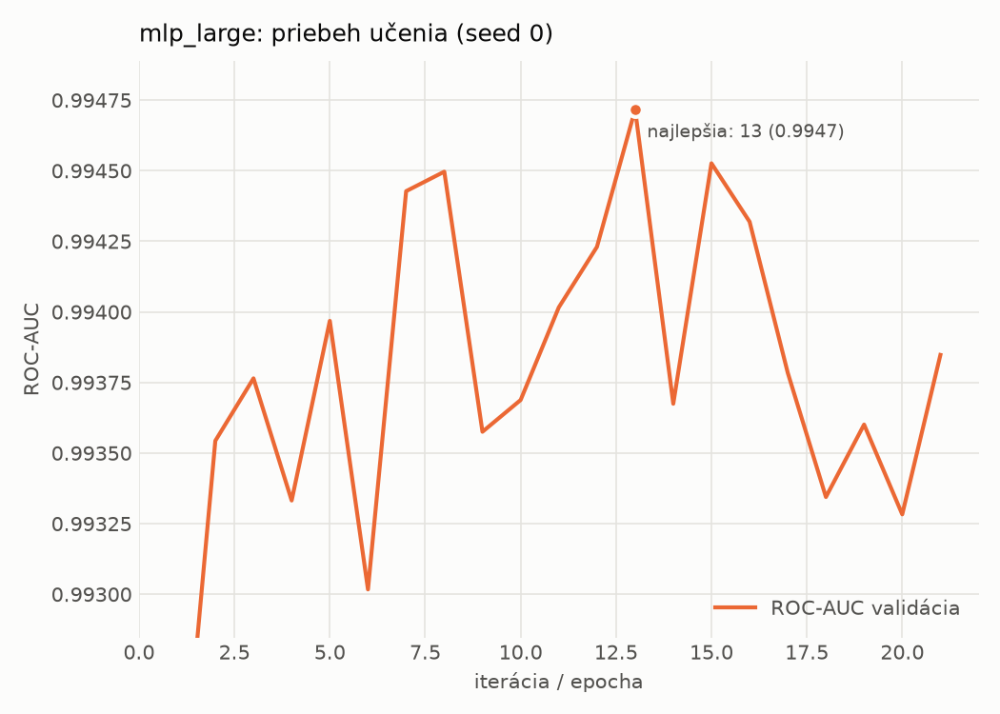

# hybrid/mlp_large – beh `20261123-010826`

> Automaticky generované (`src/training/run_tabular.py`). Konfigurácia: `config.yaml`, protokol: `protocol.yaml`.

- **Model:** `mlp` – veľká neurónová sieť (3–5 skrytých vrstiev, 512–2048 neurónov), kandidát na učiteľa
- **Ladenie:** bez ladenia – hyperparametre prevzaté z `runs_v4/real_p/full/hybrid/mlp_large/20261123-000809`
- **Finálne modely:** seedy [0, 1, 2]; hodnoty sú priemer ± smerodajná odchýlka cez seedy
- **Najlepšie hyperparametre:** `{"max_epochs": 100, "patience": 8, "hidden_layers": 3, "hidden_width": 1024, "width_decay": 1.0, "dropout": 0.11375540844608736, "lr": 0.0022038218939289885, "weight_decay": 1.0842262717330169e-05, "batch_size": 256}`

## Detekčná kvalita (bez prahu)
| metrika | train (podvzorka) | validácia | test |
|---|---|---|---|
| ROC-AUC | 0.9992 ± 0.0003 | 0.9948 ± 0.0001 | 0.9917 ± 0.0006 |
| PR-AUC | 0.9990 ± 0.0004 | 0.9936 ± 0.0003 | 0.9924 ± 0.0003 |
| TPR pri FPR 1 % | 0.9906 ± 0.0033 | 0.9590 ± 0.0021 | 0.9390 ± 0.0056 |
| TPR pri FPR 0,1 % | 0.9763 ± 0.0072 | 0.8290 ± 0.0349 | 0.8218 ± 0.0075 |
| log loss | 0.0249 ± 0.0068 | 0.0829 ± 0.0070 | 0.1180 ± 0.0092 |
| Brier skóre | 0.0063 ± 0.0018 | 0.0181 ± 0.0005 | 0.0259 ± 0.0012 |

Rozdiel ROC-AUC train − validácia: **0.0044** (veľký rozdiel = preučenie).

## Pri prahu z validácie (FPR ≤ 1% na validácii)
| metrika | train (podvzorka) | validácia | test |
|---|---|---|---|
| accuracy | 0.9901 ± 0.0020 | 0.9783 ± 0.0010 | 0.9655 ± 0.0027 |
| balanced accuracy | 0.9873 ± 0.0024 | 0.9747 ± 0.0012 | 0.9625 ± 0.0030 |
| precision | 0.9983 ± 0.0008 | 0.9846 ± 0.0005 | 0.9895 ± 0.0005 |
| recall (TPR) | 0.9756 ± 0.0044 | 0.9590 ± 0.0021 | 0.9330 ± 0.0057 |
| FPR | 0.0010 ± 0.0005 | 0.0095 ± 0.0003 | 0.0081 ± 0.0004 |
| F1 | 0.9868 ± 0.0026 | 0.9716 ± 0.0013 | 0.9604 ± 0.0032 |
| MCC | 0.9791 ± 0.0041 | 0.9543 ± 0.0021 | 0.9312 ± 0.0053 |

## Pri pevnom prahu 0.5
| metrika | train (podvzorka) | validácia | test |
|---|---|---|---|
| accuracy | 0.9920 ± 0.0026 | 0.9783 ± 0.0004 | 0.9689 ± 0.0018 |
| balanced accuracy | 0.9908 ± 0.0026 | 0.9764 ± 0.0003 | 0.9670 ± 0.0017 |
| precision | 0.9931 ± 0.0039 | 0.9759 ± 0.0011 | 0.9818 ± 0.0026 |
| recall (TPR) | 0.9858 ± 0.0031 | 0.9679 ± 0.0003 | 0.9482 ± 0.0019 |
| FPR | 0.0042 ± 0.0024 | 0.0151 ± 0.0007 | 0.0143 ± 0.0021 |
| F1 | 0.9894 ± 0.0034 | 0.9719 ± 0.0005 | 0.9647 ± 0.0020 |
| MCC | 0.9831 ± 0.0054 | 0.9543 ± 0.0008 | 0.9374 ± 0.0036 |

## Výpočtové nároky (seed 0, testovacia množina)
| meranie | hodnota |
|---|---|
| tréning finálneho modelu | 6.6 s (priemer cez seedy) |
| ladenie spolu | 0 s |
| počet parametrov / uzlov | 2 400 257 |
| veľkosť modelu na disku | 9.64 MB |
| transformácia vstupu – latencia (1 vlákno) | 0.017 ms |
| transformácia vstupu – priepustnosť | 282 079 vzoriek/s |
| CPU latencia modelu (batch 1, 1 vlákno) | 0.278 ms (p95 0.582) |
| CPU priepustnosť (24 vlákien) | 154 253 vzoriek/s |
| GPU latencia (batch 1) | 0.626 ms (p95 0.907) |
| GPU priepustnosť | 770 284 vzoriek/s |
| GPU špičková pamäť | 224 MB |

## Grafy
| | |
|---|---|
|  |  |
|  |  |
|  |  |
|  |  |

## Súbory
`metrics.json` (všetky metriky po seedoch vrátane rodín), `timing.json`, `hpo_trials.csv`,
`predictions/<časť>_seed<N>.parquet` (sha256, family, label, score), `model/seed_<N>/`, `log.txt`.
