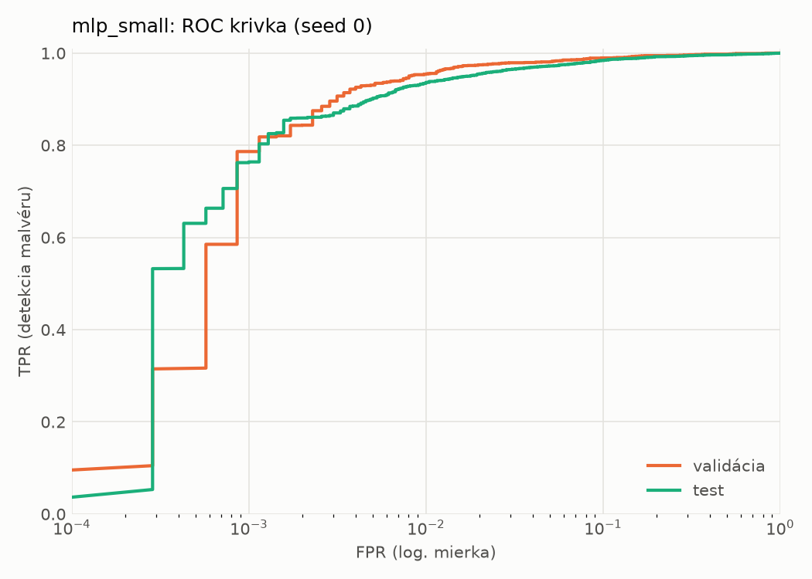
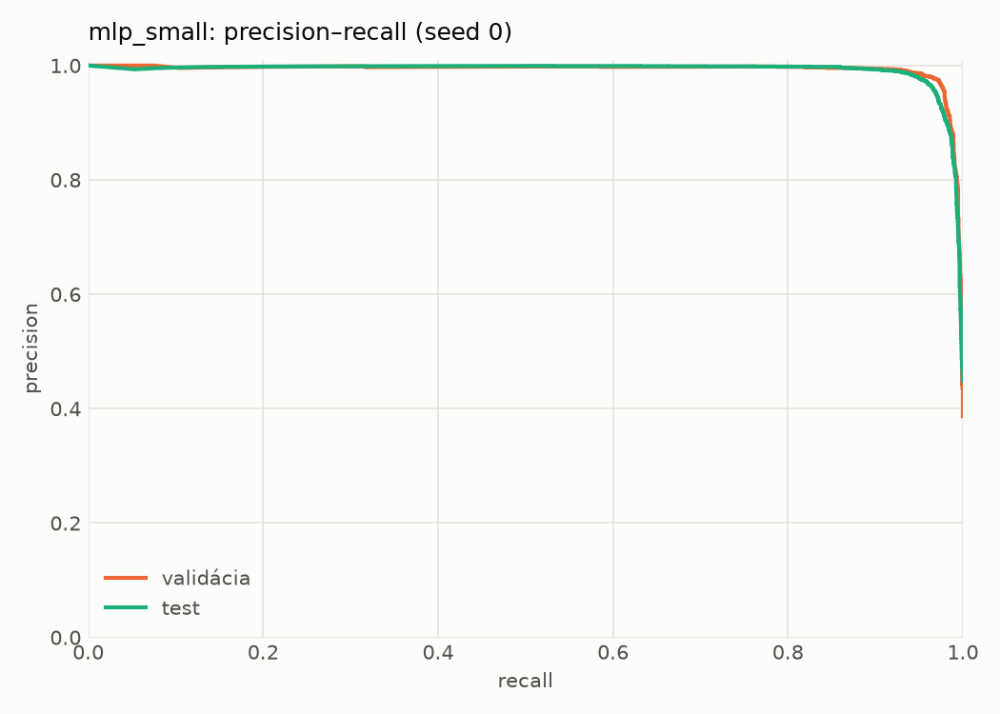
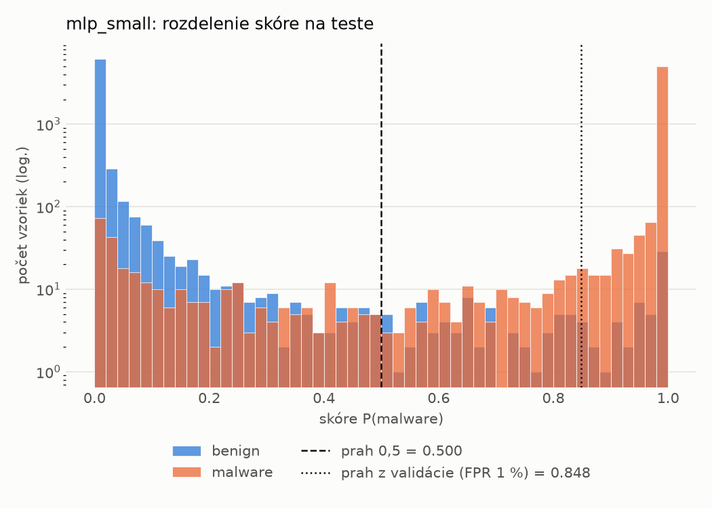
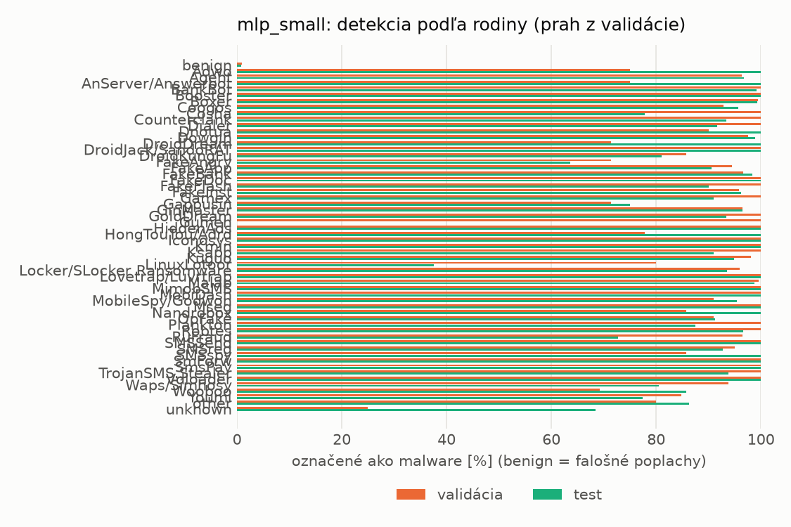
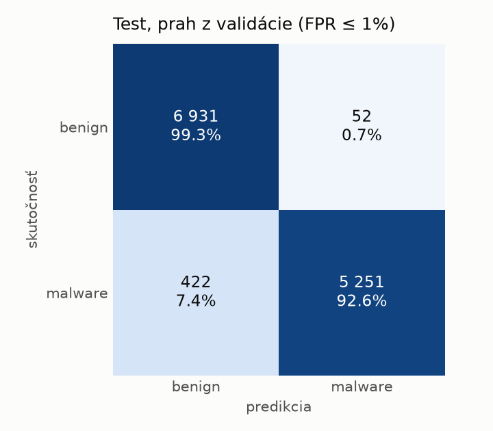
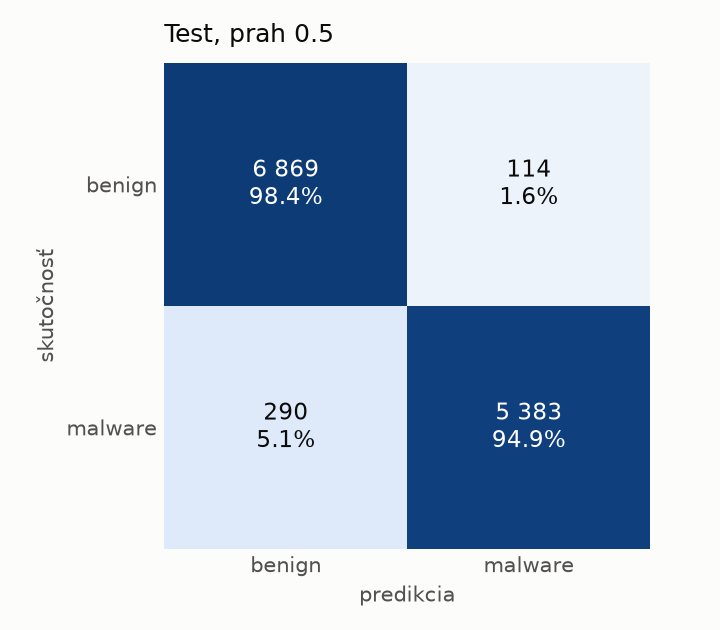
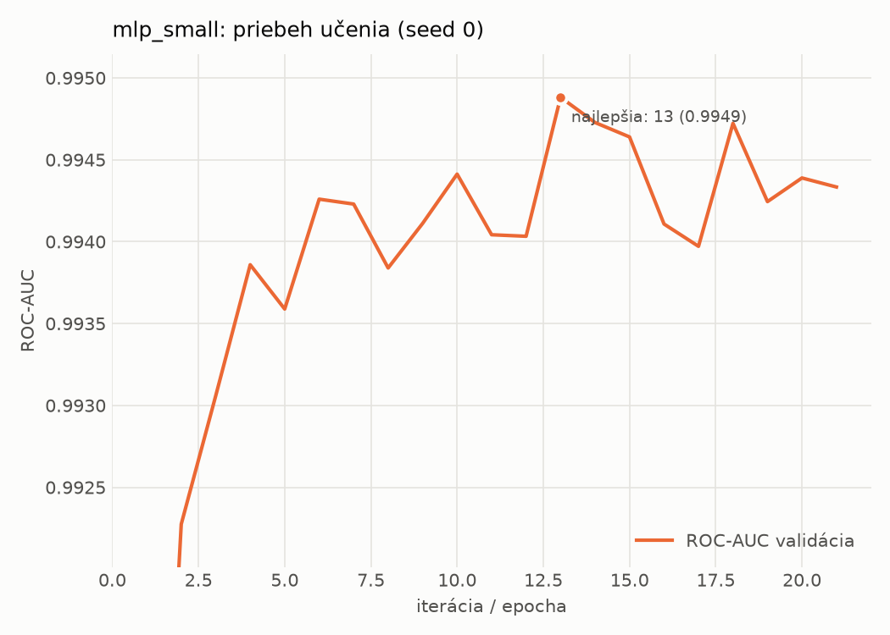

# hybrid/mlp_small – beh `20261123-010817`

> Automaticky generované (`src/training/run_tabular.py`). Konfigurácia: `config.yaml`, protokol: `protocol.yaml`.

- **Model:** `mlp` – malá neurónová sieť (1–2 skryté vrstvy), kandidát na ľahkého študenta
- **Ladenie:** bez ladenia – hyperparametre prevzaté z `runs_v4/real_p/full/hybrid/mlp_small/20261123-000512`
- **Finálne modely:** seedy [0, 1, 2]; hodnoty sú priemer ± smerodajná odchýlka cez seedy
- **Najlepšie hyperparametre:** `{"width_decay": 0.5, "max_epochs": 100, "patience": 8, "hidden_layers": 2, "hidden_width": 256, "dropout": 0.17059205009500078, "lr": 0.0013906274900964423, "weight_decay": 9.337519104222036e-06, "batch_size": 1024}`

## Detekčná kvalita (bez prahu)
| metrika | train (podvzorka) | validácia | test |
|---|---|---|---|
| ROC-AUC | 0.9988 ± 0.0005 | 0.9948 ± 0.0001 | 0.9922 ± 0.0002 |
| PR-AUC | 0.9986 ± 0.0006 | 0.9934 ± 0.0008 | 0.9921 ± 0.0002 |
| TPR pri FPR 1 % | 0.9875 ± 0.0062 | 0.9531 ± 0.0071 | 0.9358 ± 0.0076 |
| TPR pri FPR 0,1 % | 0.9660 ± 0.0188 | 0.7971 ± 0.0228 | 0.7958 ± 0.0348 |
| log loss | 0.0315 ± 0.0089 | 0.0775 ± 0.0009 | 0.1042 ± 0.0030 |
| Brier skóre | 0.0078 ± 0.0025 | 0.0185 ± 0.0012 | 0.0254 ± 0.0014 |

Rozdiel ROC-AUC train − validácia: **0.0041** (veľký rozdiel = preučenie).

## Pri prahu z validácie (FPR ≤ 1% na validácii)
| metrika | train (podvzorka) | validácia | test |
|---|---|---|---|
| accuracy | 0.9879 ± 0.0034 | 0.9759 ± 0.0027 | 0.9639 ± 0.0030 |
| balanced accuracy | 0.9845 ± 0.0043 | 0.9717 ± 0.0036 | 0.9606 ± 0.0034 |
| precision | 0.9980 ± 0.0014 | 0.9840 ± 0.0001 | 0.9896 ± 0.0006 |
| recall (TPR) | 0.9701 ± 0.0078 | 0.9531 ± 0.0071 | 0.9292 ± 0.0073 |
| FPR | 0.0012 ± 0.0008 | 0.0097 ± 0.0000 | 0.0079 ± 0.0005 |
| F1 | 0.9838 ± 0.0046 | 0.9683 ± 0.0037 | 0.9584 ± 0.0037 |
| MCC | 0.9745 ± 0.0072 | 0.9491 ± 0.0057 | 0.9280 ± 0.0059 |

## Pri pevnom prahu 0.5
| metrika | train (podvzorka) | validácia | test |
|---|---|---|---|
| accuracy | 0.9899 ± 0.0031 | 0.9778 ± 0.0028 | 0.9685 ± 0.0020 |
| balanced accuracy | 0.9887 ± 0.0031 | 0.9765 ± 0.0029 | 0.9668 ± 0.0021 |
| precision | 0.9894 ± 0.0051 | 0.9717 ± 0.0042 | 0.9788 ± 0.0015 |
| recall (TPR) | 0.9839 ± 0.0034 | 0.9709 ± 0.0031 | 0.9503 ± 0.0033 |
| FPR | 0.0064 ± 0.0031 | 0.0179 ± 0.0027 | 0.0168 ± 0.0011 |
| F1 | 0.9866 ± 0.0040 | 0.9713 ± 0.0037 | 0.9643 ± 0.0023 |
| MCC | 0.9785 ± 0.0065 | 0.9532 ± 0.0060 | 0.9365 ± 0.0040 |

## Výpočtové nároky (seed 0, testovacia množina)
| meranie | hodnota |
|---|---|
| tréning finálneho modelu | 2.3 s (priemer cez seedy) |
| ladenie spolu | 0 s |
| počet parametrov / uzlov | 107 265 |
| veľkosť modelu na disku | 0.45 MB |
| transformácia vstupu – latencia (1 vlákno) | 0.017 ms |
| transformácia vstupu – priepustnosť | 356 769 vzoriek/s |
| CPU latencia modelu (batch 1, 1 vlákno) | 0.107 ms (p95 0.116) |
| CPU priepustnosť (24 vlákien) | 1 098 230 vzoriek/s |
| GPU latencia (batch 1) | 0.674 ms (p95 0.720) |
| GPU priepustnosť | 1 251 570 vzoriek/s |
| GPU špičková pamäť | 102 MB |

## Grafy
| | |
|---|---|
|  |  |
|  |  |
|  |  |
|  |  |

## Súbory
`metrics.json` (všetky metriky po seedoch vrátane rodín), `timing.json`, `hpo_trials.csv`,
`predictions/<časť>_seed<N>.parquet` (sha256, family, label, score), `model/seed_<N>/`, `log.txt`.
