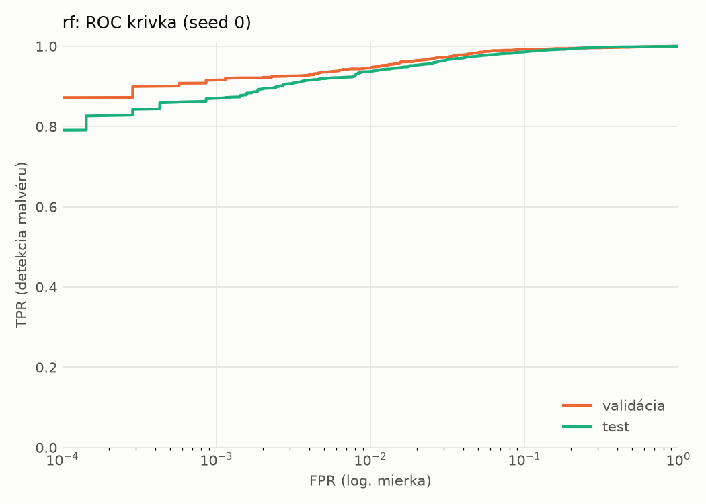
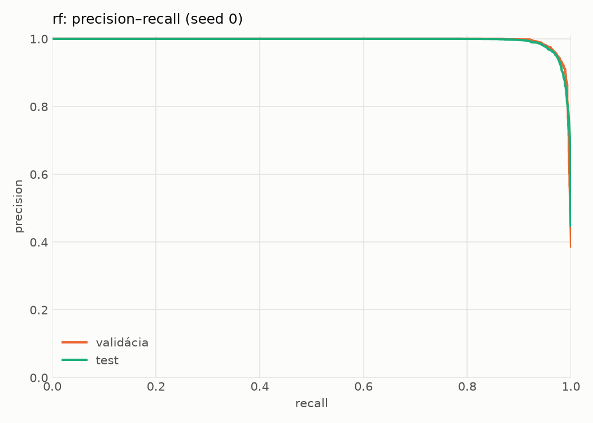
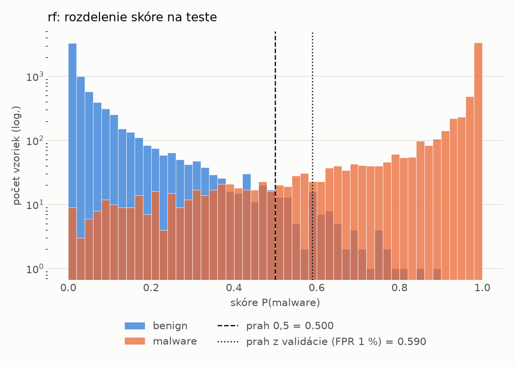
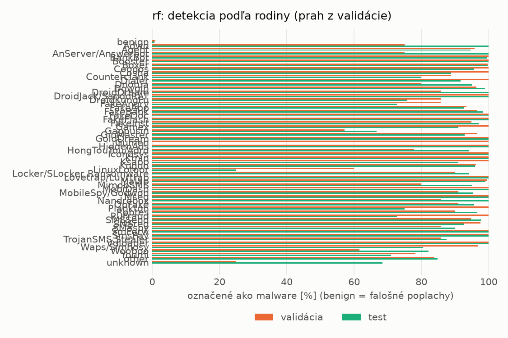
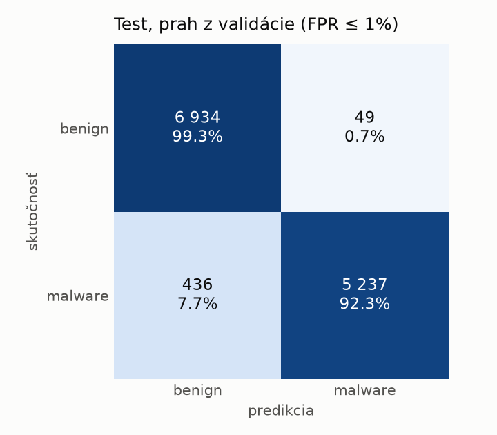
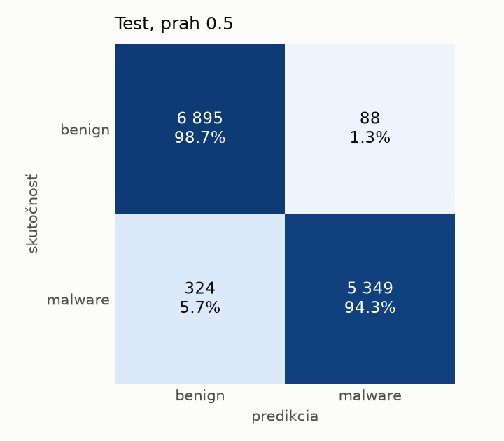

# hybrid/rf – beh `20261123-010748`

> Automaticky generované (`src/training/run_tabular.py`). Konfigurácia: `config.yaml`, protokol: `protocol.yaml`.

- **Model:** `random_forest` – Random Forest (pôvodné hodnoty príznakov)
- **Ladenie:** bez ladenia – hyperparametre prevzaté z `runs_v4/real_p/full/hybrid/rf/20261122-235747`
- **Finálne modely:** seedy [0, 1, 2]; hodnoty sú priemer ± smerodajná odchýlka cez seedy
- **Najlepšie hyperparametre:** `{"n_estimators": 400, "max_depth": null, "min_samples_leaf": 1, "max_features": "sqrt"}`

## Detekčná kvalita (bez prahu)
| metrika | train (podvzorka) | validácia | test |
|---|---|---|---|
| ROC-AUC | 1.0000 ± 0.0000 | 0.9953 ± 0.0001 | 0.9944 ± 0.0001 |
| PR-AUC | 1.0000 ± 0.0000 | 0.9947 ± 0.0000 | 0.9944 ± 0.0001 |
| TPR pri FPR 1 % | 1.0000 ± 0.0000 | 0.9491 ± 0.0028 | 0.9378 ± 0.0011 |
| TPR pri FPR 0,1 % | 1.0000 ± 0.0000 | 0.9144 ± 0.0076 | 0.8689 ± 0.0018 |
| log loss | 0.0261 ± 0.0000 | 0.0949 ± 0.0009 | 0.1070 ± 0.0015 |
| Brier skóre | 0.0026 ± 0.0000 | 0.0223 ± 0.0001 | 0.0275 ± 0.0001 |

Rozdiel ROC-AUC train − validácia: **0.0047** (veľký rozdiel = preučenie).

## Pri prahu z validácie (FPR ≤ 1% na validácii)
| metrika | train (podvzorka) | validácia | test |
|---|---|---|---|
| accuracy | 1.0000 ± 0.0000 | 0.9745 ± 0.0012 | 0.9632 ± 0.0014 |
| balanced accuracy | 1.0000 ± 0.0000 | 0.9698 ± 0.0015 | 0.9598 ± 0.0016 |
| precision | 1.0000 ± 0.0000 | 0.9844 ± 0.0005 | 0.9903 ± 0.0005 |
| recall (TPR) | 1.0000 ± 0.0000 | 0.9491 ± 0.0028 | 0.9271 ± 0.0034 |
| FPR | 0.0000 ± 0.0000 | 0.0095 ± 0.0003 | 0.0074 ± 0.0004 |
| F1 | 1.0000 ± 0.0000 | 0.9665 ± 0.0016 | 0.9576 ± 0.0017 |
| MCC | 1.0000 ± 0.0000 | 0.9463 ± 0.0024 | 0.9268 ± 0.0026 |

## Pri pevnom prahu 0.5
| metrika | train (podvzorka) | validácia | test |
|---|---|---|---|
| accuracy | 1.0000 ± 0.0000 | 0.9749 ± 0.0005 | 0.9674 ± 0.0006 |
| balanced accuracy | 1.0000 ± 0.0000 | 0.9723 ± 0.0004 | 0.9651 ± 0.0006 |
| precision | 1.0000 ± 0.0000 | 0.9738 ± 0.0012 | 0.9836 ± 0.0007 |
| recall (TPR) | 1.0000 ± 0.0000 | 0.9609 ± 0.0000 | 0.9429 ± 0.0006 |
| FPR | 0.0000 ± 0.0000 | 0.0163 ± 0.0008 | 0.0127 ± 0.0005 |
| F1 | 1.0000 ± 0.0000 | 0.9673 ± 0.0006 | 0.9629 ± 0.0006 |
| MCC | 1.0000 ± 0.0000 | 0.9469 ± 0.0010 | 0.9345 ± 0.0011 |

## Výpočtové nároky (seed 0, testovacia množina)
| meranie | hodnota |
|---|---|
| tréning finálneho modelu | 2.2 s (priemer cez seedy) |
| ladenie spolu | 0 s |
| počet parametrov / uzlov | 1 720 050 |
| veľkosť modelu na disku | 137.92 MB |
| CPU latencia modelu (batch 1, 1 vlákno) | 12.137 ms (p95 12.549) |
| CPU priepustnosť (24 vlákien) | 121 006 vzoriek/s |

## Grafy
| | |
|---|---|
|  |  |
|  |  |
|  |  |
|  |  |

## Súbory
`metrics.json` (všetky metriky po seedoch vrátane rodín), `timing.json`, `hpo_trials.csv`,
`predictions/<časť>_seed<N>.parquet` (sha256, family, label, score), `model/seed_<N>/`, `log.txt`.
