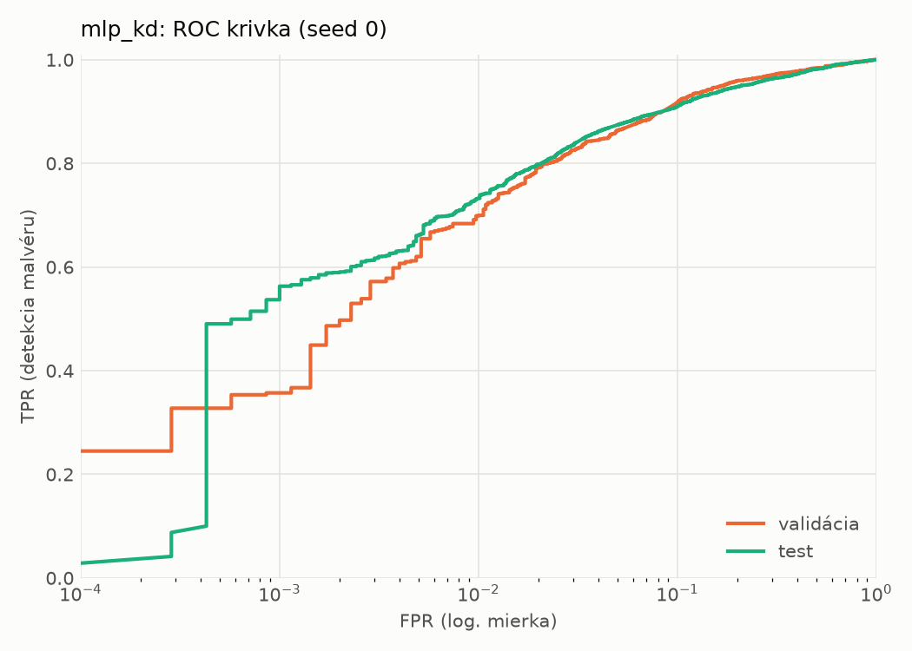
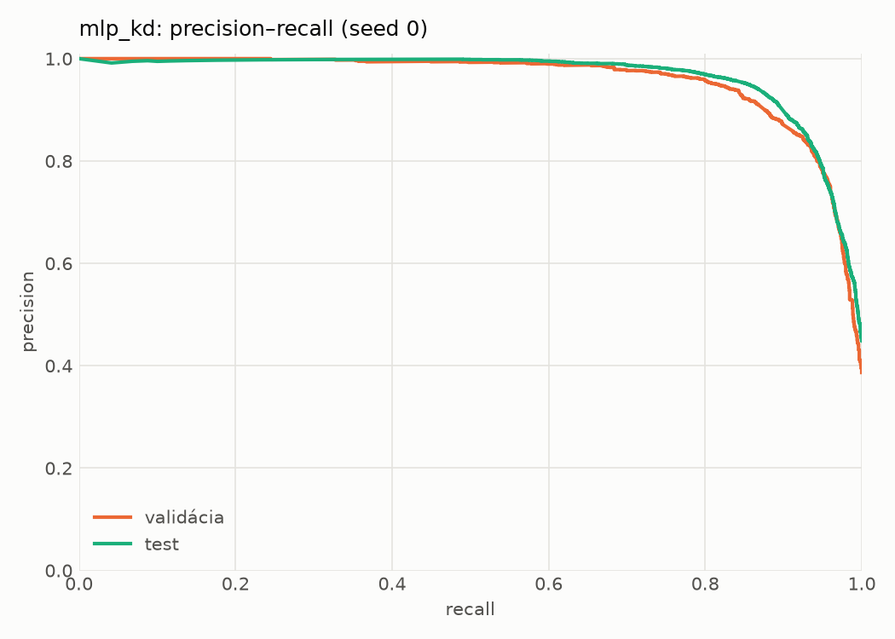
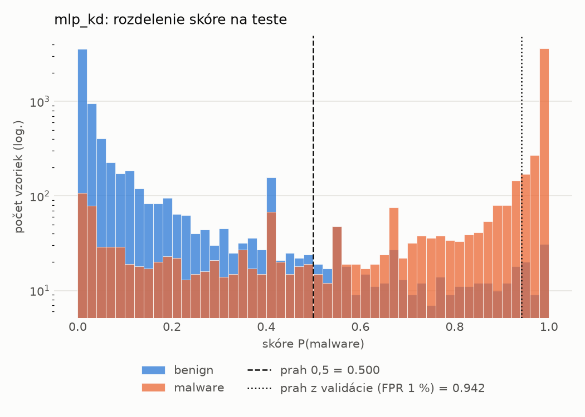
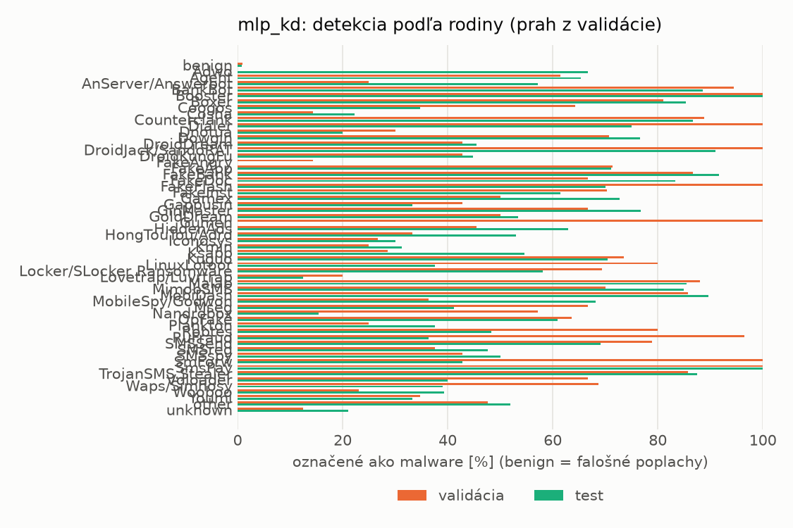
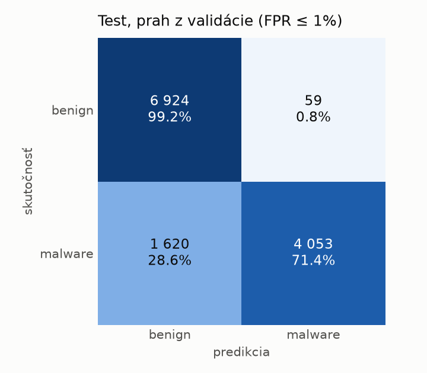
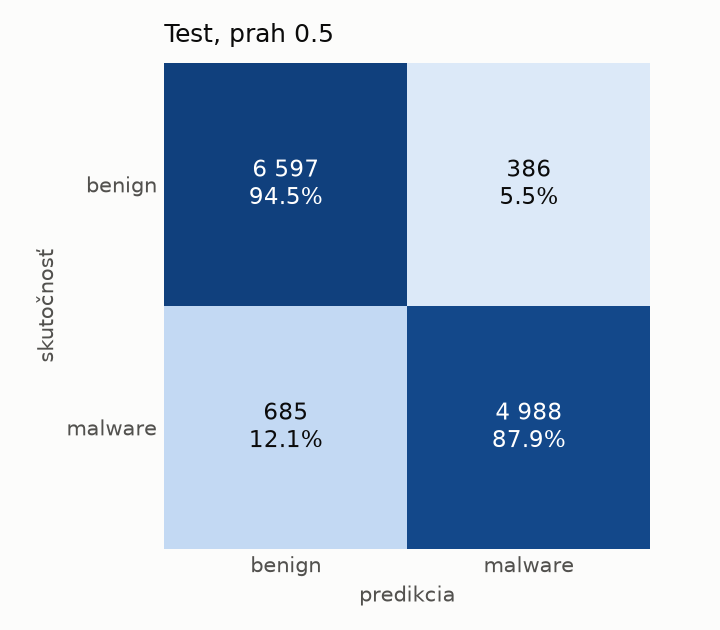
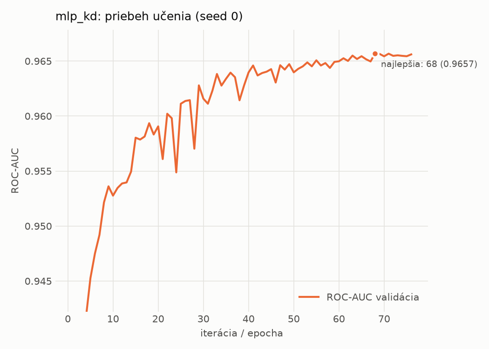

# dynamic/mlp_kd – beh `20261123-011247`

> Automaticky generované (`src/training/run_tabular.py`). Konfigurácia: `config.yaml`, protokol: `protocol.yaml`.

- **Model:** `mlp` – študent – malé MLP učené destiláciou z hybridného učiteľa
- **Ladenie:** bez ladenia – hyperparametre prevzaté z `runs_v4/real_p/full/students_dynamic/mlp_kd/20261123-003616`
- **Finálne modely:** seedy [0, 1, 2]; hodnoty sú priemer ± smerodajná odchýlka cez seedy
- **Najlepšie hyperparametre:** `{"hidden_layers": 1, "max_epochs": 100, "patience": 8, "hidden_width": 64, "dropout": 0.008718220633742228, "lr": 0.002354362488135847, "weight_decay": 3.1986204696979587e-06, "batch_size": 1024, "kd_alpha": 0.2022752781289341, "kd_temperature": 1.263446759011441}`

## Detekčná kvalita (bez prahu)
| metrika | train (podvzorka) | validácia | test |
|---|---|---|---|
| ROC-AUC | 0.9784 ± 0.0004 | 0.9659 ± 0.0008 | 0.9641 ± 0.0001 |
| PR-AUC | 0.9736 ± 0.0004 | 0.9588 ± 0.0006 | 0.9653 ± 0.0004 |
| TPR pri FPR 1 % | 0.8115 ± 0.0056 | 0.7119 ± 0.0115 | 0.7385 ± 0.0055 |
| TPR pri FPR 0,1 % | 0.6345 ± 0.0223 | 0.4191 ± 0.0591 | 0.5299 ± 0.0176 |
| log loss | 0.1703 ± 0.0019 | 0.2244 ± 0.0018 | 0.2363 ± 0.0013 |
| Brier skóre | 0.0485 ± 0.0005 | 0.0632 ± 0.0004 | 0.0654 ± 0.0003 |

Rozdiel ROC-AUC train − validácia: **0.0125** (veľký rozdiel = preučenie).

## Pri prahu z validácie (FPR ≤ 1% na validácii)
| metrika | train (podvzorka) | validácia | test |
|---|---|---|---|
| accuracy | 0.8972 ± 0.0040 | 0.8826 ± 0.0045 | 0.8713 ± 0.0034 |
| balanced accuracy | 0.8656 ± 0.0056 | 0.8511 ± 0.0058 | 0.8574 ± 0.0039 |
| precision | 0.9911 ± 0.0021 | 0.9788 ± 0.0003 | 0.9849 ± 0.0007 |
| recall (TPR) | 0.7353 ± 0.0121 | 0.7119 ± 0.0115 | 0.7239 ± 0.0082 |
| FPR | 0.0040 ± 0.0010 | 0.0097 ± 0.0000 | 0.0090 ± 0.0005 |
| F1 | 0.8442 ± 0.0073 | 0.8243 ± 0.0079 | 0.8344 ± 0.0052 |
| MCC | 0.7891 ± 0.0076 | 0.7605 ± 0.0088 | 0.7564 ± 0.0058 |

## Pri pevnom prahu 0.5
| metrika | train (podvzorka) | validácia | test |
|---|---|---|---|
| accuracy | 0.9355 ± 0.0008 | 0.9137 ± 0.0014 | 0.9153 ± 0.0000 |
| balanced accuracy | 0.9300 ± 0.0007 | 0.9083 ± 0.0015 | 0.9119 ± 0.0003 |
| precision | 0.9214 ± 0.0026 | 0.8917 ± 0.0034 | 0.9281 ± 0.0030 |
| recall (TPR) | 0.9072 ± 0.0017 | 0.8843 ± 0.0032 | 0.8793 ± 0.0033 |
| FPR | 0.0472 ± 0.0018 | 0.0677 ± 0.0025 | 0.0554 ± 0.0027 |
| F1 | 0.9142 ± 0.0010 | 0.8880 ± 0.0018 | 0.9030 ± 0.0003 |
| MCC | 0.8626 ± 0.0016 | 0.8178 ± 0.0029 | 0.8289 ± 0.0002 |

## Výpočtové nároky (seed 0, testovacia množina)
| meranie | hodnota |
|---|---|
| tréning finálneho modelu | 6.0 s (priemer cez seedy) |
| ladenie spolu | 0 s |
| počet parametrov / uzlov | 8 129 |
| veľkosť modelu na disku | 0.04 MB |
| transformácia vstupu – latencia (1 vlákno) | 0.014 ms |
| transformácia vstupu – priepustnosť | 1 255 058 vzoriek/s |
| CPU latencia modelu (batch 1, 1 vlákno) | 0.068 ms (p95 0.160) |
| CPU priepustnosť (24 vlákien) | 8 974 614 vzoriek/s |
| GPU latencia (batch 1) | 0.258 ms (p95 0.281) |
| GPU priepustnosť | 1 168 228 vzoriek/s |
| GPU špičková pamäť | 50 MB |

## Grafy
| | |
|---|---|
|  |  |
|  |  |
|  |  |
|  |  |

## Súbory
`metrics.json` (všetky metriky po seedoch vrátane rodín), `timing.json`, `hpo_trials.csv`,
`predictions/<časť>_seed<N>.parquet` (sha256, family, label, score), `model/seed_<N>/`, `log.txt`.
