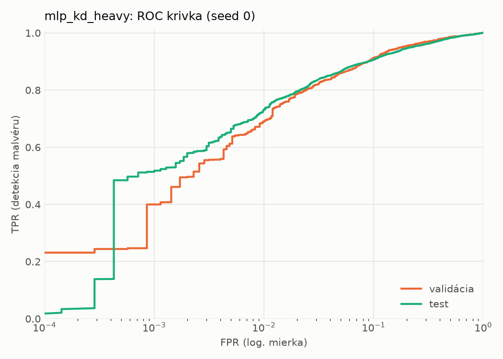
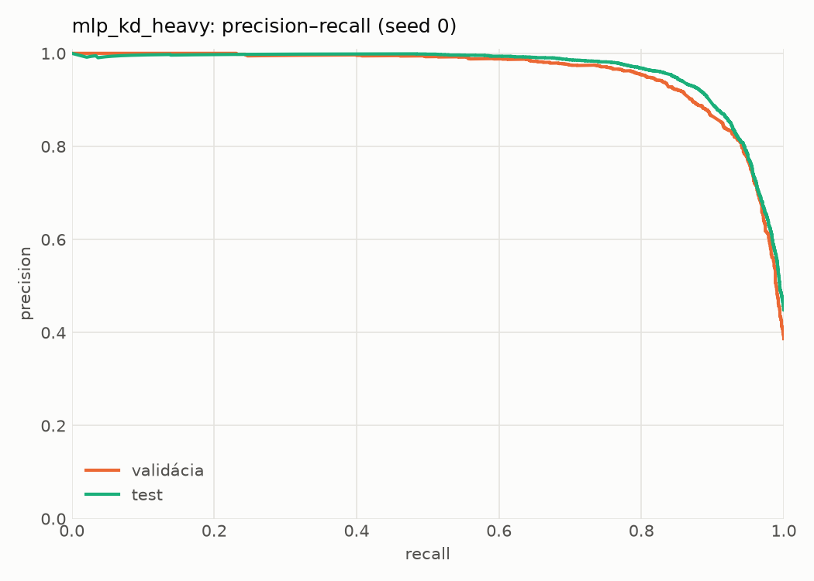
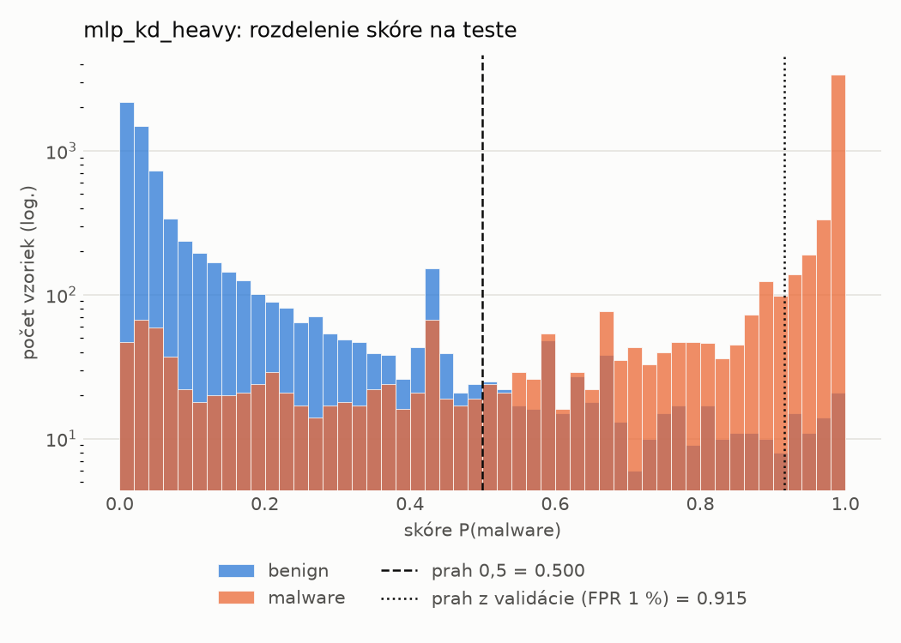
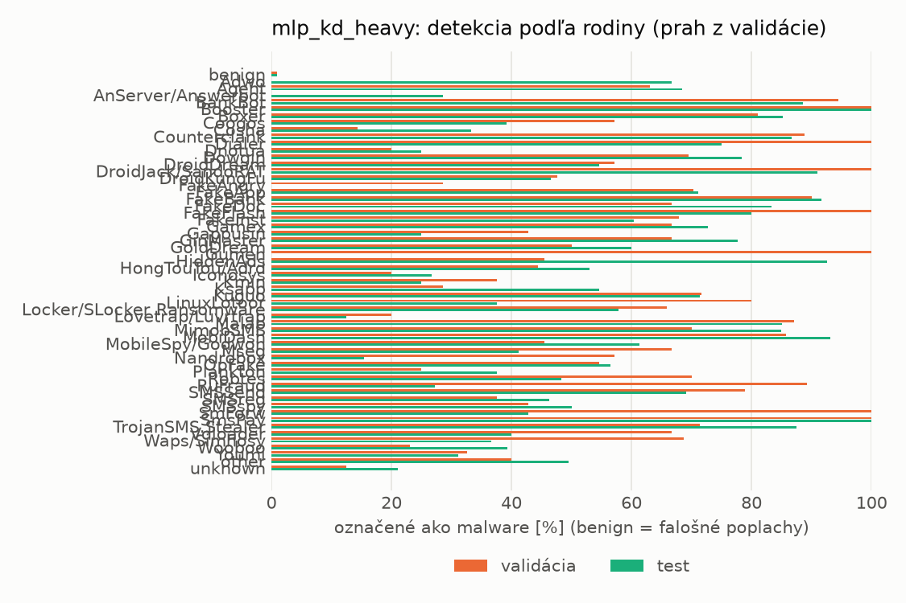
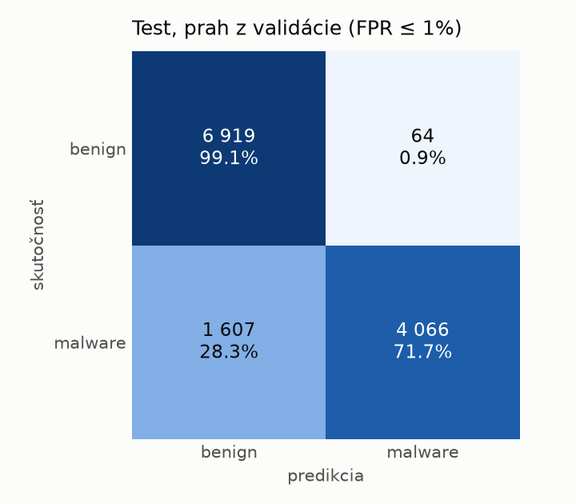
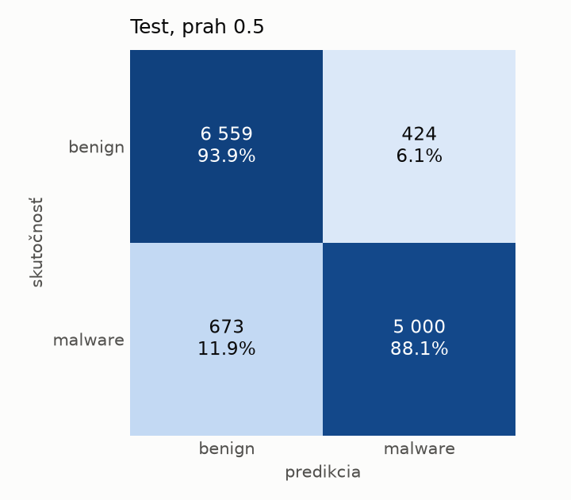
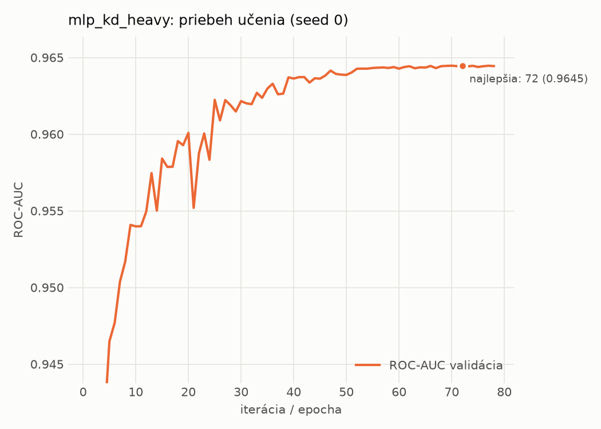

# dynamic/mlp_kd_heavy – beh `20261123-011417`

> Automaticky generované (`src/training/run_tabular.py`). Konfigurácia: `config.yaml`, protokol: `protocol.yaml`.

- **Model:** `mlp` – študent – malé MLP učené destiláciou z mlp_large hybridu (V4)
- **Ladenie:** bez ladenia – hyperparametre prevzaté z `runs_v4/real_p/full/students_dynamic/mlp_kd_heavy/20261123-005328`
- **Finálne modely:** seedy [0, 1, 2]; hodnoty sú priemer ± smerodajná odchýlka cez seedy
- **Najlepšie hyperparametre:** `{"hidden_layers": 1, "max_epochs": 100, "patience": 8, "hidden_width": 64, "dropout": 0.020410116354877387, "lr": 0.0023709262856920267, "weight_decay": 2.3924155608522853e-05, "batch_size": 1024, "kd_alpha": 0.37221474320301356, "kd_temperature": 1.1598739057164045}`

## Detekčná kvalita (bez prahu)
| metrika | train (podvzorka) | validácia | test |
|---|---|---|---|
| ROC-AUC | 0.9772 ± 0.0019 | 0.9657 ± 0.0015 | 0.9640 ± 0.0014 |
| PR-AUC | 0.9714 ± 0.0019 | 0.9583 ± 0.0018 | 0.9651 ± 0.0013 |
| TPR pri FPR 1 % | 0.7980 ± 0.0075 | 0.6970 ± 0.0073 | 0.7361 ± 0.0069 |
| TPR pri FPR 0,1 % | 0.5988 ± 0.0405 | 0.4489 ± 0.0495 | 0.5057 ± 0.0123 |
| log loss | 0.1789 ± 0.0070 | 0.2218 ± 0.0043 | 0.2306 ± 0.0038 |
| Brier skóre | 0.0509 ± 0.0023 | 0.0636 ± 0.0016 | 0.0655 ± 0.0016 |

Rozdiel ROC-AUC train − validácia: **0.0114** (veľký rozdiel = preučenie).

## Pri prahu z validácie (FPR ≤ 1% na validácii)
| metrika | train (podvzorka) | validácia | test |
|---|---|---|---|
| accuracy | 0.8911 ± 0.0025 | 0.8769 ± 0.0029 | 0.8687 ± 0.0007 |
| balanced accuracy | 0.8576 ± 0.0033 | 0.8437 ± 0.0037 | 0.8546 ± 0.0008 |
| precision | 0.9908 ± 0.0020 | 0.9785 ± 0.0005 | 0.9853 ± 0.0010 |
| recall (TPR) | 0.7194 ± 0.0068 | 0.6970 ± 0.0073 | 0.7178 ± 0.0015 |
| FPR | 0.0041 ± 0.0009 | 0.0096 ± 0.0002 | 0.0087 ± 0.0006 |
| F1 | 0.8335 ± 0.0045 | 0.8141 ± 0.0051 | 0.8306 ± 0.0010 |
| MCC | 0.7770 ± 0.0050 | 0.7492 ± 0.0057 | 0.7520 ± 0.0014 |

## Pri pevnom prahu 0.5
| metrika | train (podvzorka) | validácia | test |
|---|---|---|---|
| accuracy | 0.9333 ± 0.0041 | 0.9142 ± 0.0026 | 0.9147 ± 0.0018 |
| balanced accuracy | 0.9273 ± 0.0039 | 0.9082 ± 0.0026 | 0.9113 ± 0.0018 |
| precision | 0.9200 ± 0.0092 | 0.8952 ± 0.0074 | 0.9277 ± 0.0051 |
| recall (TPR) | 0.9026 ± 0.0058 | 0.8816 ± 0.0064 | 0.8783 ± 0.0047 |
| FPR | 0.0479 ± 0.0061 | 0.0652 ± 0.0054 | 0.0557 ± 0.0044 |
| F1 | 0.9112 ± 0.0052 | 0.8883 ± 0.0032 | 0.9023 ± 0.0021 |
| MCC | 0.8580 ± 0.0085 | 0.8188 ± 0.0053 | 0.8277 ± 0.0038 |

## Výpočtové nároky (seed 0, testovacia množina)
| meranie | hodnota |
|---|---|
| tréning finálneho modelu | 5.5 s (priemer cez seedy) |
| ladenie spolu | 0 s |
| počet parametrov / uzlov | 8 129 |
| veľkosť modelu na disku | 0.04 MB |
| transformácia vstupu – latencia (1 vlákno) | 0.014 ms |
| transformácia vstupu – priepustnosť | 778 448 vzoriek/s |
| CPU latencia modelu (batch 1, 1 vlákno) | 0.157 ms (p95 0.166) |
| CPU priepustnosť (24 vlákien) | 6 550 725 vzoriek/s |
| GPU latencia (batch 1) | 0.450 ms (p95 0.481) |
| GPU priepustnosť | 2 997 844 vzoriek/s |
| GPU špičková pamäť | 72 MB |

## Grafy
| | |
|---|---|
|  |  |
|  |  |
|  |  |
|  |  |

## Súbory
`metrics.json` (všetky metriky po seedoch vrátane rodín), `timing.json`, `hpo_trials.csv`,
`predictions/<časť>_seed<N>.parquet` (sha256, family, label, score), `model/seed_<N>/`, `log.txt`.
