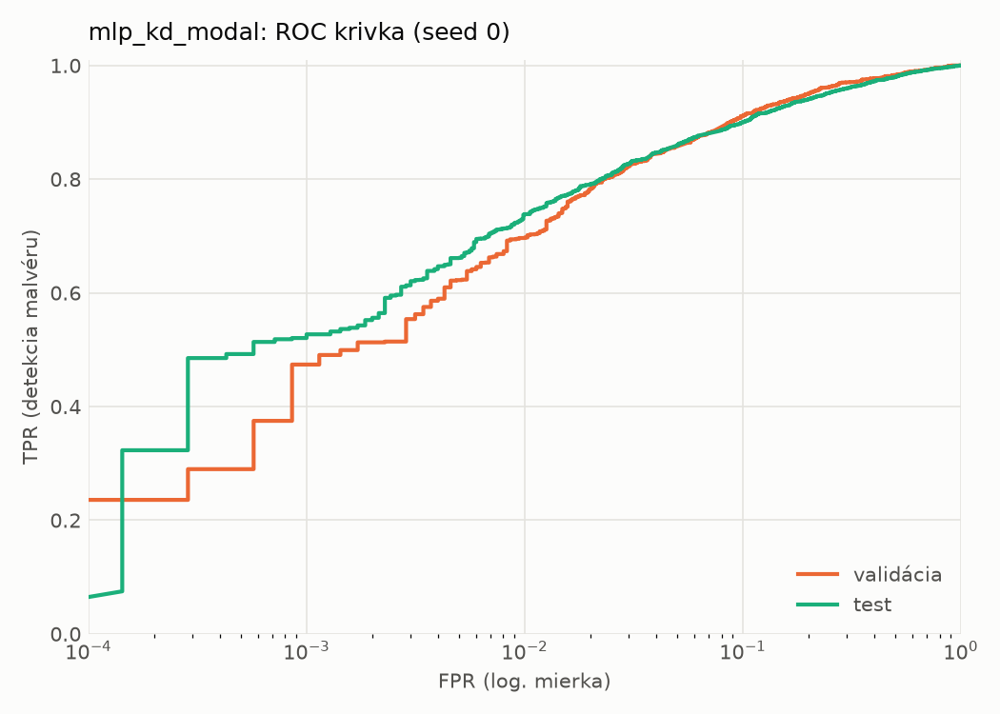
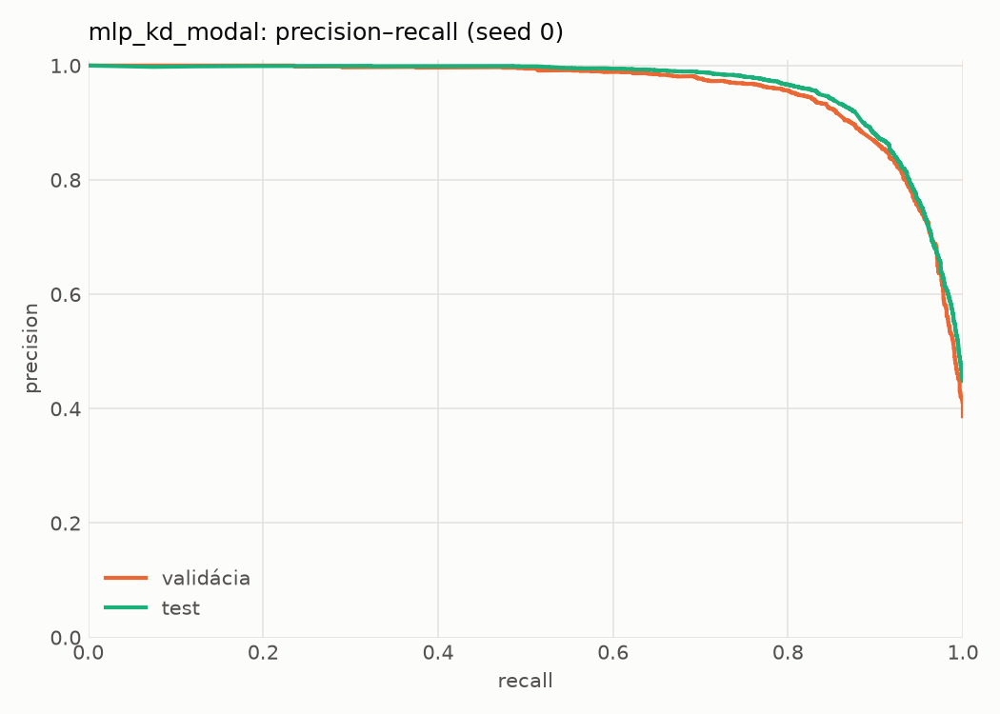
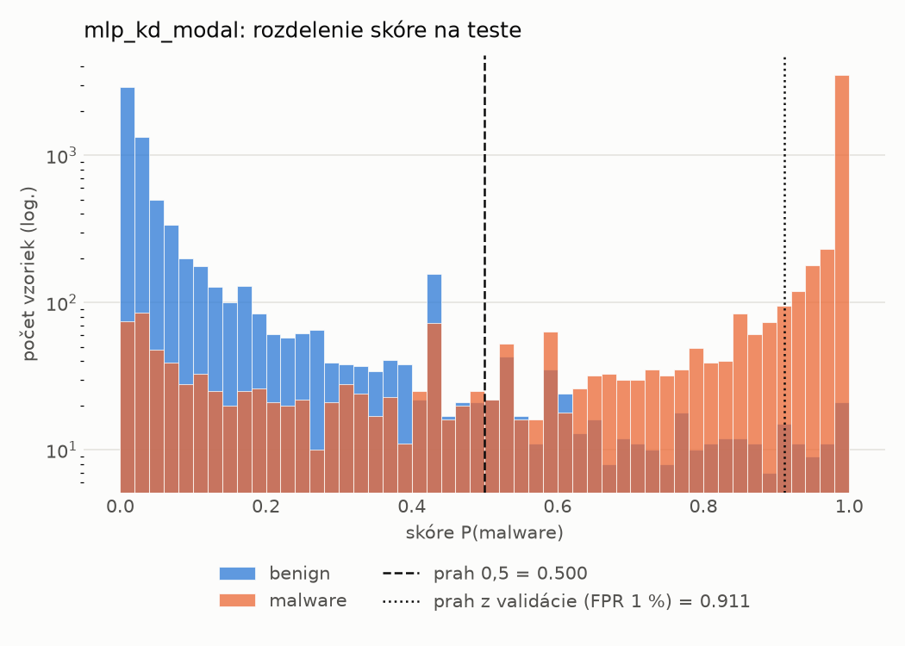
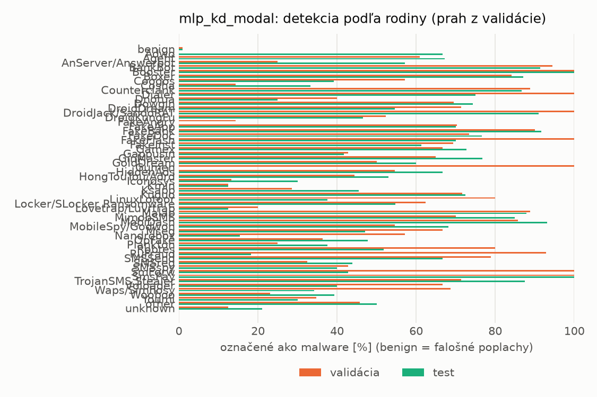
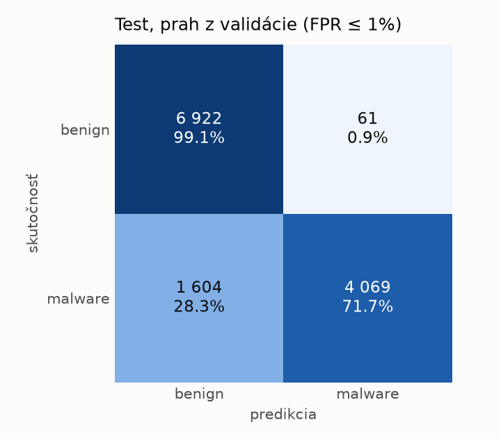
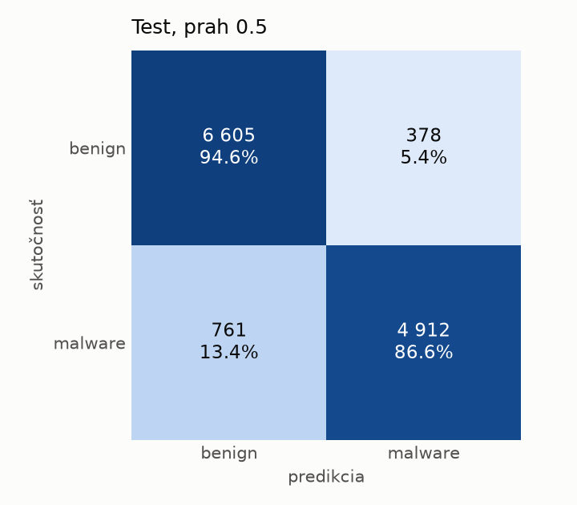
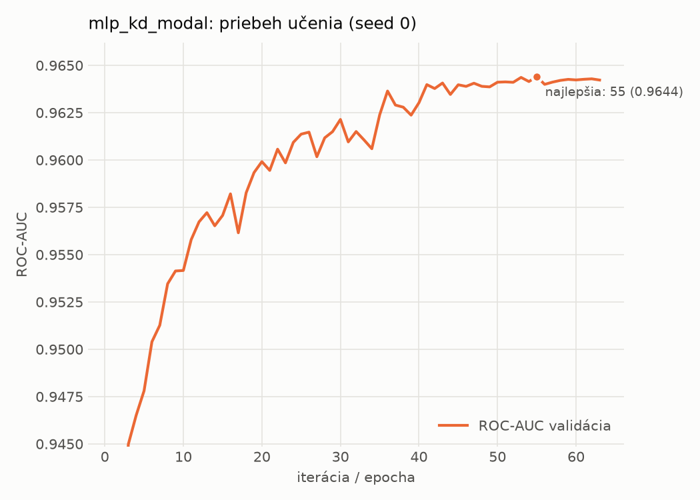

# dynamic/mlp_kd_modal – beh `20261123-011343`

> Automaticky generované (`src/training/run_tabular.py`). Konfigurácia: `config.yaml`, protokol: `protocol.yaml`.

- **Model:** `mlp` – študent – malé MLP učené destiláciou z učiteľa rovnakej modality (variant A)
- **Ladenie:** bez ladenia – hyperparametre prevzaté z `runs_v4/real_p/full/students_dynamic/mlp_kd_modal/20261123-004749`
- **Finálne modely:** seedy [0, 1, 2]; hodnoty sú priemer ± smerodajná odchýlka cez seedy
- **Najlepšie hyperparametre:** `{"hidden_layers": 1, "max_epochs": 100, "patience": 8, "hidden_width": 64, "dropout": 0.23306226533454044, "lr": 0.0029211055962699408, "weight_decay": 1.2442051354380418e-06, "batch_size": 512, "kd_alpha": 0.38098578248234166, "kd_temperature": 1.6615545083860346}`

## Detekčná kvalita (bez prahu)
| metrika | train (podvzorka) | validácia | test |
|---|---|---|---|
| ROC-AUC | 0.9729 ± 0.0006 | 0.9649 ± 0.0004 | 0.9620 ± 0.0008 |
| PR-AUC | 0.9675 ± 0.0009 | 0.9572 ± 0.0004 | 0.9639 ± 0.0009 |
| TPR pri FPR 1 % | 0.7867 ± 0.0136 | 0.6915 ± 0.0103 | 0.7473 ± 0.0085 |
| TPR pri FPR 0,1 % | 0.5623 ± 0.0110 | 0.4727 ± 0.0064 | 0.5379 ± 0.0151 |
| log loss | 0.1883 ± 0.0031 | 0.2235 ± 0.0012 | 0.2391 ± 0.0026 |
| Brier skóre | 0.0536 ± 0.0010 | 0.0644 ± 0.0001 | 0.0681 ± 0.0008 |

Rozdiel ROC-AUC train − validácia: **0.0079** (veľký rozdiel = preučenie).

## Pri prahu z validácie (FPR ≤ 1% na validácii)
| metrika | train (podvzorka) | validácia | test |
|---|---|---|---|
| accuracy | 0.8885 ± 0.0046 | 0.8748 ± 0.0040 | 0.8684 ± 0.0035 |
| balanced accuracy | 0.8543 ± 0.0061 | 0.8409 ± 0.0052 | 0.8541 ± 0.0040 |
| precision | 0.9893 ± 0.0021 | 0.9784 ± 0.0006 | 0.9871 ± 0.0020 |
| recall (TPR) | 0.7134 ± 0.0123 | 0.6915 ± 0.0103 | 0.7158 ± 0.0087 |
| FPR | 0.0047 ± 0.0009 | 0.0096 ± 0.0002 | 0.0076 ± 0.0012 |
| F1 | 0.8289 ± 0.0082 | 0.8103 ± 0.0072 | 0.8299 ± 0.0054 |
| MCC | 0.7715 ± 0.0091 | 0.7451 ± 0.0080 | 0.7520 ± 0.0059 |

## Pri pevnom prahu 0.5
| metrika | train (podvzorka) | validácia | test |
|---|---|---|---|
| accuracy | 0.9296 ± 0.0016 | 0.9132 ± 0.0015 | 0.9113 ± 0.0013 |
| balanced accuracy | 0.9220 ± 0.0010 | 0.9053 ± 0.0007 | 0.9069 ± 0.0013 |
| precision | 0.9212 ± 0.0054 | 0.9022 ± 0.0065 | 0.9326 ± 0.0037 |
| recall (TPR) | 0.8904 ± 0.0018 | 0.8701 ± 0.0035 | 0.8646 ± 0.0031 |
| FPR | 0.0465 ± 0.0035 | 0.0595 ± 0.0046 | 0.0508 ± 0.0031 |
| F1 | 0.9055 ± 0.0018 | 0.8858 ± 0.0014 | 0.8973 ± 0.0015 |
| MCC | 0.8498 ± 0.0033 | 0.8163 ± 0.0030 | 0.8213 ± 0.0027 |

## Výpočtové nároky (seed 0, testovacia množina)
| meranie | hodnota |
|---|---|
| tréning finálneho modelu | 10.5 s (priemer cez seedy) |
| ladenie spolu | 0 s |
| počet parametrov / uzlov | 8 129 |
| veľkosť modelu na disku | 0.04 MB |
| transformácia vstupu – latencia (1 vlákno) | 0.015 ms |
| transformácia vstupu – priepustnosť | 789 574 vzoriek/s |
| CPU latencia modelu (batch 1, 1 vlákno) | 0.158 ms (p95 0.168) |
| CPU priepustnosť (24 vlákien) | 6 242 170 vzoriek/s |
| GPU latencia (batch 1) | 0.445 ms (p95 0.474) |
| GPU priepustnosť | 2 199 819 vzoriek/s |
| GPU špičková pamäť | 50 MB |

## Grafy
| | |
|---|---|
|  |  |
|  |  |
|  |  |
|  |  |

## Súbory
`metrics.json` (všetky metriky po seedoch vrátane rodín), `timing.json`, `hpo_trials.csv`,
`predictions/<časť>_seed<N>.parquet` (sha256, family, label, score), `model/seed_<N>/`, `log.txt`.
