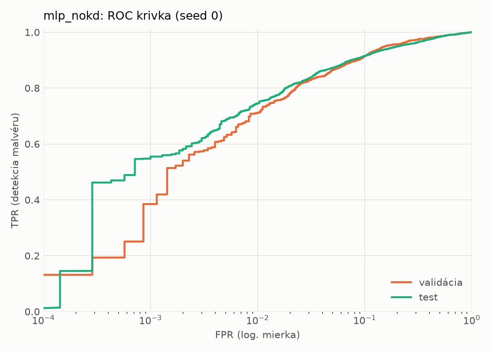
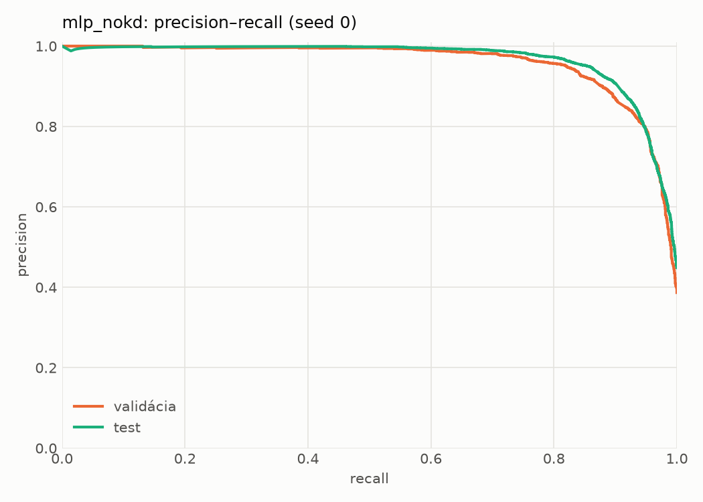
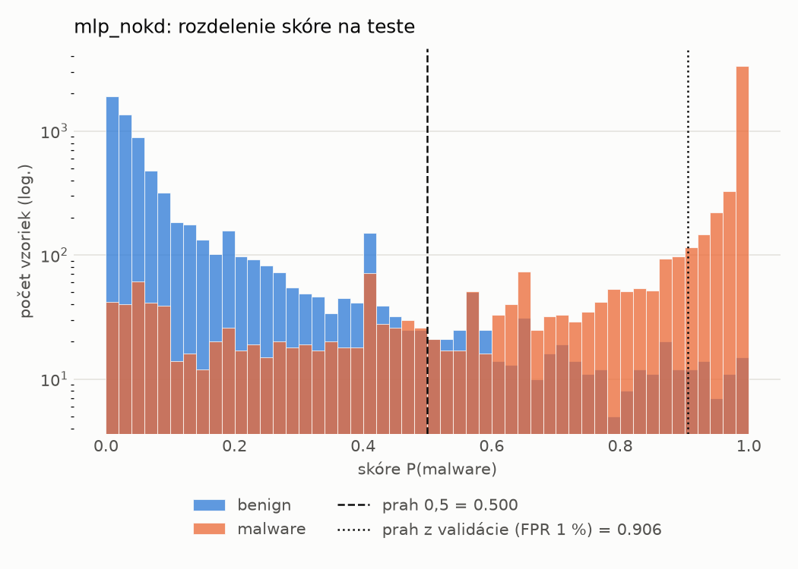
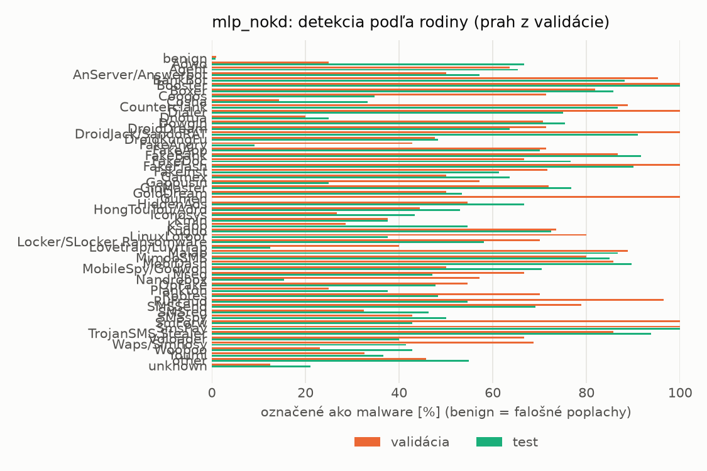
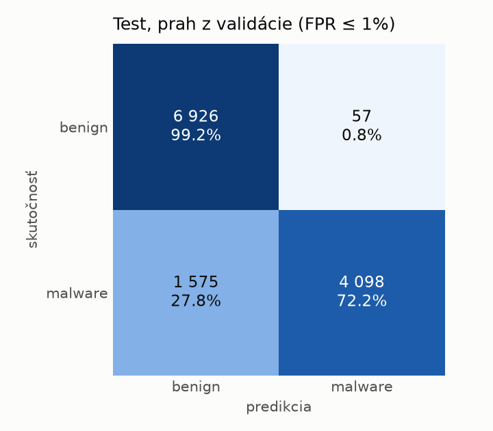
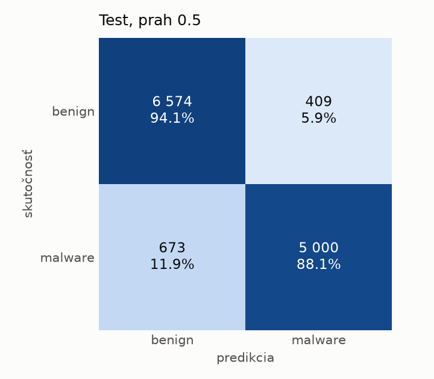
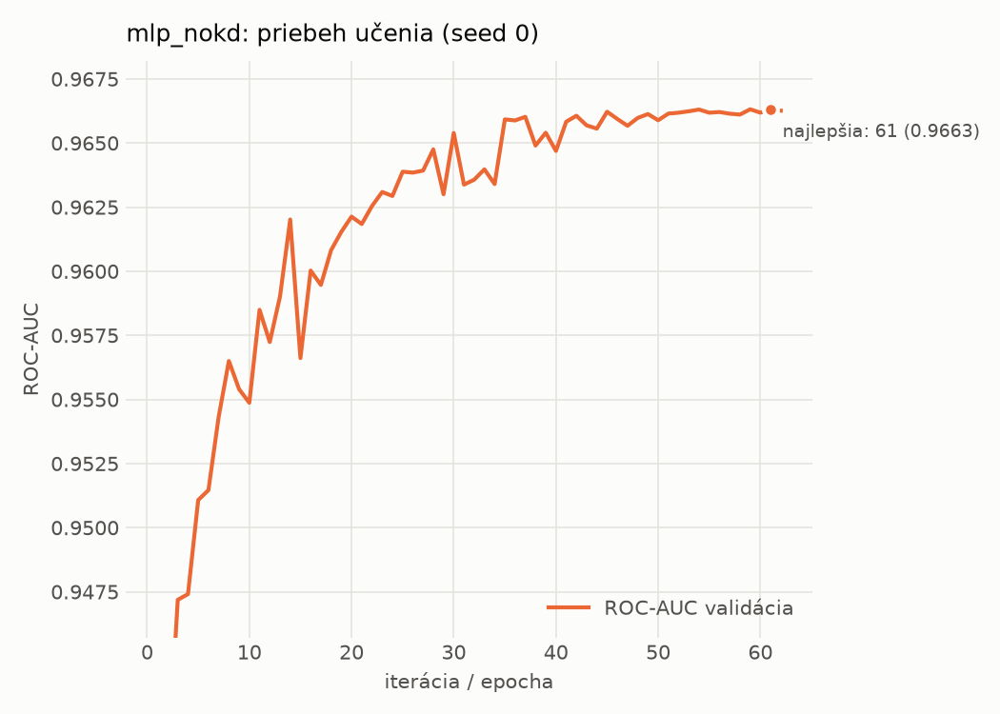

# dynamic/mlp_nokd – beh `20261123-011306`

> Automaticky generované (`src/training/run_tabular.py`). Konfigurácia: `config.yaml`, protokol: `protocol.yaml`.

- **Model:** `mlp` – kontrola – rovnaké malé MLP bez destilácie (iba skutočné označenia)
- **Ladenie:** bez ladenia – hyperparametre prevzaté z `runs_v4/real_p/full/students_dynamic/mlp_nokd/20261123-004046`
- **Finálne modely:** seedy [0, 1, 2]; hodnoty sú priemer ± smerodajná odchýlka cez seedy
- **Najlepšie hyperparametre:** `{"hidden_layers": 1, "max_epochs": 100, "patience": 8, "hidden_width": 64, "dropout": 0.01960392869507369, "lr": 0.0014251751351833603, "weight_decay": 1.336267730425129e-05, "batch_size": 256}`

## Detekčná kvalita (bez prahu)
| metrika | train (podvzorka) | validácia | test |
|---|---|---|---|
| ROC-AUC | 0.9797 ± 0.0005 | 0.9666 ± 0.0007 | 0.9652 ± 0.0004 |
| PR-AUC | 0.9748 ± 0.0006 | 0.9591 ± 0.0015 | 0.9660 ± 0.0001 |
| TPR pri FPR 1 % | 0.8195 ± 0.0074 | 0.7132 ± 0.0022 | 0.7444 ± 0.0059 |
| TPR pri FPR 0,1 % | 0.6302 ± 0.0286 | 0.4384 ± 0.0616 | 0.5244 ± 0.0205 |
| log loss | 0.1717 ± 0.0027 | 0.2190 ± 0.0030 | 0.2258 ± 0.0005 |
| Brier skóre | 0.0486 ± 0.0009 | 0.0628 ± 0.0008 | 0.0645 ± 0.0003 |

Rozdiel ROC-AUC train − validácia: **0.0131** (veľký rozdiel = preučenie).

## Pri prahu z validácie (FPR ≤ 1% na validácii)
| metrika | train (podvzorka) | validácia | test |
|---|---|---|---|
| accuracy | 0.8978 ± 0.0030 | 0.8831 ± 0.0009 | 0.8735 ± 0.0022 |
| balanced accuracy | 0.8664 ± 0.0038 | 0.8517 ± 0.0011 | 0.8599 ± 0.0024 |
| precision | 0.9916 ± 0.0012 | 0.9788 ± 0.0001 | 0.9861 ± 0.0007 |
| recall (TPR) | 0.7366 ± 0.0074 | 0.7132 ± 0.0022 | 0.7281 ± 0.0050 |
| FPR | 0.0038 ± 0.0005 | 0.0097 ± 0.0000 | 0.0084 ± 0.0005 |
| F1 | 0.8453 ± 0.0051 | 0.8251 ± 0.0015 | 0.8376 ± 0.0033 |
| MCC | 0.7905 ± 0.0060 | 0.7615 ± 0.0017 | 0.7606 ± 0.0039 |

## Pri pevnom prahu 0.5
| metrika | train (podvzorka) | validácia | test |
|---|---|---|---|
| accuracy | 0.9361 ± 0.0024 | 0.9145 ± 0.0010 | 0.9160 ± 0.0013 |
| balanced accuracy | 0.9312 ± 0.0026 | 0.9095 ± 0.0011 | 0.9129 ± 0.0013 |
| precision | 0.9196 ± 0.0033 | 0.8911 ± 0.0017 | 0.9267 ± 0.0023 |
| recall (TPR) | 0.9111 ± 0.0033 | 0.8873 ± 0.0016 | 0.8824 ± 0.0009 |
| FPR | 0.0486 ± 0.0020 | 0.0684 ± 0.0012 | 0.0567 ± 0.0019 |
| F1 | 0.9153 ± 0.0032 | 0.8892 ± 0.0013 | 0.9040 ± 0.0015 |
| MCC | 0.8641 ± 0.0052 | 0.8196 ± 0.0021 | 0.8302 ± 0.0028 |

## Výpočtové nároky (seed 0, testovacia množina)
| meranie | hodnota |
|---|---|
| tréning finálneho modelu | 11.8 s (priemer cez seedy) |
| ladenie spolu | 0 s |
| počet parametrov / uzlov | 8 129 |
| veľkosť modelu na disku | 0.04 MB |
| transformácia vstupu – latencia (1 vlákno) | 0.014 ms |
| transformácia vstupu – priepustnosť | 784 615 vzoriek/s |
| CPU latencia modelu (batch 1, 1 vlákno) | 0.158 ms (p95 0.168) |
| CPU priepustnosť (24 vlákien) | 6 806 131 vzoriek/s |
| GPU latencia (batch 1) | 0.448 ms (p95 0.479) |
| GPU priepustnosť | 3 501 452 vzoriek/s |
| GPU špičková pamäť | 72 MB |

## Grafy
| | |
|---|---|
|  |  |
|  |  |
|  |  |
|  |  |

## Súbory
`metrics.json` (všetky metriky po seedoch vrátane rodín), `timing.json`, `hpo_trials.csv`,
`predictions/<časť>_seed<N>.parquet` (sha256, family, label, score), `model/seed_<N>/`, `log.txt`.
