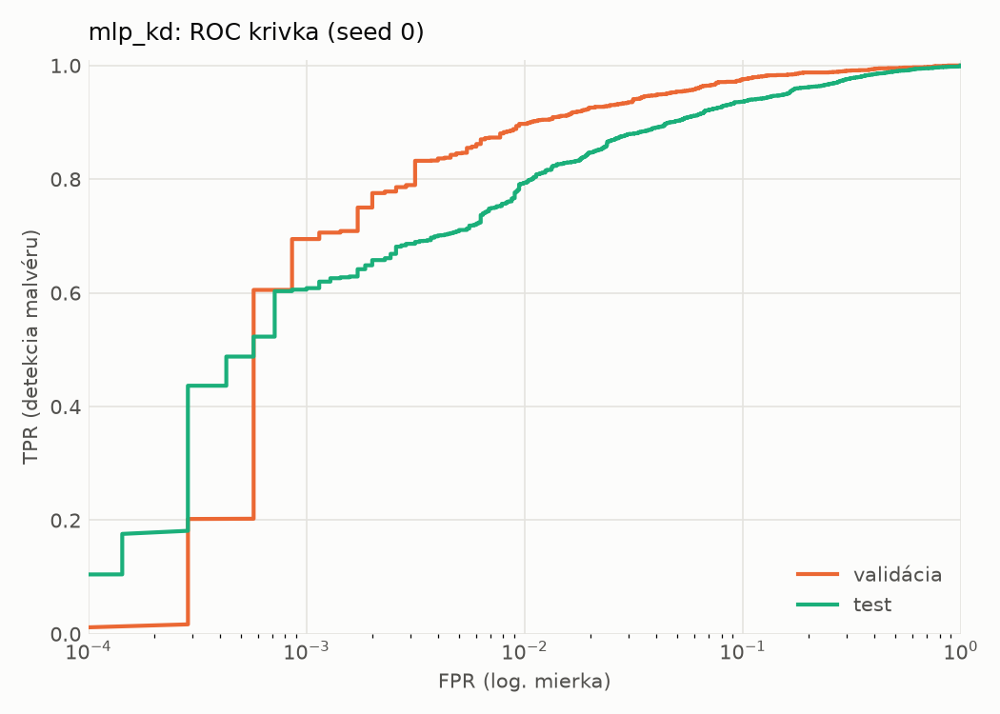
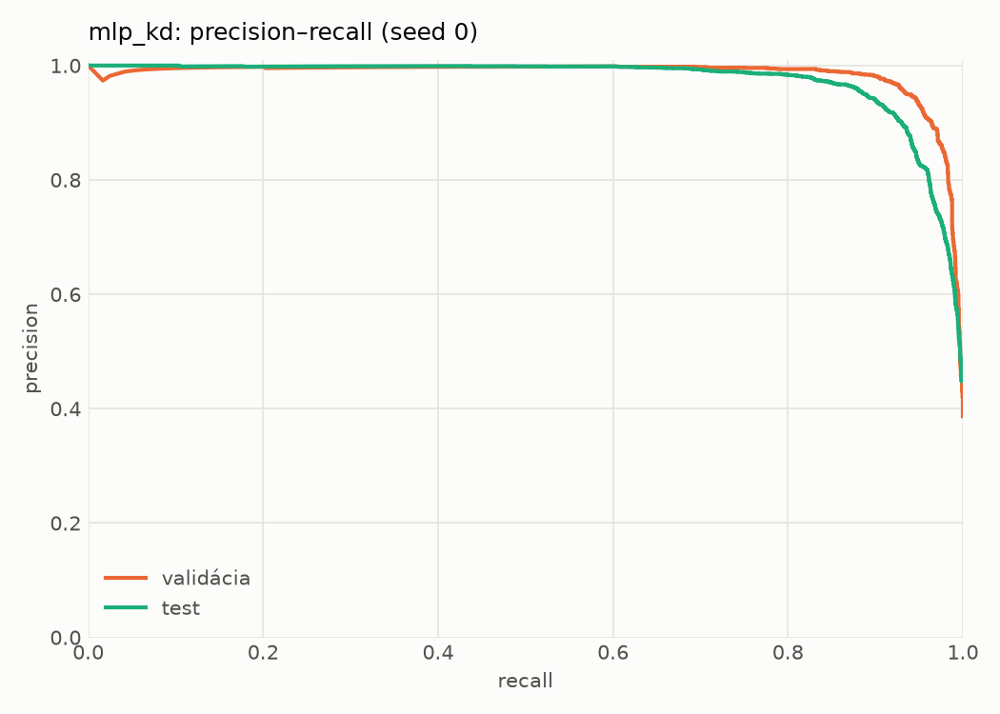
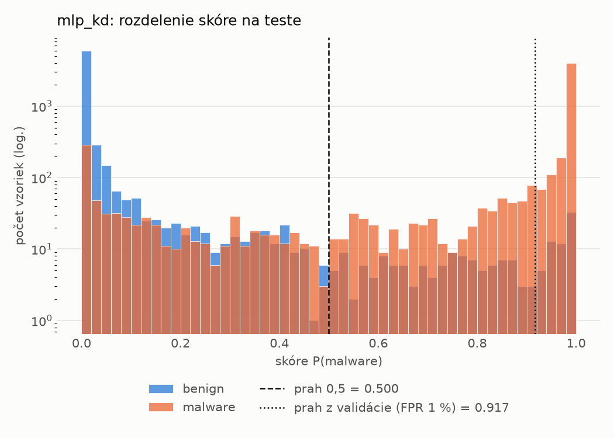
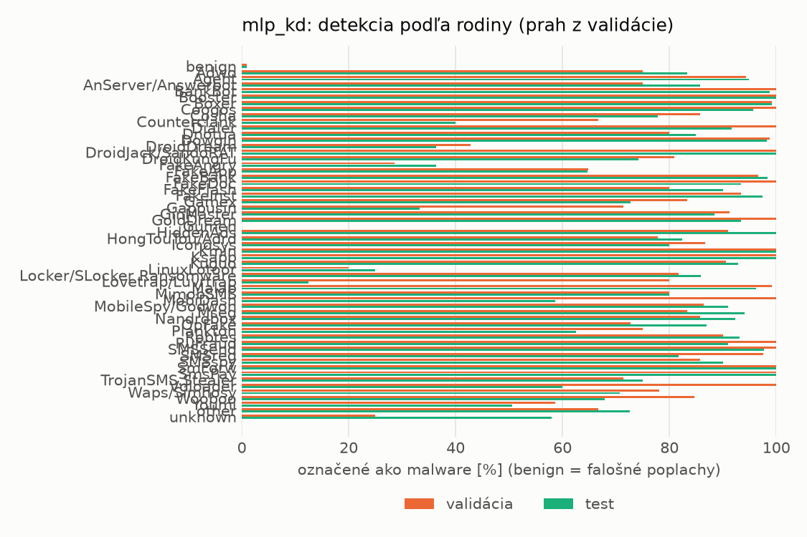
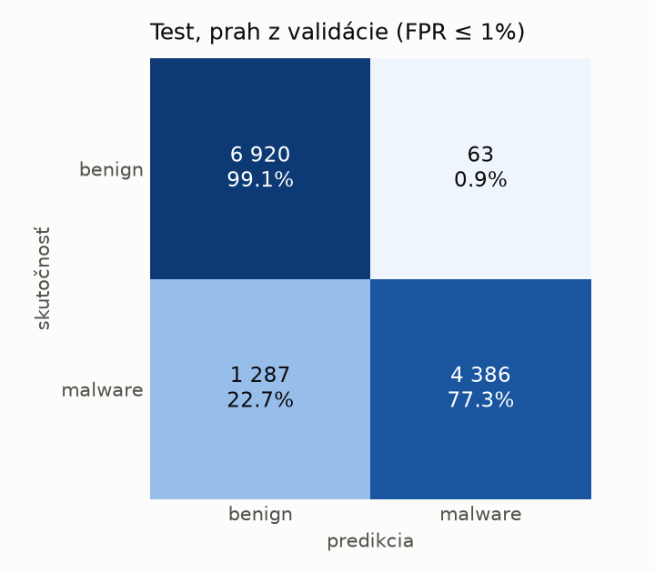
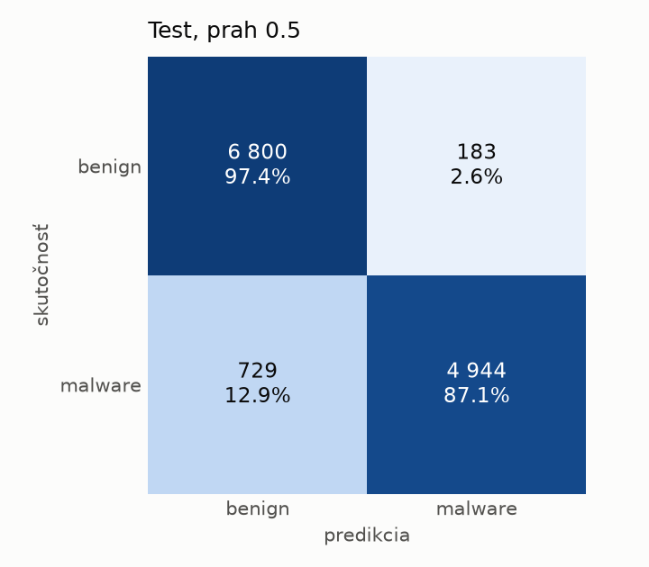
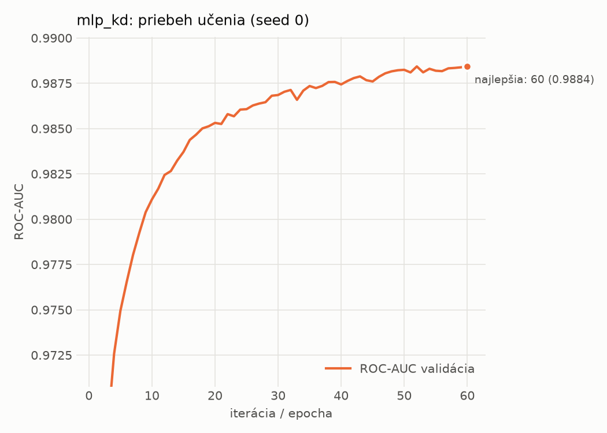

# static/mlp_kd – beh `20261123-011119`

> Automaticky generované (`src/training/run_tabular.py`). Konfigurácia: `config.yaml`, protokol: `protocol.yaml`.

- **Model:** `mlp` – študent – malé MLP učené destiláciou z hybridného učiteľa
- **Ladenie:** bez ladenia – hyperparametre prevzaté z `runs_v4/real_p/full/students_static/mlp_kd/20261123-002115`
- **Finálne modely:** seedy [0, 1, 2]; hodnoty sú priemer ± smerodajná odchýlka cez seedy
- **Najlepšie hyperparametre:** `{"hidden_layers": 1, "max_epochs": 100, "patience": 8, "hidden_width": 64, "dropout": 0.0632721567978865, "lr": 0.0009421311632910299, "weight_decay": 0.0003612082656275497, "batch_size": 1024, "kd_alpha": 0.17546922159086176, "kd_temperature": 1.684481613505065}`

## Detekčná kvalita (bez prahu)
| metrika | train (podvzorka) | validácia | test |
|---|---|---|---|
| ROC-AUC | 0.9932 ± 0.0002 | 0.9886 ± 0.0002 | 0.9765 ± 0.0022 |
| PR-AUC | 0.9917 ± 0.0004 | 0.9847 ± 0.0004 | 0.9766 ± 0.0017 |
| TPR pri FPR 1 % | 0.9273 ± 0.0016 | 0.8976 ± 0.0005 | 0.7775 ± 0.0143 |
| TPR pri FPR 0,1 % | 0.8336 ± 0.0297 | 0.6692 ± 0.0310 | 0.5897 ± 0.0148 |
| log loss | 0.0962 ± 0.0020 | 0.1387 ± 0.0007 | 0.2553 ± 0.0120 |
| Brier skóre | 0.0253 ± 0.0006 | 0.0339 ± 0.0005 | 0.0591 ± 0.0018 |

Rozdiel ROC-AUC train − validácia: **0.0045** (veľký rozdiel = preučenie).

## Pri prahu z validácie (FPR ≤ 1% na validácii)
| metrika | train (podvzorka) | validácia | test |
|---|---|---|---|
| accuracy | 0.9622 ± 0.0007 | 0.9545 ± 0.0002 | 0.8891 ± 0.0036 |
| balanced accuracy | 0.9519 ± 0.0010 | 0.9440 ± 0.0002 | 0.8773 ± 0.0041 |
| precision | 0.9902 ± 0.0007 | 0.9832 ± 0.0003 | 0.9863 ± 0.0010 |
| recall (TPR) | 0.9093 ± 0.0024 | 0.8976 ± 0.0005 | 0.7633 ± 0.0086 |
| FPR | 0.0055 ± 0.0004 | 0.0096 ± 0.0002 | 0.0086 ± 0.0007 |
| F1 | 0.9480 ± 0.0011 | 0.9385 ± 0.0003 | 0.8606 ± 0.0053 |
| MCC | 0.9205 ± 0.0015 | 0.9048 ± 0.0004 | 0.7885 ± 0.0064 |

## Pri pevnom prahu 0.5
| metrika | train (podvzorka) | validácia | test |
|---|---|---|---|
| accuracy | 0.9677 ± 0.0008 | 0.9578 ± 0.0008 | 0.9287 ± 0.0027 |
| balanced accuracy | 0.9643 ± 0.0009 | 0.9552 ± 0.0009 | 0.9234 ± 0.0031 |
| precision | 0.9641 ± 0.0006 | 0.9471 ± 0.0008 | 0.9652 ± 0.0009 |
| recall (TPR) | 0.9501 ± 0.0016 | 0.9437 ± 0.0016 | 0.8724 ± 0.0067 |
| FPR | 0.0216 ± 0.0003 | 0.0332 ± 0.0005 | 0.0255 ± 0.0008 |
| F1 | 0.9571 ± 0.0011 | 0.9454 ± 0.0010 | 0.9164 ± 0.0035 |
| MCC | 0.9312 ± 0.0017 | 0.9110 ± 0.0016 | 0.8579 ± 0.0052 |

## Výpočtové nároky (seed 0, testovacia množina)
| meranie | hodnota |
|---|---|
| tréning finálneho modelu | 4.7 s (priemer cez seedy) |
| ladenie spolu | 0 s |
| počet parametrov / uzlov | 10 689 |
| veľkosť modelu na disku | 0.05 MB |
| transformácia vstupu – latencia (1 vlákno) | 0.006 ms |
| transformácia vstupu – priepustnosť | 1 110 039 vzoriek/s |
| CPU latencia modelu (batch 1, 1 vlákno) | 0.156 ms (p95 0.166) |
| CPU priepustnosť (24 vlákien) | 4 091 556 vzoriek/s |
| GPU latencia (batch 1) | 0.470 ms (p95 0.489) |
| GPU priepustnosť | 2 517 254 vzoriek/s |
| GPU špičková pamäť | 59 MB |

## Grafy
| | |
|---|---|
|  |  |
|  |  |
|  |  |
|  |  |

## Súbory
`metrics.json` (všetky metriky po seedoch vrátane rodín), `timing.json`, `hpo_trials.csv`,
`predictions/<časť>_seed<N>.parquet` (sha256, family, label, score), `model/seed_<N>/`, `log.txt`.
