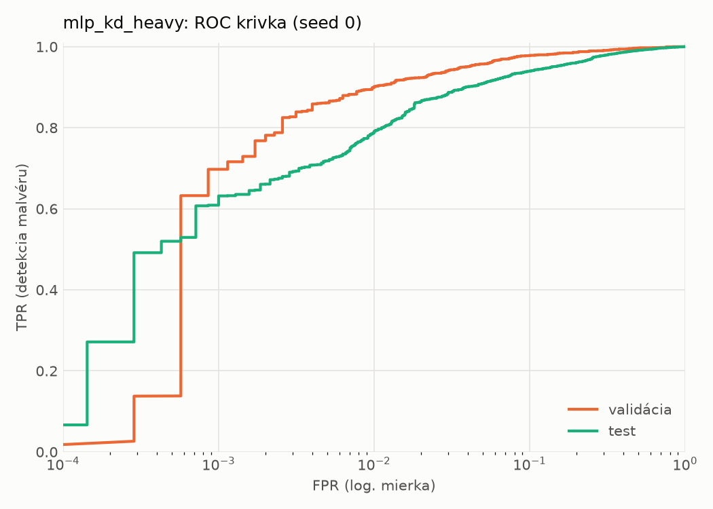
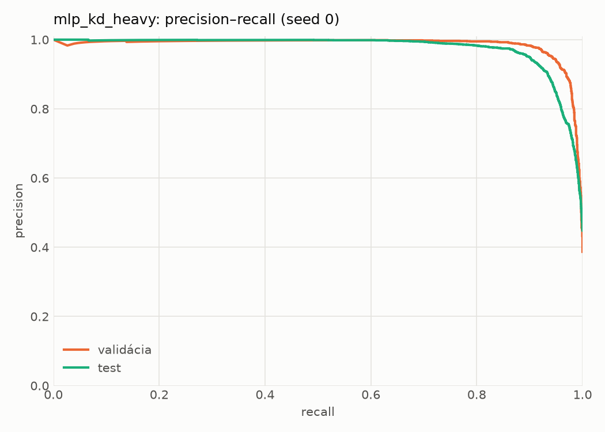
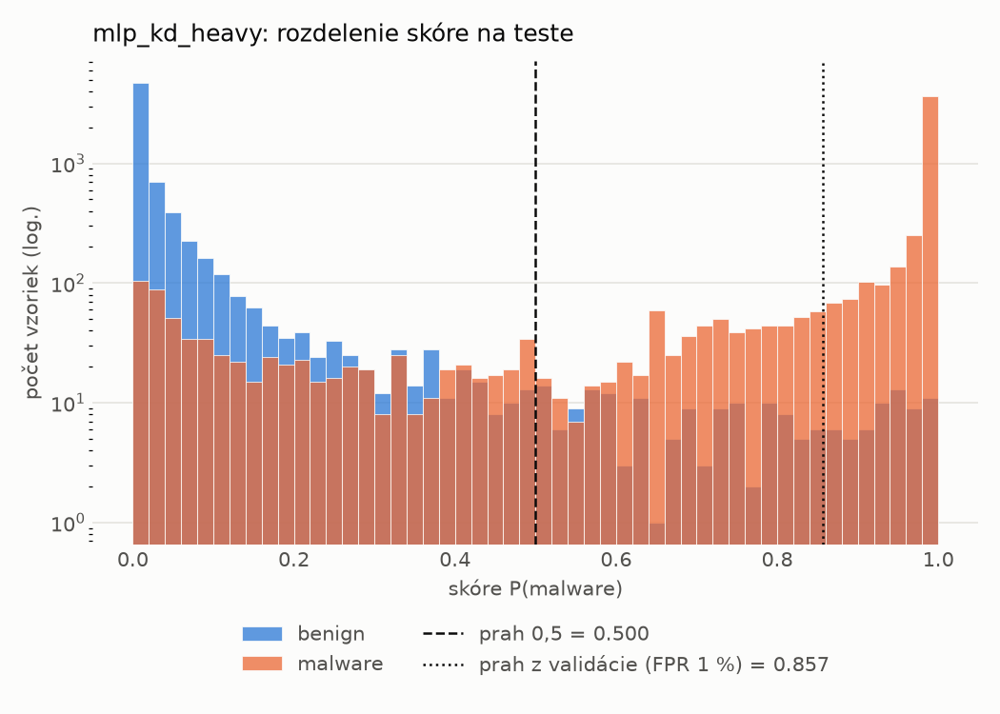
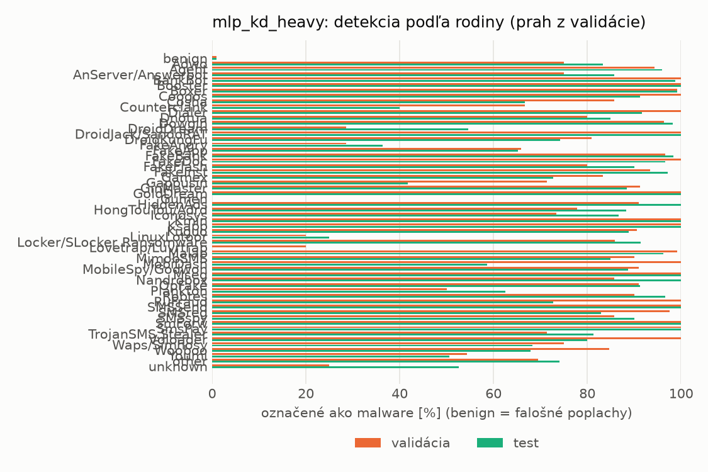
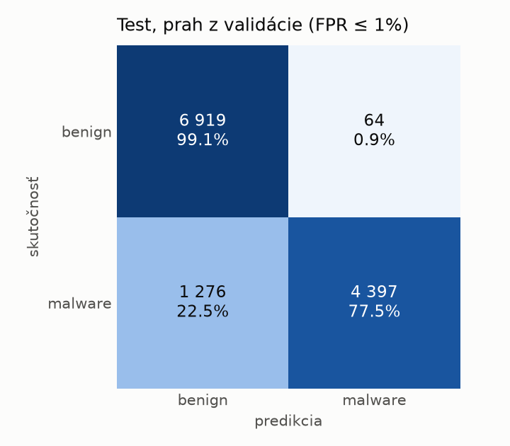
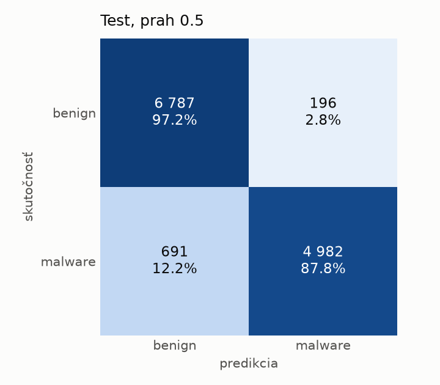
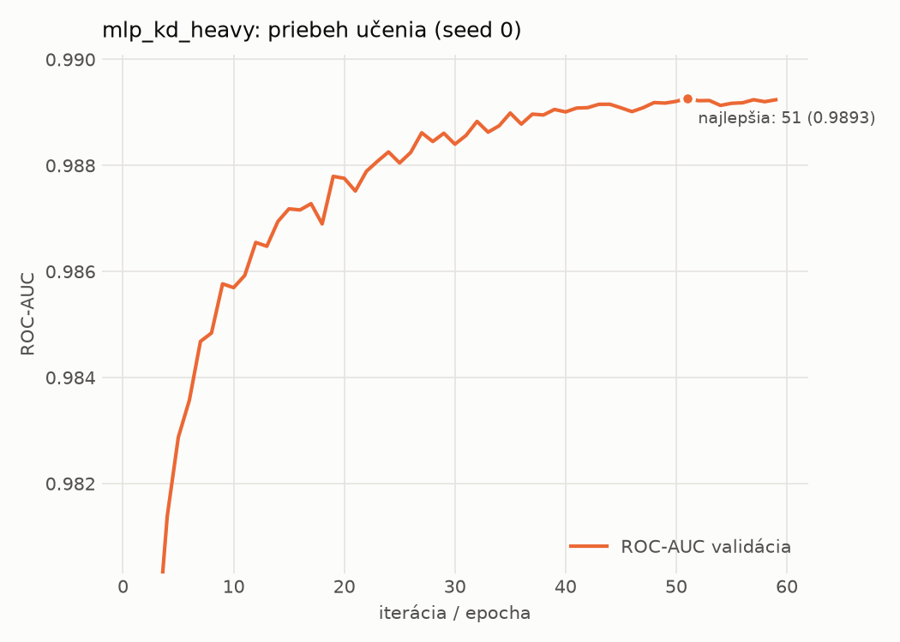

# static/mlp_kd_heavy – beh `20261123-011230`

> Automaticky generované (`src/training/run_tabular.py`). Konfigurácia: `config.yaml`, protokol: `protocol.yaml`.

- **Model:** `mlp` – študent – malé MLP učené destiláciou z mlp_large hybridu (V4)
- **Ladenie:** bez ladenia – hyperparametre prevzaté z `runs_v4/real_p/full/students_static/mlp_kd_heavy/20261123-003302`
- **Finálne modely:** seedy [0, 1, 2]; hodnoty sú priemer ± smerodajná odchýlka cez seedy
- **Najlepšie hyperparametre:** `{"hidden_layers": 1, "max_epochs": 100, "patience": 8, "hidden_width": 64, "dropout": 0.09027280410892091, "lr": 0.002542283406985367, "weight_decay": 5.0021287493134016e-05, "batch_size": 1024, "kd_alpha": 0.49398181049265616, "kd_temperature": 1.0496155846554518}`

## Detekčná kvalita (bez prahu)
| metrika | train (podvzorka) | validácia | test |
|---|---|---|---|
| ROC-AUC | 0.9947 ± 0.0003 | 0.9891 ± 0.0003 | 0.9768 ± 0.0008 |
| PR-AUC | 0.9932 ± 0.0005 | 0.9851 ± 0.0001 | 0.9770 ± 0.0007 |
| TPR pri FPR 1 % | 0.9316 ± 0.0025 | 0.8999 ± 0.0080 | 0.7861 ± 0.0065 |
| TPR pri FPR 0,1 % | 0.8321 ± 0.0152 | 0.6720 ± 0.0343 | 0.5978 ± 0.0281 |
| log loss | 0.0829 ± 0.0017 | 0.1187 ± 0.0006 | 0.1974 ± 0.0041 |
| Brier skóre | 0.0224 ± 0.0004 | 0.0319 ± 0.0001 | 0.0541 ± 0.0007 |

Rozdiel ROC-AUC train − validácia: **0.0056** (veľký rozdiel = preučenie).

## Pri prahu z validácie (FPR ≤ 1% na validácii)
| metrika | train (podvzorka) | validácia | test |
|---|---|---|---|
| accuracy | 0.9623 ± 0.0017 | 0.9553 ± 0.0031 | 0.8941 ± 0.0008 |
| balanced accuracy | 0.9517 ± 0.0022 | 0.9451 ± 0.0040 | 0.8829 ± 0.0008 |
| precision | 0.9921 ± 0.0001 | 0.9831 ± 0.0001 | 0.9857 ± 0.0008 |
| recall (TPR) | 0.9078 ± 0.0045 | 0.8999 ± 0.0080 | 0.7750 ± 0.0011 |
| FPR | 0.0044 ± 0.0001 | 0.0097 ± 0.0000 | 0.0091 ± 0.0005 |
| F1 | 0.9481 ± 0.0024 | 0.9397 ± 0.0044 | 0.8678 ± 0.0010 |
| MCC | 0.9209 ± 0.0034 | 0.9065 ± 0.0063 | 0.7973 ± 0.0016 |

## Pri pevnom prahu 0.5
| metrika | train (podvzorka) | validácia | test |
|---|---|---|---|
| accuracy | 0.9705 ± 0.0005 | 0.9576 ± 0.0002 | 0.9310 ± 0.0009 |
| balanced accuracy | 0.9676 ± 0.0005 | 0.9555 ± 0.0002 | 0.9261 ± 0.0009 |
| precision | 0.9658 ± 0.0005 | 0.9445 ± 0.0010 | 0.9638 ± 0.0019 |
| recall (TPR) | 0.9559 ± 0.0009 | 0.9461 ± 0.0009 | 0.8790 ± 0.0016 |
| FPR | 0.0207 ± 0.0003 | 0.0351 ± 0.0007 | 0.0268 ± 0.0015 |
| F1 | 0.9608 ± 0.0006 | 0.9453 ± 0.0002 | 0.9195 ± 0.0011 |
| MCC | 0.9372 ± 0.0010 | 0.9107 ± 0.0004 | 0.8621 ± 0.0019 |

## Výpočtové nároky (seed 0, testovacia množina)
| meranie | hodnota |
|---|---|
| tréning finálneho modelu | 3.8 s (priemer cez seedy) |
| ladenie spolu | 0 s |
| počet parametrov / uzlov | 10 689 |
| veľkosť modelu na disku | 0.05 MB |
| transformácia vstupu – latencia (1 vlákno) | 0.014 ms |
| transformácia vstupu – priepustnosť | 715 505 vzoriek/s |
| CPU latencia modelu (batch 1, 1 vlákno) | 0.156 ms (p95 0.165) |
| CPU priepustnosť (24 vlákien) | 5 464 594 vzoriek/s |
| GPU latencia (batch 1) | 0.448 ms (p95 0.469) |
| GPU priepustnosť | 2 465 711 vzoriek/s |
| GPU špičková pamäť | 89 MB |

## Grafy
| | |
|---|---|
|  |  |
|  |  |
|  |  |
|  |  |

## Súbory
`metrics.json` (všetky metriky po seedoch vrátane rodín), `timing.json`, `hpo_trials.csv`,
`predictions/<časť>_seed<N>.parquet` (sha256, family, label, score), `model/seed_<N>/`, `log.txt`.
