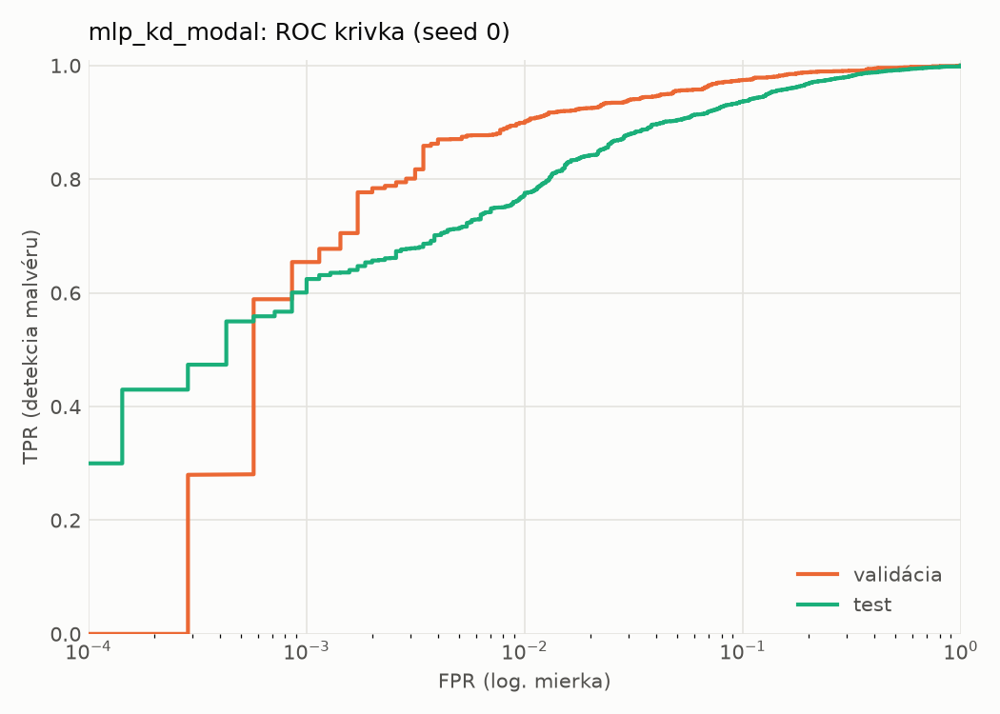
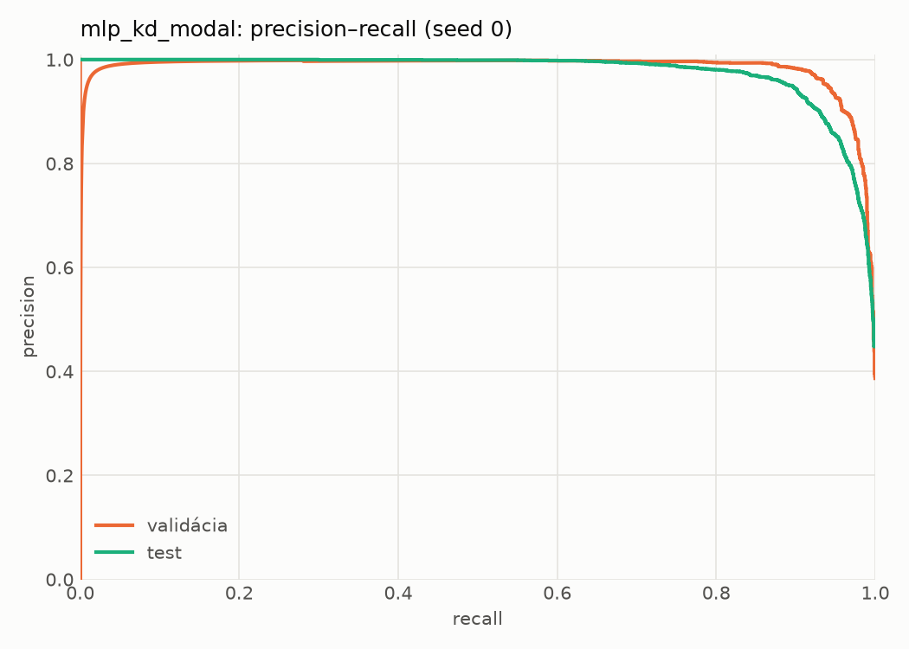
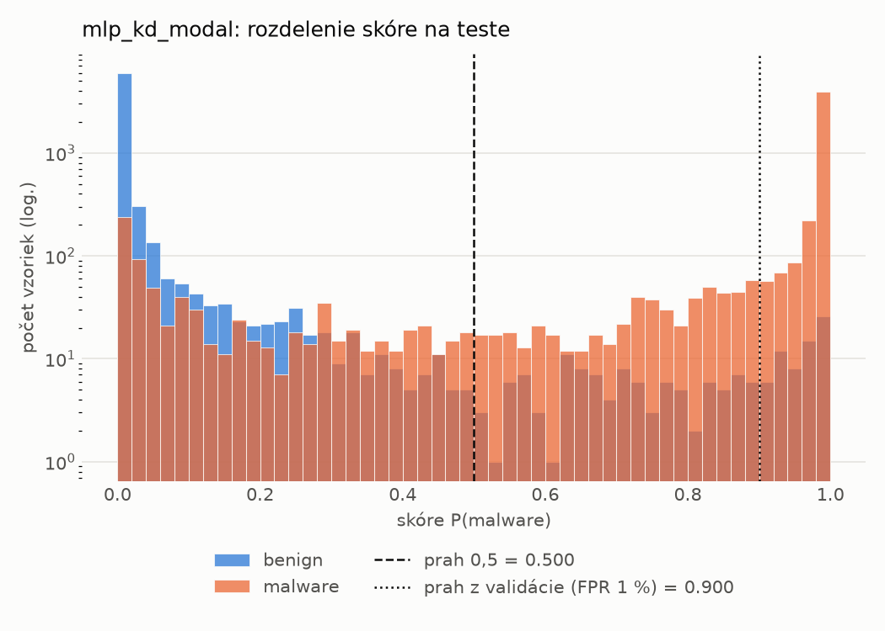
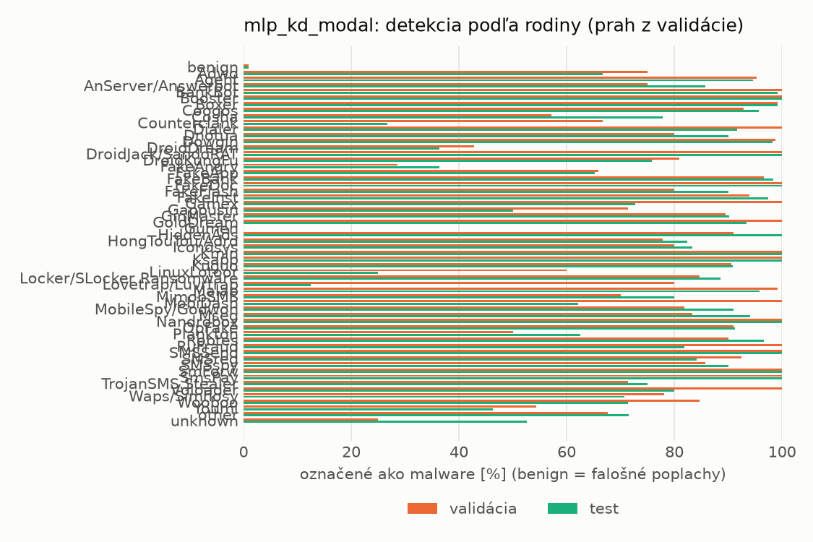
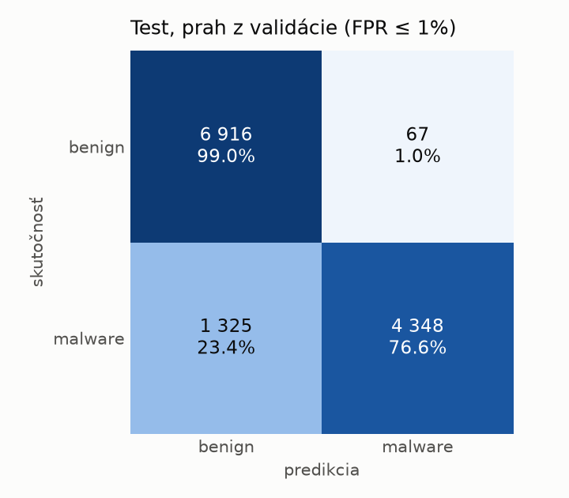
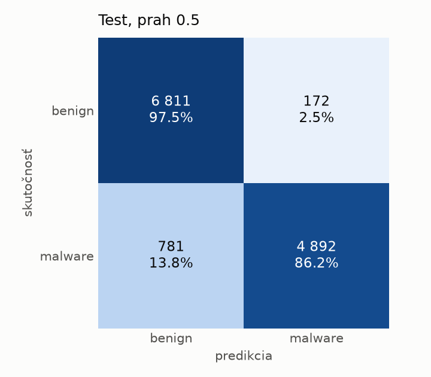
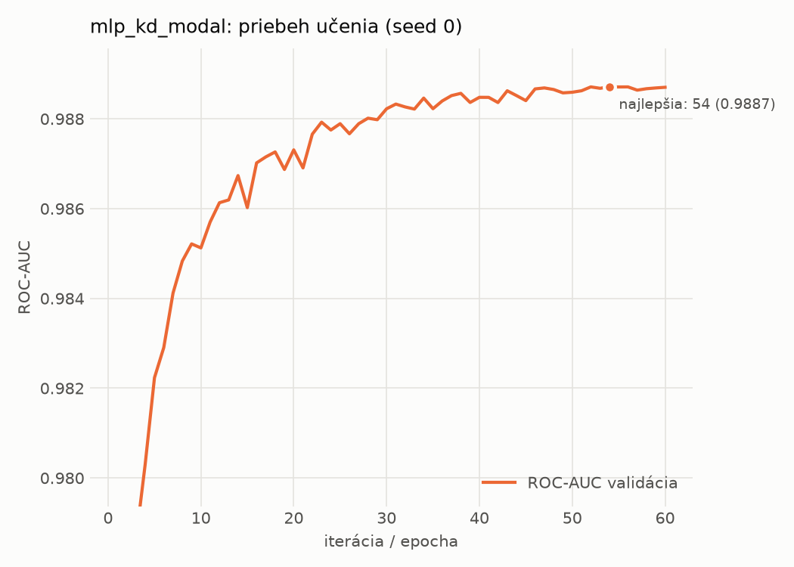

# static/mlp_kd_modal – beh `20261123-011203`

> Automaticky generované (`src/training/run_tabular.py`). Konfigurácia: `config.yaml`, protokol: `protocol.yaml`.

- **Model:** `mlp` – študent – malé MLP učené destiláciou z učiteľa rovnakej modality (variant A)
- **Ladenie:** bez ladenia – hyperparametre prevzaté z `runs_v4/real_p/full/students_static/mlp_kd_modal/20261123-002851`
- **Finálne modely:** seedy [0, 1, 2]; hodnoty sú priemer ± smerodajná odchýlka cez seedy
- **Najlepšie hyperparametre:** `{"hidden_layers": 1, "max_epochs": 100, "patience": 8, "hidden_width": 64, "dropout": 0.037581027791643296, "lr": 0.0019348891318937097, "weight_decay": 9.225533739654786e-05, "batch_size": 512, "kd_alpha": 0.37781550385889523, "kd_temperature": 3.209412682485264}`

## Detekčná kvalita (bez prahu)
| metrika | train (podvzorka) | validácia | test |
|---|---|---|---|
| ROC-AUC | 0.9936 ± 0.0001 | 0.9886 ± 0.0003 | 0.9771 ± 0.0008 |
| PR-AUC | 0.9918 ± 0.0002 | 0.9830 ± 0.0008 | 0.9769 ± 0.0004 |
| TPR pri FPR 1 % | 0.9197 ± 0.0048 | 0.8988 ± 0.0036 | 0.7791 ± 0.0075 |
| TPR pri FPR 0,1 % | 0.8496 ± 0.0022 | 0.6736 ± 0.0170 | 0.6282 ± 0.0273 |
| log loss | 0.0958 ± 0.0021 | 0.1357 ± 0.0046 | 0.2447 ± 0.0093 |
| Brier skóre | 0.0265 ± 0.0006 | 0.0345 ± 0.0013 | 0.0599 ± 0.0014 |

Rozdiel ROC-AUC train − validácia: **0.0049** (veľký rozdiel = preučenie).

## Pri prahu z validácie (FPR ≤ 1% na validácii)
| metrika | train (podvzorka) | validácia | test |
|---|---|---|---|
| accuracy | 0.9604 ± 0.0012 | 0.9550 ± 0.0014 | 0.8904 ± 0.0028 |
| balanced accuracy | 0.9495 ± 0.0016 | 0.9446 ± 0.0018 | 0.8787 ± 0.0031 |
| precision | 0.9900 ± 0.0007 | 0.9833 ± 0.0003 | 0.9858 ± 0.0009 |
| recall (TPR) | 0.9045 ± 0.0031 | 0.8988 ± 0.0036 | 0.7664 ± 0.0062 |
| FPR | 0.0056 ± 0.0004 | 0.0096 ± 0.0002 | 0.0090 ± 0.0005 |
| F1 | 0.9453 ± 0.0017 | 0.9392 ± 0.0020 | 0.8624 ± 0.0040 |
| MCC | 0.9166 ± 0.0025 | 0.9058 ± 0.0029 | 0.7906 ± 0.0051 |

## Pri pevnom prahu 0.5
| metrika | train (podvzorka) | validácia | test |
|---|---|---|---|
| accuracy | 0.9666 ± 0.0008 | 0.9561 ± 0.0015 | 0.9268 ± 0.0020 |
| balanced accuracy | 0.9629 ± 0.0005 | 0.9533 ± 0.0014 | 0.9213 ± 0.0024 |
| precision | 0.9633 ± 0.0026 | 0.9454 ± 0.0031 | 0.9649 ± 0.0010 |
| recall (TPR) | 0.9479 ± 0.0005 | 0.9409 ± 0.0014 | 0.8683 ± 0.0057 |
| FPR | 0.0221 ± 0.0016 | 0.0343 ± 0.0020 | 0.0256 ± 0.0009 |
| F1 | 0.9555 ± 0.0010 | 0.9432 ± 0.0019 | 0.9141 ± 0.0027 |
| MCC | 0.9288 ± 0.0017 | 0.9074 ± 0.0032 | 0.8543 ± 0.0037 |

## Výpočtové nároky (seed 0, testovacia množina)
| meranie | hodnota |
|---|---|
| tréning finálneho modelu | 8.2 s (priemer cez seedy) |
| ladenie spolu | 0 s |
| počet parametrov / uzlov | 10 689 |
| veľkosť modelu na disku | 0.05 MB |
| transformácia vstupu – latencia (1 vlákno) | 0.014 ms |
| transformácia vstupu – priepustnosť | 708 428 vzoriek/s |
| CPU latencia modelu (batch 1, 1 vlákno) | 0.157 ms (p95 0.166) |
| CPU priepustnosť (24 vlákien) | 5 273 553 vzoriek/s |
| GPU latencia (batch 1) | 0.452 ms (p95 0.478) |
| GPU priepustnosť | 1 880 311 vzoriek/s |
| GPU špičková pamäť | 59 MB |

## Grafy
| | |
|---|---|
|  |  |
|  |  |
|  |  |
|  |  |

## Súbory
`metrics.json` (všetky metriky po seedoch vrátane rodín), `timing.json`, `hpo_trials.csv`,
`predictions/<časť>_seed<N>.parquet` (sha256, family, label, score), `model/seed_<N>/`, `log.txt`.
