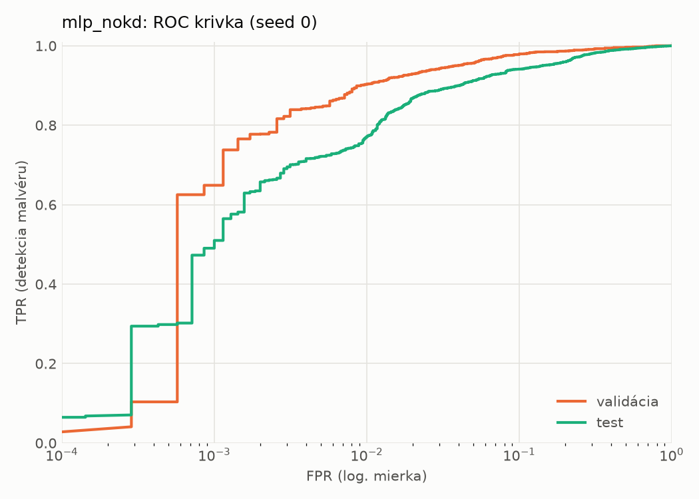
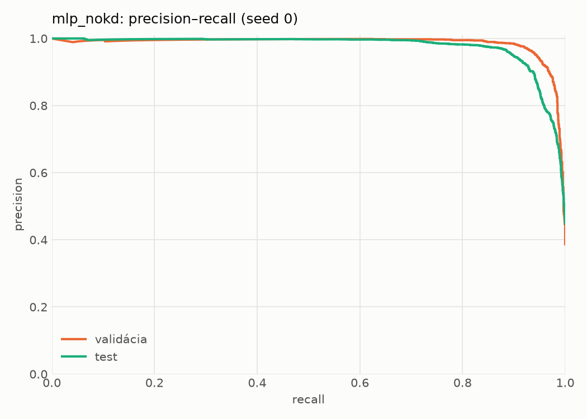
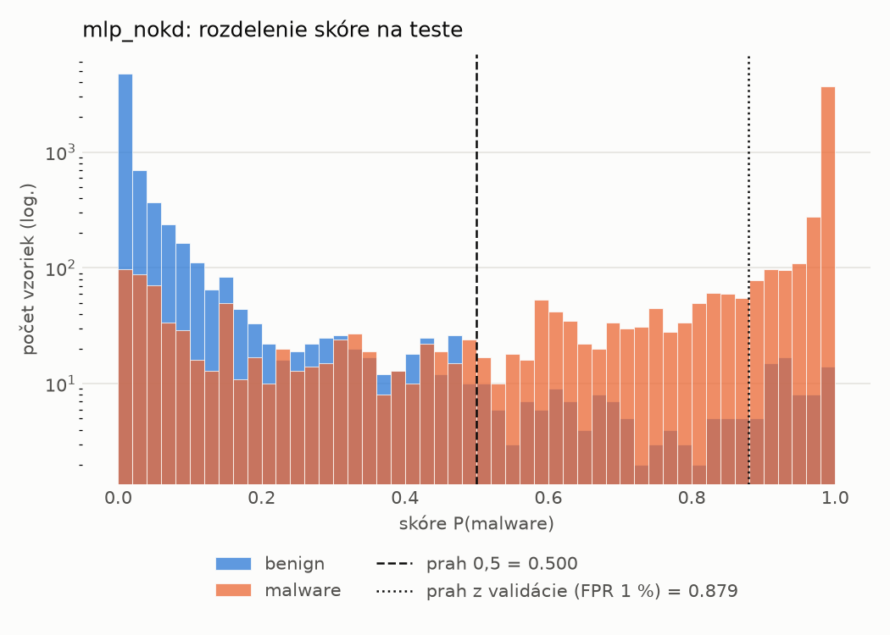
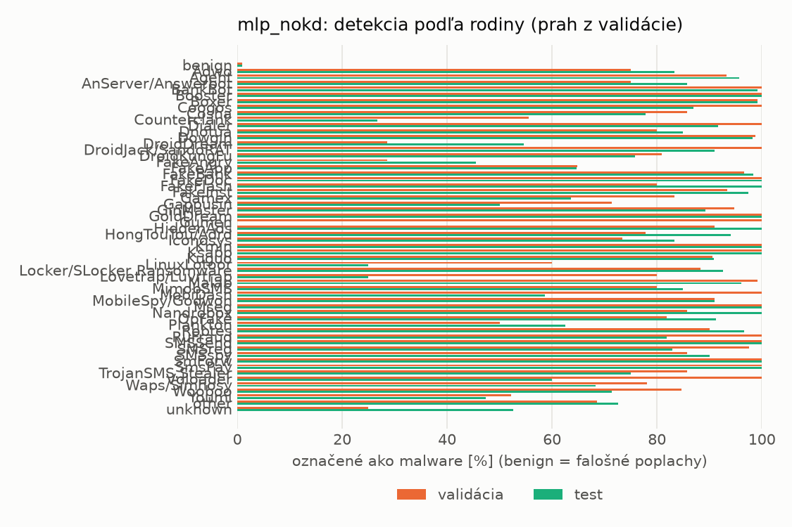
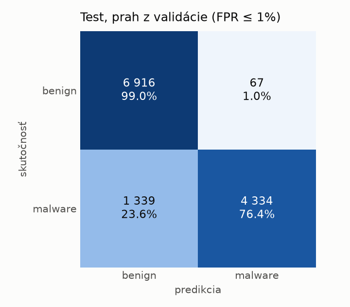
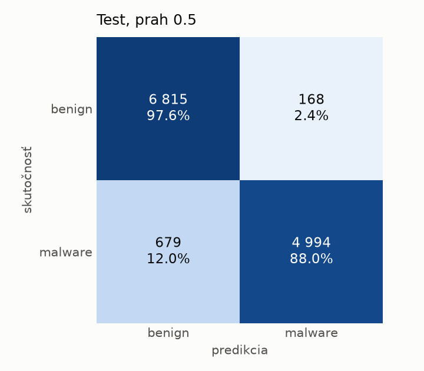
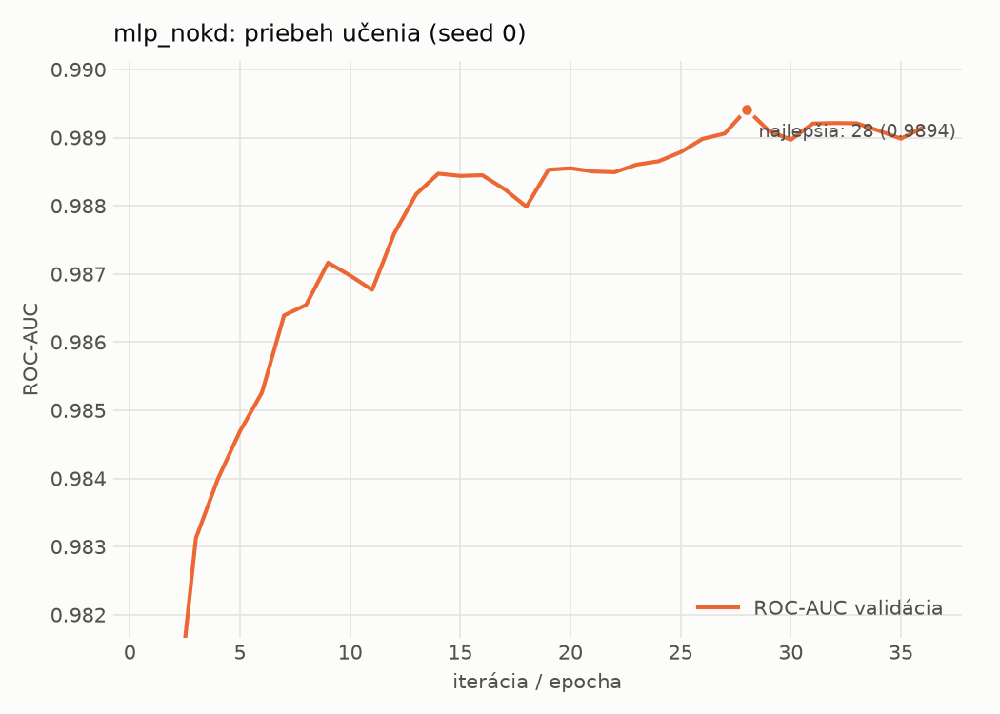

# static/mlp_nokd – beh `20261123-011135`

> Automaticky generované (`src/training/run_tabular.py`). Konfigurácia: `config.yaml`, protokol: `protocol.yaml`.

- **Model:** `mlp` – kontrola – rovnaké malé MLP bez destilácie (iba skutočné označenia)
- **Ladenie:** bez ladenia – hyperparametre prevzaté z `runs_v4/real_p/full/students_static/mlp_nokd/20261123-002453`
- **Finálne modely:** seedy [0, 1, 2]; hodnoty sú priemer ± smerodajná odchýlka cez seedy
- **Najlepšie hyperparametre:** `{"hidden_layers": 1, "max_epochs": 100, "patience": 8, "hidden_width": 64, "dropout": 0.15022694447625398, "lr": 0.0027248227778296176, "weight_decay": 1.7062100113192703e-06, "batch_size": 256}`

## Detekčná kvalita (bez prahu)
| metrika | train (podvzorka) | validácia | test |
|---|---|---|---|
| ROC-AUC | 0.9959 ± 0.0003 | 0.9896 ± 0.0009 | 0.9770 ± 0.0012 |
| PR-AUC | 0.9948 ± 0.0005 | 0.9860 ± 0.0011 | 0.9765 ± 0.0015 |
| TPR pri FPR 1 % | 0.9476 ± 0.0052 | 0.9043 ± 0.0096 | 0.7901 ± 0.0189 |
| TPR pri FPR 0,1 % | 0.8737 ± 0.0259 | 0.7107 ± 0.0609 | 0.4918 ± 0.0023 |
| log loss | 0.0723 ± 0.0034 | 0.1161 ± 0.0045 | 0.2012 ± 0.0080 |
| Brier skóre | 0.0196 ± 0.0009 | 0.0308 ± 0.0013 | 0.0535 ± 0.0029 |

Rozdiel ROC-AUC train − validácia: **0.0064** (veľký rozdiel = preučenie).

## Pri prahu z validácie (FPR ≤ 1% na validácii)
| metrika | train (podvzorka) | validácia | test |
|---|---|---|---|
| accuracy | 0.9662 ± 0.0035 | 0.9570 ± 0.0037 | 0.8946 ± 0.0105 |
| balanced accuracy | 0.9567 ± 0.0048 | 0.9473 ± 0.0048 | 0.8835 ± 0.0117 |
| precision | 0.9928 ± 0.0011 | 0.9832 ± 0.0002 | 0.9860 ± 0.0012 |
| recall (TPR) | 0.9176 ± 0.0102 | 0.9043 ± 0.0096 | 0.7760 ± 0.0237 |
| FPR | 0.0041 ± 0.0007 | 0.0097 ± 0.0000 | 0.0090 ± 0.0008 |
| F1 | 0.9537 ± 0.0050 | 0.9421 ± 0.0053 | 0.8683 ± 0.0147 |
| MCC | 0.9290 ± 0.0071 | 0.9100 ± 0.0077 | 0.7983 ± 0.0188 |

## Pri pevnom prahu 0.5
| metrika | train (podvzorka) | validácia | test |
|---|---|---|---|
| accuracy | 0.9741 ± 0.0018 | 0.9599 ± 0.0026 | 0.9328 ± 0.0041 |
| balanced accuracy | 0.9715 ± 0.0024 | 0.9573 ± 0.0031 | 0.9279 ± 0.0046 |
| precision | 0.9706 ± 0.0005 | 0.9500 ± 0.0022 | 0.9667 ± 0.0007 |
| recall (TPR) | 0.9609 ± 0.0046 | 0.9461 ± 0.0052 | 0.8805 ± 0.0093 |
| FPR | 0.0178 ± 0.0002 | 0.0314 ± 0.0013 | 0.0247 ± 0.0006 |
| F1 | 0.9657 ± 0.0025 | 0.9480 ± 0.0035 | 0.9216 ± 0.0051 |
| MCC | 0.9450 ± 0.0039 | 0.9153 ± 0.0056 | 0.8660 ± 0.0078 |

## Výpočtové nároky (seed 0, testovacia množina)
| meranie | hodnota |
|---|---|
| tréning finálneho modelu | 8.9 s (priemer cez seedy) |
| ladenie spolu | 0 s |
| počet parametrov / uzlov | 10 689 |
| veľkosť modelu na disku | 0.05 MB |
| transformácia vstupu – latencia (1 vlákno) | 0.014 ms |
| transformácia vstupu – priepustnosť | 742 631 vzoriek/s |
| CPU latencia modelu (batch 1, 1 vlákno) | 0.157 ms (p95 0.167) |
| CPU priepustnosť (24 vlákien) | 5 310 953 vzoriek/s |
| GPU latencia (batch 1) | 0.450 ms (p95 0.474) |
| GPU priepustnosť | 2 627 580 vzoriek/s |
| GPU špičková pamäť | 89 MB |

## Grafy
| | |
|---|---|
|  |  |
|  |  |
|  |  |
|  |  |

## Súbory
`metrics.json` (všetky metriky po seedoch vrátane rodín), `timing.json`, `hpo_trials.csv`,
`predictions/<časť>_seed<N>.parquet` (sha256, family, label, score), `model/seed_<N>/`, `log.txt`.
