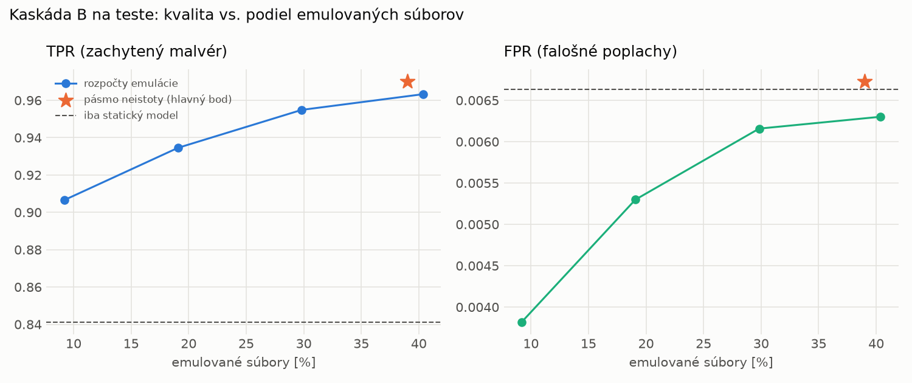

# Kaskáda B `b_direct` – beh `20261123-191729`

> Generované `src/cascade/evaluate_b.py` (2026-11-23T19:17:29+01:00). Seedy: [0, 1, 2]; hodnoty = priemer ± sm. odchýlka.
> Všetky prahy a pásmo neistoty sú z validácie; test sa na nič nenastavuje. Postup: `docs/09_plan_v2.md`.

| rola | beh |
|---|---|
| static | `runs_v4/real_p/lofo/BankBot/students_static/mlp_kd/20261123-191350` |
| hybrid | `runs_v4/real_p/lofo/BankBot/hybrid/lightgbm/20261123-191024` |

Druhý stupeň: **hybrid**. Pásmo neistoty statického modelu: FPR ≤ 0.1% nad `hi`,
najviac 1% malvéru validácie pod `lo` (seed 0: lo = 0.0065, hi = 0.9996, seed 1: lo = 0.0075, hi = 0.9998, seed 2: lo = 0.0052, hi = 0.9999).

## Test
| prístup | accuracy | balanced_accuracy | precision | recall_tpr | fpr | f1 | mcc |
|---|---|---|---|---|---|---|---|
| kaskáda B | 0.9829 ± 0.0006 | 0.9817 ± 0.0006 | 0.9915 ± 0.0003 | 0.9702 ± 0.0011 | 0.0067 ± 0.0002 | 0.9808 ± 0.0006 | 0.9656 ± 0.0011 |
| statický | 0.9252 ± 0.0046 | 0.9173 ± 0.0052 | 0.9904 ± 0.0008 | 0.8412 ± 0.0110 | 0.0066 ± 0.0006 | 0.9097 ± 0.0062 | 0.8548 ± 0.0085 |
| hybrid (každá vzorka) | 0.9839 ± 0.0007 | 0.9828 ± 0.0008 | 0.9912 ± 0.0002 | 0.9726 ± 0.0017 | 0.0070 ± 0.0001 | 0.9818 ± 0.0008 | 0.9674 ± 0.0015 |

- **emulované súbory: 38.99%** (ostatné rozhodne iba statický model); na hybrid ide 38.99% súborov
- chyby pri istom rozhodnutí statického modelu (seed 0): 46
- validácia: emulované 38.92%, na hybrid 38.92%

## Validácia
| prístup | accuracy | balanced_accuracy | precision | recall_tpr | fpr | f1 | mcc |
|---|---|---|---|---|---|---|---|
| kaskáda B | 0.9804 ± 0.0008 | 0.9789 ± 0.0008 | 0.9881 ± 0.0006 | 0.9668 ± 0.0013 | 0.0091 ± 0.0004 | 0.9773 ± 0.0009 | 0.9602 ± 0.0016 |
| statický | 0.9183 ± 0.0064 | 0.9079 ± 0.0073 | 0.9850 ± 0.0003 | 0.8256 ± 0.0146 | 0.0097 ± 0.0000 | 0.8983 ± 0.0087 | 0.8400 ± 0.0119 |
| hybrid (každá vzorka) | 0.9815 ± 0.0007 | 0.9802 ± 0.0008 | 0.9876 ± 0.0000 | 0.9699 ± 0.0015 | 0.0095 ± 0.0000 | 0.9786 ± 0.0008 | 0.9625 ± 0.0014 |

## Januárové vzorky vynechanej rodiny (iba malvér → TPR)
| prístup | TPR |
|---|---|
| kaskáda B | 0.9926 ± 0.0006 |
| statický | 0.9641 ± 0.0155 |
| hybrid (každá vzorka) | 0.9942 ± 0.0006 |

Podiel emulovaných: 31.40%

## Krivka rozpočtu emulácie (test, priemer cez seedy)
| budget_val | emulation_rate | hybrid_rate | recall_tpr | fpr | f1 |
|---|---|---|---|---|---|
| 0.1000 | 0.0919 | 0.0919 | 0.9066 | 0.0038 | 0.9486 |
| 0.2000 | 0.1907 | 0.1907 | 0.9345 | 0.0053 | 0.9629 |
| 0.3000 | 0.2983 | 0.2983 | 0.9549 | 0.0062 | 0.9731 |
| 0.4000 | 0.4036 | 0.4036 | 0.9633 | 0.0063 | 0.9774 |

## Výpočtové nároky
Čas dynamickej analýzy (beh v emulátore alebo na zariadení) dataset neuvádza, preto sa neodhaduje. Úspora kaskády B = podiel súborov s dynamickou analýzou: **38.99%** (ostatné prístupy 100 %).

_Chýba benchmark niektorého komponentu (v zero-day behoch sa nemeria)._

