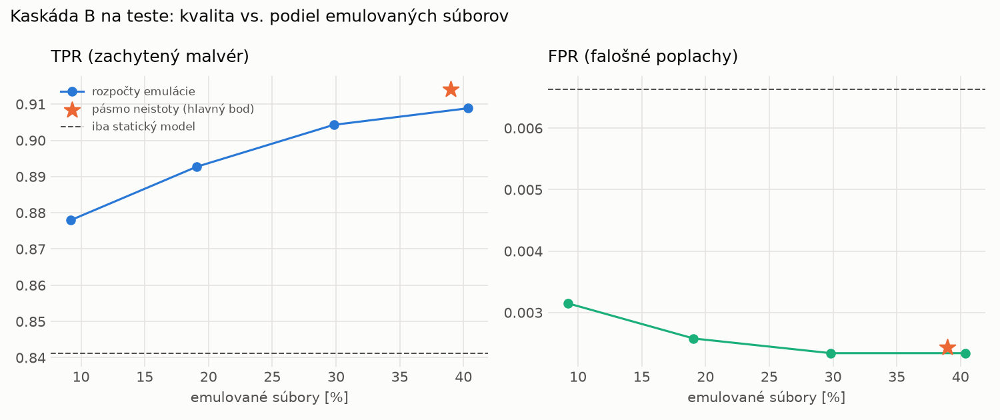

# Kaskáda B `b_heavy` – beh `20261123-191731`

> Generované `src/cascade/evaluate_b.py` (2026-11-23T19:17:31+01:00). Seedy: [0, 1, 2]; hodnoty = priemer ± sm. odchýlka.
> Všetky prahy a pásmo neistoty sú z validácie; test sa na nič nenastavuje. Postup: `docs/09_plan_v2.md`.

| rola | beh |
|---|---|
| static | `runs_v4/real_p/lofo/BankBot/students_static/mlp_kd/20261123-191350` |
| dynamic | `runs_v4/real_p/lofo/BankBot/students_dynamic/mlp_kd/20261123-191512` |
| hybrid | `runs_v4/real_p/lofo/BankBot/hybrid/mlp_large/20261123-191049` |

Druhý stupeň: **dynamic**. Pásmo neistoty statického modelu: FPR ≤ 0.1% nad `hi`,
najviac 1% malvéru validácie pod `lo` (seed 0: lo = 0.0065, hi = 0.9996, seed 1: lo = 0.0075, hi = 0.9998, seed 2: lo = 0.0052, hi = 0.9999).

## Test
| prístup | accuracy | balanced_accuracy | precision | recall_tpr | fpr | f1 | mcc |
|---|---|---|---|---|---|---|---|
| kaskáda B | 0.9602 ± 0.0017 | 0.9559 ± 0.0019 | 0.9967 ± 0.0002 | 0.9142 ± 0.0037 | 0.0024 ± 0.0001 | 0.9537 ± 0.0021 | 0.9215 ± 0.0033 |
| statický | 0.9252 ± 0.0046 | 0.9173 ± 0.0052 | 0.9904 ± 0.0008 | 0.8412 ± 0.0110 | 0.0066 ± 0.0006 | 0.9097 ± 0.0062 | 0.8548 ± 0.0085 |
| dynamický | 0.8708 ± 0.0052 | 0.8570 ± 0.0059 | 0.9838 ± 0.0005 | 0.7237 ± 0.0122 | 0.0097 ± 0.0005 | 0.8339 ± 0.0080 | 0.7553 ± 0.0091 |
| hybrid (každá vzorka) | 0.9715 ± 0.0011 | 0.9690 ± 0.0011 | 0.9912 ± 0.0019 | 0.9448 ± 0.0017 | 0.0068 ± 0.0015 | 0.9675 ± 0.0012 | 0.9430 ± 0.0022 |

- **emulované súbory: 38.99%** (ostatné rozhodne iba statický model); na hybrid ide 8.98% súborov
- chyby pri istom rozhodnutí statického modelu (seed 0): 46
- validácia: emulované 38.92%, na hybrid 9.65%

## Validácia
| prístup | accuracy | balanced_accuracy | precision | recall_tpr | fpr | f1 | mcc |
|---|---|---|---|---|---|---|---|
| kaskáda B | 0.9563 ± 0.0018 | 0.9507 ± 0.0019 | 0.9933 ± 0.0010 | 0.9062 ± 0.0033 | 0.0048 ± 0.0007 | 0.9478 ± 0.0022 | 0.9132 ± 0.0035 |
| statický | 0.9183 ± 0.0064 | 0.9079 ± 0.0073 | 0.9850 ± 0.0003 | 0.8256 ± 0.0146 | 0.0097 ± 0.0000 | 0.8983 ± 0.0087 | 0.8400 ± 0.0119 |
| dynamický | 0.8718 ± 0.0056 | 0.8547 ± 0.0064 | 0.9828 ± 0.0003 | 0.7192 ± 0.0127 | 0.0097 ± 0.0000 | 0.8306 ± 0.0086 | 0.7545 ± 0.0100 |
| hybrid (každá vzorka) | 0.9685 ± 0.0014 | 0.9654 ± 0.0016 | 0.9868 ± 0.0000 | 0.9406 ± 0.0032 | 0.0097 ± 0.0000 | 0.9631 ± 0.0017 | 0.9365 ± 0.0027 |

## Januárové vzorky vynechanej rodiny (iba malvér → TPR)
| prístup | TPR |
|---|---|
| kaskáda B | 0.9770 ± 0.0110 |
| statický | 0.9641 ± 0.0155 |
| dynamický | 0.7303 ± 0.0650 |
| hybrid (každá vzorka) | 0.9831 ± 0.0102 |

Podiel emulovaných: 31.40%

## Krivka rozpočtu emulácie (test, priemer cez seedy)
| budget_val | emulation_rate | hybrid_rate | recall_tpr | fpr | f1 |
|---|---|---|---|---|---|
| 0.1000 | 0.0919 | 0.0412 | 0.8780 | 0.0032 | 0.9331 |
| 0.2000 | 0.1907 | 0.0711 | 0.8927 | 0.0026 | 0.9417 |
| 0.3000 | 0.2983 | 0.0931 | 0.9043 | 0.0023 | 0.9483 |
| 0.4000 | 0.4036 | 0.1071 | 0.9089 | 0.0023 | 0.9508 |

## Výpočtové nároky
Čas dynamickej analýzy (beh v emulátore alebo na zariadení) dataset neuvádza, preto sa neodhaduje. Úspora kaskády B = podiel súborov s dynamickou analýzou: **38.99%** (ostatné prístupy 100 %).

_Chýba benchmark niektorého komponentu (v zero-day behoch sa nemeria)._

