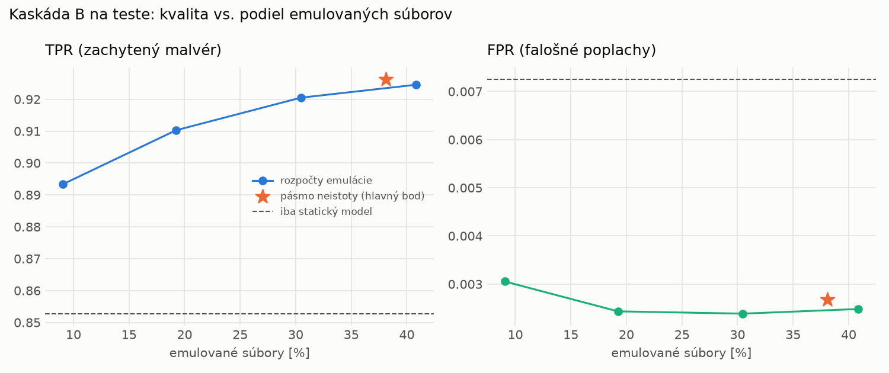

# Kaskáda B `b_heavyteacher` – beh `20261123-191737`

> Generované `src/cascade/evaluate_b.py` (2026-11-23T19:17:37+01:00). Seedy: [0, 1, 2]; hodnoty = priemer ± sm. odchýlka.
> Všetky prahy a pásmo neistoty sú z validácie; test sa na nič nenastavuje. Postup: `docs/09_plan_v2.md`.

| rola | beh |
|---|---|
| static | `runs_v4/real_p/lofo/BankBot/students_static/mlp_kd_heavy/20261123-191459` |
| dynamic | `runs_v4/real_p/lofo/BankBot/students_dynamic/mlp_kd_heavy/20261123-191652` |
| hybrid | `runs_v4/real_p/lofo/BankBot/hybrid/lightgbm/20261123-191024` |

Druhý stupeň: **dynamic**. Pásmo neistoty statického modelu: FPR ≤ 0.1% nad `hi`,
najviac 1% malvéru validácie pod `lo` (seed 0: lo = 0.0297, hi = 0.9995, seed 1: lo = 0.0390, hi = 0.9964, seed 2: lo = 0.0281, hi = 0.9993).

## Test
| prístup | accuracy | balanced_accuracy | precision | recall_tpr | fpr | f1 | mcc |
|---|---|---|---|---|---|---|---|
| kaskáda B | 0.9655 ± 0.0008 | 0.9618 ± 0.0009 | 0.9965 ± 0.0001 | 0.9263 ± 0.0017 | 0.0027 ± 0.0001 | 0.9601 ± 0.0009 | 0.9317 ± 0.0015 |
| statický | 0.9300 ± 0.0021 | 0.9227 ± 0.0023 | 0.9896 ± 0.0006 | 0.8528 ± 0.0044 | 0.0073 ± 0.0004 | 0.9161 ± 0.0027 | 0.8636 ± 0.0040 |
| dynamický | 0.8684 ± 0.0033 | 0.8543 ± 0.0037 | 0.9845 ± 0.0009 | 0.7177 ± 0.0081 | 0.0092 ± 0.0006 | 0.8302 ± 0.0051 | 0.7512 ± 0.0056 |
| hybrid (každá vzorka) | 0.9839 ± 0.0007 | 0.9828 ± 0.0008 | 0.9912 ± 0.0002 | 0.9726 ± 0.0017 | 0.0070 ± 0.0001 | 0.9818 ± 0.0008 | 0.9674 ± 0.0015 |

- **emulované súbory: 38.09%** (ostatné rozhodne iba statický model); na hybrid ide 8.39% súborov
- chyby pri istom rozhodnutí statického modelu (seed 0): 44
- validácia: emulované 37.72%, na hybrid 9.38%

## Validácia
| prístup | accuracy | balanced_accuracy | precision | recall_tpr | fpr | f1 | mcc |
|---|---|---|---|---|---|---|---|
| kaskáda B | 0.9637 ± 0.0003 | 0.9591 ± 0.0004 | 0.9936 ± 0.0004 | 0.9228 ± 0.0011 | 0.0046 ± 0.0003 | 0.9569 ± 0.0004 | 0.9275 ± 0.0006 |
| statický | 0.9212 ± 0.0028 | 0.9113 ± 0.0033 | 0.9851 ± 0.0001 | 0.8323 ± 0.0065 | 0.0097 ± 0.0000 | 0.9023 ± 0.0039 | 0.8454 ± 0.0053 |
| dynamický | 0.8699 ± 0.0048 | 0.8525 ± 0.0055 | 0.9827 ± 0.0003 | 0.7148 ± 0.0109 | 0.0097 ± 0.0000 | 0.8276 ± 0.0074 | 0.7510 ± 0.0086 |
| hybrid (každá vzorka) | 0.9815 ± 0.0007 | 0.9802 ± 0.0008 | 0.9876 ± 0.0000 | 0.9699 ± 0.0015 | 0.0095 ± 0.0000 | 0.9786 ± 0.0008 | 0.9625 ± 0.0014 |

## Januárové vzorky vynechanej rodiny (iba malvér → TPR)
| prístup | TPR |
|---|---|
| kaskáda B | 0.9871 ± 0.0012 |
| statický | 0.9817 ± 0.0010 |
| dynamický | 0.6958 ± 0.0148 |
| hybrid (každá vzorka) | 0.9942 ± 0.0006 |

Podiel emulovaných: 26.13%

## Krivka rozpočtu emulácie (test, priemer cez seedy)
| budget_val | emulation_rate | hybrid_rate | recall_tpr | fpr | f1 |
|---|---|---|---|---|---|
| 0.1000 | 0.0905 | 0.0399 | 0.8934 | 0.0031 | 0.9418 |
| 0.2000 | 0.1923 | 0.0701 | 0.9103 | 0.0024 | 0.9515 |
| 0.3000 | 0.3047 | 0.0844 | 0.9205 | 0.0024 | 0.9571 |
| 0.4000 | 0.4084 | 0.0959 | 0.9246 | 0.0025 | 0.9593 |

## Výpočtové nároky
Čas dynamickej analýzy (beh v emulátore alebo na zariadení) dataset neuvádza, preto sa neodhaduje. Úspora kaskády B = podiel súborov s dynamickou analýzou: **38.09%** (ostatné prístupy 100 %).

_Chýba benchmark niektorého komponentu (v zero-day behoch sa nemeria)._

