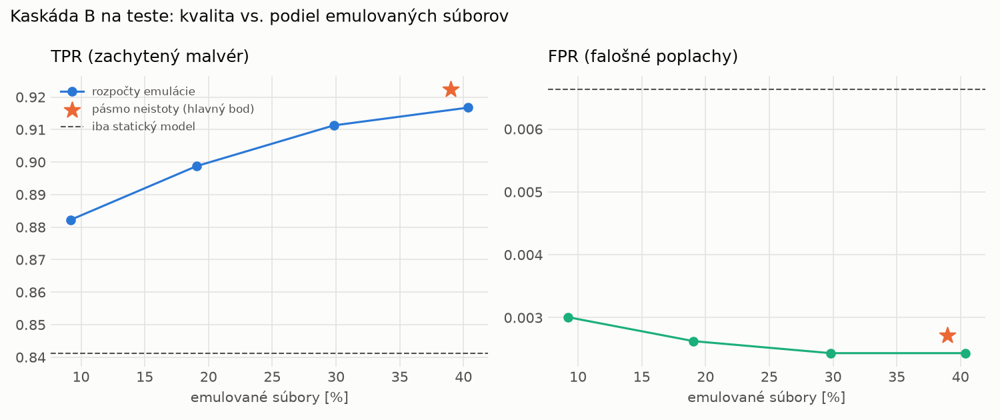

# Kaskáda B `b_main` – beh `20261123-191727`

> Generované `src/cascade/evaluate_b.py` (2026-11-23T19:17:28+01:00). Seedy: [0, 1, 2]; hodnoty = priemer ± sm. odchýlka.
> Všetky prahy a pásmo neistoty sú z validácie; test sa na nič nenastavuje. Postup: `docs/09_plan_v2.md`.

| rola | beh |
|---|---|
| static | `runs_v4/real_p/lofo/BankBot/students_static/mlp_kd/20261123-191350` |
| dynamic | `runs_v4/real_p/lofo/BankBot/students_dynamic/mlp_kd/20261123-191512` |
| hybrid | `runs_v4/real_p/lofo/BankBot/hybrid/lightgbm/20261123-191024` |

Druhý stupeň: **dynamic**. Pásmo neistoty statického modelu: FPR ≤ 0.1% nad `hi`,
najviac 1% malvéru validácie pod `lo` (seed 0: lo = 0.0065, hi = 0.9996, seed 1: lo = 0.0075, hi = 0.9998, seed 2: lo = 0.0052, hi = 0.9999).

## Test
| prístup | accuracy | balanced_accuracy | precision | recall_tpr | fpr | f1 | mcc |
|---|---|---|---|---|---|---|---|
| kaskáda B | 0.9637 ± 0.0023 | 0.9599 ± 0.0026 | 0.9964 ± 0.0003 | 0.9224 ± 0.0052 | 0.0027 ± 0.0002 | 0.9580 ± 0.0028 | 0.9283 ± 0.0045 |
| statický | 0.9252 ± 0.0046 | 0.9173 ± 0.0052 | 0.9904 ± 0.0008 | 0.8412 ± 0.0110 | 0.0066 ± 0.0006 | 0.9097 ± 0.0062 | 0.8548 ± 0.0085 |
| dynamický | 0.8708 ± 0.0052 | 0.8570 ± 0.0059 | 0.9838 ± 0.0005 | 0.7237 ± 0.0122 | 0.0097 ± 0.0005 | 0.8339 ± 0.0080 | 0.7553 ± 0.0091 |
| hybrid (každá vzorka) | 0.9839 ± 0.0007 | 0.9828 ± 0.0008 | 0.9912 ± 0.0002 | 0.9726 ± 0.0017 | 0.0070 ± 0.0001 | 0.9818 ± 0.0008 | 0.9674 ± 0.0015 |

- **emulované súbory: 38.99%** (ostatné rozhodne iba statický model); na hybrid ide 8.98% súborov
- chyby pri istom rozhodnutí statického modelu (seed 0): 46
- validácia: emulované 38.92%, na hybrid 9.65%

## Validácia
| prístup | accuracy | balanced_accuracy | precision | recall_tpr | fpr | f1 | mcc |
|---|---|---|---|---|---|---|---|
| kaskáda B | 0.9615 ± 0.0027 | 0.9565 ± 0.0031 | 0.9951 ± 0.0009 | 0.9165 ± 0.0055 | 0.0035 ± 0.0006 | 0.9541 ± 0.0034 | 0.9234 ± 0.0054 |
| statický | 0.9183 ± 0.0064 | 0.9079 ± 0.0073 | 0.9850 ± 0.0003 | 0.8256 ± 0.0146 | 0.0097 ± 0.0000 | 0.8983 ± 0.0087 | 0.8400 ± 0.0119 |
| dynamický | 0.8718 ± 0.0056 | 0.8547 ± 0.0064 | 0.9828 ± 0.0003 | 0.7192 ± 0.0127 | 0.0097 ± 0.0000 | 0.8306 ± 0.0086 | 0.7545 ± 0.0100 |
| hybrid (každá vzorka) | 0.9815 ± 0.0007 | 0.9802 ± 0.0008 | 0.9876 ± 0.0000 | 0.9699 ± 0.0015 | 0.0095 ± 0.0000 | 0.9786 ± 0.0008 | 0.9625 ± 0.0014 |

## Januárové vzorky vynechanej rodiny (iba malvér → TPR)
| prístup | TPR |
|---|---|
| kaskáda B | 0.9800 ± 0.0098 |
| statický | 0.9641 ± 0.0155 |
| dynamický | 0.7303 ± 0.0650 |
| hybrid (každá vzorka) | 0.9942 ± 0.0006 |

Podiel emulovaných: 31.40%

## Krivka rozpočtu emulácie (test, priemer cez seedy)
| budget_val | emulation_rate | hybrid_rate | recall_tpr | fpr | f1 |
|---|---|---|---|---|---|
| 0.1000 | 0.0919 | 0.0412 | 0.8822 | 0.0030 | 0.9356 |
| 0.2000 | 0.1907 | 0.0711 | 0.8988 | 0.0026 | 0.9451 |
| 0.3000 | 0.2983 | 0.0931 | 0.9113 | 0.0024 | 0.9521 |
| 0.4000 | 0.4036 | 0.1071 | 0.9167 | 0.0024 | 0.9551 |

## Výpočtové nároky
Čas dynamickej analýzy (beh v emulátore alebo na zariadení) dataset neuvádza, preto sa neodhaduje. Úspora kaskády B = podiel súborov s dynamickou analýzou: **38.99%** (ostatné prístupy 100 %).

_Chýba benchmark niektorého komponentu (v zero-day behoch sa nemeria)._

