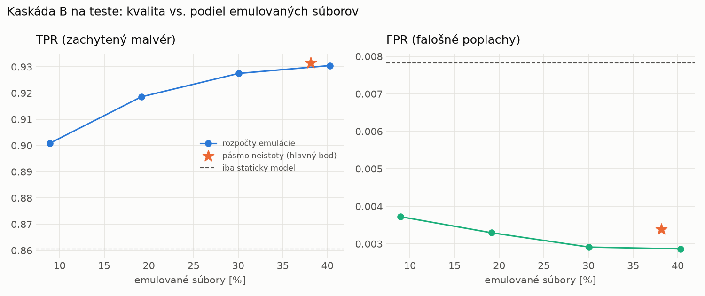

# Kaskáda B `b_nokd` – beh `20261123-191735`

> Generované `src/cascade/evaluate_b.py` (2026-11-23T19:17:35+01:00). Seedy: [0, 1, 2]; hodnoty = priemer ± sm. odchýlka.
> Všetky prahy a pásmo neistoty sú z validácie; test sa na nič nenastavuje. Postup: `docs/09_plan_v2.md`.

| rola | beh |
|---|---|
| static | `runs_v4/real_p/lofo/BankBot/students_static/mlp_nokd/20261123-191409` |
| dynamic | `runs_v4/real_p/lofo/BankBot/students_dynamic/mlp_nokd/20261123-191529` |
| hybrid | `runs_v4/real_p/lofo/BankBot/hybrid/lightgbm/20261123-191024` |

Druhý stupeň: **dynamic**. Pásmo neistoty statického modelu: FPR ≤ 0.1% nad `hi`,
najviac 1% malvéru validácie pod `lo` (seed 0: lo = 0.0352, hi = 0.9998, seed 1: lo = 0.0249, hi = 0.9956, seed 2: lo = 0.0434, hi = 0.9982).

## Test
| prístup | accuracy | balanced_accuracy | precision | recall_tpr | fpr | f1 | mcc |
|---|---|---|---|---|---|---|---|
| kaskáda B | 0.9674 ± 0.0023 | 0.9641 ± 0.0025 | 0.9955 ± 0.0004 | 0.9315 ± 0.0051 | 0.0034 ± 0.0003 | 0.9625 ± 0.0027 | 0.9354 ± 0.0044 |
| statický | 0.9332 ± 0.0035 | 0.9264 ± 0.0039 | 0.9889 ± 0.0012 | 0.8606 ± 0.0082 | 0.0078 ± 0.0009 | 0.9203 ± 0.0045 | 0.8694 ± 0.0064 |
| dynamický | 0.8680 ± 0.0042 | 0.8537 ± 0.0047 | 0.9854 ± 0.0007 | 0.7161 ± 0.0100 | 0.0086 ± 0.0005 | 0.8294 ± 0.0065 | 0.7507 ± 0.0072 |
| hybrid (každá vzorka) | 0.9839 ± 0.0007 | 0.9828 ± 0.0008 | 0.9912 ± 0.0002 | 0.9726 ± 0.0017 | 0.0070 ± 0.0001 | 0.9818 ± 0.0008 | 0.9674 ± 0.0015 |

- **emulované súbory: 38.15%** (ostatné rozhodne iba statický model); na hybrid ide 8.13% súborov
- chyby pri istom rozhodnutí statického modelu (seed 0): 50
- validácia: emulované 38.45%, na hybrid 8.94%

## Validácia
| prístup | accuracy | balanced_accuracy | precision | recall_tpr | fpr | f1 | mcc |
|---|---|---|---|---|---|---|---|
| kaskáda B | 0.9664 ± 0.0025 | 0.9623 ± 0.0029 | 0.9938 ± 0.0002 | 0.9290 ± 0.0060 | 0.0045 ± 0.0002 | 0.9603 ± 0.0031 | 0.9329 ± 0.0049 |
| statický | 0.9290 ± 0.0070 | 0.9202 ± 0.0080 | 0.9859 ± 0.0005 | 0.8498 ± 0.0161 | 0.0095 ± 0.0003 | 0.9127 ± 0.0094 | 0.8602 ± 0.0132 |
| dynamický | 0.8714 ± 0.0046 | 0.8542 ± 0.0053 | 0.9828 ± 0.0003 | 0.7182 ± 0.0106 | 0.0097 ± 0.0000 | 0.8299 ± 0.0072 | 0.7537 ± 0.0084 |
| hybrid (každá vzorka) | 0.9815 ± 0.0007 | 0.9802 ± 0.0008 | 0.9876 ± 0.0000 | 0.9699 ± 0.0015 | 0.0095 ± 0.0000 | 0.9786 ± 0.0008 | 0.9625 ± 0.0014 |

## Januárové vzorky vynechanej rodiny (iba malvér → TPR)
| prístup | TPR |
|---|---|
| kaskáda B | 0.9888 ± 0.0018 |
| statický | 0.9834 ± 0.0036 |
| dynamický | 0.6565 ± 0.0086 |
| hybrid (každá vzorka) | 0.9942 ± 0.0006 |

Podiel emulovaných: 24.57%

## Krivka rozpočtu emulácie (test, priemer cez seedy)
| budget_val | emulation_rate | hybrid_rate | recall_tpr | fpr | f1 |
|---|---|---|---|---|---|
| 0.1000 | 0.0892 | 0.0400 | 0.9009 | 0.0037 | 0.9456 |
| 0.2000 | 0.1916 | 0.0663 | 0.9186 | 0.0033 | 0.9555 |
| 0.3000 | 0.3006 | 0.0841 | 0.9275 | 0.0029 | 0.9606 |
| 0.4000 | 0.4029 | 0.0925 | 0.9305 | 0.0029 | 0.9622 |

## Výpočtové nároky
Čas dynamickej analýzy (beh v emulátore alebo na zariadení) dataset neuvádza, preto sa neodhaduje. Úspora kaskády B = podiel súborov s dynamickou analýzou: **38.15%** (ostatné prístupy 100 %).

_Chýba benchmark niektorého komponentu (v zero-day behoch sa nemeria)._

