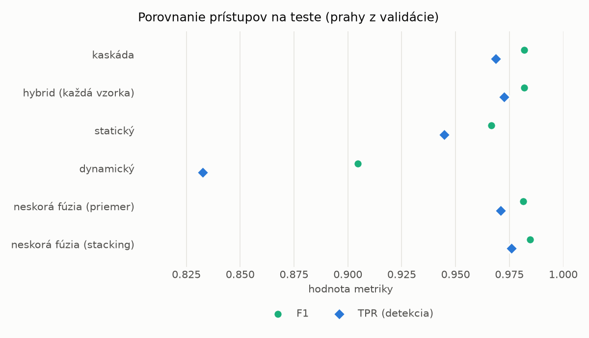
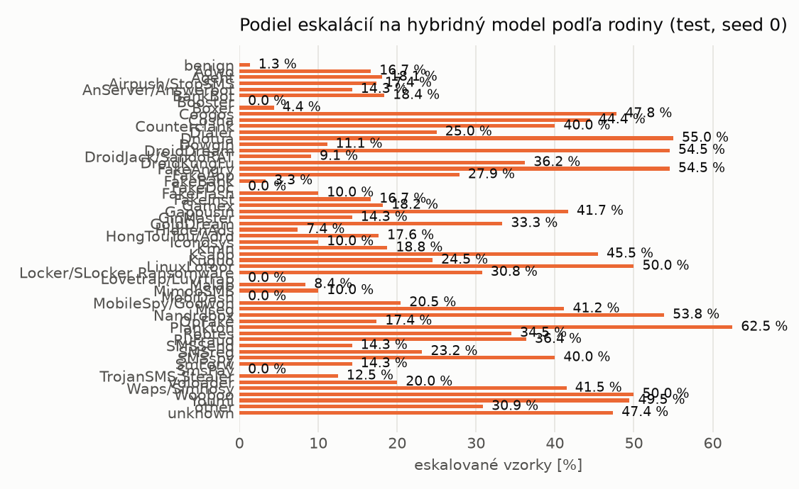

# Kaskáda `baselines` – beh `20261123-191723`

> Generované `src/cascade/evaluate.py` (2026-11-23T19:17:23+01:00). Seedy: [0, 1, 2]; hodnoty = priemer ± sm. odchýlka.
> Všetky prahy sú určené na validácii (FPR ≤ 1 %); test sa na nič nenastavuje.

| rola | beh |
|---|---|
| static | `runs_v4/real_p/lofo/BankBot/static/lightgbm/20261123-190600` |
| dynamic | `runs_v4/real_p/lofo/BankBot/dynamic/lightgbm/20261123-190812` |
| hybrid | `runs_v4/real_p/lofo/BankBot/hybrid/lightgbm/20261123-191024` |

## Test
| prístup | accuracy | balanced_accuracy | precision | recall_tpr | fpr | f1 | mcc |
|---|---|---|---|---|---|---|---|
| kaskáda | 0.9841 ± 0.0002 | 0.9826 ± 0.0002 | 0.9956 ± 0.0005 | 0.9687 ± 0.0007 | 0.0035 ± 0.0004 | 0.9820 ± 0.0002 | 0.9680 ± 0.0004 |
| hybrid (každá vzorka) | 0.9839 ± 0.0007 | 0.9828 ± 0.0008 | 0.9912 ± 0.0002 | 0.9726 ± 0.0017 | 0.0070 ± 0.0001 | 0.9818 ± 0.0008 | 0.9674 ± 0.0015 |
| statický | 0.9708 ± 0.0013 | 0.9683 ± 0.0015 | 0.9897 ± 0.0007 | 0.9447 ± 0.0033 | 0.0080 ± 0.0006 | 0.9667 ± 0.0016 | 0.9415 ± 0.0026 |
| dynamický | 0.9213 ± 0.0012 | 0.9130 ± 0.0014 | 0.9904 ± 0.0012 | 0.8325 ± 0.0032 | 0.0066 ± 0.0009 | 0.9046 ± 0.0017 | 0.8476 ± 0.0022 |
| neskorá fúzia (priemer) | 0.9836 ± 0.0011 | 0.9824 ± 0.0013 | 0.9922 ± 0.0011 | 0.9710 ± 0.0034 | 0.0062 ± 0.0009 | 0.9815 ± 0.0012 | 0.9669 ± 0.0021 |
| neskorá fúzia (stacking) | 0.9863 ± 0.0001 | 0.9853 ± 0.0002 | 0.9934 ± 0.0009 | 0.9759 ± 0.0011 | 0.0053 ± 0.0007 | 0.9846 ± 0.0001 | 0.9724 ± 0.0002 |

## Validácia
| prístup | accuracy | balanced_accuracy | precision | recall_tpr | fpr | f1 | mcc |
|---|---|---|---|---|---|---|---|
| kaskáda | 0.9817 ± 0.0005 | 0.9798 ± 0.0006 | 0.9935 ± 0.0007 | 0.9644 ± 0.0009 | 0.0049 ± 0.0005 | 0.9788 ± 0.0006 | 0.9630 ± 0.0011 |
| hybrid (každá vzorka) | 0.9815 ± 0.0007 | 0.9802 ± 0.0008 | 0.9876 ± 0.0000 | 0.9699 ± 0.0015 | 0.0095 ± 0.0000 | 0.9786 ± 0.0008 | 0.9625 ± 0.0014 |
| statický | 0.9699 ± 0.0018 | 0.9669 ± 0.0021 | 0.9870 ± 0.0002 | 0.9435 ± 0.0041 | 0.0096 ± 0.0002 | 0.9648 ± 0.0022 | 0.9392 ± 0.0036 |
| dynamický | 0.9217 ± 0.0023 | 0.9119 ± 0.0026 | 0.9853 ± 0.0003 | 0.8334 ± 0.0052 | 0.0096 ± 0.0002 | 0.9030 ± 0.0031 | 0.8465 ± 0.0043 |
| neskorá fúzia (priemer) | 0.9804 ± 0.0021 | 0.9789 ± 0.0024 | 0.9873 ± 0.0002 | 0.9675 ± 0.0048 | 0.0096 ± 0.0002 | 0.9773 ± 0.0025 | 0.9602 ± 0.0043 |
| neskorá fúzia (stacking) | 0.9839 ± 0.0004 | 0.9829 ± 0.0004 | 0.9882 ± 0.0009 | 0.9749 ± 0.0011 | 0.0091 ± 0.0007 | 0.9815 ± 0.0005 | 0.9673 ± 0.0008 |

## Správanie kaskády (test, seed 0)
- podiel eskalácií na hybrid: **8.90%** (1127 vzoriek)
- chyby pri zhode študentov (kaskáda ich nemôže opraviť): **104**
  (0.902% zo zhôd; FP 3, FN 101)
- úspešnosť na eskalovaných vzorkách: hybrid 0.9112688553682342, statický 0.7799467613132209,
  dynamický 0.22005323868677906  → prínos hybridu pri nezhode

## Výpočtové nároky (odhad z benchmarkov komponentov)
_Chýba benchmark niektorého komponentu (`python -m src.evaluation.benchmark`)._

