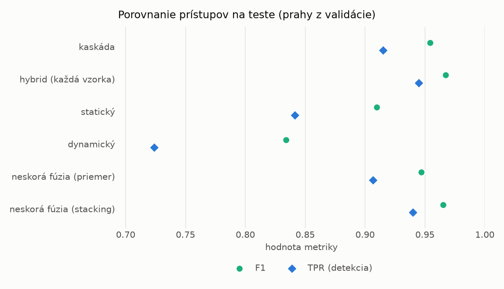
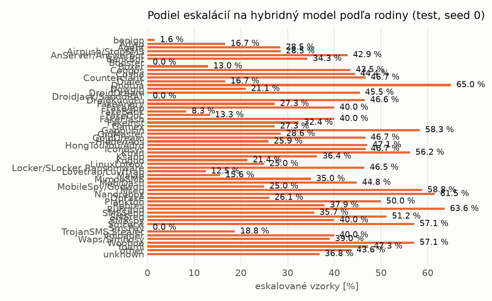

# Kaskáda `heavy` – beh `20261123-191721`

> Generované `src/cascade/evaluate.py` (2026-11-23T19:17:21+01:00). Seedy: [0, 1, 2]; hodnoty = priemer ± sm. odchýlka.
> Všetky prahy sú určené na validácii (FPR ≤ 1 %); test sa na nič nenastavuje.

| rola | beh |
|---|---|
| static | `runs_v4/real_p/lofo/BankBot/students_static/mlp_kd/20261123-191350` |
| dynamic | `runs_v4/real_p/lofo/BankBot/students_dynamic/mlp_kd/20261123-191512` |
| hybrid | `runs_v4/real_p/lofo/BankBot/hybrid/mlp_large/20261123-191049` |

## Test
| prístup | accuracy | balanced_accuracy | precision | recall_tpr | fpr | f1 | mcc |
|---|---|---|---|---|---|---|---|
| kaskáda | 0.9606 ± 0.0016 | 0.9563 ± 0.0018 | 0.9968 ± 0.0002 | 0.9150 ± 0.0033 | 0.0024 ± 0.0002 | 0.9541 ± 0.0019 | 0.9223 ± 0.0031 |
| hybrid (každá vzorka) | 0.9715 ± 0.0011 | 0.9690 ± 0.0011 | 0.9912 ± 0.0019 | 0.9448 ± 0.0017 | 0.0068 ± 0.0015 | 0.9675 ± 0.0012 | 0.9430 ± 0.0022 |
| statický | 0.9252 ± 0.0046 | 0.9173 ± 0.0052 | 0.9904 ± 0.0008 | 0.8412 ± 0.0110 | 0.0066 ± 0.0006 | 0.9097 ± 0.0062 | 0.8548 ± 0.0085 |
| dynamický | 0.8708 ± 0.0052 | 0.8570 ± 0.0059 | 0.9838 ± 0.0005 | 0.7237 ± 0.0122 | 0.0097 ± 0.0005 | 0.8339 ± 0.0080 | 0.7553 ± 0.0091 |
| neskorá fúzia (priemer) | 0.9544 ± 0.0019 | 0.9499 ± 0.0022 | 0.9908 ± 0.0006 | 0.9067 ± 0.0048 | 0.0068 ± 0.0005 | 0.9469 ± 0.0024 | 0.9098 ± 0.0037 |
| neskorá fúzia (stacking) | 0.9696 ± 0.0022 | 0.9668 ± 0.0025 | 0.9918 ± 0.0006 | 0.9399 ± 0.0053 | 0.0063 ± 0.0005 | 0.9652 ± 0.0026 | 0.9393 ± 0.0042 |

## Validácia
| prístup | accuracy | balanced_accuracy | precision | recall_tpr | fpr | f1 | mcc |
|---|---|---|---|---|---|---|---|
| kaskáda | 0.9567 ± 0.0014 | 0.9511 ± 0.0015 | 0.9935 ± 0.0008 | 0.9067 ± 0.0025 | 0.0046 ± 0.0006 | 0.9481 ± 0.0017 | 0.9139 ± 0.0027 |
| hybrid (každá vzorka) | 0.9685 ± 0.0014 | 0.9654 ± 0.0016 | 0.9868 ± 0.0000 | 0.9406 ± 0.0032 | 0.0097 ± 0.0000 | 0.9631 ± 0.0017 | 0.9365 ± 0.0027 |
| statický | 0.9183 ± 0.0064 | 0.9079 ± 0.0073 | 0.9850 ± 0.0003 | 0.8256 ± 0.0146 | 0.0097 ± 0.0000 | 0.8983 ± 0.0087 | 0.8400 ± 0.0119 |
| dynamický | 0.8718 ± 0.0056 | 0.8547 ± 0.0064 | 0.9828 ± 0.0003 | 0.7192 ± 0.0127 | 0.0097 ± 0.0000 | 0.8306 ± 0.0086 | 0.7545 ± 0.0100 |
| neskorá fúzia (priemer) | 0.9503 ± 0.0033 | 0.9445 ± 0.0037 | 0.9862 ± 0.0001 | 0.8987 ± 0.0075 | 0.0097 ± 0.0000 | 0.9404 ± 0.0042 | 0.9008 ± 0.0063 |
| neskorá fúzia (stacking) | 0.9661 ± 0.0019 | 0.9626 ± 0.0022 | 0.9868 ± 0.0001 | 0.9349 ± 0.0043 | 0.0097 ± 0.0000 | 0.9601 ± 0.0023 | 0.9317 ± 0.0037 |

## Správanie kaskády (test, seed 0)
- podiel eskalácií na hybrid: **13.99%** (1771 vzoriek)
- chyby pri zhode študentov (kaskáda ich nemôže opraviť): **400**
  (3.675% zo zhôd; FP 1, FN 399)
- úspešnosť na eskalovaných vzorkách: hybrid 0.9491812535290797, statický 0.6804065499717674,
  dynamický 0.31959345002823264  → prínos hybridu pri nezhode

## Výpočtové nároky (odhad z benchmarkov komponentov)
_Chýba benchmark niektorého komponentu (`python -m src.evaluation.benchmark`)._

