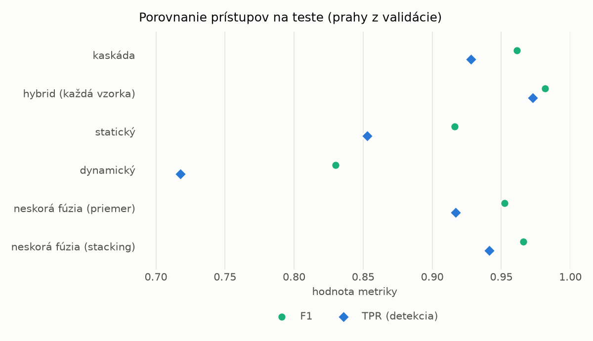
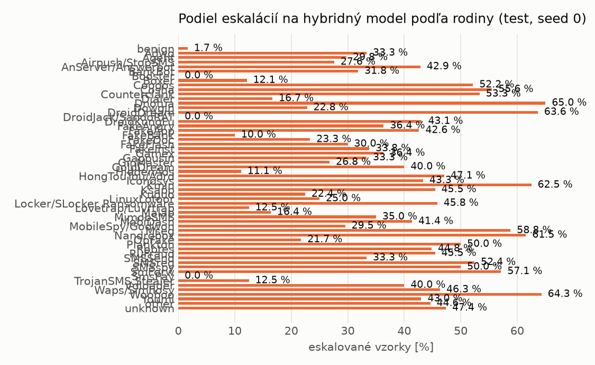

# Kaskáda `heavyteacher` – beh `20261123-191725`

> Generované `src/cascade/evaluate.py` (2026-11-23T19:17:26+01:00). Seedy: [0, 1, 2]; hodnoty = priemer ± sm. odchýlka.
> Všetky prahy sú určené na validácii (FPR ≤ 1 %); test sa na nič nenastavuje.

| rola | beh |
|---|---|
| static | `runs_v4/real_p/lofo/BankBot/students_static/mlp_kd_heavy/20261123-191459` |
| dynamic | `runs_v4/real_p/lofo/BankBot/students_dynamic/mlp_kd_heavy/20261123-191652` |
| hybrid | `runs_v4/real_p/lofo/BankBot/hybrid/lightgbm/20261123-191024` |

## Test
| prístup | accuracy | balanced_accuracy | precision | recall_tpr | fpr | f1 | mcc |
|---|---|---|---|---|---|---|---|
| kaskáda | 0.9664 ± 0.0004 | 0.9628 ± 0.0005 | 0.9968 ± 0.0002 | 0.9279 ± 0.0011 | 0.0024 ± 0.0002 | 0.9611 ± 0.0005 | 0.9334 ± 0.0009 |
| hybrid (každá vzorka) | 0.9839 ± 0.0007 | 0.9828 ± 0.0008 | 0.9912 ± 0.0002 | 0.9726 ± 0.0017 | 0.0070 ± 0.0001 | 0.9818 ± 0.0008 | 0.9674 ± 0.0015 |
| statický | 0.9300 ± 0.0021 | 0.9227 ± 0.0023 | 0.9896 ± 0.0006 | 0.8528 ± 0.0044 | 0.0073 ± 0.0004 | 0.9161 ± 0.0027 | 0.8636 ± 0.0040 |
| dynamický | 0.8684 ± 0.0033 | 0.8543 ± 0.0037 | 0.9845 ± 0.0009 | 0.7177 ± 0.0081 | 0.0092 ± 0.0006 | 0.8302 ± 0.0051 | 0.7512 ± 0.0056 |
| neskorá fúzia (priemer) | 0.9587 ± 0.0023 | 0.9548 ± 0.0026 | 0.9904 ± 0.0009 | 0.9168 ± 0.0055 | 0.0072 ± 0.0007 | 0.9522 ± 0.0028 | 0.9181 ± 0.0044 |
| neskorá fúzia (stacking) | 0.9702 ± 0.0005 | 0.9675 ± 0.0006 | 0.9918 ± 0.0007 | 0.9413 ± 0.0016 | 0.0063 ± 0.0006 | 0.9659 ± 0.0006 | 0.9405 ± 0.0010 |

## Validácia
| prístup | accuracy | balanced_accuracy | precision | recall_tpr | fpr | f1 | mcc |
|---|---|---|---|---|---|---|---|
| kaskáda | 0.9652 ± 0.0004 | 0.9608 ± 0.0005 | 0.9943 ± 0.0004 | 0.9257 ± 0.0013 | 0.0041 ± 0.0003 | 0.9588 ± 0.0005 | 0.9305 ± 0.0008 |
| hybrid (každá vzorka) | 0.9815 ± 0.0007 | 0.9802 ± 0.0008 | 0.9876 ± 0.0000 | 0.9699 ± 0.0015 | 0.0095 ± 0.0000 | 0.9786 ± 0.0008 | 0.9625 ± 0.0014 |
| statický | 0.9212 ± 0.0028 | 0.9113 ± 0.0033 | 0.9851 ± 0.0001 | 0.8323 ± 0.0065 | 0.0097 ± 0.0000 | 0.9023 ± 0.0039 | 0.8454 ± 0.0053 |
| dynamický | 0.8699 ± 0.0048 | 0.8525 ± 0.0055 | 0.9827 ± 0.0003 | 0.7148 ± 0.0109 | 0.0097 ± 0.0000 | 0.8276 ± 0.0074 | 0.7510 ± 0.0086 |
| neskorá fúzia (priemer) | 0.9561 ± 0.0022 | 0.9512 ± 0.0026 | 0.9864 ± 0.0001 | 0.9121 ± 0.0051 | 0.0097 ± 0.0000 | 0.9478 ± 0.0028 | 0.9121 ± 0.0044 |
| neskorá fúzia (stacking) | 0.9673 ± 0.0013 | 0.9640 ± 0.0015 | 0.9868 ± 0.0000 | 0.9377 ± 0.0031 | 0.0097 ± 0.0000 | 0.9616 ± 0.0016 | 0.9341 ± 0.0027 |

## Správanie kaskády (test, seed 0)
- podiel eskalácií na hybrid: **14.08%** (1782 vzoriek)
- chyby pri zhode študentov (kaskáda ich nemôže opraviť): **367**
  (3.375% zo zhôd; FP 1, FN 366)
- úspešnosť na eskalovaných vzorkách: hybrid 0.968013468013468, statický 0.7042648709315376,
  dynamický 0.2957351290684624  → prínos hybridu pri nezhode

## Výpočtové nároky (odhad z benchmarkov komponentov)
_Chýba benchmark niektorého komponentu (`python -m src.evaluation.benchmark`)._

