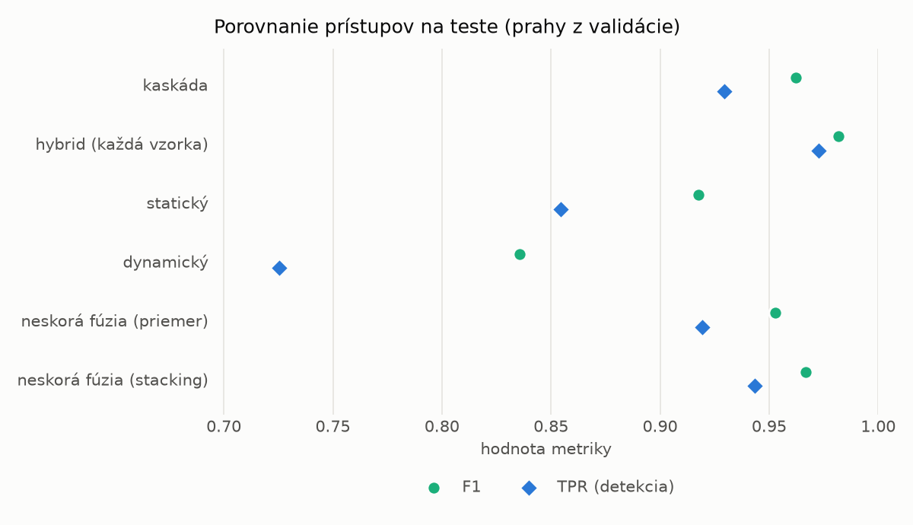
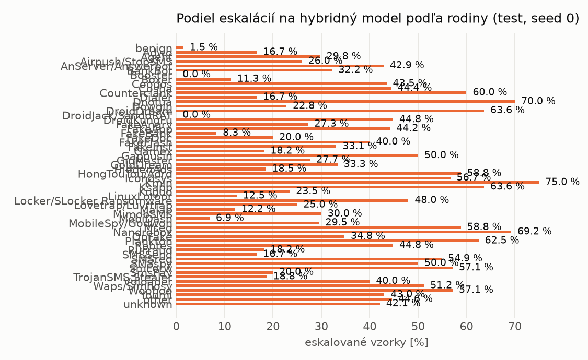

# Kaskáda `modal` – beh `20261123-191719`

> Generované `src/cascade/evaluate.py` (2026-11-23T19:17:19+01:00). Seedy: [0, 1, 2]; hodnoty = priemer ± sm. odchýlka.
> Všetky prahy sú určené na validácii (FPR ≤ 1 %); test sa na nič nenastavuje.

| rola | beh |
|---|---|
| static | `runs_v4/real_p/lofo/BankBot/students_static/mlp_kd_modal/20261123-191434` |
| dynamic | `runs_v4/real_p/lofo/BankBot/students_dynamic/mlp_kd_modal/20261123-191610` |
| hybrid | `runs_v4/real_p/lofo/BankBot/hybrid/lightgbm/20261123-191024` |

## Test
| prístup | accuracy | balanced_accuracy | precision | recall_tpr | fpr | f1 | mcc |
|---|---|---|---|---|---|---|---|
| kaskáda | 0.9672 ± 0.0019 | 0.9637 ± 0.0022 | 0.9972 ± 0.0003 | 0.9294 ± 0.0042 | 0.0021 ± 0.0002 | 0.9621 ± 0.0023 | 0.9351 ± 0.0038 |
| hybrid (každá vzorka) | 0.9839 ± 0.0007 | 0.9828 ± 0.0008 | 0.9912 ± 0.0002 | 0.9726 ± 0.0017 | 0.0070 ± 0.0001 | 0.9818 ± 0.0008 | 0.9674 ± 0.0015 |
| statický | 0.9312 ± 0.0044 | 0.9240 ± 0.0051 | 0.9905 ± 0.0016 | 0.8546 ± 0.0112 | 0.0066 ± 0.0012 | 0.9176 ± 0.0058 | 0.8660 ± 0.0080 |
| dynamický | 0.8719 ± 0.0040 | 0.8582 ± 0.0045 | 0.9849 ± 0.0005 | 0.7254 ± 0.0092 | 0.0090 ± 0.0004 | 0.8355 ± 0.0060 | 0.7576 ± 0.0069 |
| neskorá fúzia (priemer) | 0.9593 ± 0.0007 | 0.9556 ± 0.0008 | 0.9891 ± 0.0004 | 0.9194 ± 0.0012 | 0.0082 ± 0.0003 | 0.9530 ± 0.0008 | 0.9191 ± 0.0014 |
| neskorá fúzia (stacking) | 0.9711 ± 0.0012 | 0.9685 ± 0.0014 | 0.9915 ± 0.0010 | 0.9435 ± 0.0036 | 0.0066 ± 0.0008 | 0.9669 ± 0.0015 | 0.9421 ± 0.0023 |

## Validácia
| prístup | accuracy | balanced_accuracy | precision | recall_tpr | fpr | f1 | mcc |
|---|---|---|---|---|---|---|---|
| kaskáda | 0.9657 ± 0.0007 | 0.9614 ± 0.0008 | 0.9946 ± 0.0008 | 0.9267 ± 0.0017 | 0.0039 ± 0.0006 | 0.9594 ± 0.0009 | 0.9316 ± 0.0015 |
| hybrid (každá vzorka) | 0.9815 ± 0.0007 | 0.9802 ± 0.0008 | 0.9876 ± 0.0000 | 0.9699 ± 0.0015 | 0.0095 ± 0.0000 | 0.9786 ± 0.0008 | 0.9625 ± 0.0014 |
| statický | 0.9263 ± 0.0057 | 0.9171 ± 0.0065 | 0.9853 ± 0.0002 | 0.8440 ± 0.0130 | 0.0097 ± 0.0000 | 0.9092 ± 0.0076 | 0.8551 ± 0.0108 |
| dynamický | 0.8730 ± 0.0039 | 0.8561 ± 0.0045 | 0.9829 ± 0.0002 | 0.7220 ± 0.0090 | 0.0097 ± 0.0000 | 0.8325 ± 0.0060 | 0.7567 ± 0.0071 |
| neskorá fúzia (priemer) | 0.9562 ± 0.0019 | 0.9513 ± 0.0022 | 0.9864 ± 0.0001 | 0.9123 ± 0.0043 | 0.0097 ± 0.0000 | 0.9479 ± 0.0024 | 0.9122 ± 0.0037 |
| neskorá fúzia (stacking) | 0.9687 ± 0.0018 | 0.9656 ± 0.0021 | 0.9868 ± 0.0001 | 0.9409 ± 0.0041 | 0.0097 ± 0.0000 | 0.9633 ± 0.0022 | 0.9369 ± 0.0036 |

## Správanie kaskády (test, seed 0)
- podiel eskalácií na hybrid: **13.65%** (1728 vzoriek)
- chyby pri zhode študentov (kaskáda ich nemôže opraviť): **384**
  (3.514% zo zhôd; FP 0, FN 384)
- úspešnosť na eskalovaných vzorkách: hybrid 0.96875, statický 0.7129629629629629,
  dynamický 0.28703703703703703  → prínos hybridu pri nezhode

## Výpočtové nároky (odhad z benchmarkov komponentov)
_Chýba benchmark niektorého komponentu (`python -m src.evaluation.benchmark`)._

