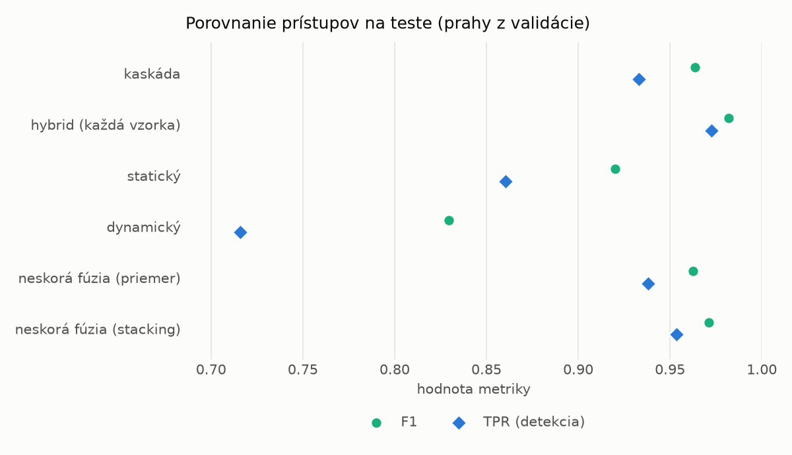
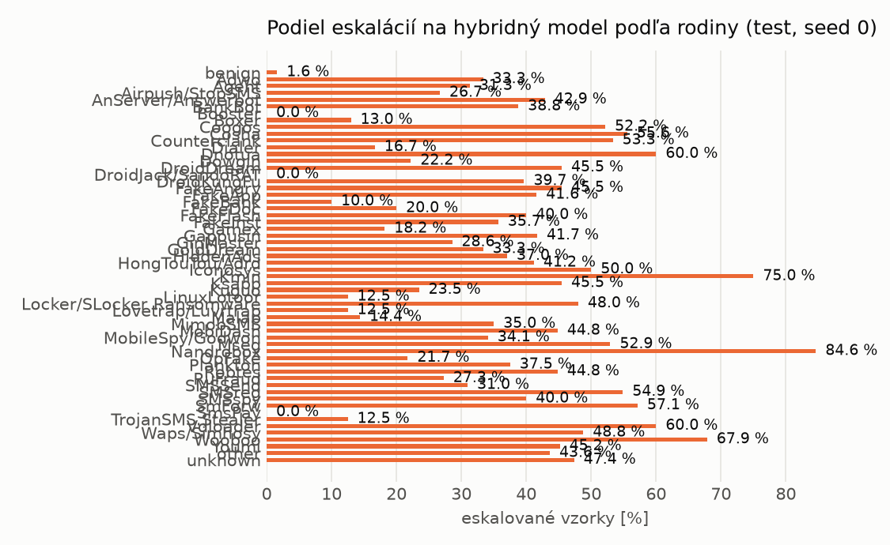

# Kaskáda `nokd` – beh `20261123-191716`

> Generované `src/cascade/evaluate.py` (2026-11-23T19:17:17+01:00). Seedy: [0, 1, 2]; hodnoty = priemer ± sm. odchýlka.
> Všetky prahy sú určené na validácii (FPR ≤ 1 %); test sa na nič nenastavuje.

| rola | beh |
|---|---|
| static | `runs_v4/real_p/lofo/BankBot/students_static/mlp_nokd/20261123-191409` |
| dynamic | `runs_v4/real_p/lofo/BankBot/students_dynamic/mlp_nokd/20261123-191529` |
| hybrid | `runs_v4/real_p/lofo/BankBot/hybrid/lightgbm/20261123-191024` |

## Test
| prístup | accuracy | balanced_accuracy | precision | recall_tpr | fpr | f1 | mcc |
|---|---|---|---|---|---|---|---|
| kaskáda | 0.9685 ± 0.0021 | 0.9652 ± 0.0024 | 0.9964 ± 0.0003 | 0.9331 ± 0.0051 | 0.0027 ± 0.0002 | 0.9637 ± 0.0026 | 0.9375 ± 0.0041 |
| hybrid (každá vzorka) | 0.9839 ± 0.0007 | 0.9828 ± 0.0008 | 0.9912 ± 0.0002 | 0.9726 ± 0.0017 | 0.0070 ± 0.0001 | 0.9818 ± 0.0008 | 0.9674 ± 0.0015 |
| statický | 0.9332 ± 0.0035 | 0.9264 ± 0.0039 | 0.9889 ± 0.0012 | 0.8606 ± 0.0082 | 0.0078 ± 0.0009 | 0.9203 ± 0.0045 | 0.8694 ± 0.0064 |
| dynamický | 0.8680 ± 0.0042 | 0.8537 ± 0.0047 | 0.9854 ± 0.0007 | 0.7161 ± 0.0100 | 0.0086 ± 0.0005 | 0.8294 ± 0.0065 | 0.7507 ± 0.0072 |
| neskorá fúzia (priemer) | 0.9674 ± 0.0018 | 0.9647 ± 0.0019 | 0.9887 ± 0.0009 | 0.9380 ± 0.0033 | 0.0087 ± 0.0006 | 0.9627 ± 0.0021 | 0.9348 ± 0.0035 |
| neskorá fúzia (stacking) | 0.9747 ± 0.0007 | 0.9727 ± 0.0007 | 0.9898 ± 0.0005 | 0.9535 ± 0.0011 | 0.0080 ± 0.0004 | 0.9713 ± 0.0008 | 0.9492 ± 0.0014 |

## Validácia
| prístup | accuracy | balanced_accuracy | precision | recall_tpr | fpr | f1 | mcc |
|---|---|---|---|---|---|---|---|
| kaskáda | 0.9680 ± 0.0026 | 0.9640 ± 0.0030 | 0.9942 ± 0.0002 | 0.9322 ± 0.0062 | 0.0042 ± 0.0002 | 0.9622 ± 0.0032 | 0.9360 ± 0.0051 |
| hybrid (každá vzorka) | 0.9815 ± 0.0007 | 0.9802 ± 0.0008 | 0.9876 ± 0.0000 | 0.9699 ± 0.0015 | 0.0095 ± 0.0000 | 0.9786 ± 0.0008 | 0.9625 ± 0.0014 |
| statický | 0.9290 ± 0.0070 | 0.9202 ± 0.0080 | 0.9859 ± 0.0005 | 0.8498 ± 0.0161 | 0.0095 ± 0.0003 | 0.9127 ± 0.0094 | 0.8602 ± 0.0132 |
| dynamický | 0.8714 ± 0.0046 | 0.8542 ± 0.0053 | 0.9828 ± 0.0003 | 0.7182 ± 0.0106 | 0.0097 ± 0.0000 | 0.8299 ± 0.0072 | 0.7537 ± 0.0084 |
| neskorá fúzia (priemer) | 0.9660 ± 0.0018 | 0.9625 ± 0.0020 | 0.9868 ± 0.0001 | 0.9348 ± 0.0041 | 0.0097 ± 0.0000 | 0.9601 ± 0.0022 | 0.9316 ± 0.0035 |
| neskorá fúzia (stacking) | 0.9718 ± 0.0013 | 0.9692 ± 0.0015 | 0.9869 ± 0.0000 | 0.9481 ± 0.0030 | 0.0097 ± 0.0000 | 0.9671 ± 0.0016 | 0.9431 ± 0.0026 |

## Správanie kaskády (test, seed 0)
- podiel eskalácií na hybrid: **14.29%** (1808 vzoriek)
- chyby pri zhode študentov (kaskáda ich nemôže opraviť): **323**
  (2.978% zo zhôd; FP 1, FN 322)
- úspešnosť na eskalovaných vzorkách: hybrid 0.9668141592920354, statický 0.7311946902654868,
  dynamický 0.2688053097345133  → prínos hybridu pri nezhode

## Výpočtové nároky (odhad z benchmarkov komponentov)
_Chýba benchmark niektorého komponentu (`python -m src.evaluation.benchmark`)._

