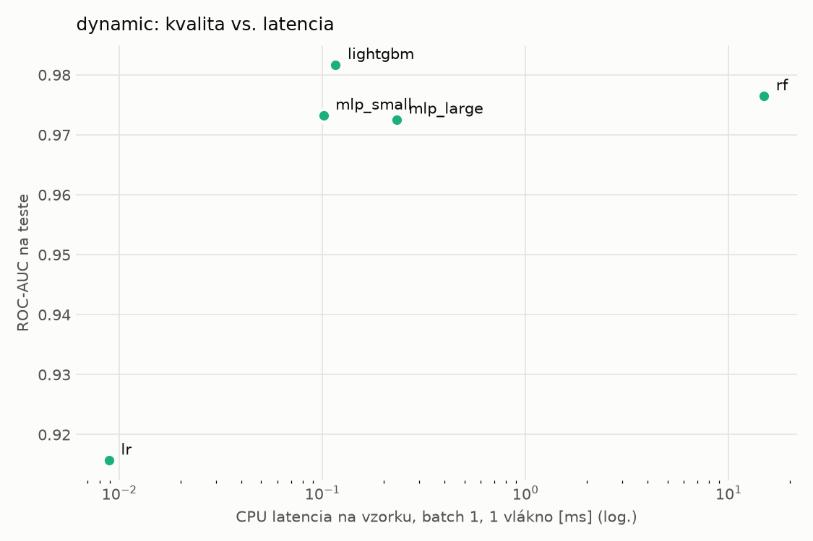
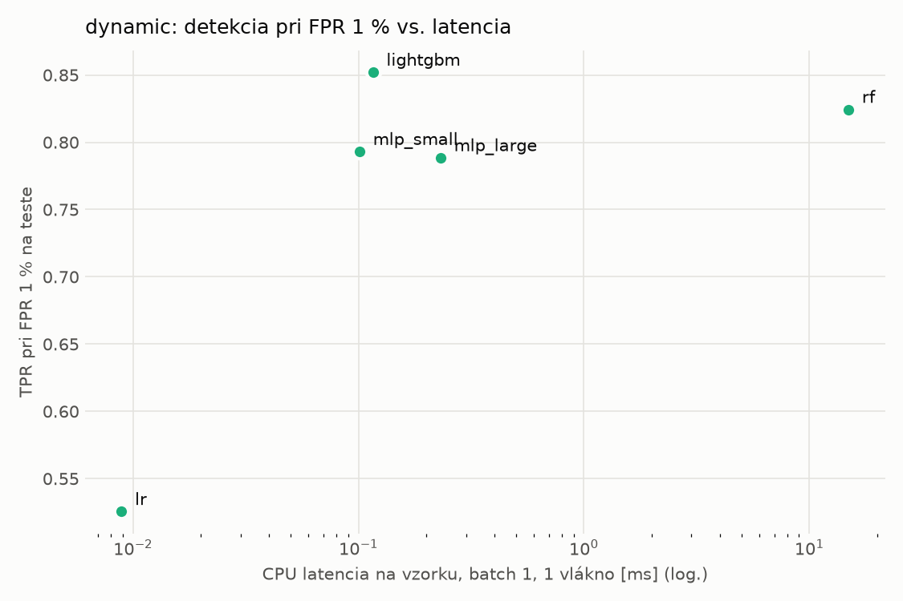
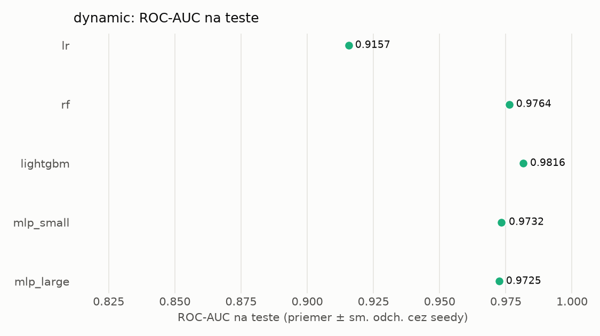
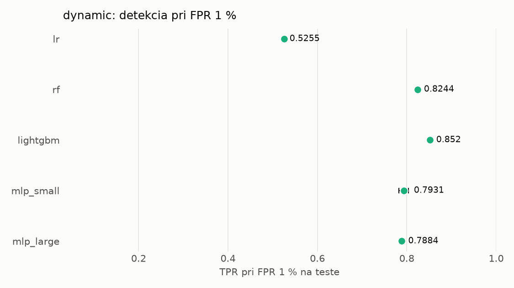

# Porovnanie modelov – dynamic

> Generované `src/evaluation/compare.py` (2026-11-23T19:10:04+01:00); použitý je posledný beh každého modelu.
> Metriky sú priemer cez seedy. \* = pri prahu určenom na validácii (FPR ≤ 1 %).
> CPU ms/vz. = medián latencie jednej vzorky na 1 vlákne vrátane transformácie vstupu (meranie hneď po tréningu,
> orientačné). Oficiálne merania spotreby sú v časti „Spotreba zdrojov pri inferencii“.

## Detekčná kvalita a orientačné časy
| model | ROC-AUC val | ROC-AUC test | TPR@FPR 1 % test | TPR@FPR 0,1 % test | F1 test* | FPR test* | gap train−val | CPU ms/vz. | CPU vz./s | GPU ms/vz. | parametre | MB | tréning s | ladenie min |
|---|---|---|---|---|---|---|---|---|---|---|---|---|---|---|
| [lr](../../dynamic/lr/20261123-190752/README.md) | 0.9077 | 0.9157 ± 0.0000 | 0.5255 | 0.3982 | 0.6600 | 0.0072 | 0.0110 | 0.009 | 4 584 511 | – | 124 | 0.01 | 0.4 | 0.0 |
| [rf](../../dynamic/rf/20261123-190754/README.md) | 0.9738 | 0.9764 ± 0.0000 | 0.8244 | 0.7123 | 0.8953 | 0.0073 | 0.0248 | 14.929 | 111 260 | – | 3 280 984 | 262.85 | 2.4 | 0.0 |
| [lightgbm](../../dynamic/lightgbm/20261123-190812/README.md) | 0.9796 | 0.9816 ± 0.0001 | 0.8520 | 0.7415 | 0.9046 | 0.0066 | 0.0195 | 0.116 | 93 196 | – | 227 331 | 12.47 | 10.5 | 0.0 |
| [mlp_small](../../dynamic/mlp_small/20261123-190851/README.md) | 0.9712 | 0.9732 ± 0.0005 | 0.7931 | 0.6510 | 0.8673 | 0.0076 | 0.0147 | 0.101 | 2 789 201 | 0.665 | 65 537 | 0.27 | 15.8 | 0.0 |
| [mlp_large](../../dynamic/mlp_large/20261123-190940/README.md) | 0.9721 | 0.9725 ± 0.0001 | 0.7884 | 0.6202 | 0.8641 | 0.0076 | 0.0139 | 0.232 | 336 680 | 0.610 | 1 119 745 | 4.51 | 7.0 | 0.0 |

## Nízka prevalencia malvéru (test, prah z validácie)
| model | TPR | FPR | precision @ 1 % | falošné na 1 skutočný poplach @ 1 % | precision @ 0.1 % | falošné na 1 skutočný poplach @ 0.1 % |
|---|---|---|---|---|---|---|
| lr | 0.4969 | 0.0072 | 0.412 | 1.43 | 0.065 | 14.39 |
| rf | 0.8177 | 0.0073 | 0.531 | 0.88 | 0.101 | 8.92 |
| lightgbm | 0.8325 | 0.0066 | 0.561 | 0.78 | 0.112 | 7.90 |
| mlp_small | 0.7729 | 0.0076 | 0.505 | 0.98 | 0.092 | 9.87 |
| mlp_large | 0.7679 | 0.0076 | 0.505 | 0.98 | 0.092 | 9.87 |

Prepočet: TPR a FPR nezávisia od podielu malvéru, preto sa dajú preniesť na nízku prevalenciu (v reálnej prevádzke je malvéru ~1 % alebo menej; v teste 54 %). „Falošné na 1 skutočný poplach“ = koľko neškodných súborov je označených na každý zachytený malvér.

## Spotreba zdrojov pri inferencii (benchmark, testovacia množina)
_Benchmark zatiaľ nebol spustený (`python -m src.evaluation.benchmark --approach dynamic`)._

## Grafy

