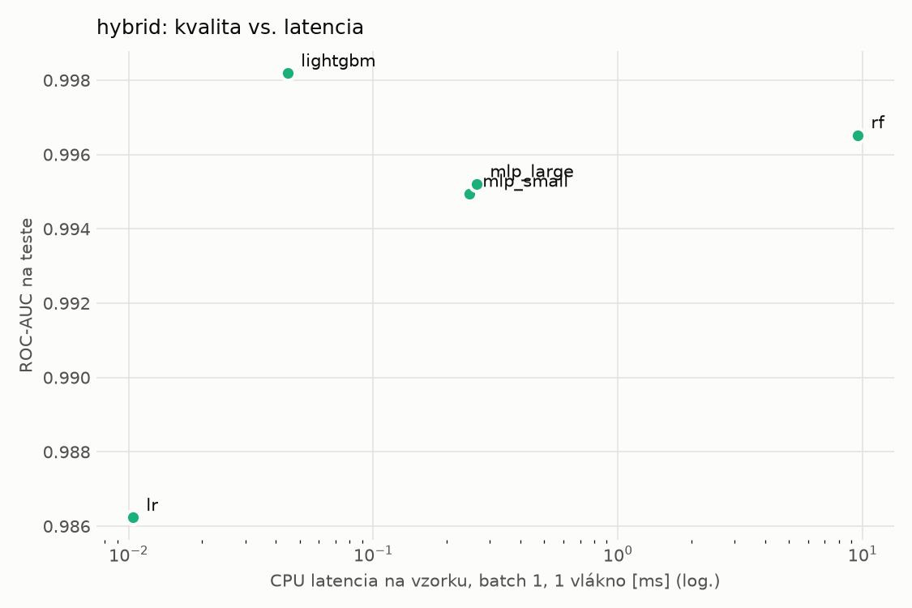
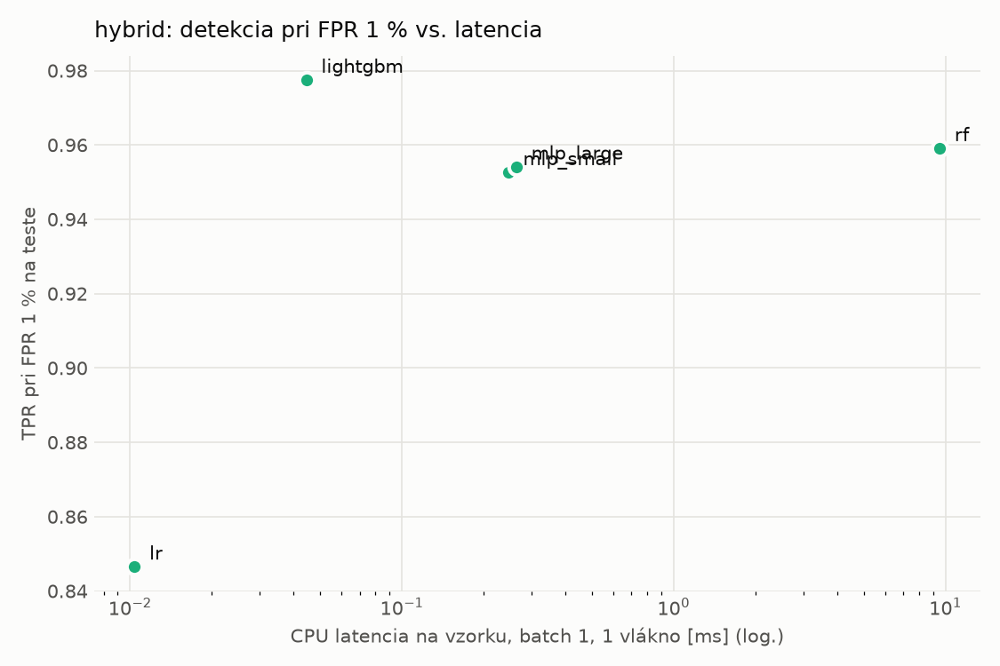
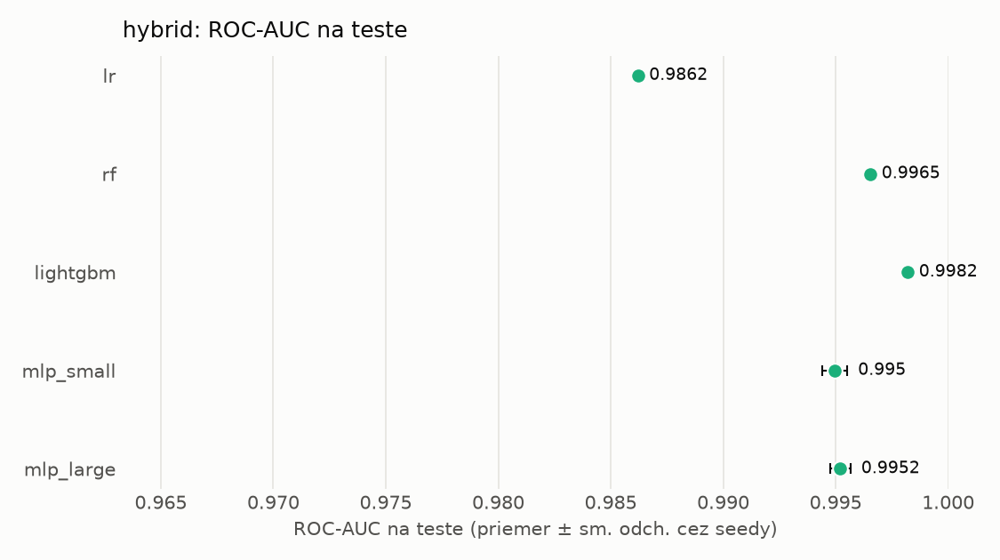
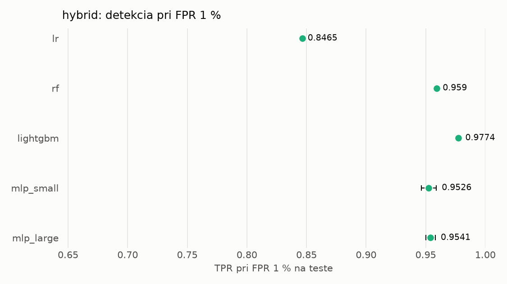

# Porovnanie modelov – hybrid

> Generované `src/evaluation/compare.py` (2026-11-23T19:11:09+01:00); použitý je posledný beh každého modelu.
> Metriky sú priemer cez seedy. \* = pri prahu určenom na validácii (FPR ≤ 1 %).
> CPU ms/vz. = medián latencie jednej vzorky na 1 vlákne vrátane transformácie vstupu (meranie hneď po tréningu,
> orientačné). Oficiálne merania spotreby sú v časti „Spotreba zdrojov pri inferencii“.

## Detekčná kvalita a orientačné časy
| model | ROC-AUC val | ROC-AUC test | TPR@FPR 1 % test | TPR@FPR 0,1 % test | F1 test* | FPR test* | gap train−val | CPU ms/vz. | CPU vz./s | GPU ms/vz. | parametre | MB | tréning s | ladenie min |
|---|---|---|---|---|---|---|---|---|---|---|---|---|---|---|
| [lr](../../hybrid/lr/20261123-191007/README.md) | 0.9836 | 0.9862 ± 0.0000 | 0.8465 | 0.6090 | 0.9037 | 0.0076 | 0.0037 | 0.010 | 2 221 793 | – | 286 | 0.01 | 0.2 | 0.0 |
| [rf](../../hybrid/rf/20261123-191009/README.md) | 0.9952 | 0.9965 ± 0.0000 | 0.9590 | 0.8935 | 0.9705 | 0.0063 | 0.0048 | 9.528 | 133 526 | – | 1 935 328 | 155.16 | 2.5 | 0.0 |
| [lightgbm](../../hybrid/lightgbm/20261123-191024/README.md) | 0.9967 | 0.9982 ± 0.0000 | 0.9774 | 0.9226 | 0.9818 | 0.0070 | 0.0033 | 0.045 | 277 016 | – | 60 346 | 3.42 | 4.8 | 0.0 |
| [mlp_small](../../hybrid/mlp_small/20261123-191041/README.md) | 0.9939 | 0.9950 ± 0.0006 | 0.9526 | 0.8160 | 0.9672 | 0.0077 | 0.0045 | 0.246 | 1 354 742 | 0.473 | 107 009 | 0.44 | 1.7 | 0.0 |
| [mlp_large](../../hybrid/mlp_large/20261123-191049/README.md) | 0.9940 | 0.9952 ± 0.0005 | 0.9541 | 0.8134 | 0.9675 | 0.0068 | 0.0037 | 0.264 | 155 827 | 0.401 | 2 399 233 | 9.64 | 5.5 | 0.0 |

## Nízka prevalencia malvéru (test, prah z validácie)
| model | TPR | FPR | precision @ 1 % | falošné na 1 skutočný poplach @ 1 % | precision @ 0.1 % | falošné na 1 skutočný poplach @ 0.1 % |
|---|---|---|---|---|---|---|
| lr | 0.8320 | 0.0076 | 0.525 | 0.90 | 0.099 | 9.11 |
| rf | 0.9500 | 0.0063 | 0.604 | 0.66 | 0.131 | 6.63 |
| lightgbm | 0.9726 | 0.0070 | 0.583 | 0.71 | 0.122 | 7.21 |
| mlp_small | 0.9454 | 0.0077 | 0.554 | 0.80 | 0.110 | 8.12 |
| mlp_large | 0.9448 | 0.0068 | 0.583 | 0.72 | 0.122 | 7.22 |

Prepočet: TPR a FPR nezávisia od podielu malvéru, preto sa dajú preniesť na nízku prevalenciu (v reálnej prevádzke je malvéru ~1 % alebo menej; v teste 54 %). „Falošné na 1 skutočný poplach“ = koľko neškodných súborov je označených na každý zachytený malvér.

## Spotreba zdrojov pri inferencii (benchmark, testovacia množina)
_Benchmark zatiaľ nebol spustený (`python -m src.evaluation.benchmark --approach hybrid`)._

## Grafy

