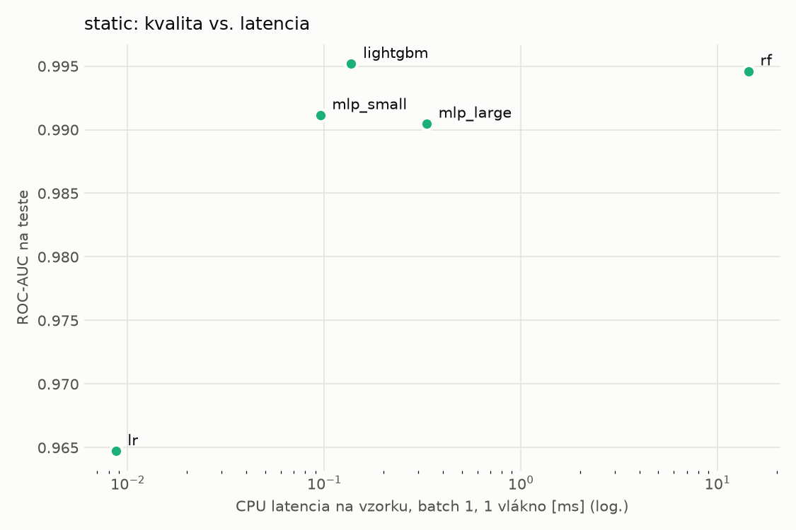
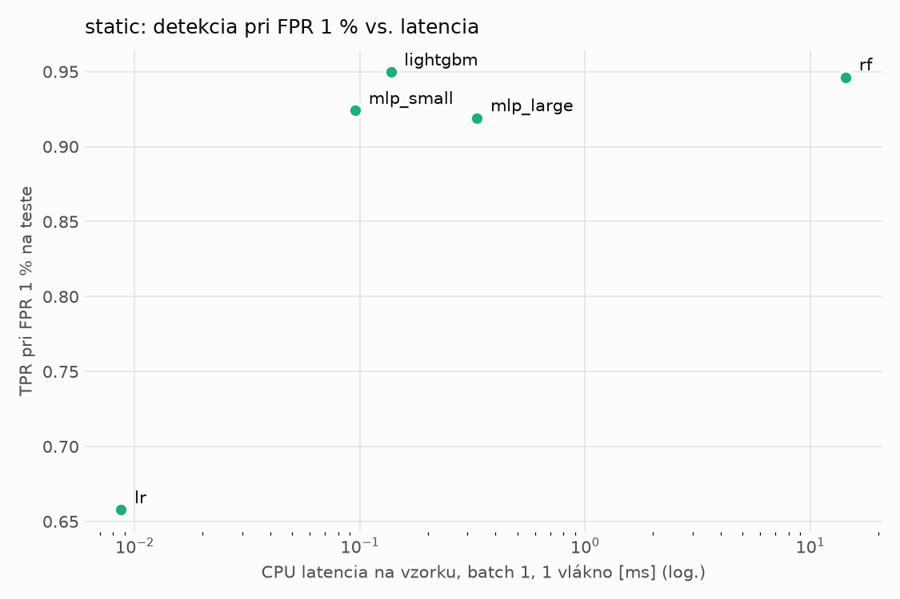
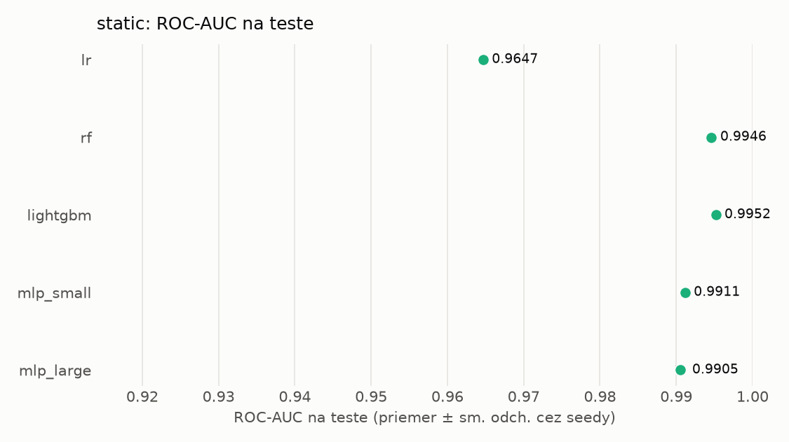
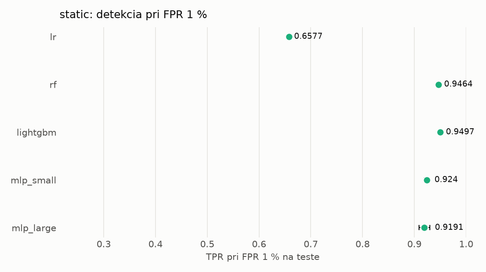

# Porovnanie modelov – static

> Generované `src/evaluation/compare.py` (2026-11-23T19:07:49+01:00); použitý je posledný beh každého modelu.
> Metriky sú priemer cez seedy. \* = pri prahu určenom na validácii (FPR ≤ 1 %).
> CPU ms/vz. = medián latencie jednej vzorky na 1 vlákne vrátane transformácie vstupu (meranie hneď po tréningu,
> orientačné). Oficiálne merania spotreby sú v časti „Spotreba zdrojov pri inferencii“.

## Detekčná kvalita a orientačné časy
| model | ROC-AUC val | ROC-AUC test | TPR@FPR 1 % test | TPR@FPR 0,1 % test | F1 test* | FPR test* | gap train−val | CPU ms/vz. | CPU vz./s | GPU ms/vz. | parametre | MB | tréning s | ladenie min |
|---|---|---|---|---|---|---|---|---|---|---|---|---|---|---|
| [lr](../../static/lr/20261123-190544/README.md) | 0.9615 | 0.9647 ± 0.0000 | 0.6577 | 0.1389 | 0.7428 | 0.0079 | 0.0055 | 0.009 | 3 323 006 | – | 163 | 0.01 | 0.2 | 0.0 |
| [rf](../../static/rf/20261123-190545/README.md) | 0.9932 | 0.9946 ± 0.0001 | 0.9464 | 0.8629 | 0.9596 | 0.0058 | 0.0068 | 14.365 | 102 956 | – | 3 069 768 | 245.96 | 1.5 | 0.0 |
| [lightgbm](../../static/lightgbm/20261123-190600/README.md) | 0.9940 | 0.9952 ± 0.0000 | 0.9497 | 0.8730 | 0.9667 | 0.0080 | 0.0060 | 0.137 | 110 719 | – | 367 393 | 20.61 | 9.0 | 0.0 |
| [mlp_small](../../static/mlp_small/20261123-190638/README.md) | 0.9900 | 0.9911 ± 0.0000 | 0.9240 | 0.6829 | 0.9419 | 0.0066 | 0.0072 | 0.095 | 1 879 139 | 0.636 | 75 521 | 0.32 | 10.9 | 0.0 |
| [mlp_large](../../static/mlp_large/20261123-190713/README.md) | 0.9906 | 0.9905 ± 0.0005 | 0.9191 | 0.6205 | 0.9428 | 0.0068 | 0.0074 | 0.332 | 132 442 | 0.527 | 2 964 481 | 11.90 | 10.8 | 0.0 |

## Nízka prevalencia malvéru (test, prah z validácie)
| model | TPR | FPR | precision @ 1 % | falošné na 1 skutočný poplach @ 1 % | precision @ 0.1 % | falošné na 1 skutočný poplach @ 0.1 % |
|---|---|---|---|---|---|---|
| lr | 0.5965 | 0.0079 | 0.433 | 1.31 | 0.070 | 13.19 |
| rf | 0.9289 | 0.0058 | 0.619 | 0.62 | 0.139 | 6.21 |
| lightgbm | 0.9447 | 0.0080 | 0.545 | 0.84 | 0.106 | 8.43 |
| mlp_small | 0.8974 | 0.0066 | 0.579 | 0.73 | 0.120 | 7.33 |
| mlp_large | 0.8992 | 0.0068 | 0.573 | 0.75 | 0.117 | 7.53 |

Prepočet: TPR a FPR nezávisia od podielu malvéru, preto sa dajú preniesť na nízku prevalenciu (v reálnej prevádzke je malvéru ~1 % alebo menej; v teste 54 %). „Falošné na 1 skutočný poplach“ = koľko neškodných súborov je označených na každý zachytený malvér.

## Spotreba zdrojov pri inferencii (benchmark, testovacia množina)
_Benchmark zatiaľ nebol spustený (`python -m src.evaluation.benchmark --approach static`)._

## Grafy

