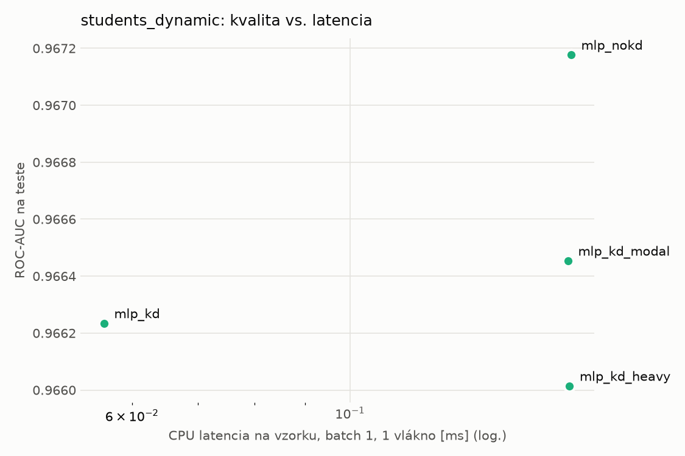
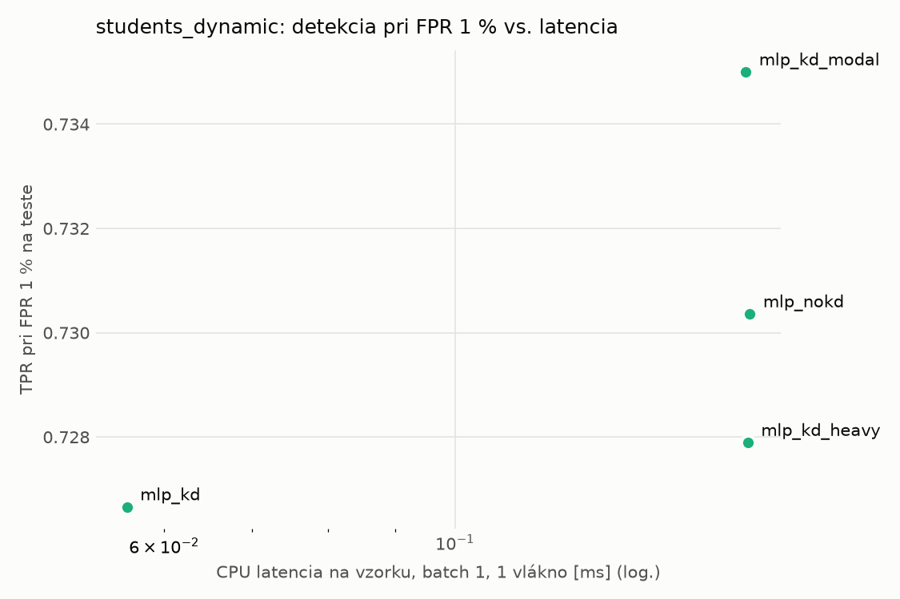
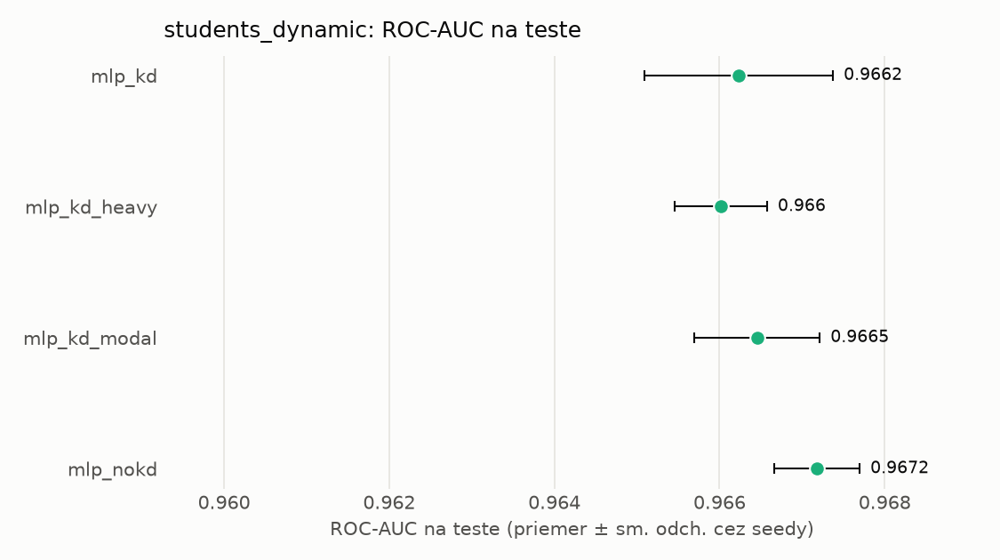
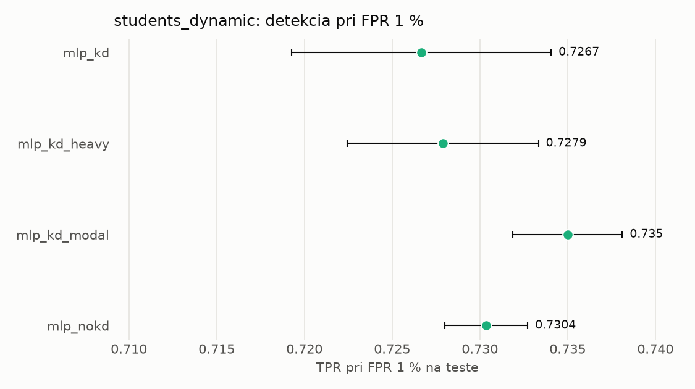

# Porovnanie modelov – students_dynamic

> Generované `src/evaluation/compare.py` (2026-11-23T19:17:12+01:00); použitý je posledný beh každého modelu.
> Metriky sú priemer cez seedy. \* = pri prahu určenom na validácii (FPR ≤ 1 %).
> CPU ms/vz. = medián latencie jednej vzorky na 1 vlákne vrátane transformácie vstupu (meranie hneď po tréningu,
> orientačné). Oficiálne merania spotreby sú v časti „Spotreba zdrojov pri inferencii“.

## Detekčná kvalita a orientačné časy
| model | ROC-AUC val | ROC-AUC test | TPR@FPR 1 % test | TPR@FPR 0,1 % test | F1 test* | FPR test* | gap train−val | CPU ms/vz. | CPU vz./s | GPU ms/vz. | parametre | MB | tréning s | ladenie min |
|---|---|---|---|---|---|---|---|---|---|---|---|---|---|---|
| [mlp_kd](../../students_dynamic/mlp_kd/20261123-191512/README.md) | 0.9637 | 0.9662 ± 0.0011 | 0.7267 | 0.4972 | 0.8339 | 0.0097 | 0.0115 | 0.056 | 6 352 138 | 0.285 | 8 129 | 0.04 | 5.0 | 0.0 |
| [mlp_kd_heavy](../../students_dynamic/mlp_kd_heavy/20261123-191652/README.md) | 0.9619 | 0.9660 ± 0.0006 | 0.7279 | 0.4939 | 0.8302 | 0.0092 | 0.0119 | 0.167 | 6 355 009 | 0.448 | 8 129 | 0.04 | 5.7 | 0.0 |
| [mlp_kd_modal](../../students_dynamic/mlp_kd_modal/20261123-191610/README.md) | 0.9628 | 0.9665 ± 0.0008 | 0.7350 | 0.4982 | 0.8355 | 0.0090 | 0.0090 | 0.167 | 6 065 370 | 0.443 | 8 129 | 0.04 | 13.5 | 0.0 |
| [mlp_nokd](../../students_dynamic/mlp_nokd/20261123-191529/README.md) | 0.9641 | 0.9672 ± 0.0005 | 0.7304 | 0.5013 | 0.8294 | 0.0086 | 0.0136 | 0.168 | 6 043 646 | 0.443 | 8 129 | 0.04 | 13.1 | 0.0 |

## Nízka prevalencia malvéru (test, prah z validácie)
| model | TPR | FPR | precision @ 1 % | falošné na 1 skutočný poplach @ 1 % | precision @ 0.1 % | falošné na 1 skutočný poplach @ 0.1 % |
|---|---|---|---|---|---|---|
| mlp_kd | 0.7237 | 0.0097 | 0.430 | 1.33 | 0.070 | 13.38 |
| mlp_kd_heavy | 0.7177 | 0.0092 | 0.442 | 1.26 | 0.073 | 12.76 |
| mlp_kd_modal | 0.7254 | 0.0090 | 0.448 | 1.23 | 0.074 | 12.42 |
| mlp_nokd | 0.7161 | 0.0086 | 0.456 | 1.19 | 0.077 | 12.05 |

Prepočet: TPR a FPR nezávisia od podielu malvéru, preto sa dajú preniesť na nízku prevalenciu (v reálnej prevádzke je malvéru ~1 % alebo menej; v teste 54 %). „Falošné na 1 skutočný poplach“ = koľko neškodných súborov je označených na každý zachytený malvér.

## Spotreba zdrojov pri inferencii (benchmark, testovacia množina)
_Benchmark zatiaľ nebol spustený (`python -m src.evaluation.benchmark --approach students_dynamic`)._

## Grafy

