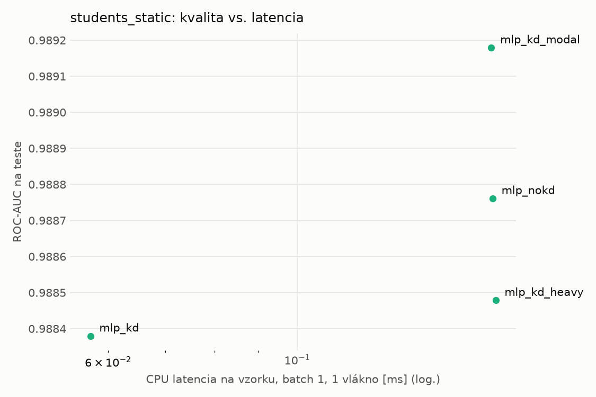
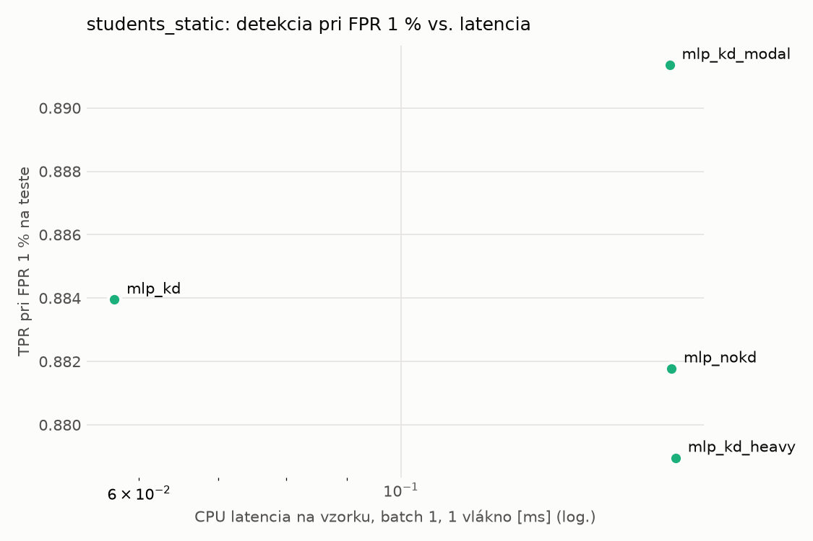
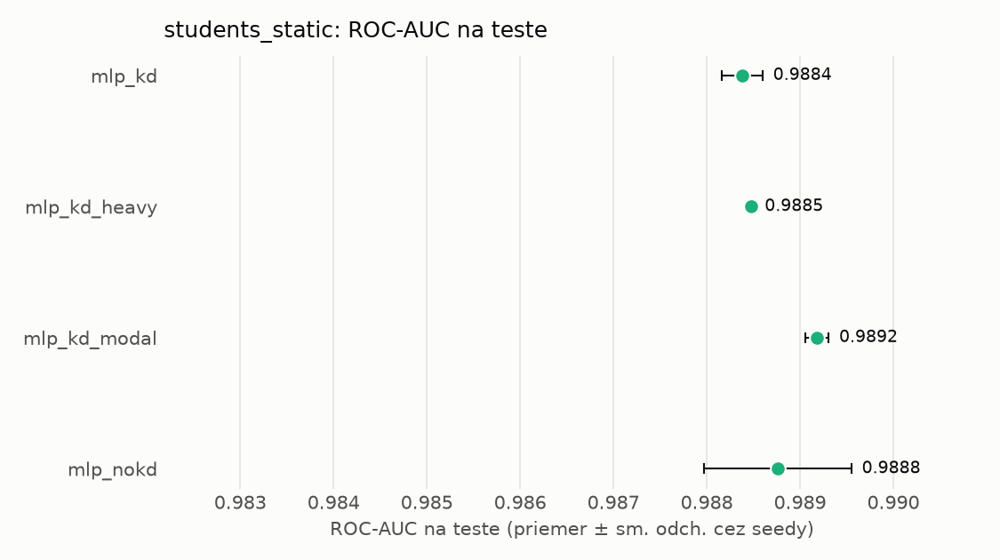
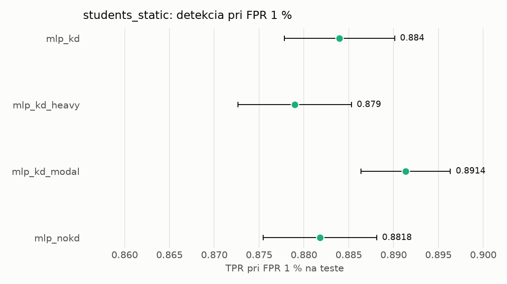

# Porovnanie modelov – students_static

> Generované `src/evaluation/compare.py` (2026-11-23T19:15:10+01:00); použitý je posledný beh každého modelu.
> Metriky sú priemer cez seedy. \* = pri prahu určenom na validácii (FPR ≤ 1 %).
> CPU ms/vz. = medián latencie jednej vzorky na 1 vlákne vrátane transformácie vstupu (meranie hneď po tréningu,
> orientačné). Oficiálne merania spotreby sú v časti „Spotreba zdrojov pri inferencii“.

## Detekčná kvalita a orientačné časy
| model | ROC-AUC val | ROC-AUC test | TPR@FPR 1 % test | TPR@FPR 0,1 % test | F1 test* | FPR test* | gap train−val | CPU ms/vz. | CPU vz./s | GPU ms/vz. | parametre | MB | tréning s | ladenie min |
|---|---|---|---|---|---|---|---|---|---|---|---|---|---|---|
| [mlp_kd](../../students_static/mlp_kd/20261123-191350/README.md) | 0.9864 | 0.9884 ± 0.0002 | 0.8840 | 0.6228 | 0.9097 | 0.0066 | 0.0046 | 0.057 | 3 988 403 | 0.446 | 10 625 | 0.05 | 5.9 | 0.0 |
| [mlp_kd_heavy](../../students_static/mlp_kd_heavy/20261123-191459/README.md) | 0.9868 | 0.9885 ± 0.0000 | 0.8790 | 0.6132 | 0.9161 | 0.0073 | 0.0059 | 0.171 | 4 456 966 | 0.277 | 10 625 | 0.05 | 3.0 | 0.0 |
| [mlp_kd_modal](../../students_static/mlp_kd_modal/20261123-191434/README.md) | 0.9874 | 0.9892 ± 0.0001 | 0.8914 | 0.6913 | 0.9176 | 0.0066 | 0.0046 | 0.169 | 4 809 607 | 0.448 | 10 625 | 0.05 | 7.6 | 0.0 |
| [mlp_nokd](../../students_static/mlp_nokd/20261123-191409/README.md) | 0.9871 | 0.9888 ± 0.0008 | 0.8818 | 0.5372 | 0.9203 | 0.0078 | 0.0066 | 0.170 | 5 123 264 | 0.445 | 10 625 | 0.05 | 7.8 | 0.0 |

## Nízka prevalencia malvéru (test, prah z validácie)
| model | TPR | FPR | precision @ 1 % | falošné na 1 skutočný poplach @ 1 % | precision @ 0.1 % | falošné na 1 skutočný poplach @ 0.1 % |
|---|---|---|---|---|---|---|
| mlp_kd | 0.8412 | 0.0066 | 0.562 | 0.78 | 0.113 | 7.88 |
| mlp_kd_heavy | 0.8528 | 0.0073 | 0.543 | 0.84 | 0.105 | 8.50 |
| mlp_kd_modal | 0.8546 | 0.0066 | 0.565 | 0.77 | 0.114 | 7.76 |
| mlp_nokd | 0.8606 | 0.0078 | 0.526 | 0.90 | 0.099 | 9.09 |

Prepočet: TPR a FPR nezávisia od podielu malvéru, preto sa dajú preniesť na nízku prevalenciu (v reálnej prevádzke je malvéru ~1 % alebo menej; v teste 54 %). „Falošné na 1 skutočný poplach“ = koľko neškodných súborov je označených na každý zachytený malvér.

## Spotreba zdrojov pri inferencii (benchmark, testovacia množina)
_Benchmark zatiaľ nebol spustený (`python -m src.evaluation.benchmark --approach students_static`)._

## Grafy

