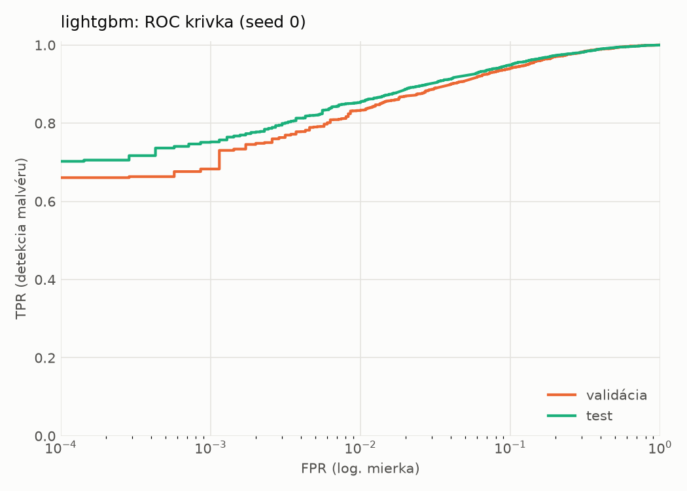
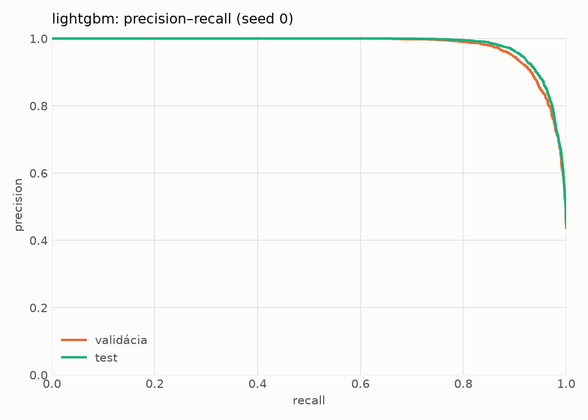
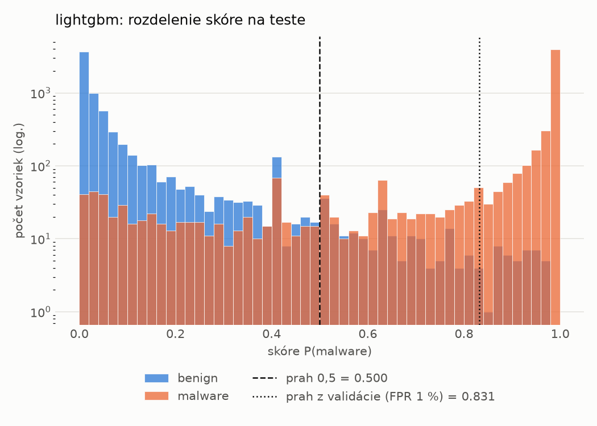
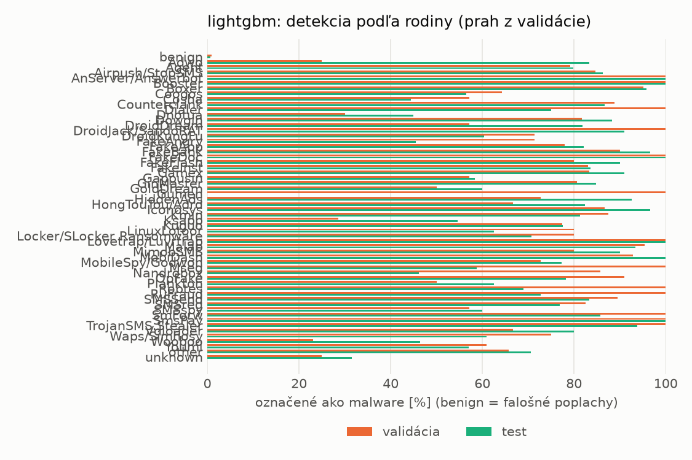
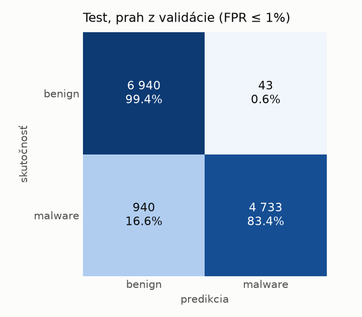
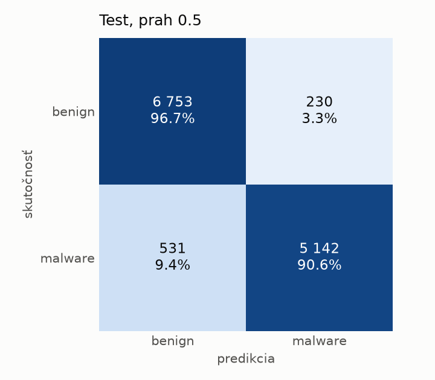
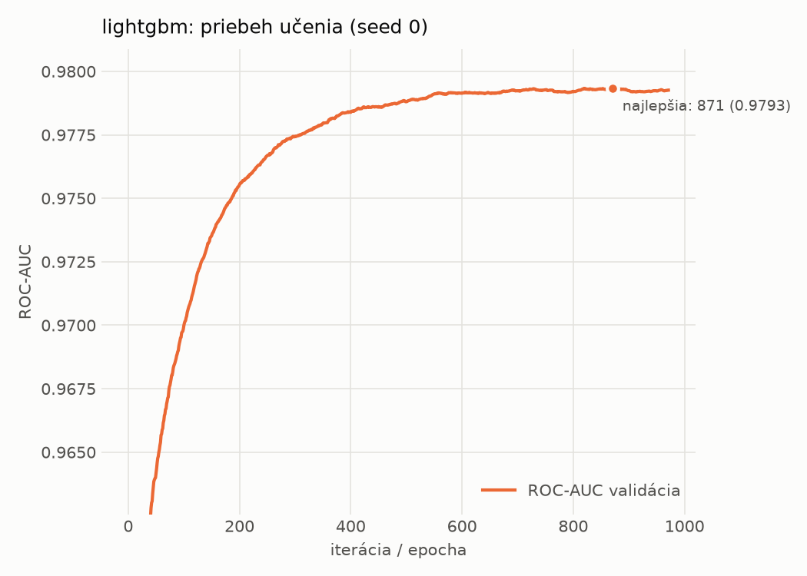

# dynamic/lightgbm – beh `20261123-190812`

> Automaticky generované (`src/training/run_tabular.py`). Konfigurácia: `config.yaml`, protokol: `protocol.yaml`.

- **Model:** `lightgbm` – LightGBM, gradient boosting stromov s early stopping na validácii (pôvodné hodnoty príznakov)
- **Ladenie:** bez ladenia – hyperparametre prevzaté z `runs_v4/real_p/full/dynamic/lightgbm/20261122-233440`
- **Finálne modely:** seedy [0, 1, 2]; hodnoty sú priemer ± smerodajná odchýlka cez seedy
- **Najlepšie hyperparametre:** `{"num_boost_round": 5000, "early_stopping_rounds": 100, "learning_rate": 0.027489744122517933, "num_leaves": 131, "min_child_samples": 30, "feature_fraction": 0.6013521321216351, "bagging_fraction": 0.9615246014341245, "lambda_l1": 3.231327066876444e-06, "lambda_l2": 0.000134433136248308}`

## Detekčná kvalita (bez prahu)
| metrika | train (podvzorka) | validácia | test |
|---|---|---|---|
| ROC-AUC | 0.9991 ± 0.0003 | 0.9796 ± 0.0003 | 0.9816 ± 0.0001 |
| PR-AUC | 0.9988 ± 0.0003 | 0.9793 ± 0.0003 | 0.9824 ± 0.0001 |
| TPR pri FPR 1 % | 0.9703 ± 0.0030 | 0.8334 ± 0.0052 | 0.8520 ± 0.0016 |
| TPR pri FPR 0,1 % | 0.9602 ± 0.0037 | 0.6992 ± 0.0153 | 0.7415 ± 0.0084 |
| log loss | 0.0530 ± 0.0085 | 0.1697 ± 0.0010 | 0.1592 ± 0.0003 |
| Brier skóre | 0.0123 ± 0.0019 | 0.0496 ± 0.0004 | 0.0458 ± 0.0002 |

Rozdiel ROC-AUC train − validácia: **0.0195** (veľký rozdiel = preučenie).

## Pri prahu z validácie (FPR ≤ 1% na validácii)
| metrika | train (podvzorka) | validácia | test |
|---|---|---|---|
| accuracy | 0.9738 ± 0.0045 | 0.9217 ± 0.0023 | 0.9213 ± 0.0012 |
| balanced accuracy | 0.9697 ± 0.0052 | 0.9119 ± 0.0026 | 0.9130 ± 0.0014 |
| precision | 0.9996 ± 0.0001 | 0.9853 ± 0.0003 | 0.9904 ± 0.0012 |
| recall (TPR) | 0.9396 ± 0.0103 | 0.8334 ± 0.0052 | 0.8325 ± 0.0032 |
| FPR | 0.0003 ± 0.0001 | 0.0096 ± 0.0002 | 0.0066 ± 0.0009 |
| F1 | 0.9687 ± 0.0055 | 0.9030 ± 0.0031 | 0.9046 ± 0.0017 |
| MCC | 0.9475 ± 0.0089 | 0.8465 ± 0.0043 | 0.8476 ± 0.0022 |

## Pri pevnom prahu 0.5
| metrika | train (podvzorka) | validácia | test |
|---|---|---|---|
| accuracy | 0.9839 ± 0.0018 | 0.9329 ± 0.0010 | 0.9398 ± 0.0006 |
| balanced accuracy | 0.9830 ± 0.0020 | 0.9290 ± 0.0011 | 0.9367 ± 0.0007 |
| precision | 0.9857 ± 0.0011 | 0.9459 ± 0.0004 | 0.9566 ± 0.0005 |
| recall (TPR) | 0.9768 ± 0.0031 | 0.8977 ± 0.0022 | 0.9069 ± 0.0015 |
| FPR | 0.0108 ± 0.0008 | 0.0398 ± 0.0003 | 0.0334 ± 0.0004 |
| F1 | 0.9812 ± 0.0021 | 0.9212 ± 0.0013 | 0.9311 ± 0.0008 |
| MCC | 0.9671 ± 0.0037 | 0.8637 ± 0.0020 | 0.8787 ± 0.0013 |

## Výpočtové nároky (seed 0, testovacia množina)
| meranie | hodnota |
|---|---|
| tréning finálneho modelu | 10.5 s (priemer cez seedy) |
| ladenie spolu | 0 s |
| počet parametrov / uzlov | 227 331 |
| veľkosť modelu na disku | 12.47 MB |
| CPU latencia modelu (batch 1, 1 vlákno) | 0.116 ms (p95 0.150) |
| CPU priepustnosť (24 vlákien) | 93 196 vzoriek/s |

## Grafy
| | |
|---|---|
|  |  |
|  |  |
|  |  |
|  |  |

## Súbory
`metrics.json` (všetky metriky po seedoch vrátane rodín), `timing.json`, `hpo_trials.csv`,
`predictions/<časť>_seed<N>.parquet` (sha256, family, label, score), `model/seed_<N>/`, `log.txt`.
