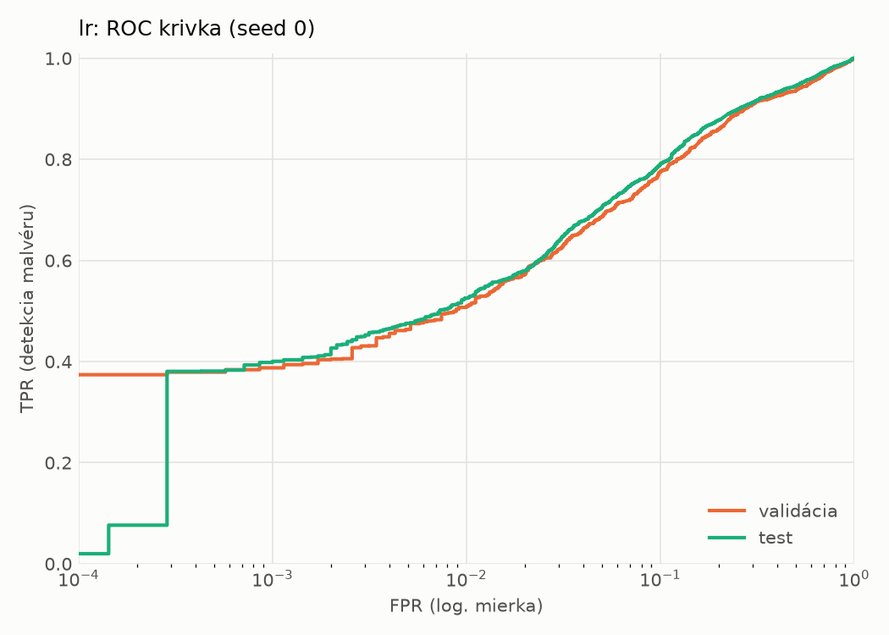
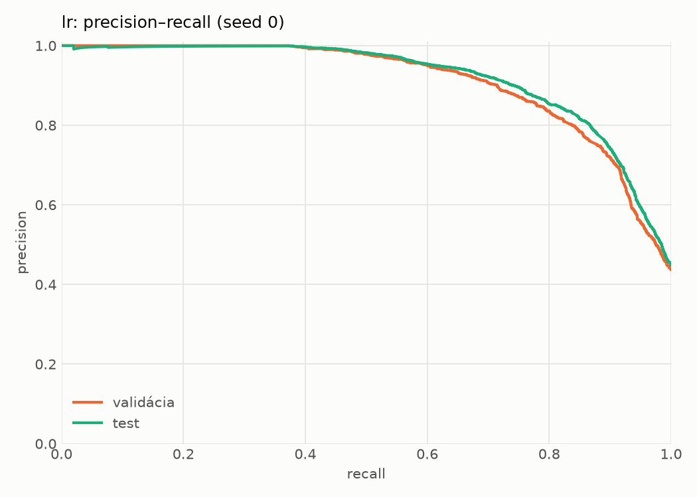
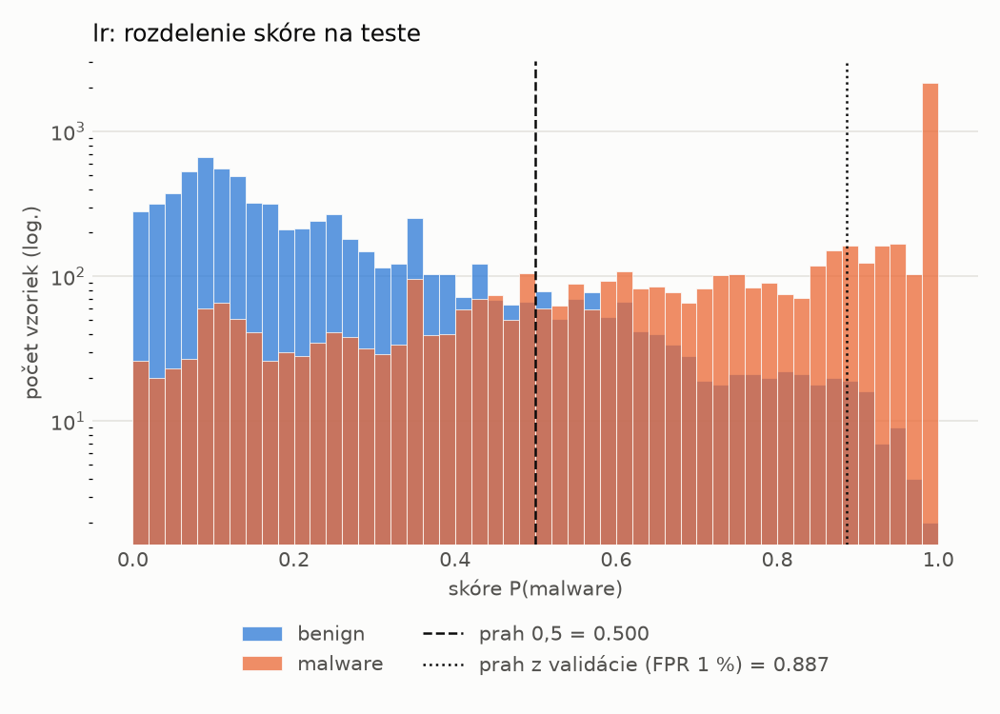
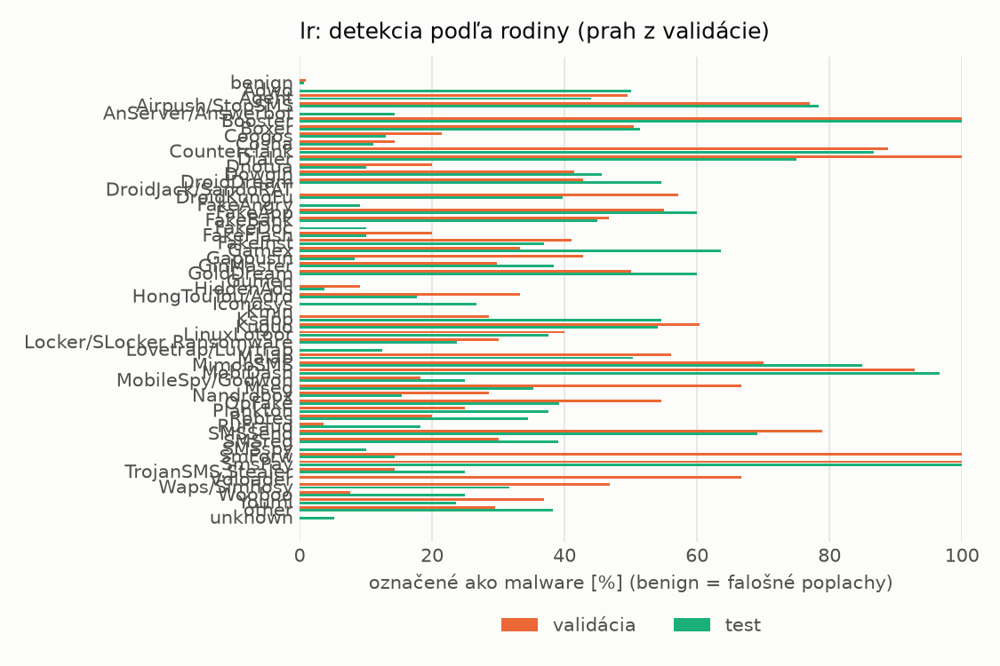
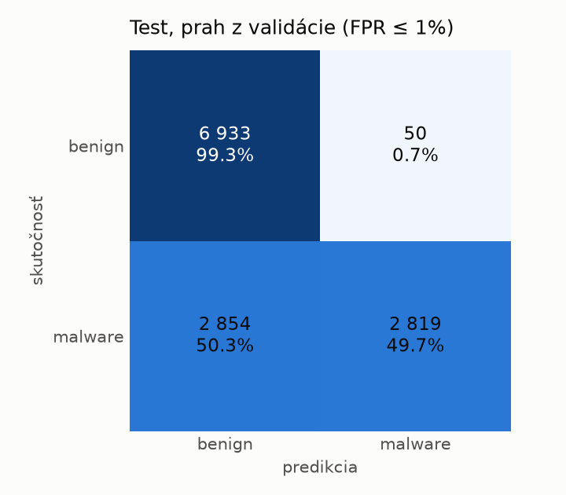
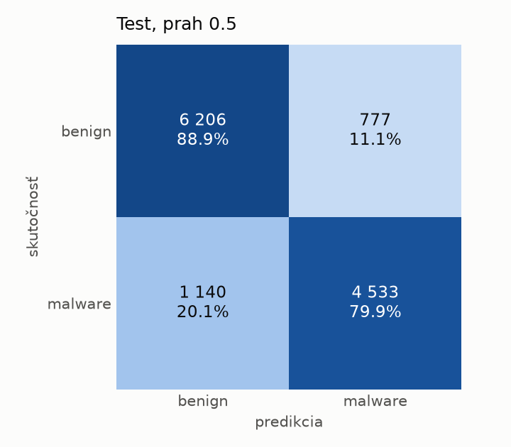

# dynamic/lr – beh `20261123-190752`

> Automaticky generované (`src/training/run_tabular.py`). Konfigurácia: `config.yaml`, protokol: `protocol.yaml`.

- **Model:** `logreg` – logistická regresia s L2 regularizáciou (vstup signed log1p + štandardizácia)
- **Ladenie:** bez ladenia – hyperparametre prevzaté z `runs_v4/real_p/full/dynamic/lr/20261122-233312`
- **Finálne modely:** seedy [0, 1, 2]; hodnoty sú priemer ± smerodajná odchýlka cez seedy
- **Najlepšie hyperparametre:** `{"max_iter": 2000, "C": 9.535095002298556}`

## Detekčná kvalita (bez prahu)
| metrika | train (podvzorka) | validácia | test |
|---|---|---|---|
| ROC-AUC | 0.9187 ± 0.0000 | 0.9077 ± 0.0000 | 0.9157 ± 0.0000 |
| PR-AUC | 0.9186 ± 0.0000 | 0.9106 ± 0.0000 | 0.9193 ± 0.0000 |
| TPR pri FPR 1 % | 0.5342 ± 0.0000 | 0.5072 ± 0.0000 | 0.5255 ± 0.0000 |
| TPR pri FPR 0,1 % | 0.4035 ± 0.0000 | 0.3876 ± 0.0000 | 0.3982 ± 0.0000 |
| log loss | 0.3509 ± 0.0000 | 0.3677 ± 0.0000 | 0.3581 ± 0.0000 |
| Brier skóre | 0.1077 ± 0.0000 | 0.1142 ± 0.0000 | 0.1101 ± 0.0000 |

Rozdiel ROC-AUC train − validácia: **0.0110** (veľký rozdiel = preučenie).

## Pri prahu z validácie (FPR ≤ 1% na validácii)
| metrika | train (podvzorka) | validácia | test |
|---|---|---|---|
| accuracy | 0.7877 ± 0.0000 | 0.7794 ± 0.0000 | 0.7705 ± 0.0000 |
| balanced accuracy | 0.7556 ± 0.0000 | 0.7490 ± 0.0000 | 0.7449 ± 0.0000 |
| precision | 0.9765 ± 0.0000 | 0.9772 ± 0.0000 | 0.9826 ± 0.0000 |
| recall (TPR) | 0.5207 ± 0.0000 | 0.5072 ± 0.0000 | 0.4969 ± 0.0000 |
| FPR | 0.0095 ± 0.0000 | 0.0092 ± 0.0000 | 0.0072 ± 0.0000 |
| F1 | 0.6793 ± 0.0000 | 0.6678 ± 0.0000 | 0.6600 ± 0.0000 |
| MCC | 0.6015 ± 0.0000 | 0.5899 ± 0.0000 | 0.5817 ± 0.0000 |

## Pri pevnom prahu 0.5
| metrika | train (podvzorka) | validácia | test |
|---|---|---|---|
| accuracy | 0.8533 ± 0.0000 | 0.8454 ± 0.0000 | 0.8485 ± 0.0000 |
| balanced accuracy | 0.8481 ± 0.0000 | 0.8392 ± 0.0000 | 0.8439 ± 0.0000 |
| precision | 0.8439 ± 0.0000 | 0.8465 ± 0.0000 | 0.8537 ± 0.0000 |
| recall (TPR) | 0.8101 ± 0.0000 | 0.7896 ± 0.0000 | 0.7990 ± 0.0000 |
| FPR | 0.1138 ± 0.0000 | 0.1112 ± 0.0000 | 0.1113 ± 0.0000 |
| F1 | 0.8266 ± 0.0000 | 0.8170 ± 0.0000 | 0.8255 ± 0.0000 |
| MCC | 0.7000 ± 0.0000 | 0.6848 ± 0.0000 | 0.6931 ± 0.0000 |

## Výpočtové nároky (seed 0, testovacia množina)
| meranie | hodnota |
|---|---|
| tréning finálneho modelu | 0.4 s (priemer cez seedy) |
| ladenie spolu | 0 s |
| počet parametrov / uzlov | 124 |
| veľkosť modelu na disku | 0.01 MB |
| transformácia vstupu – latencia (1 vlákno) | 0.005 ms |
| transformácia vstupu – priepustnosť | 1 351 833 vzoriek/s |
| CPU latencia modelu (batch 1, 1 vlákno) | 0.004 ms (p95 0.004) |
| CPU priepustnosť (24 vlákien) | 4 584 511 vzoriek/s |

## Grafy
| | |
|---|---|
|  |  |
|  |  |
|  |  |
|  |  |

## Súbory
`metrics.json` (všetky metriky po seedoch vrátane rodín), `timing.json`, `hpo_trials.csv`,
`predictions/<časť>_seed<N>.parquet` (sha256, family, label, score), `model/seed_<N>/`, `log.txt`.
