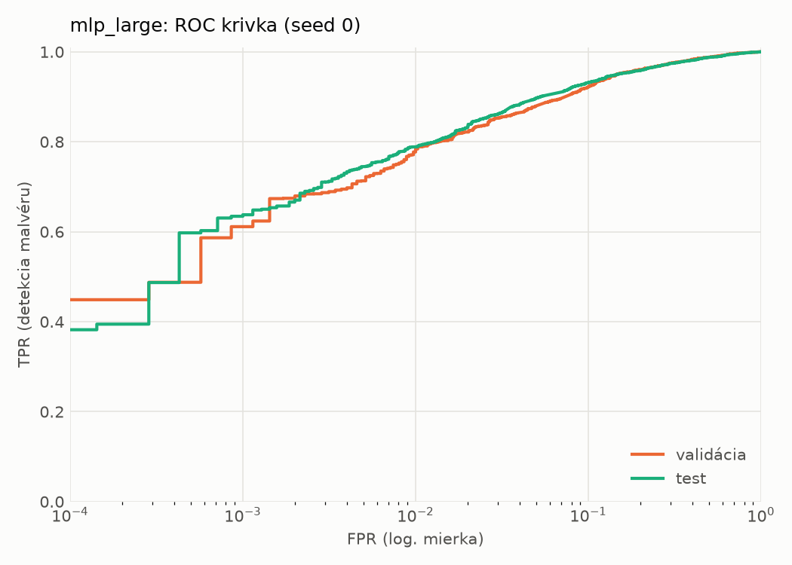
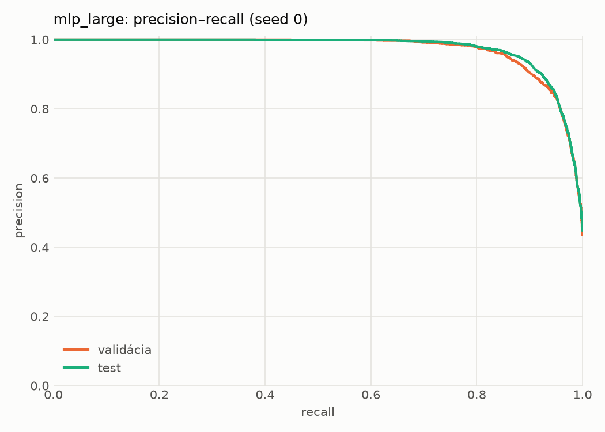
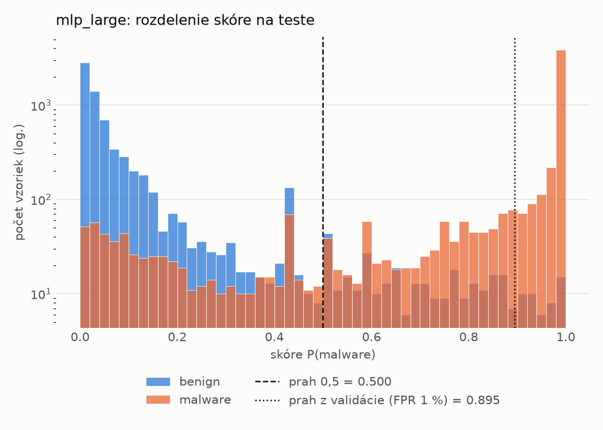
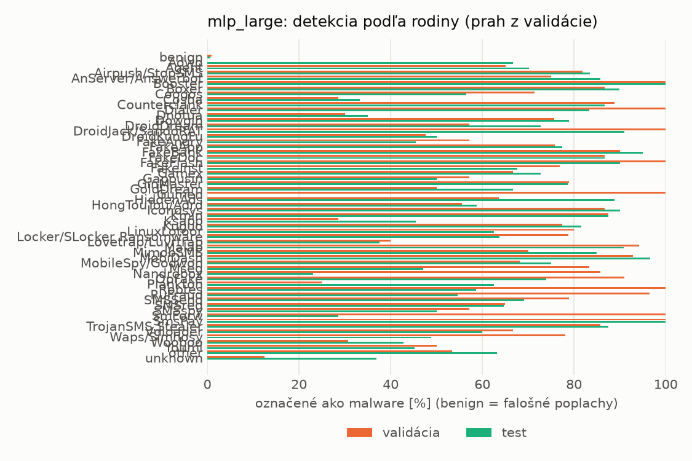
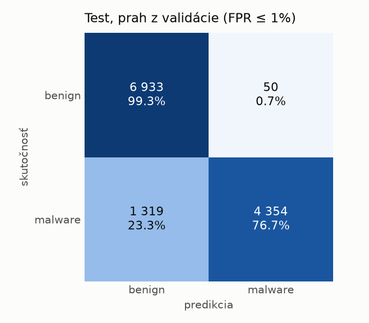
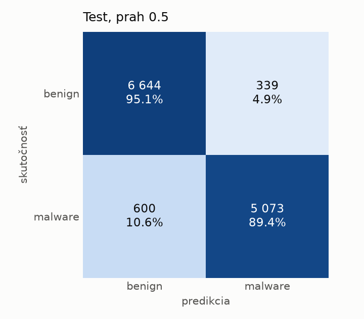
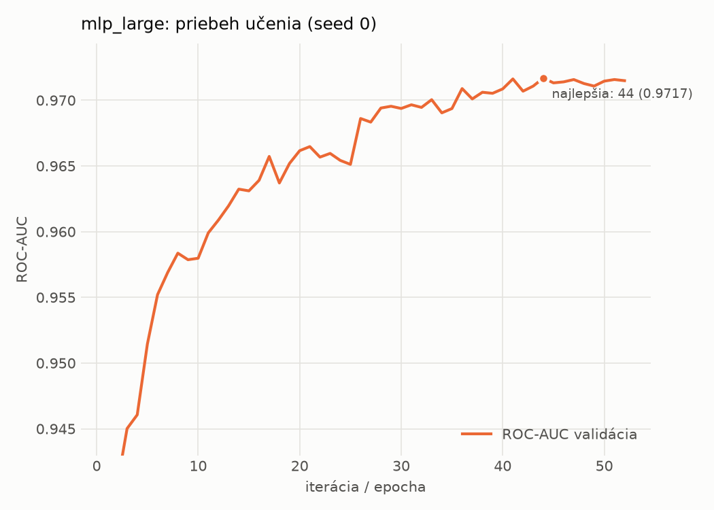

# dynamic/mlp_large – beh `20261123-190940`

> Automaticky generované (`src/training/run_tabular.py`). Konfigurácia: `config.yaml`, protokol: `protocol.yaml`.

- **Model:** `mlp` – veľká neurónová sieť (3–5 skrytých vrstiev, 512–2048 neurónov), kandidát na učiteľa
- **Ladenie:** bez ladenia – hyperparametre prevzaté z `runs_v4/real_p/full/dynamic/mlp_large/20261122-235153`
- **Finálne modely:** seedy [0, 1, 2]; hodnoty sú priemer ± smerodajná odchýlka cez seedy
- **Najlepšie hyperparametre:** `{"max_epochs": 100, "patience": 8, "hidden_layers": 5, "hidden_width": 512, "width_decay": 1.0, "dropout": 0.3998176791356432, "lr": 0.0024125104549951384, "weight_decay": 1.1960883604412328e-06, "batch_size": 1024}`

## Detekčná kvalita (bez prahu)
| metrika | train (podvzorka) | validácia | test |
|---|---|---|---|
| ROC-AUC | 0.9861 ± 0.0004 | 0.9721 ± 0.0005 | 0.9725 ± 0.0001 |
| PR-AUC | 0.9854 ± 0.0003 | 0.9718 ± 0.0005 | 0.9739 ± 0.0001 |
| TPR pri FPR 1 % | 0.8651 ± 0.0034 | 0.7770 ± 0.0032 | 0.7884 ± 0.0025 |
| TPR pri FPR 0,1 % | 0.7574 ± 0.0141 | 0.6000 ± 0.0212 | 0.6202 ± 0.0128 |
| log loss | 0.1393 ± 0.0012 | 0.2054 ± 0.0019 | 0.1983 ± 0.0005 |
| Brier skóre | 0.0400 ± 0.0003 | 0.0599 ± 0.0006 | 0.0564 ± 0.0003 |

Rozdiel ROC-AUC train − validácia: **0.0139** (veľký rozdiel = preučenie).

## Pri prahu z validácie (FPR ≤ 1% na validácii)
| metrika | train (podvzorka) | validácia | test |
|---|---|---|---|
| accuracy | 0.9130 ± 0.0008 | 0.8971 ± 0.0014 | 0.8918 ± 0.0020 |
| balanced accuracy | 0.8997 ± 0.0009 | 0.8836 ± 0.0016 | 0.8802 ± 0.0023 |
| precision | 0.9953 ± 0.0002 | 0.9841 ± 0.0001 | 0.9880 ± 0.0009 |
| recall (TPR) | 0.8023 ± 0.0017 | 0.7770 ± 0.0032 | 0.7679 ± 0.0050 |
| FPR | 0.0029 ± 0.0001 | 0.0097 ± 0.0000 | 0.0076 ± 0.0006 |
| F1 | 0.8884 ± 0.0011 | 0.8684 ± 0.0020 | 0.8641 ± 0.0029 |
| MCC | 0.8312 ± 0.0015 | 0.8006 ± 0.0025 | 0.7936 ± 0.0034 |

## Pri pevnom prahu 0.5
| metrika | train (podvzorka) | validácia | test |
|---|---|---|---|
| accuracy | 0.9463 ± 0.0005 | 0.9184 ± 0.0001 | 0.9263 ± 0.0005 |
| balanced accuracy | 0.9438 ± 0.0008 | 0.9155 ± 0.0005 | 0.9238 ± 0.0008 |
| precision | 0.9484 ± 0.0023 | 0.9189 ± 0.0031 | 0.9342 ± 0.0027 |
| recall (TPR) | 0.9260 ± 0.0033 | 0.8921 ± 0.0037 | 0.8989 ± 0.0041 |
| FPR | 0.0383 ± 0.0019 | 0.0611 ± 0.0028 | 0.0514 ± 0.0025 |
| F1 | 0.9370 ± 0.0007 | 0.9053 ± 0.0004 | 0.9162 ± 0.0008 |
| MCC | 0.8904 ± 0.0009 | 0.8340 ± 0.0002 | 0.8511 ± 0.0008 |

## Výpočtové nároky (seed 0, testovacia množina)
| meranie | hodnota |
|---|---|
| tréning finálneho modelu | 7.0 s (priemer cez seedy) |
| ladenie spolu | 0 s |
| počet parametrov / uzlov | 1 119 745 |
| veľkosť modelu na disku | 4.51 MB |
| transformácia vstupu – latencia (1 vlákno) | 0.015 ms |
| transformácia vstupu – priepustnosť | 770 772 vzoriek/s |
| CPU latencia modelu (batch 1, 1 vlákno) | 0.217 ms (p95 0.567) |
| CPU priepustnosť (24 vlákien) | 336 680 vzoriek/s |
| GPU latencia (batch 1) | 0.610 ms (p95 1.376) |
| GPU priepustnosť | 1 786 914 vzoriek/s |
| GPU špičková pamäť | 116 MB |

## Grafy
| | |
|---|---|
|  |  |
|  |  |
|  |  |
|  |  |

## Súbory
`metrics.json` (všetky metriky po seedoch vrátane rodín), `timing.json`, `hpo_trials.csv`,
`predictions/<časť>_seed<N>.parquet` (sha256, family, label, score), `model/seed_<N>/`, `log.txt`.
