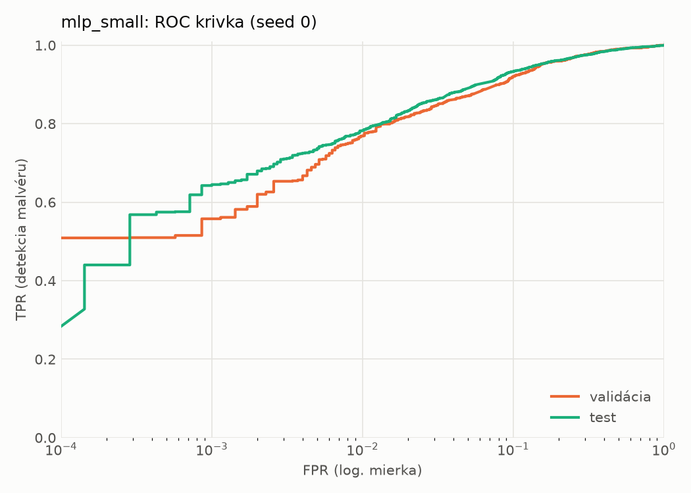
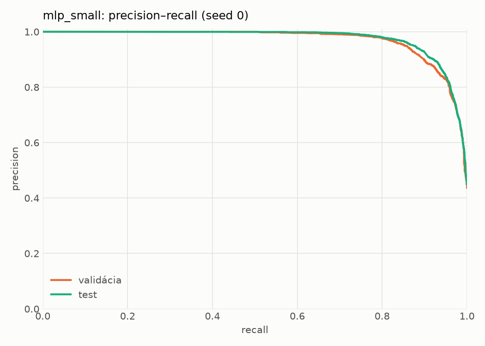
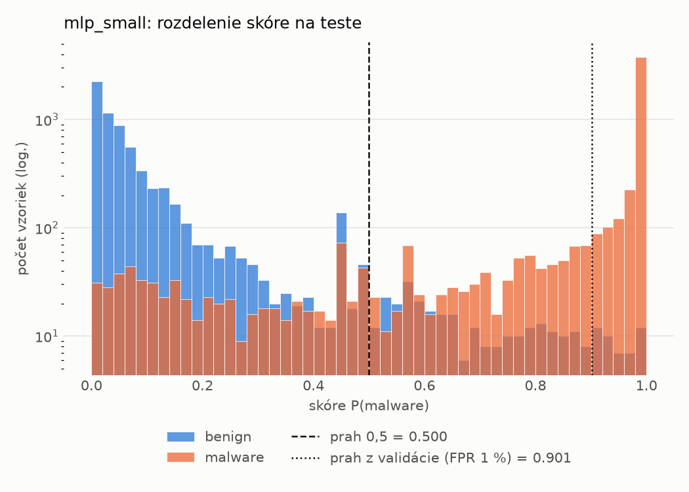
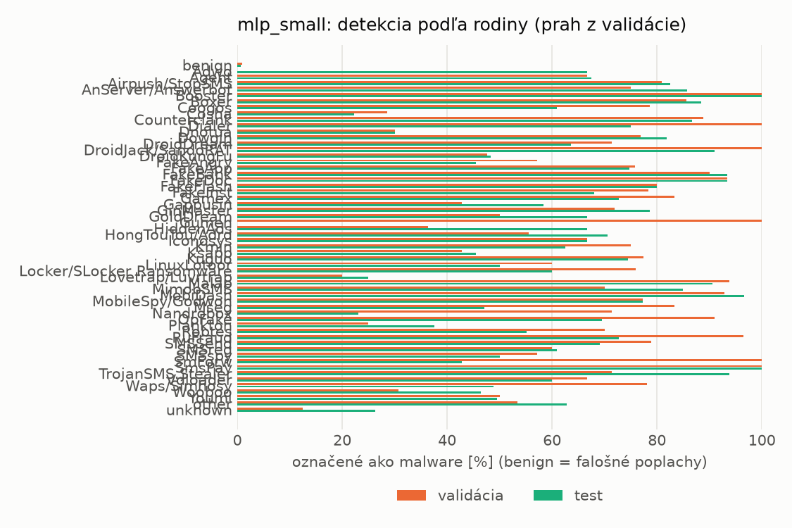
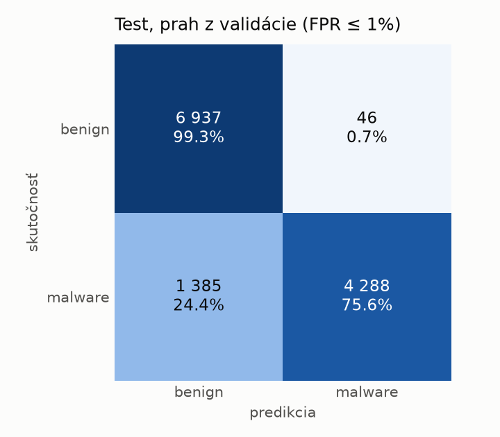
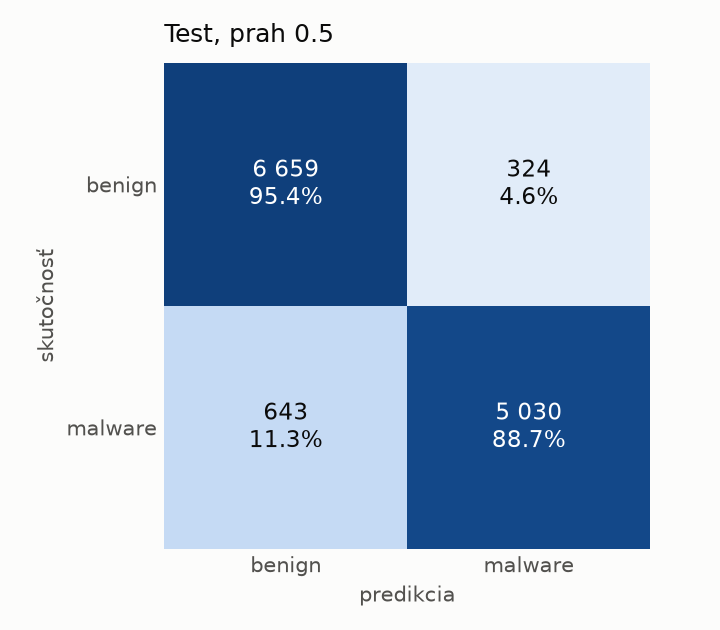
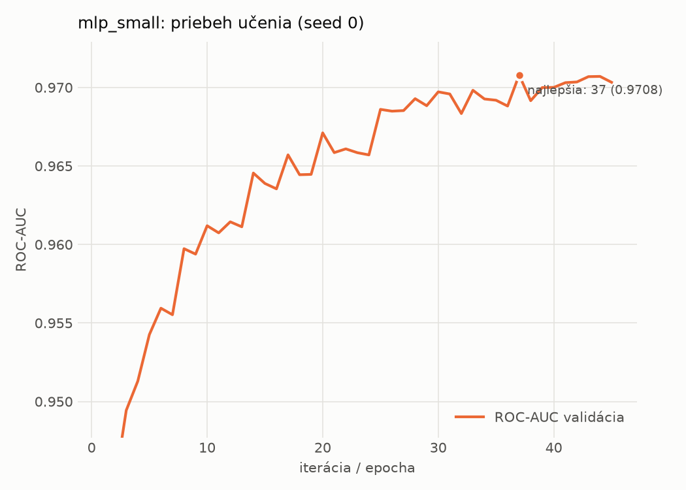

# dynamic/mlp_small – beh `20261123-190851`

> Automaticky generované (`src/training/run_tabular.py`). Konfigurácia: `config.yaml`, protokol: `protocol.yaml`.

- **Model:** `mlp` – malá neurónová sieť (1–2 skryté vrstvy), kandidát na ľahkého študenta
- **Ladenie:** bez ladenia – hyperparametre prevzaté z `runs_v4/real_p/full/dynamic/mlp_small/20261122-234317`
- **Finálne modely:** seedy [0, 1, 2]; hodnoty sú priemer ± smerodajná odchýlka cez seedy
- **Najlepšie hyperparametre:** `{"width_decay": 0.5, "max_epochs": 100, "patience": 8, "hidden_layers": 2, "hidden_width": 256, "dropout": 0.2449160262890371, "lr": 0.002872548733508973, "weight_decay": 4.509331245708397e-06, "batch_size": 256}`

## Detekčná kvalita (bez prahu)
| metrika | train (podvzorka) | validácia | test |
|---|---|---|---|
| ROC-AUC | 0.9859 ± 0.0013 | 0.9712 ± 0.0004 | 0.9732 ± 0.0005 |
| PR-AUC | 0.9852 ± 0.0013 | 0.9708 ± 0.0006 | 0.9744 ± 0.0006 |
| TPR pri FPR 1 % | 0.8662 ± 0.0105 | 0.7805 ± 0.0112 | 0.7931 ± 0.0106 |
| TPR pri FPR 0,1 % | 0.7352 ± 0.0151 | 0.5853 ± 0.0266 | 0.6510 ± 0.0075 |
| log loss | 0.1427 ± 0.0063 | 0.2087 ± 0.0008 | 0.1981 ± 0.0006 |
| Brier skóre | 0.0405 ± 0.0019 | 0.0606 ± 0.0006 | 0.0562 ± 0.0007 |

Rozdiel ROC-AUC train − validácia: **0.0147** (veľký rozdiel = preučenie).

## Pri prahu z validácie (FPR ≤ 1% na validácii)
| metrika | train (podvzorka) | validácia | test |
|---|---|---|---|
| accuracy | 0.9136 ± 0.0053 | 0.8986 ± 0.0049 | 0.8940 ± 0.0063 |
| balanced accuracy | 0.9005 ± 0.0061 | 0.8854 ± 0.0056 | 0.8826 ± 0.0071 |
| precision | 0.9941 ± 0.0001 | 0.9842 ± 0.0002 | 0.9880 ± 0.0014 |
| recall (TPR) | 0.8046 ± 0.0124 | 0.7805 ± 0.0112 | 0.7729 ± 0.0150 |
| FPR | 0.0036 ± 0.0001 | 0.0097 ± 0.0000 | 0.0076 ± 0.0010 |
| F1 | 0.8894 ± 0.0076 | 0.8705 ± 0.0070 | 0.8673 ± 0.0091 |
| MCC | 0.8321 ± 0.0098 | 0.8034 ± 0.0090 | 0.7976 ± 0.0110 |

## Pri pevnom prahu 0.5
| metrika | train (podvzorka) | validácia | test |
|---|---|---|---|
| accuracy | 0.9474 ± 0.0023 | 0.9162 ± 0.0007 | 0.9264 ± 0.0024 |
| balanced accuracy | 0.9442 ± 0.0027 | 0.9123 ± 0.0015 | 0.9234 ± 0.0029 |
| precision | 0.9559 ± 0.0050 | 0.9233 ± 0.0048 | 0.9385 ± 0.0039 |
| recall (TPR) | 0.9206 ± 0.0076 | 0.8814 ± 0.0073 | 0.8944 ± 0.0083 |
| FPR | 0.0323 ± 0.0041 | 0.0568 ± 0.0044 | 0.0476 ± 0.0036 |
| F1 | 0.9379 ± 0.0029 | 0.9019 ± 0.0015 | 0.9159 ± 0.0032 |
| MCC | 0.8928 ± 0.0046 | 0.8295 ± 0.0014 | 0.8513 ± 0.0048 |

## Výpočtové nároky (seed 0, testovacia množina)
| meranie | hodnota |
|---|---|
| tréning finálneho modelu | 15.8 s (priemer cez seedy) |
| ladenie spolu | 0 s |
| počet parametrov / uzlov | 65 537 |
| veľkosť modelu na disku | 0.27 MB |
| transformácia vstupu – latencia (1 vlákno) | 0.014 ms |
| transformácia vstupu – priepustnosť | 1 153 051 vzoriek/s |
| CPU latencia modelu (batch 1, 1 vlákno) | 0.087 ms (p95 0.236) |
| CPU priepustnosť (24 vlákien) | 2 789 201 vzoriek/s |
| GPU latencia (batch 1) | 0.665 ms (p95 0.728) |
| GPU priepustnosť | 2 098 108 vzoriek/s |
| GPU špičková pamäť | 66 MB |

## Grafy
| | |
|---|---|
|  |  |
|  |  |
|  |  |
|  |  |

## Súbory
`metrics.json` (všetky metriky po seedoch vrátane rodín), `timing.json`, `hpo_trials.csv`,
`predictions/<časť>_seed<N>.parquet` (sha256, family, label, score), `model/seed_<N>/`, `log.txt`.
