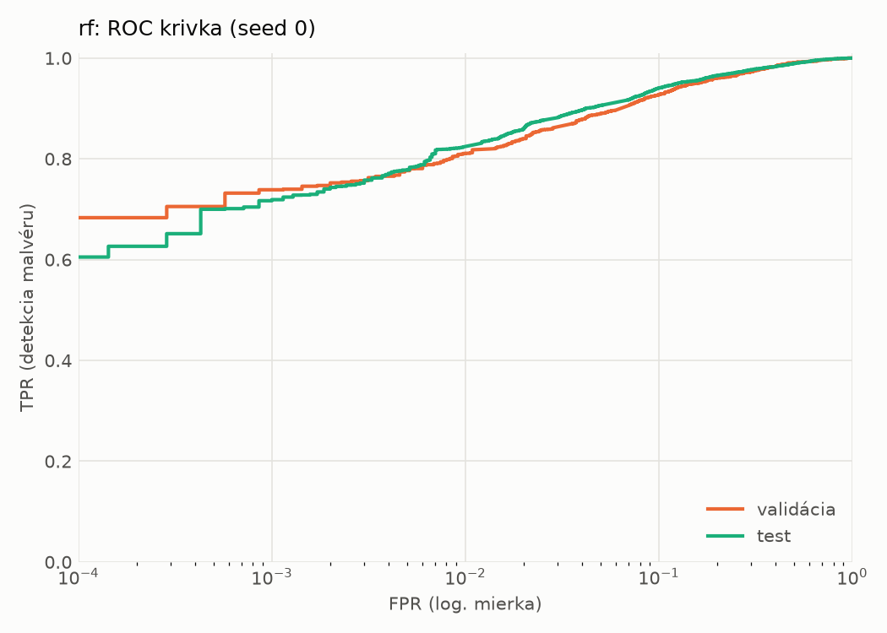
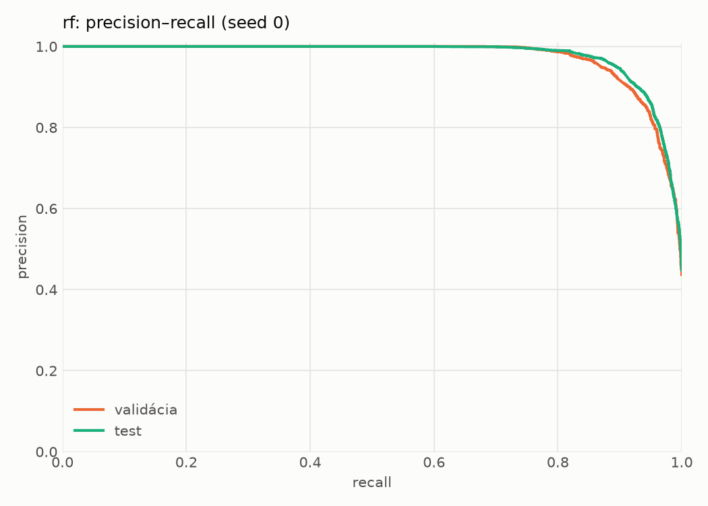
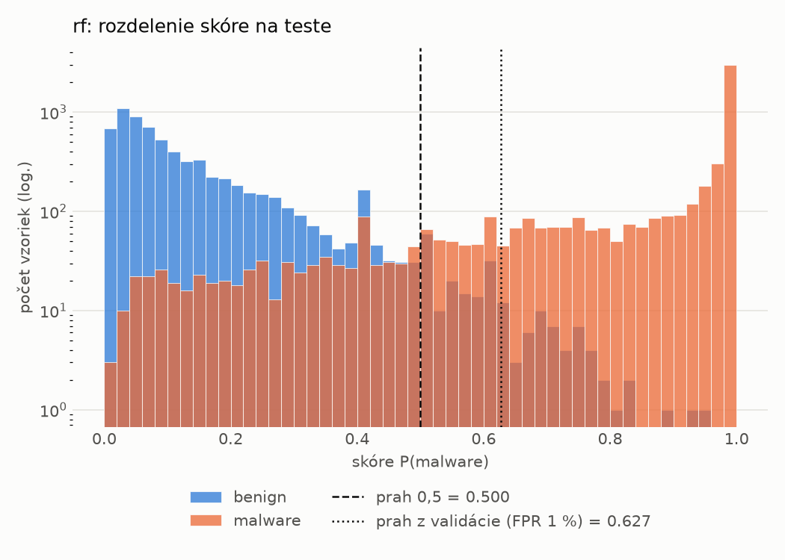
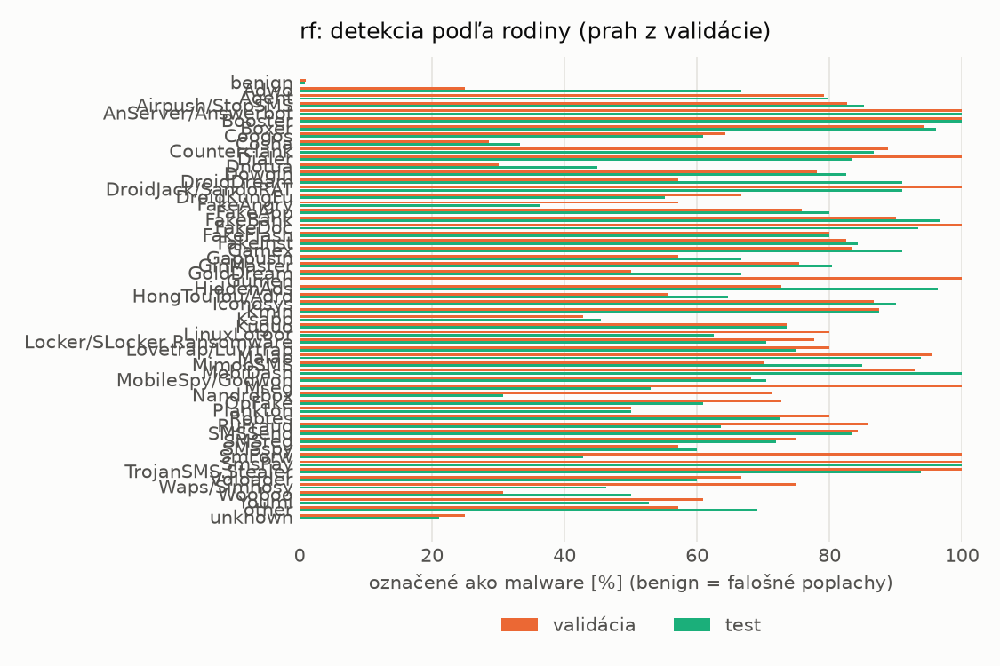
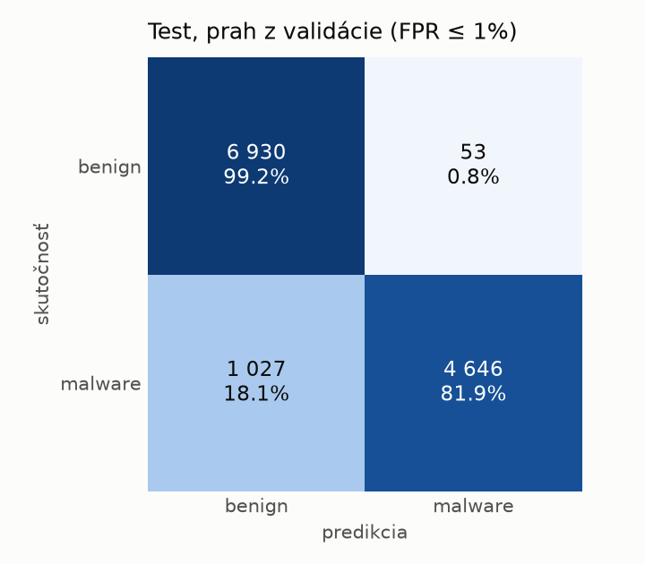
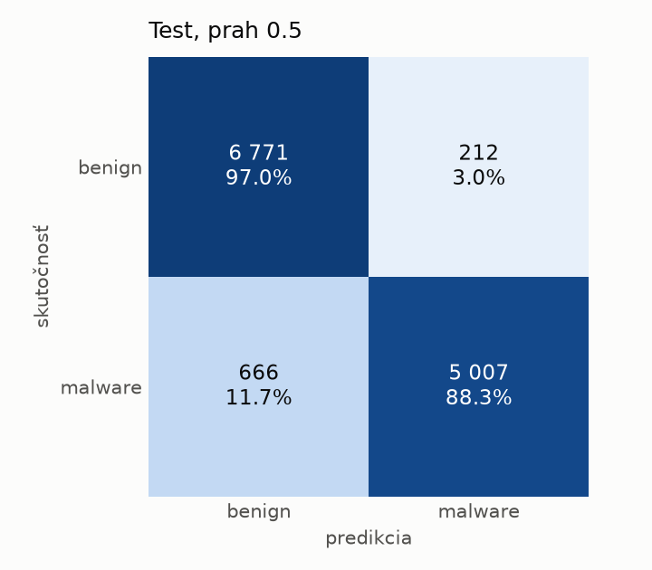

# dynamic/rf – beh `20261123-190754`

> Automaticky generované (`src/training/run_tabular.py`). Konfigurácia: `config.yaml`, protokol: `protocol.yaml`.

- **Model:** `random_forest` – Random Forest (pôvodné hodnoty príznakov)
- **Ladenie:** bez ladenia – hyperparametre prevzaté z `runs_v4/real_p/full/dynamic/rf/20261122-233325`
- **Finálne modely:** seedy [0, 1, 2]; hodnoty sú priemer ± smerodajná odchýlka cez seedy
- **Najlepšie hyperparametre:** `{"n_estimators": 500, "max_depth": 24, "min_samples_leaf": 1, "max_features": "sqrt"}`

## Detekčná kvalita (bez prahu)
| metrika | train (podvzorka) | validácia | test |
|---|---|---|---|
| ROC-AUC | 0.9986 ± 0.0000 | 0.9738 ± 0.0001 | 0.9764 ± 0.0000 |
| PR-AUC | 0.9984 ± 0.0000 | 0.9742 ± 0.0001 | 0.9778 ± 0.0001 |
| TPR pri FPR 1 % | 0.9674 ± 0.0005 | 0.8108 ± 0.0024 | 0.8244 ± 0.0017 |
| TPR pri FPR 0,1 % | 0.9495 ± 0.0006 | 0.7384 ± 0.0015 | 0.7123 ± 0.0044 |
| log loss | 0.0892 ± 0.0002 | 0.2060 ± 0.0003 | 0.2025 ± 0.0001 |
| Brier skóre | 0.0181 ± 0.0000 | 0.0594 ± 0.0001 | 0.0576 ± 0.0001 |

Rozdiel ROC-AUC train − validácia: **0.0248** (veľký rozdiel = preučenie).

## Pri prahu z validácie (FPR ≤ 1% na validácii)
| metrika | train (podvzorka) | validácia | test |
|---|---|---|---|
| accuracy | 0.9772 ± 0.0004 | 0.9118 ± 0.0010 | 0.9143 ± 0.0010 |
| balanced accuracy | 0.9736 ± 0.0004 | 0.9005 ± 0.0012 | 0.9052 ± 0.0012 |
| precision | 0.9999 ± 0.0001 | 0.9848 ± 0.0000 | 0.9891 ± 0.0009 |
| recall (TPR) | 0.9473 ± 0.0008 | 0.8108 ± 0.0024 | 0.8177 ± 0.0031 |
| FPR | 0.0001 ± 0.0001 | 0.0097 ± 0.0000 | 0.0073 ± 0.0006 |
| F1 | 0.9729 ± 0.0004 | 0.8893 ± 0.0015 | 0.8953 ± 0.0015 |
| MCC | 0.9543 ± 0.0007 | 0.8278 ± 0.0020 | 0.8345 ± 0.0017 |

## Pri pevnom prahu 0.5
| metrika | train (podvzorka) | validácia | test |
|---|---|---|---|
| accuracy | 0.9825 ± 0.0003 | 0.9240 ± 0.0010 | 0.9304 ± 0.0002 |
| balanced accuracy | 0.9814 ± 0.0003 | 0.9180 ± 0.0010 | 0.9259 ± 0.0002 |
| precision | 0.9855 ± 0.0000 | 0.9513 ± 0.0012 | 0.9588 ± 0.0009 |
| recall (TPR) | 0.9737 ± 0.0006 | 0.8706 ± 0.0012 | 0.8827 ± 0.0005 |
| FPR | 0.0109 ± 0.0000 | 0.0346 ± 0.0009 | 0.0308 ± 0.0007 |
| F1 | 0.9796 ± 0.0003 | 0.9091 ± 0.0012 | 0.9192 ± 0.0002 |
| MCC | 0.9643 ± 0.0005 | 0.8464 ± 0.0020 | 0.8605 ± 0.0005 |

## Výpočtové nároky (seed 0, testovacia množina)
| meranie | hodnota |
|---|---|
| tréning finálneho modelu | 2.4 s (priemer cez seedy) |
| ladenie spolu | 0 s |
| počet parametrov / uzlov | 3 280 984 |
| veľkosť modelu na disku | 262.85 MB |
| CPU latencia modelu (batch 1, 1 vlákno) | 14.929 ms (p95 15.504) |
| CPU priepustnosť (24 vlákien) | 111 260 vzoriek/s |

## Grafy
| | |
|---|---|
|  |  |
|  |  |
|  |  |
|  |  |

## Súbory
`metrics.json` (všetky metriky po seedoch vrátane rodín), `timing.json`, `hpo_trials.csv`,
`predictions/<časť>_seed<N>.parquet` (sha256, family, label, score), `model/seed_<N>/`, `log.txt`.
