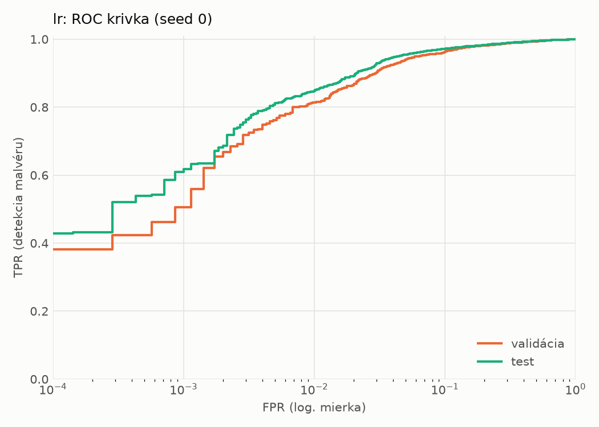
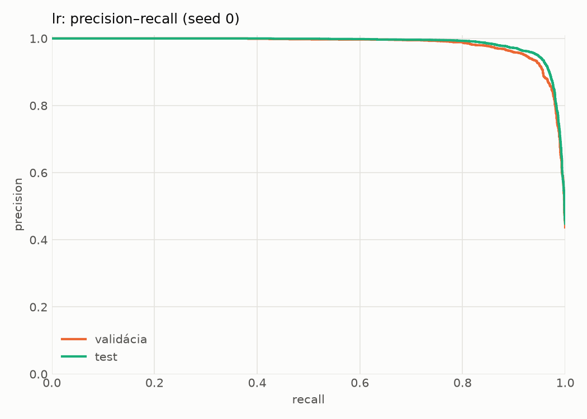
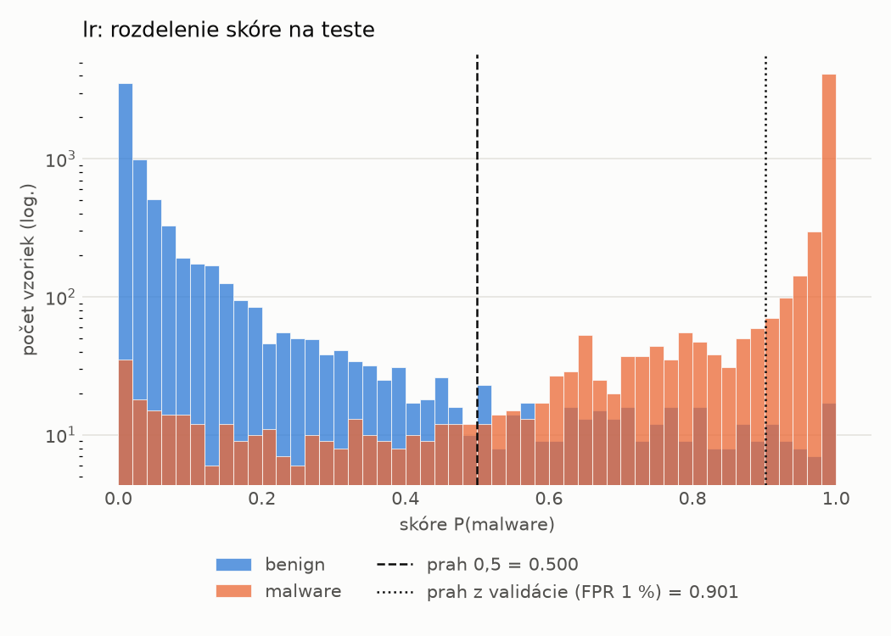
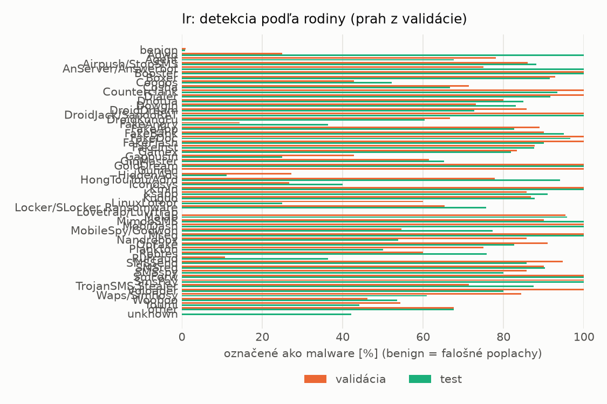
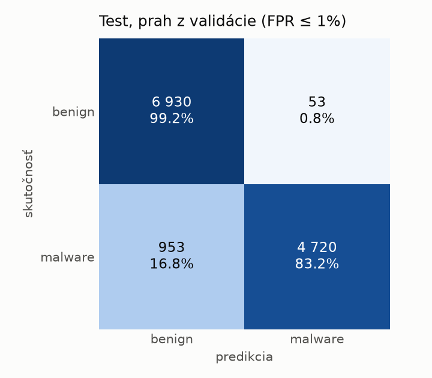
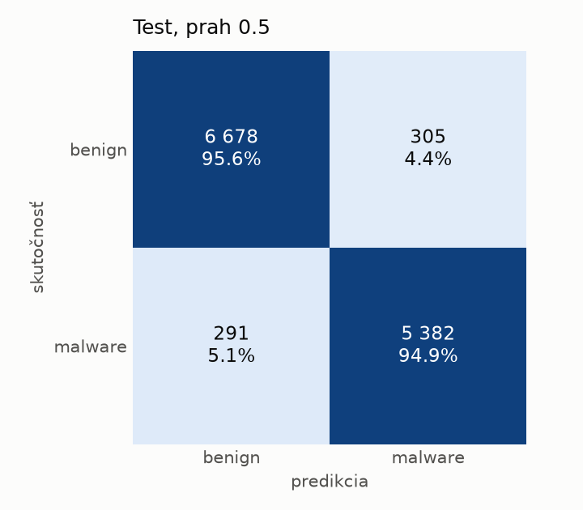

# hybrid/lr – beh `20261123-191007`

> Automaticky generované (`src/training/run_tabular.py`). Konfigurácia: `config.yaml`, protokol: `protocol.yaml`.

- **Model:** `logreg` – logistická regresia s L2 regularizáciou (vstup signed log1p + štandardizácia)
- **Ladenie:** bez ladenia – hyperparametre prevzaté z `runs_v4/real_p/full/hybrid/lr/20261122-235738`
- **Finálne modely:** seedy [0, 1, 2]; hodnoty sú priemer ± smerodajná odchýlka cez seedy
- **Najlepšie hyperparametre:** `{"max_iter": 2000, "C": 0.07124252843547843}`

## Detekčná kvalita (bez prahu)
| metrika | train (podvzorka) | validácia | test |
|---|---|---|---|
| ROC-AUC | 0.9873 ± 0.0000 | 0.9836 ± 0.0000 | 0.9862 ± 0.0000 |
| PR-AUC | 0.9866 ± 0.0000 | 0.9826 ± 0.0000 | 0.9864 ± 0.0000 |
| TPR pri FPR 1 % | 0.8568 ± 0.0000 | 0.8132 ± 0.0000 | 0.8465 ± 0.0000 |
| TPR pri FPR 0,1 % | 0.5328 ± 0.0000 | 0.5057 ± 0.0000 | 0.6090 ± 0.0000 |
| log loss | 0.1328 ± 0.0000 | 0.1545 ± 0.0000 | 0.1400 ± 0.0000 |
| Brier skóre | 0.0363 ± 0.0000 | 0.0429 ± 0.0000 | 0.0379 ± 0.0000 |

Rozdiel ROC-AUC train − validácia: **0.0037** (veľký rozdiel = preučenie).

## Pri prahu z validácie (FPR ≤ 1% na validácii)
| metrika | train (podvzorka) | validácia | test |
|---|---|---|---|
| accuracy | 0.9210 ± 0.0000 | 0.9129 ± 0.0000 | 0.9205 ± 0.0000 |
| balanced accuracy | 0.9093 ± 0.0000 | 0.9017 ± 0.0000 | 0.9122 ± 0.0000 |
| precision | 0.9919 ± 0.0000 | 0.9848 ± 0.0000 | 0.9889 ± 0.0000 |
| recall (TPR) | 0.8237 ± 0.0000 | 0.8132 ± 0.0000 | 0.8320 ± 0.0000 |
| FPR | 0.0051 ± 0.0000 | 0.0097 ± 0.0000 | 0.0076 ± 0.0000 |
| F1 | 0.9000 ± 0.0000 | 0.8908 ± 0.0000 | 0.9037 ± 0.0000 |
| MCC | 0.8455 ± 0.0000 | 0.8298 ± 0.0000 | 0.8459 ± 0.0000 |

## Pri pevnom prahu 0.5
| metrika | train (podvzorka) | validácia | test |
|---|---|---|---|
| accuracy | 0.9553 ± 0.0000 | 0.9445 ± 0.0000 | 0.9529 ± 0.0000 |
| balanced accuracy | 0.9539 ± 0.0000 | 0.9429 ± 0.0000 | 0.9525 ± 0.0000 |
| precision | 0.9525 ± 0.0000 | 0.9424 ± 0.0000 | 0.9464 ± 0.0000 |
| recall (TPR) | 0.9435 ± 0.0000 | 0.9299 ± 0.0000 | 0.9487 ± 0.0000 |
| FPR | 0.0357 ± 0.0000 | 0.0441 ± 0.0000 | 0.0437 ± 0.0000 |
| F1 | 0.9480 ± 0.0000 | 0.9361 ± 0.0000 | 0.9475 ± 0.0000 |
| MCC | 0.9088 ± 0.0000 | 0.8871 ± 0.0000 | 0.9048 ± 0.0000 |

## Výpočtové nároky (seed 0, testovacia množina)
| meranie | hodnota |
|---|---|
| tréning finálneho modelu | 0.2 s (priemer cez seedy) |
| ladenie spolu | 0 s |
| počet parametrov / uzlov | 286 |
| veľkosť modelu na disku | 0.01 MB |
| transformácia vstupu – latencia (1 vlákno) | 0.006 ms |
| transformácia vstupu – priepustnosť | 502 192 vzoriek/s |
| CPU latencia modelu (batch 1, 1 vlákno) | 0.004 ms (p95 0.005) |
| CPU priepustnosť (24 vlákien) | 2 221 793 vzoriek/s |

## Grafy
| | |
|---|---|
|  |  |
|  |  |
|  |  |
|  |  |

## Súbory
`metrics.json` (všetky metriky po seedoch vrátane rodín), `timing.json`, `hpo_trials.csv`,
`predictions/<časť>_seed<N>.parquet` (sha256, family, label, score), `model/seed_<N>/`, `log.txt`.
