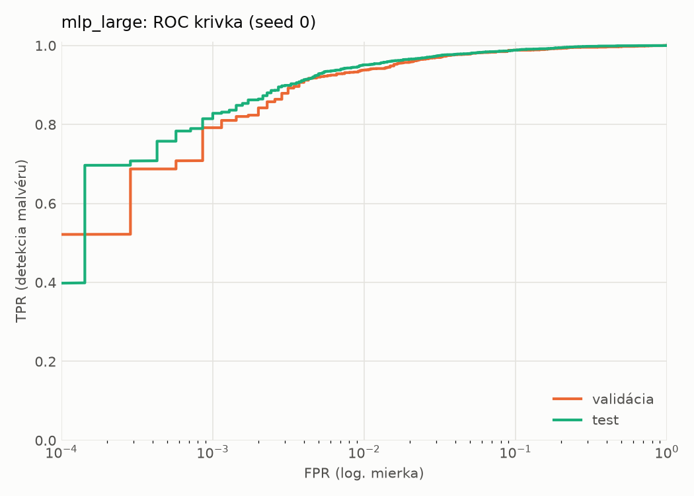
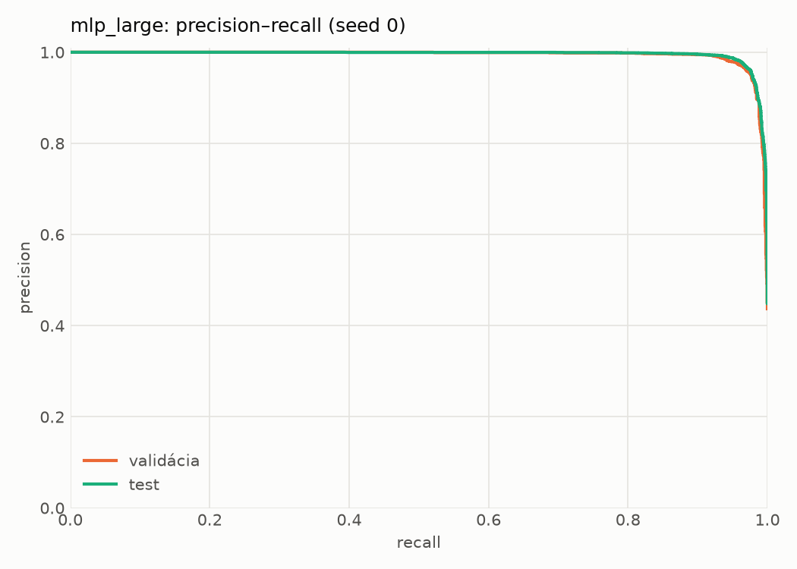
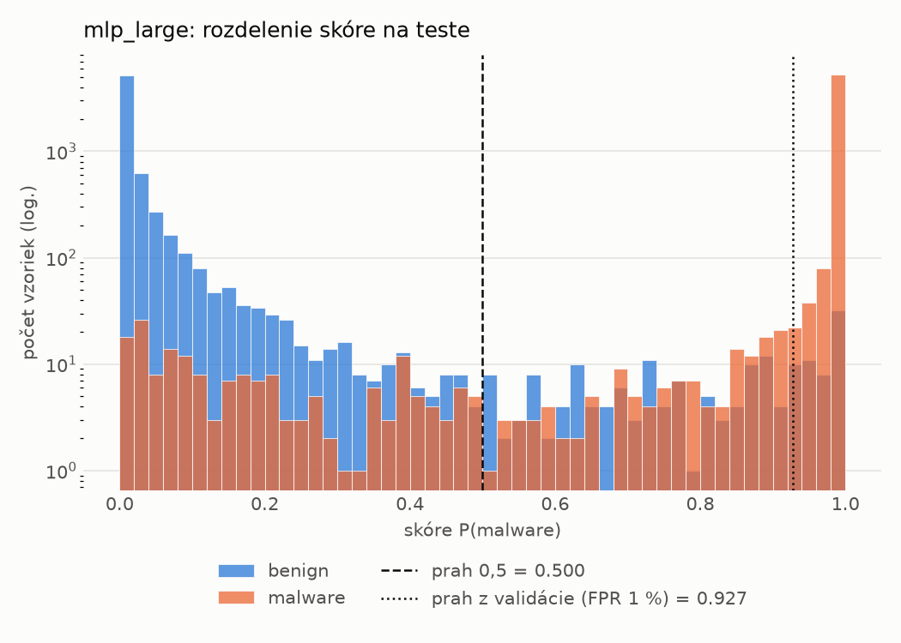
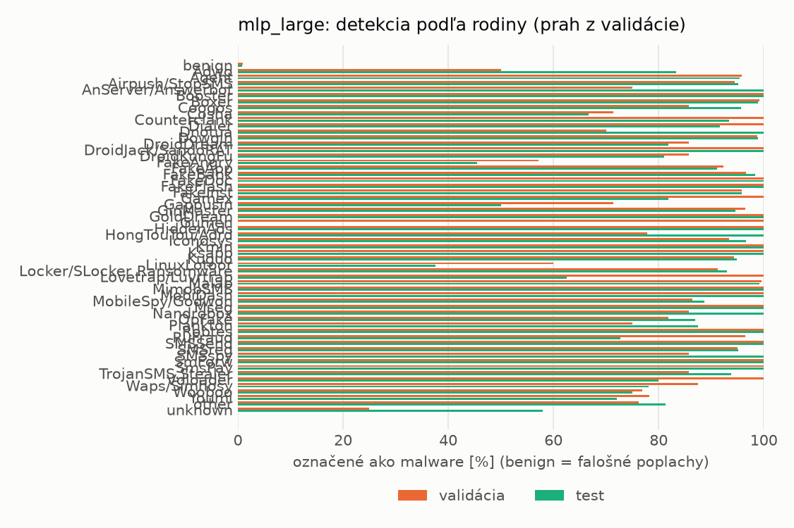
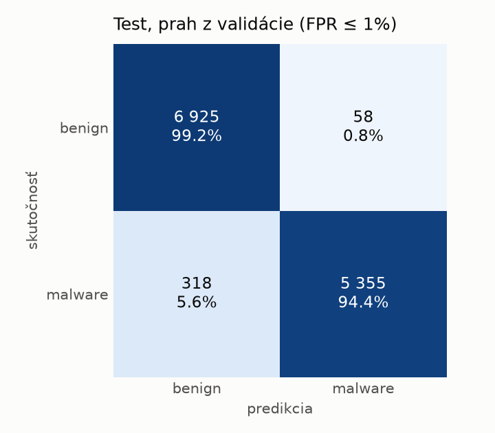
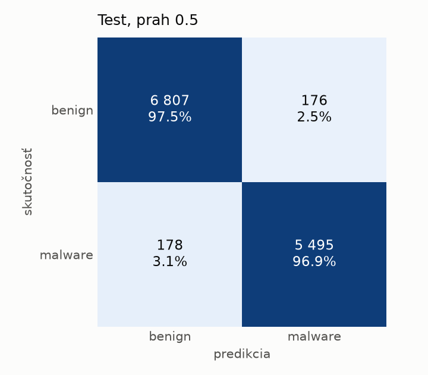
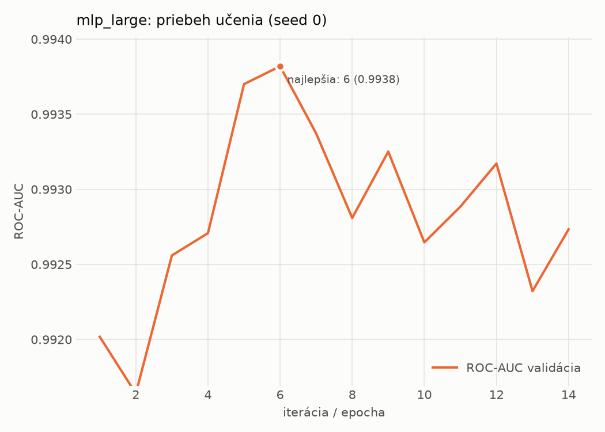

# hybrid/mlp_large – beh `20261123-191049`

> Automaticky generované (`src/training/run_tabular.py`). Konfigurácia: `config.yaml`, protokol: `protocol.yaml`.

- **Model:** `mlp` – veľká neurónová sieť (3–5 skrytých vrstiev, 512–2048 neurónov), kandidát na učiteľa
- **Ladenie:** bez ladenia – hyperparametre prevzaté z `runs_v4/real_p/full/hybrid/mlp_large/20261123-000809`
- **Finálne modely:** seedy [0, 1, 2]; hodnoty sú priemer ± smerodajná odchýlka cez seedy
- **Najlepšie hyperparametre:** `{"max_epochs": 100, "patience": 8, "hidden_layers": 3, "hidden_width": 1024, "width_decay": 1.0, "dropout": 0.11375540844608736, "lr": 0.0022038218939289885, "weight_decay": 1.0842262717330169e-05, "batch_size": 256}`

## Detekčná kvalita (bez prahu)
| metrika | train (podvzorka) | validácia | test |
|---|---|---|---|
| ROC-AUC | 0.9977 ± 0.0002 | 0.9940 ± 0.0002 | 0.9952 ± 0.0005 |
| PR-AUC | 0.9977 ± 0.0002 | 0.9939 ± 0.0001 | 0.9952 ± 0.0005 |
| TPR pri FPR 1 % | 0.9766 ± 0.0028 | 0.9406 ± 0.0032 | 0.9541 ± 0.0040 |
| TPR pri FPR 0,1 % | 0.9499 ± 0.0101 | 0.7241 ± 0.0665 | 0.8134 ± 0.0011 |
| log loss | 0.0490 ± 0.0028 | 0.0904 ± 0.0041 | 0.0809 ± 0.0056 |
| Brier skóre | 0.0127 ± 0.0010 | 0.0225 ± 0.0011 | 0.0208 ± 0.0012 |

Rozdiel ROC-AUC train − validácia: **0.0037** (veľký rozdiel = preučenie).

## Pri prahu z validácie (FPR ≤ 1% na validácii)
| metrika | train (podvzorka) | validácia | test |
|---|---|---|---|
| accuracy | 0.9793 ± 0.0024 | 0.9685 ± 0.0014 | 0.9715 ± 0.0011 |
| balanced accuracy | 0.9763 ± 0.0026 | 0.9654 ± 0.0016 | 0.9690 ± 0.0011 |
| precision | 0.9981 ± 0.0011 | 0.9868 ± 0.0000 | 0.9912 ± 0.0019 |
| recall (TPR) | 0.9540 ± 0.0045 | 0.9406 ± 0.0032 | 0.9448 ± 0.0017 |
| FPR | 0.0014 ± 0.0008 | 0.0097 ± 0.0000 | 0.0068 ± 0.0015 |
| F1 | 0.9755 ± 0.0028 | 0.9631 ± 0.0017 | 0.9675 ± 0.0012 |
| MCC | 0.9584 ± 0.0047 | 0.9365 ± 0.0027 | 0.9430 ± 0.0022 |

## Pri pevnom prahu 0.5
| metrika | train (podvzorka) | validácia | test |
|---|---|---|---|
| accuracy | 0.9840 ± 0.0014 | 0.9718 ± 0.0012 | 0.9736 ± 0.0014 |
| balanced accuracy | 0.9831 ± 0.0013 | 0.9713 ± 0.0010 | 0.9729 ± 0.0012 |
| precision | 0.9859 ± 0.0033 | 0.9687 ± 0.0038 | 0.9739 ± 0.0043 |
| recall (TPR) | 0.9768 ± 0.0021 | 0.9668 ± 0.0017 | 0.9669 ± 0.0016 |
| FPR | 0.0106 ± 0.0025 | 0.0243 ± 0.0031 | 0.0211 ± 0.0036 |
| F1 | 0.9813 ± 0.0016 | 0.9677 ± 0.0013 | 0.9704 ± 0.0015 |
| MCC | 0.9673 ± 0.0029 | 0.9427 ± 0.0024 | 0.9465 ± 0.0029 |

## Výpočtové nároky (seed 0, testovacia množina)
| meranie | hodnota |
|---|---|
| tréning finálneho modelu | 5.5 s (priemer cez seedy) |
| ladenie spolu | 0 s |
| počet parametrov / uzlov | 2 399 233 |
| veľkosť modelu na disku | 9.64 MB |
| transformácia vstupu – latencia (1 vlákno) | 0.017 ms |
| transformácia vstupu – priepustnosť | 291 935 vzoriek/s |
| CPU latencia modelu (batch 1, 1 vlákno) | 0.248 ms (p95 0.584) |
| CPU priepustnosť (24 vlákien) | 155 827 vzoriek/s |
| GPU latencia (batch 1) | 0.401 ms (p95 0.909) |
| GPU priepustnosť | 774 849 vzoriek/s |
| GPU špičková pamäť | 233 MB |

## Grafy
| | |
|---|---|
|  |  |
|  |  |
|  |  |
|  |  |

## Súbory
`metrics.json` (všetky metriky po seedoch vrátane rodín), `timing.json`, `hpo_trials.csv`,
`predictions/<časť>_seed<N>.parquet` (sha256, family, label, score), `model/seed_<N>/`, `log.txt`.
