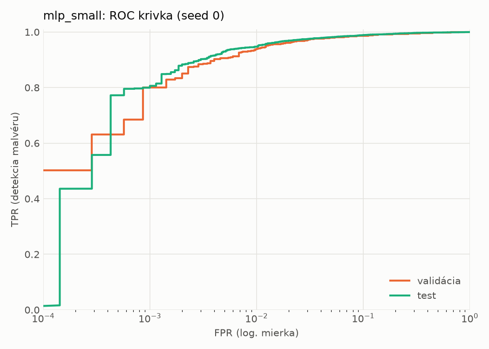
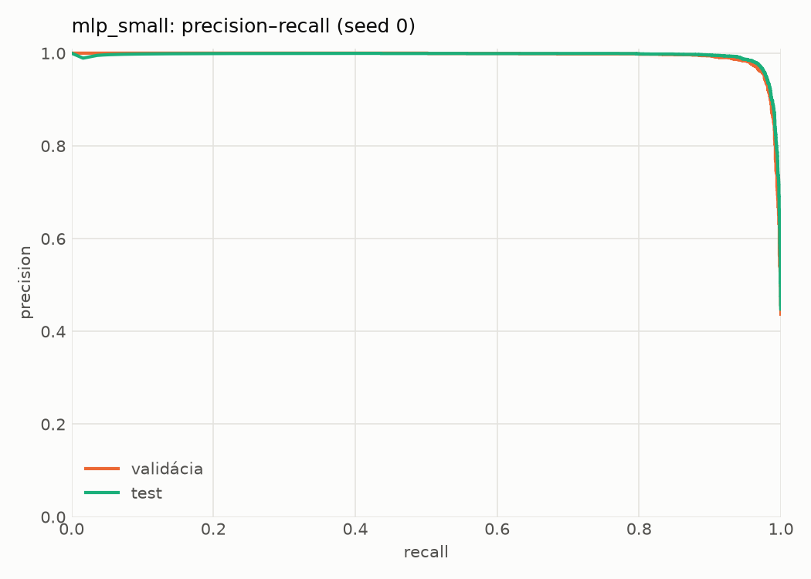
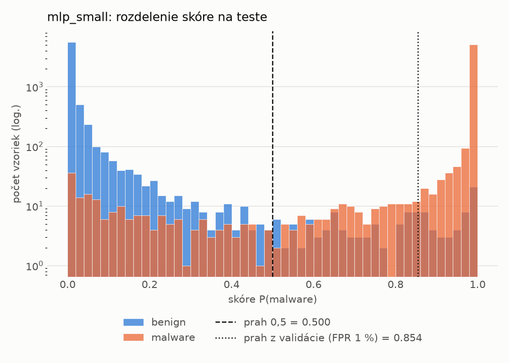
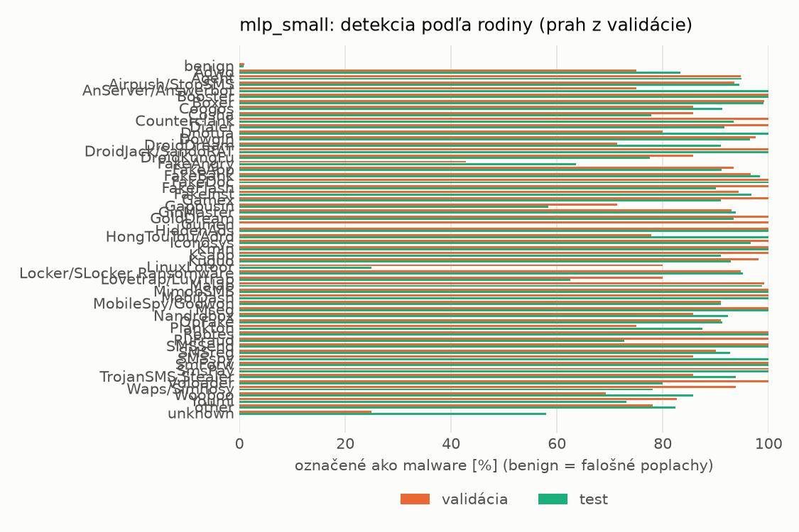
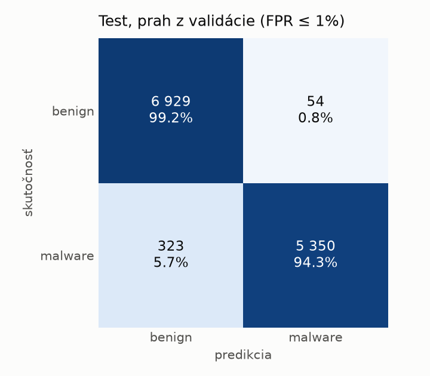
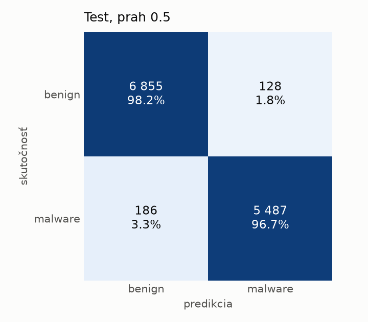
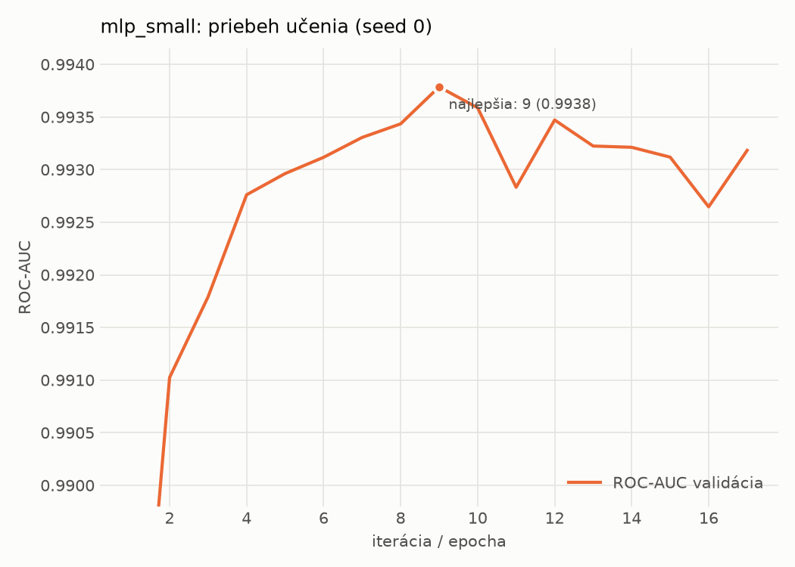

# hybrid/mlp_small – beh `20261123-191041`

> Automaticky generované (`src/training/run_tabular.py`). Konfigurácia: `config.yaml`, protokol: `protocol.yaml`.

- **Model:** `mlp` – malá neurónová sieť (1–2 skryté vrstvy), kandidát na ľahkého študenta
- **Ladenie:** bez ladenia – hyperparametre prevzaté z `runs_v4/real_p/full/hybrid/mlp_small/20261123-000512`
- **Finálne modely:** seedy [0, 1, 2]; hodnoty sú priemer ± smerodajná odchýlka cez seedy
- **Najlepšie hyperparametre:** `{"width_decay": 0.5, "max_epochs": 100, "patience": 8, "hidden_layers": 2, "hidden_width": 256, "dropout": 0.17059205009500078, "lr": 0.0013906274900964423, "weight_decay": 9.337519104222036e-06, "batch_size": 1024}`

## Detekčná kvalita (bez prahu)
| metrika | train (podvzorka) | validácia | test |
|---|---|---|---|
| ROC-AUC | 0.9984 ± 0.0009 | 0.9939 ± 0.0002 | 0.9950 ± 0.0006 |
| PR-AUC | 0.9983 ± 0.0009 | 0.9936 ± 0.0001 | 0.9949 ± 0.0008 |
| TPR pri FPR 1 % | 0.9833 ± 0.0070 | 0.9407 ± 0.0111 | 0.9526 ± 0.0064 |
| TPR pri FPR 0,1 % | 0.9615 ± 0.0199 | 0.7923 ± 0.0356 | 0.8160 ± 0.0433 |
| log loss | 0.0387 ± 0.0126 | 0.0900 ± 0.0027 | 0.0793 ± 0.0034 |
| Brier skóre | 0.0099 ± 0.0033 | 0.0219 ± 0.0026 | 0.0195 ± 0.0016 |

Rozdiel ROC-AUC train − validácia: **0.0045** (veľký rozdiel = preučenie).

## Pri prahu z validácie (FPR ≤ 1% na validácii)
| metrika | train (podvzorka) | validácia | test |
|---|---|---|---|
| accuracy | 0.9829 ± 0.0055 | 0.9686 ± 0.0048 | 0.9713 ± 0.0033 |
| balanced accuracy | 0.9803 ± 0.0063 | 0.9655 ± 0.0055 | 0.9689 ± 0.0038 |
| precision | 0.9989 ± 0.0009 | 0.9868 ± 0.0002 | 0.9901 ± 0.0011 |
| recall (TPR) | 0.9615 ± 0.0120 | 0.9407 ± 0.0111 | 0.9454 ± 0.0085 |
| FPR | 0.0008 ± 0.0006 | 0.0097 ± 0.0000 | 0.0077 ± 0.0009 |
| F1 | 0.9798 ± 0.0066 | 0.9632 ± 0.0059 | 0.9672 ± 0.0040 |
| MCC | 0.9655 ± 0.0110 | 0.9367 ± 0.0096 | 0.9425 ± 0.0065 |

## Pri pevnom prahu 0.5
| metrika | train (podvzorka) | validácia | test |
|---|---|---|---|
| accuracy | 0.9879 ± 0.0042 | 0.9735 ± 0.0039 | 0.9761 ± 0.0022 |
| balanced accuracy | 0.9871 ± 0.0042 | 0.9730 ± 0.0038 | 0.9755 ± 0.0022 |
| precision | 0.9907 ± 0.0054 | 0.9704 ± 0.0062 | 0.9767 ± 0.0030 |
| recall (TPR) | 0.9812 ± 0.0048 | 0.9689 ± 0.0033 | 0.9699 ± 0.0027 |
| FPR | 0.0070 ± 0.0041 | 0.0229 ± 0.0049 | 0.0188 ± 0.0025 |
| F1 | 0.9859 ± 0.0049 | 0.9696 ± 0.0044 | 0.9733 ± 0.0024 |
| MCC | 0.9753 ± 0.0086 | 0.9461 ± 0.0080 | 0.9517 ± 0.0044 |

## Výpočtové nároky (seed 0, testovacia množina)
| meranie | hodnota |
|---|---|
| tréning finálneho modelu | 1.7 s (priemer cez seedy) |
| ladenie spolu | 0 s |
| počet parametrov / uzlov | 107 009 |
| veľkosť modelu na disku | 0.44 MB |
| transformácia vstupu – latencia (1 vlákno) | 0.017 ms |
| transformácia vstupu – priepustnosť | 418 405 vzoriek/s |
| CPU latencia modelu (batch 1, 1 vlákno) | 0.230 ms (p95 0.244) |
| CPU priepustnosť (24 vlákien) | 1 354 742 vzoriek/s |
| GPU latencia (batch 1) | 0.473 ms (p95 0.729) |
| GPU priepustnosť | 1 521 739 vzoriek/s |
| GPU špičková pamäť | 107 MB |

## Grafy
| | |
|---|---|
|  |  |
|  |  |
|  |  |
|  |  |

## Súbory
`metrics.json` (všetky metriky po seedoch vrátane rodín), `timing.json`, `hpo_trials.csv`,
`predictions/<časť>_seed<N>.parquet` (sha256, family, label, score), `model/seed_<N>/`, `log.txt`.
