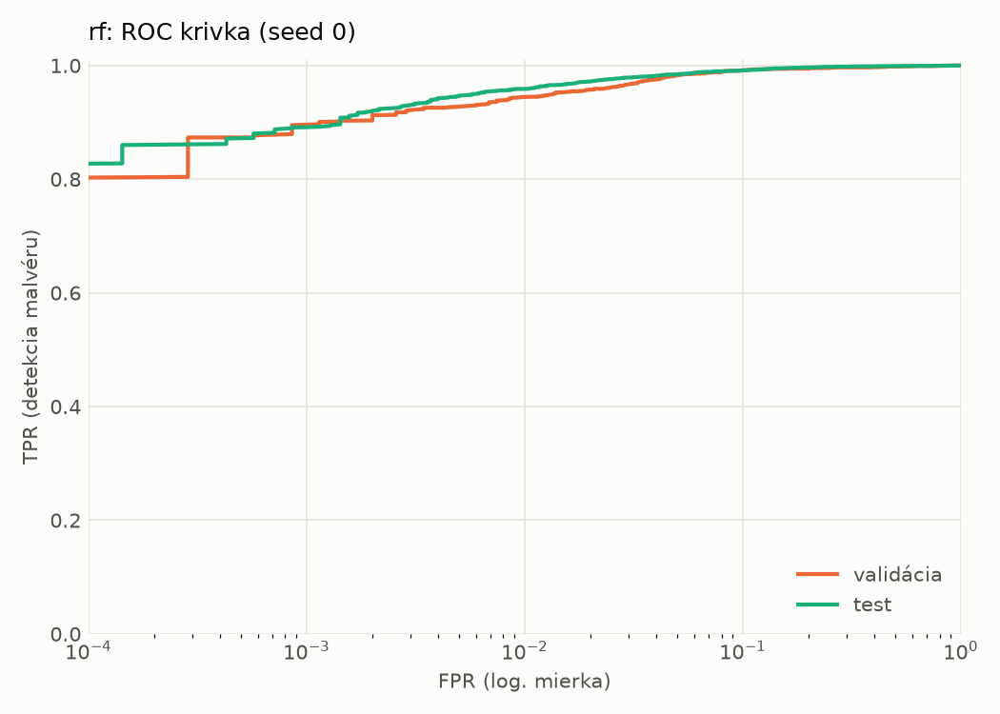
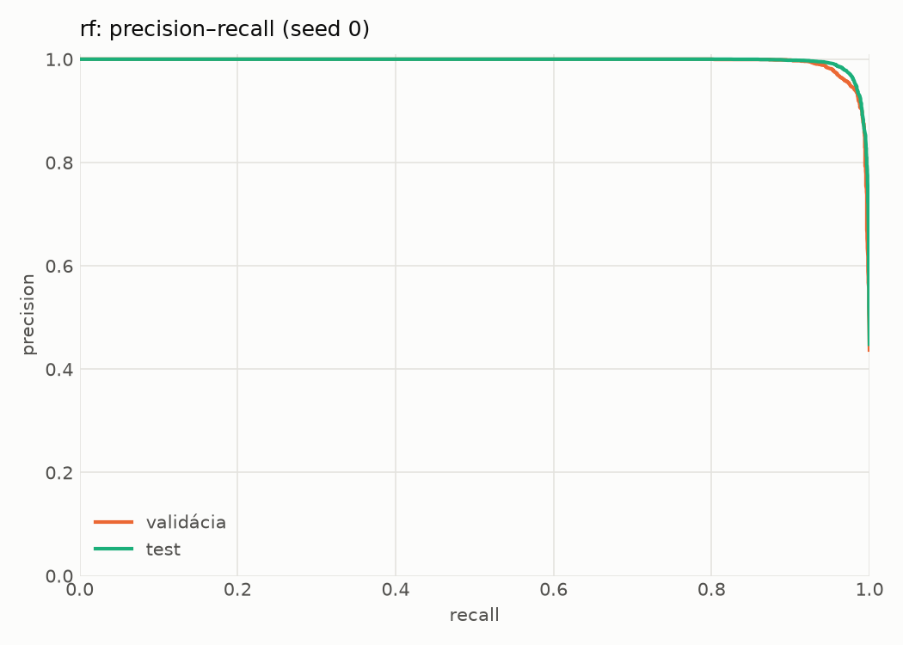
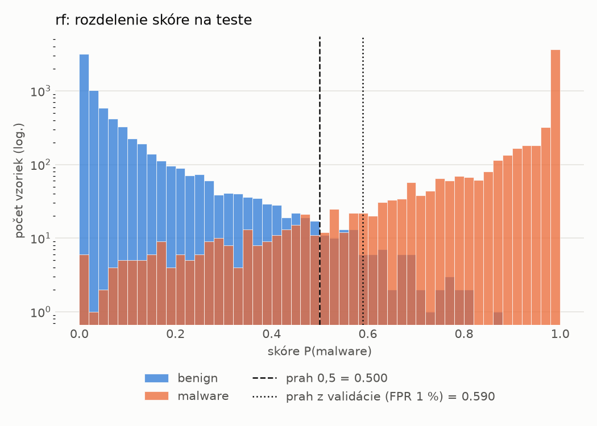
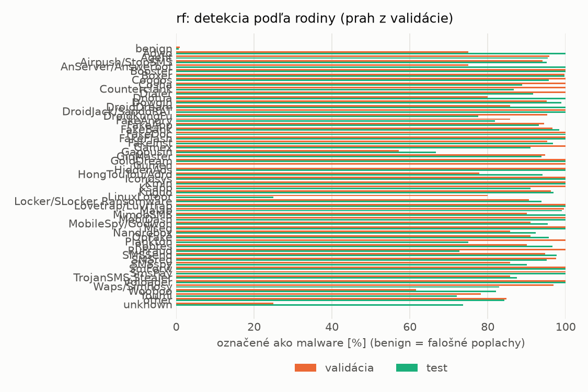
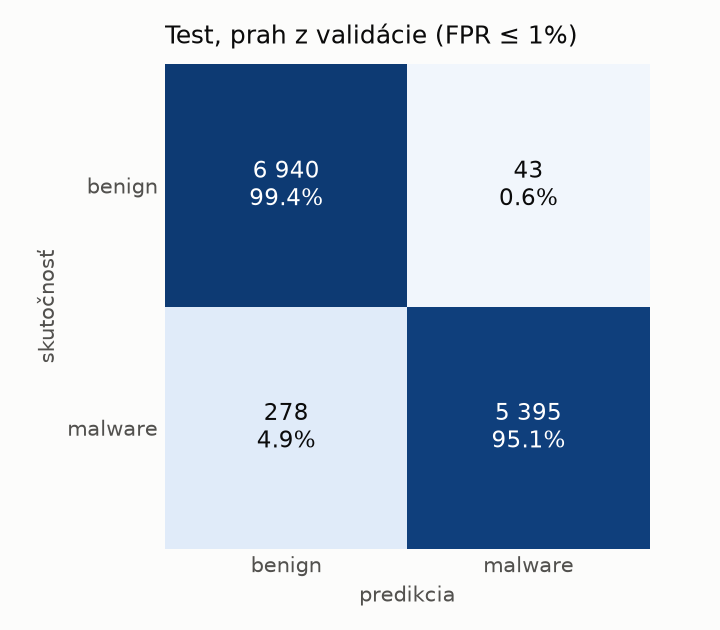
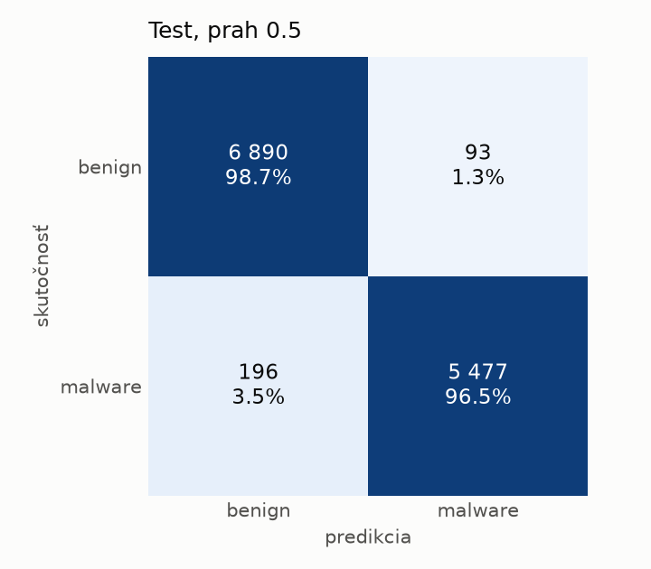

# hybrid/rf – beh `20261123-191009`

> Automaticky generované (`src/training/run_tabular.py`). Konfigurácia: `config.yaml`, protokol: `protocol.yaml`.

- **Model:** `random_forest` – Random Forest (pôvodné hodnoty príznakov)
- **Ladenie:** bez ladenia – hyperparametre prevzaté z `runs_v4/real_p/full/hybrid/rf/20261122-235747`
- **Finálne modely:** seedy [0, 1, 2]; hodnoty sú priemer ± smerodajná odchýlka cez seedy
- **Najlepšie hyperparametre:** `{"n_estimators": 400, "max_depth": null, "min_samples_leaf": 1, "max_features": "sqrt"}`

## Detekčná kvalita (bez prahu)
| metrika | train (podvzorka) | validácia | test |
|---|---|---|---|
| ROC-AUC | 1.0000 ± 0.0000 | 0.9952 ± 0.0001 | 0.9965 ± 0.0000 |
| PR-AUC | 1.0000 ± 0.0000 | 0.9951 ± 0.0001 | 0.9965 ± 0.0000 |
| TPR pri FPR 1 % | 1.0000 ± 0.0000 | 0.9424 ± 0.0027 | 0.9590 ± 0.0007 |
| TPR pri FPR 0,1 % | 1.0000 ± 0.0000 | 0.8864 ± 0.0091 | 0.8935 ± 0.0054 |
| log loss | 0.0275 ± 0.0001 | 0.1009 ± 0.0015 | 0.0942 ± 0.0003 |
| Brier skóre | 0.0030 ± 0.0000 | 0.0248 ± 0.0002 | 0.0226 ± 0.0001 |

Rozdiel ROC-AUC train − validácia: **0.0048** (veľký rozdiel = preučenie).

## Pri prahu z validácie (FPR ≤ 1% na validácii)
| metrika | train (podvzorka) | validácia | test |
|---|---|---|---|
| accuracy | 1.0000 ± 0.0000 | 0.9694 ± 0.0012 | 0.9741 ± 0.0005 |
| balanced accuracy | 1.0000 ± 0.0000 | 0.9664 ± 0.0014 | 0.9718 ± 0.0005 |
| precision | 1.0000 ± 0.0000 | 0.9870 ± 0.0002 | 0.9919 ± 0.0003 |
| recall (TPR) | 1.0000 ± 0.0000 | 0.9424 ± 0.0027 | 0.9500 ± 0.0009 |
| FPR | 0.0000 ± 0.0000 | 0.0096 ± 0.0002 | 0.0063 ± 0.0002 |
| F1 | 1.0000 ± 0.0000 | 0.9642 ± 0.0014 | 0.9705 ± 0.0005 |
| MCC | 1.0000 ± 0.0000 | 0.9383 ± 0.0024 | 0.9482 ± 0.0009 |

## Pri pevnom prahu 0.5
| metrika | train (podvzorka) | validácia | test |
|---|---|---|---|
| accuracy | 1.0000 ± 0.0000 | 0.9698 ± 0.0003 | 0.9771 ± 0.0002 |
| balanced accuracy | 1.0000 ± 0.0000 | 0.9684 ± 0.0003 | 0.9760 ± 0.0002 |
| precision | 1.0000 ± 0.0000 | 0.9732 ± 0.0008 | 0.9832 ± 0.0001 |
| recall (TPR) | 1.0000 ± 0.0000 | 0.9573 ± 0.0008 | 0.9654 ± 0.0004 |
| FPR | 0.0000 ± 0.0000 | 0.0204 ± 0.0007 | 0.0134 ± 0.0001 |
| F1 | 1.0000 ± 0.0000 | 0.9652 ± 0.0003 | 0.9742 ± 0.0002 |
| MCC | 1.0000 ± 0.0000 | 0.9387 ± 0.0006 | 0.9538 ± 0.0003 |

## Výpočtové nároky (seed 0, testovacia množina)
| meranie | hodnota |
|---|---|
| tréning finálneho modelu | 2.5 s (priemer cez seedy) |
| ladenie spolu | 0 s |
| počet parametrov / uzlov | 1 935 328 |
| veľkosť modelu na disku | 155.16 MB |
| CPU latencia modelu (batch 1, 1 vlákno) | 9.528 ms (p95 9.959) |
| CPU priepustnosť (24 vlákien) | 133 526 vzoriek/s |

## Grafy
| | |
|---|---|
|  |  |
|  |  |
|  |  |
|  |  |

## Súbory
`metrics.json` (všetky metriky po seedoch vrátane rodín), `timing.json`, `hpo_trials.csv`,
`predictions/<časť>_seed<N>.parquet` (sha256, family, label, score), `model/seed_<N>/`, `log.txt`.
