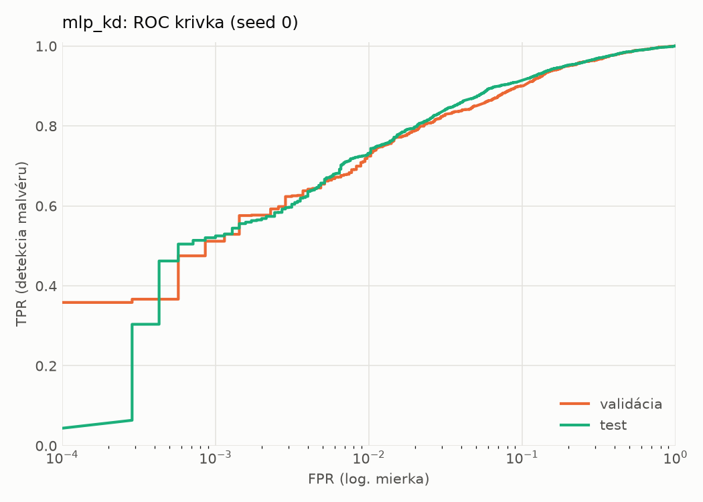
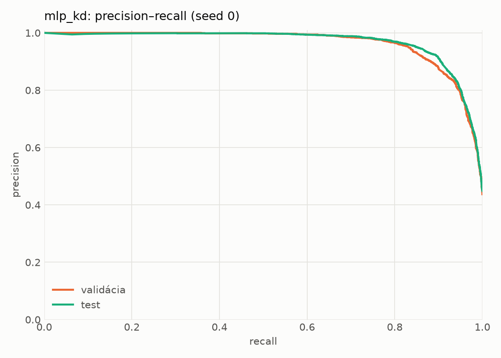
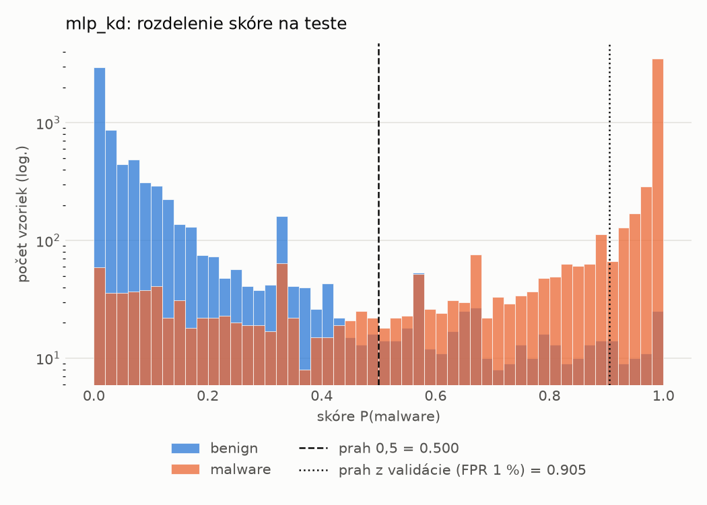
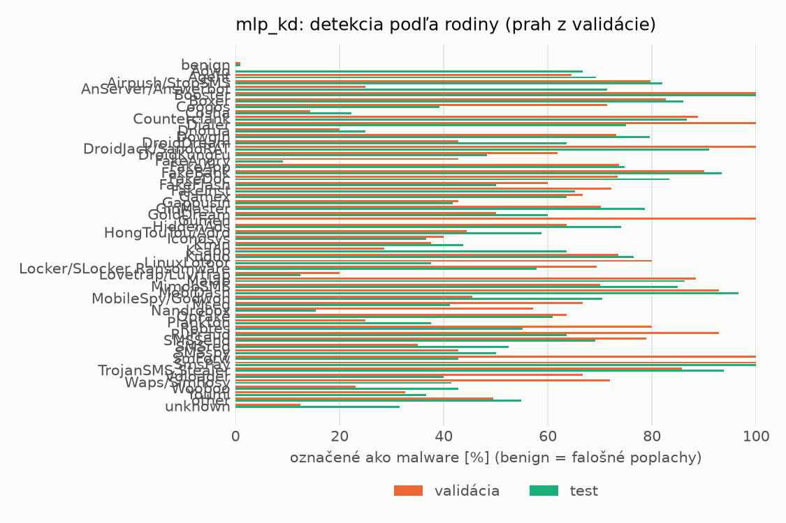
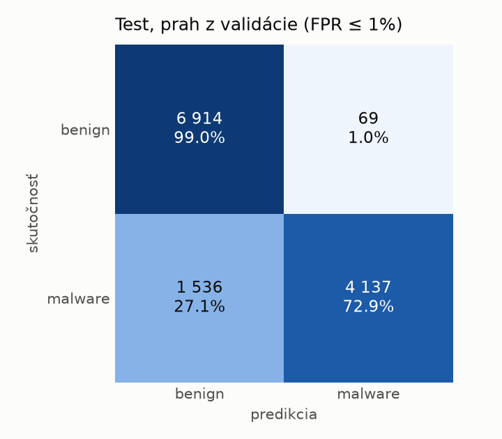
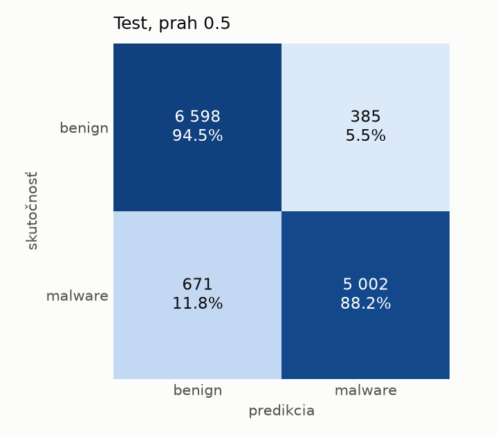
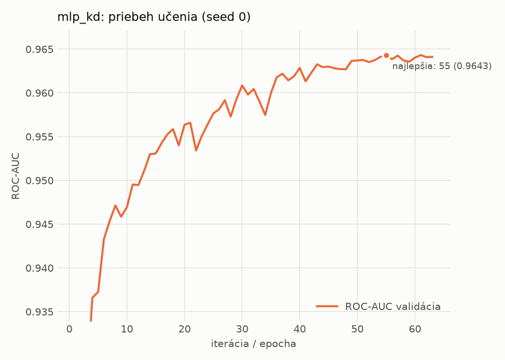

# dynamic/mlp_kd – beh `20261123-191512`

> Automaticky generované (`src/training/run_tabular.py`). Konfigurácia: `config.yaml`, protokol: `protocol.yaml`.

- **Model:** `mlp` – študent – malé MLP učené destiláciou z hybridného učiteľa
- **Ladenie:** bez ladenia – hyperparametre prevzaté z `runs_v4/real_p/full/students_dynamic/mlp_kd/20261123-003616`
- **Finálne modely:** seedy [0, 1, 2]; hodnoty sú priemer ± smerodajná odchýlka cez seedy
- **Najlepšie hyperparametre:** `{"hidden_layers": 1, "max_epochs": 100, "patience": 8, "hidden_width": 64, "dropout": 0.008718220633742228, "lr": 0.002354362488135847, "weight_decay": 3.1986204696979587e-06, "batch_size": 1024, "kd_alpha": 0.2022752781289341, "kd_temperature": 1.263446759011441}`

## Detekčná kvalita (bez prahu)
| metrika | train (podvzorka) | validácia | test |
|---|---|---|---|
| ROC-AUC | 0.9752 ± 0.0018 | 0.9637 ± 0.0032 | 0.9662 ± 0.0011 |
| PR-AUC | 0.9741 ± 0.0018 | 0.9629 ± 0.0029 | 0.9663 ± 0.0014 |
| TPR pri FPR 1 % | 0.7989 ± 0.0045 | 0.7192 ± 0.0127 | 0.7267 ± 0.0074 |
| TPR pri FPR 0,1 % | 0.5539 ± 0.0222 | 0.5105 ± 0.0120 | 0.4972 ± 0.0241 |
| log loss | 0.1889 ± 0.0068 | 0.2361 ± 0.0084 | 0.2281 ± 0.0030 |
| Brier skóre | 0.0545 ± 0.0018 | 0.0690 ± 0.0026 | 0.0643 ± 0.0012 |

Rozdiel ROC-AUC train − validácia: **0.0115** (veľký rozdiel = preučenie).

## Pri prahu z validácie (FPR ≤ 1% na validácii)
| metrika | train (podvzorka) | validácia | test |
|---|---|---|---|
| accuracy | 0.8842 ± 0.0061 | 0.8718 ± 0.0056 | 0.8708 ± 0.0052 |
| balanced accuracy | 0.8668 ± 0.0071 | 0.8547 ± 0.0064 | 0.8570 ± 0.0059 |
| precision | 0.9901 ± 0.0002 | 0.9828 ± 0.0003 | 0.9838 ± 0.0005 |
| recall (TPR) | 0.7392 ± 0.0141 | 0.7192 ± 0.0127 | 0.7237 ± 0.0122 |
| FPR | 0.0056 ± 0.0000 | 0.0097 ± 0.0000 | 0.0097 ± 0.0005 |
| F1 | 0.8464 ± 0.0093 | 0.8306 ± 0.0086 | 0.8339 ± 0.0080 |
| MCC | 0.7774 ± 0.0111 | 0.7545 ± 0.0100 | 0.7553 ± 0.0091 |

## Pri pevnom prahu 0.5
| metrika | train (podvzorka) | validácia | test |
|---|---|---|---|
| accuracy | 0.9279 ± 0.0012 | 0.9048 ± 0.0031 | 0.9157 ± 0.0010 |
| balanced accuracy | 0.9243 ± 0.0012 | 0.9007 ± 0.0031 | 0.9124 ± 0.0011 |
| precision | 0.9323 ± 0.0016 | 0.9095 ± 0.0044 | 0.9280 ± 0.0004 |
| recall (TPR) | 0.8982 ± 0.0013 | 0.8685 ± 0.0041 | 0.8803 ± 0.0020 |
| FPR | 0.0496 ± 0.0012 | 0.0671 ± 0.0035 | 0.0555 ± 0.0003 |
| F1 | 0.9149 ± 0.0013 | 0.8885 ± 0.0036 | 0.9035 ± 0.0012 |
| MCC | 0.8528 ± 0.0024 | 0.8061 ± 0.0063 | 0.8297 ± 0.0019 |

## Výpočtové nároky (seed 0, testovacia množina)
| meranie | hodnota |
|---|---|
| tréning finálneho modelu | 5.0 s (priemer cez seedy) |
| ladenie spolu | 0 s |
| počet parametrov / uzlov | 8 129 |
| veľkosť modelu na disku | 0.04 MB |
| transformácia vstupu – latencia (1 vlákno) | 0.006 ms |
| transformácia vstupu – priepustnosť | 1 197 011 vzoriek/s |
| CPU latencia modelu (batch 1, 1 vlákno) | 0.051 ms (p95 0.059) |
| CPU priepustnosť (24 vlákien) | 6 352 138 vzoriek/s |
| GPU latencia (batch 1) | 0.285 ms (p95 0.305) |
| GPU priepustnosť | 3 224 294 vzoriek/s |
| GPU špičková pamäť | 53 MB |

## Grafy
| | |
|---|---|
|  |  |
|  |  |
|  |  |
|  |  |

## Súbory
`metrics.json` (všetky metriky po seedoch vrátane rodín), `timing.json`, `hpo_trials.csv`,
`predictions/<časť>_seed<N>.parquet` (sha256, family, label, score), `model/seed_<N>/`, `log.txt`.
