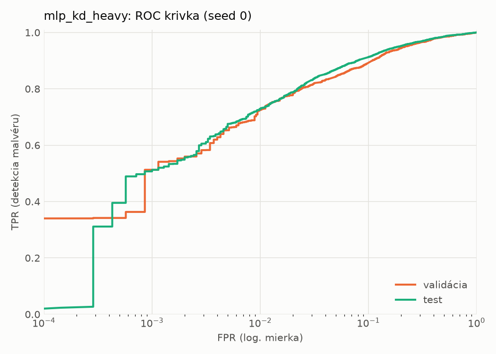
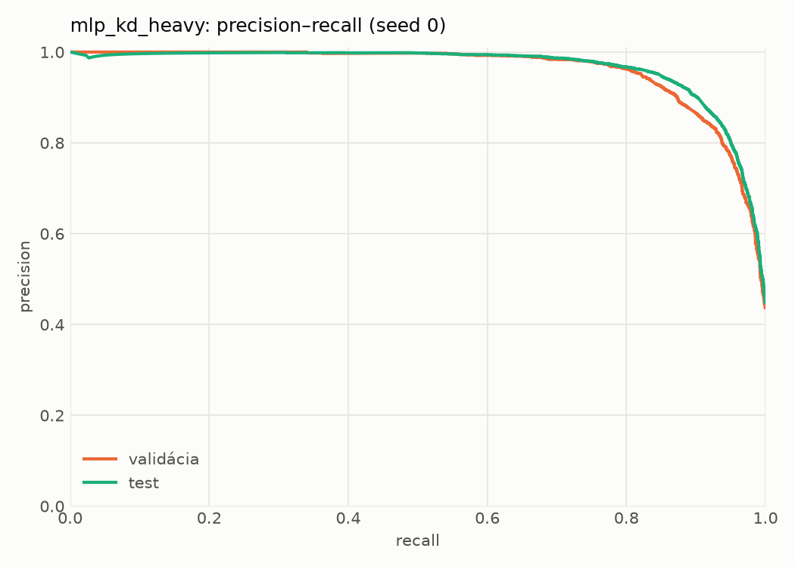
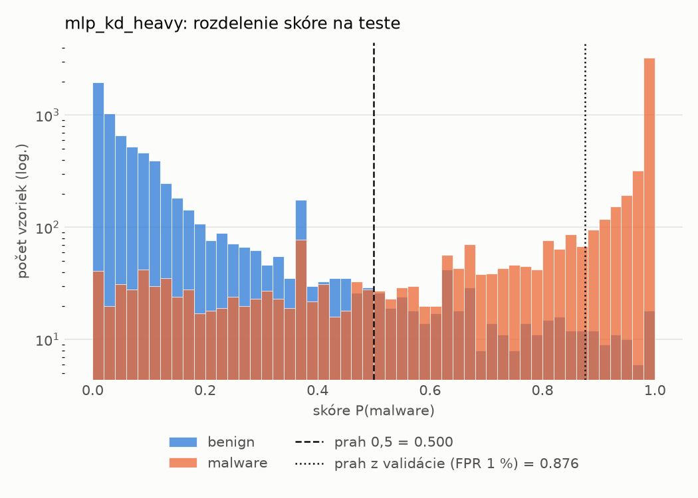
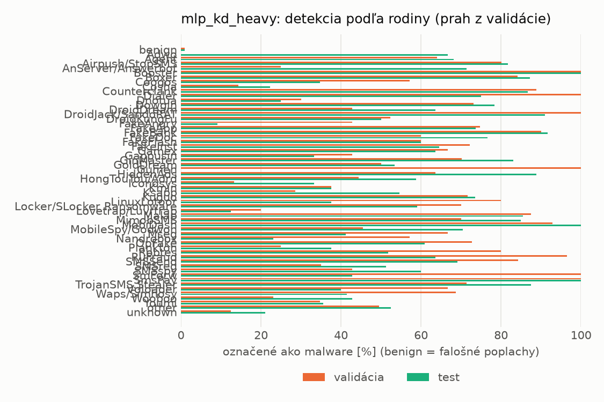
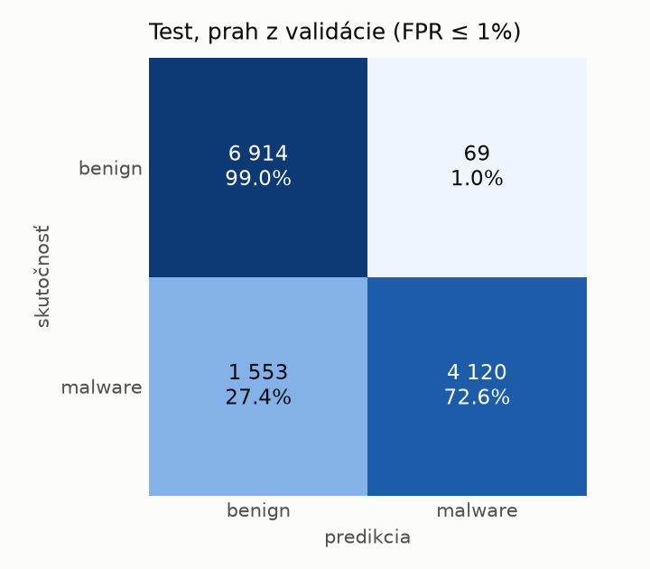
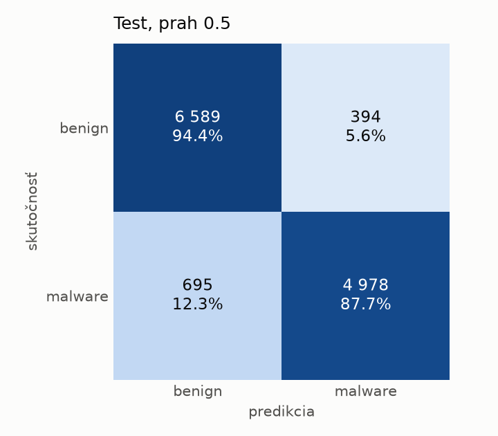
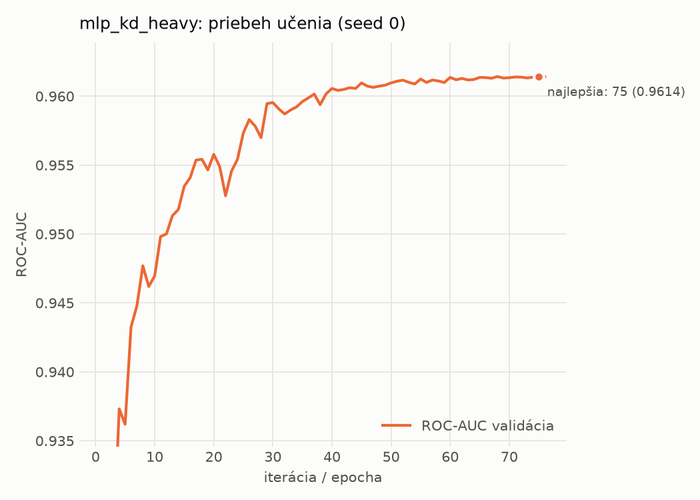

# dynamic/mlp_kd_heavy – beh `20261123-191652`

> Automaticky generované (`src/training/run_tabular.py`). Konfigurácia: `config.yaml`, protokol: `protocol.yaml`.

- **Model:** `mlp` – študent – malé MLP učené destiláciou z mlp_large hybridu (V4)
- **Ladenie:** bez ladenia – hyperparametre prevzaté z `runs_v4/real_p/full/students_dynamic/mlp_kd_heavy/20261123-005328`
- **Finálne modely:** seedy [0, 1, 2]; hodnoty sú priemer ± smerodajná odchýlka cez seedy
- **Najlepšie hyperparametre:** `{"hidden_layers": 1, "max_epochs": 100, "patience": 8, "hidden_width": 64, "dropout": 0.020410116354877387, "lr": 0.0023709262856920267, "weight_decay": 2.3924155608522853e-05, "batch_size": 1024, "kd_alpha": 0.37221474320301356, "kd_temperature": 1.1598739057164045}`

## Detekčná kvalita (bez prahu)
| metrika | train (podvzorka) | validácia | test |
|---|---|---|---|
| ROC-AUC | 0.9738 ± 0.0004 | 0.9619 ± 0.0011 | 0.9660 ± 0.0006 |
| PR-AUC | 0.9726 ± 0.0004 | 0.9613 ± 0.0008 | 0.9657 ± 0.0007 |
| TPR pri FPR 1 % | 0.7872 ± 0.0031 | 0.7148 ± 0.0109 | 0.7279 ± 0.0054 |
| TPR pri FPR 0,1 % | 0.5549 ± 0.0129 | 0.4748 ± 0.0429 | 0.4939 ± 0.0266 |
| log loss | 0.1970 ± 0.0023 | 0.2390 ± 0.0030 | 0.2272 ± 0.0020 |
| Brier skóre | 0.0571 ± 0.0006 | 0.0700 ± 0.0009 | 0.0651 ± 0.0006 |

Rozdiel ROC-AUC train − validácia: **0.0119** (veľký rozdiel = preučenie).

## Pri prahu z validácie (FPR ≤ 1% na validácii)
| metrika | train (podvzorka) | validácia | test |
|---|---|---|---|
| accuracy | 0.8819 ± 0.0039 | 0.8699 ± 0.0048 | 0.8684 ± 0.0033 |
| balanced accuracy | 0.8640 ± 0.0045 | 0.8525 ± 0.0055 | 0.8543 ± 0.0037 |
| precision | 0.9903 ± 0.0005 | 0.9827 ± 0.0003 | 0.9845 ± 0.0009 |
| recall (TPR) | 0.7335 ± 0.0091 | 0.7148 ± 0.0109 | 0.7177 ± 0.0081 |
| FPR | 0.0055 ± 0.0003 | 0.0097 ± 0.0000 | 0.0092 ± 0.0006 |
| F1 | 0.8428 ± 0.0060 | 0.8276 ± 0.0074 | 0.8302 ± 0.0051 |
| MCC | 0.7732 ± 0.0071 | 0.7510 ± 0.0086 | 0.7512 ± 0.0056 |

## Pri pevnom prahu 0.5
| metrika | train (podvzorka) | validácia | test |
|---|---|---|---|
| accuracy | 0.9252 ± 0.0018 | 0.9034 ± 0.0019 | 0.9140 ± 0.0012 |
| balanced accuracy | 0.9220 ± 0.0021 | 0.8995 ± 0.0019 | 0.9107 ± 0.0014 |
| precision | 0.9259 ± 0.0002 | 0.9062 ± 0.0027 | 0.9250 ± 0.0015 |
| recall (TPR) | 0.8987 ± 0.0045 | 0.8688 ± 0.0021 | 0.8794 ± 0.0031 |
| FPR | 0.0547 ± 0.0004 | 0.0698 ± 0.0021 | 0.0580 ± 0.0013 |
| F1 | 0.9121 ± 0.0023 | 0.8871 ± 0.0022 | 0.9016 ± 0.0015 |
| MCC | 0.8473 ± 0.0036 | 0.8032 ± 0.0039 | 0.8261 ± 0.0025 |

## Výpočtové nároky (seed 0, testovacia množina)
| meranie | hodnota |
|---|---|
| tréning finálneho modelu | 5.7 s (priemer cez seedy) |
| ladenie spolu | 0 s |
| počet parametrov / uzlov | 8 129 |
| veľkosť modelu na disku | 0.04 MB |
| transformácia vstupu – latencia (1 vlákno) | 0.015 ms |
| transformácia vstupu – priepustnosť | 765 337 vzoriek/s |
| CPU latencia modelu (batch 1, 1 vlákno) | 0.153 ms (p95 0.162) |
| CPU priepustnosť (24 vlákien) | 6 355 009 vzoriek/s |
| GPU latencia (batch 1) | 0.448 ms (p95 0.483) |
| GPU priepustnosť | 3 209 006 vzoriek/s |
| GPU špičková pamäť | 77 MB |

## Grafy
| | |
|---|---|
|  |  |
|  |  |
|  |  |
|  |  |

## Súbory
`metrics.json` (všetky metriky po seedoch vrátane rodín), `timing.json`, `hpo_trials.csv`,
`predictions/<časť>_seed<N>.parquet` (sha256, family, label, score), `model/seed_<N>/`, `log.txt`.
