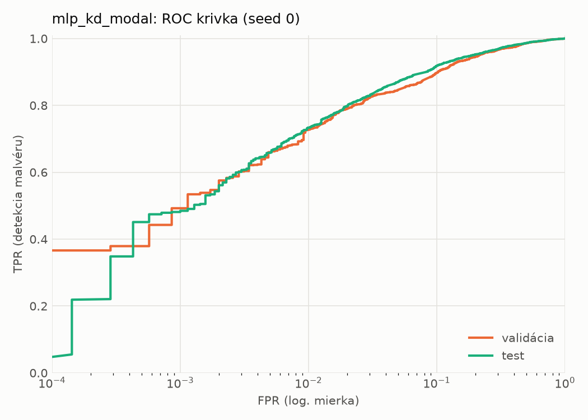
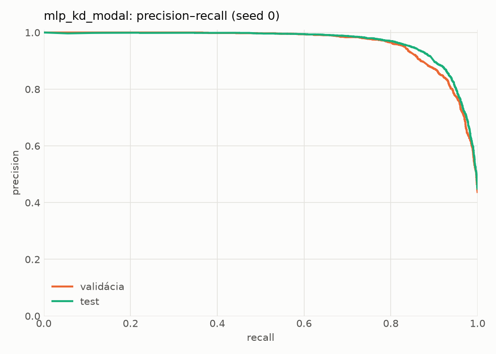
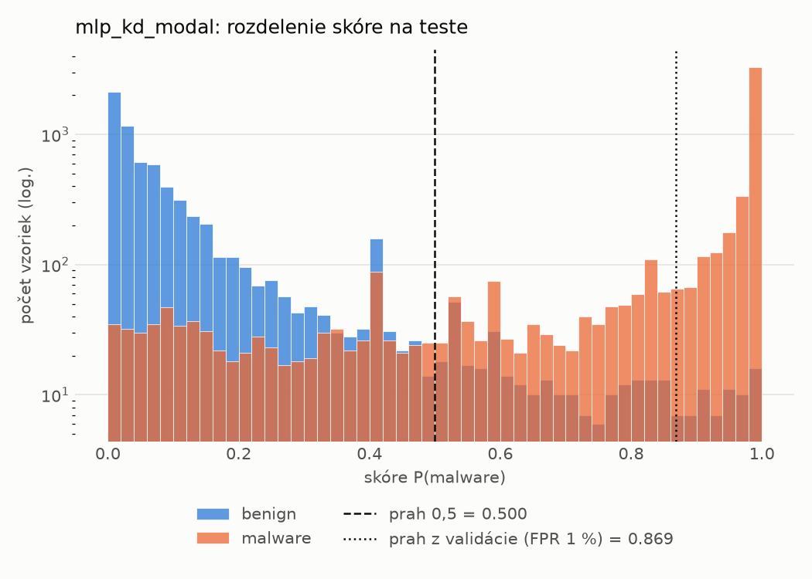
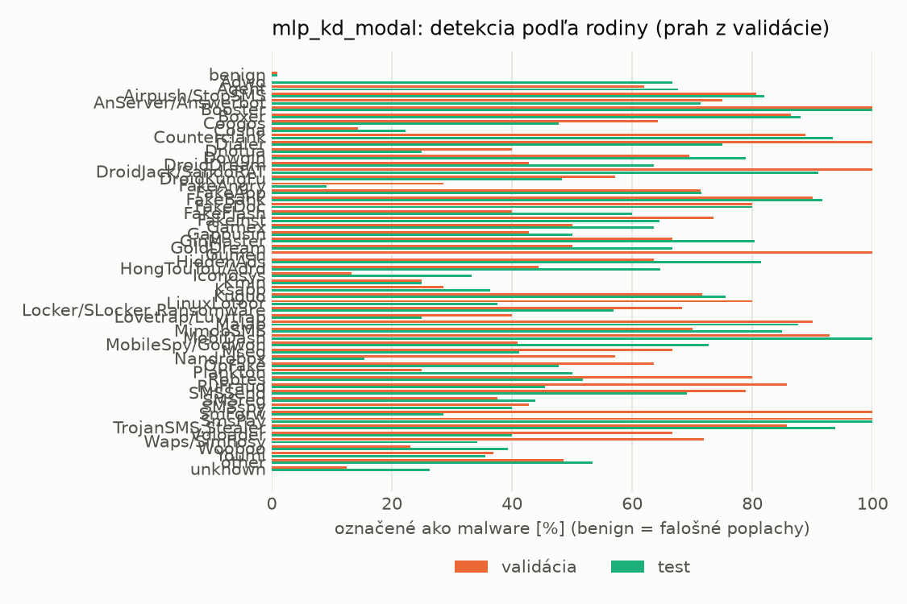
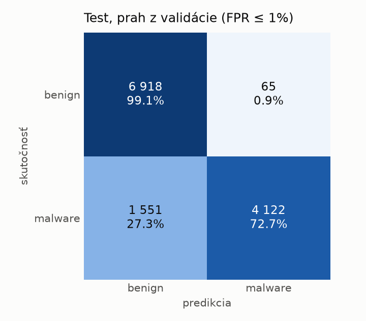
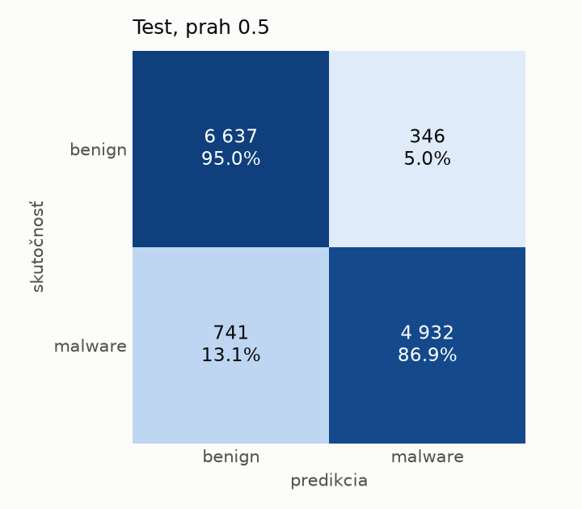
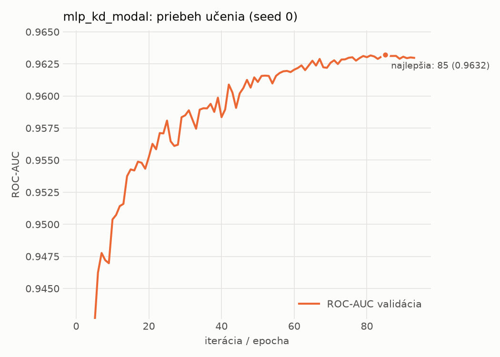

# dynamic/mlp_kd_modal – beh `20261123-191610`

> Automaticky generované (`src/training/run_tabular.py`). Konfigurácia: `config.yaml`, protokol: `protocol.yaml`.

- **Model:** `mlp` – študent – malé MLP učené destiláciou z učiteľa rovnakej modality (variant A)
- **Ladenie:** bez ladenia – hyperparametre prevzaté z `runs_v4/real_p/full/students_dynamic/mlp_kd_modal/20261123-004749`
- **Finálne modely:** seedy [0, 1, 2]; hodnoty sú priemer ± smerodajná odchýlka cez seedy
- **Najlepšie hyperparametre:** `{"hidden_layers": 1, "max_epochs": 100, "patience": 8, "hidden_width": 64, "dropout": 0.23306226533454044, "lr": 0.0029211055962699408, "weight_decay": 1.2442051354380418e-06, "batch_size": 512, "kd_alpha": 0.38098578248234166, "kd_temperature": 1.6615545083860346}`

## Detekčná kvalita (bez prahu)
| metrika | train (podvzorka) | validácia | test |
|---|---|---|---|
| ROC-AUC | 0.9719 ± 0.0007 | 0.9628 ± 0.0006 | 0.9665 ± 0.0008 |
| PR-AUC | 0.9712 ± 0.0006 | 0.9621 ± 0.0006 | 0.9669 ± 0.0006 |
| TPR pri FPR 1 % | 0.7789 ± 0.0029 | 0.7220 ± 0.0090 | 0.7350 ± 0.0031 |
| TPR pri FPR 0,1 % | 0.5382 ± 0.0062 | 0.5253 ± 0.0285 | 0.4982 ± 0.0150 |
| log loss | 0.2013 ± 0.0019 | 0.2351 ± 0.0019 | 0.2239 ± 0.0019 |
| Brier skóre | 0.0578 ± 0.0007 | 0.0696 ± 0.0007 | 0.0651 ± 0.0008 |

Rozdiel ROC-AUC train − validácia: **0.0090** (veľký rozdiel = preučenie).

## Pri prahu z validácie (FPR ≤ 1% na validácii)
| metrika | train (podvzorka) | validácia | test |
|---|---|---|---|
| accuracy | 0.8853 ± 0.0036 | 0.8730 ± 0.0039 | 0.8719 ± 0.0040 |
| balanced accuracy | 0.8681 ± 0.0042 | 0.8561 ± 0.0045 | 0.8582 ± 0.0045 |
| precision | 0.9894 ± 0.0002 | 0.9829 ± 0.0002 | 0.9849 ± 0.0005 |
| recall (TPR) | 0.7423 ± 0.0084 | 0.7220 ± 0.0090 | 0.7254 ± 0.0092 |
| FPR | 0.0060 ± 0.0001 | 0.0097 ± 0.0000 | 0.0090 ± 0.0004 |
| F1 | 0.8482 ± 0.0055 | 0.8325 ± 0.0060 | 0.8355 ± 0.0060 |
| MCC | 0.7793 ± 0.0065 | 0.7567 ± 0.0071 | 0.7576 ± 0.0069 |

## Pri pevnom prahu 0.5
| metrika | train (podvzorka) | validácia | test |
|---|---|---|---|
| accuracy | 0.9228 ± 0.0010 | 0.9031 ± 0.0020 | 0.9129 ± 0.0023 |
| balanced accuracy | 0.9182 ± 0.0011 | 0.8980 ± 0.0021 | 0.9087 ± 0.0023 |
| precision | 0.9335 ± 0.0011 | 0.9156 ± 0.0019 | 0.9328 ± 0.0022 |
| recall (TPR) | 0.8842 ± 0.0016 | 0.8574 ± 0.0031 | 0.8683 ± 0.0032 |
| FPR | 0.0479 ± 0.0008 | 0.0613 ± 0.0013 | 0.0508 ± 0.0016 |
| F1 | 0.9082 ± 0.0012 | 0.8856 ± 0.0024 | 0.8994 ± 0.0027 |
| MCC | 0.8426 ± 0.0021 | 0.8031 ± 0.0040 | 0.8245 ± 0.0046 |

## Výpočtové nároky (seed 0, testovacia množina)
| meranie | hodnota |
|---|---|
| tréning finálneho modelu | 13.5 s (priemer cez seedy) |
| ladenie spolu | 0 s |
| počet parametrov / uzlov | 8 129 |
| veľkosť modelu na disku | 0.04 MB |
| transformácia vstupu – latencia (1 vlákno) | 0.014 ms |
| transformácia vstupu – priepustnosť | 775 158 vzoriek/s |
| CPU latencia modelu (batch 1, 1 vlákno) | 0.152 ms (p95 0.161) |
| CPU priepustnosť (24 vlákien) | 6 065 370 vzoriek/s |
| GPU latencia (batch 1) | 0.443 ms (p95 0.473) |
| GPU priepustnosť | 2 224 879 vzoriek/s |
| GPU špičková pamäť | 53 MB |

## Grafy
| | |
|---|---|
|  |  |
|  |  |
|  |  |
|  |  |

## Súbory
`metrics.json` (všetky metriky po seedoch vrátane rodín), `timing.json`, `hpo_trials.csv`,
`predictions/<časť>_seed<N>.parquet` (sha256, family, label, score), `model/seed_<N>/`, `log.txt`.
