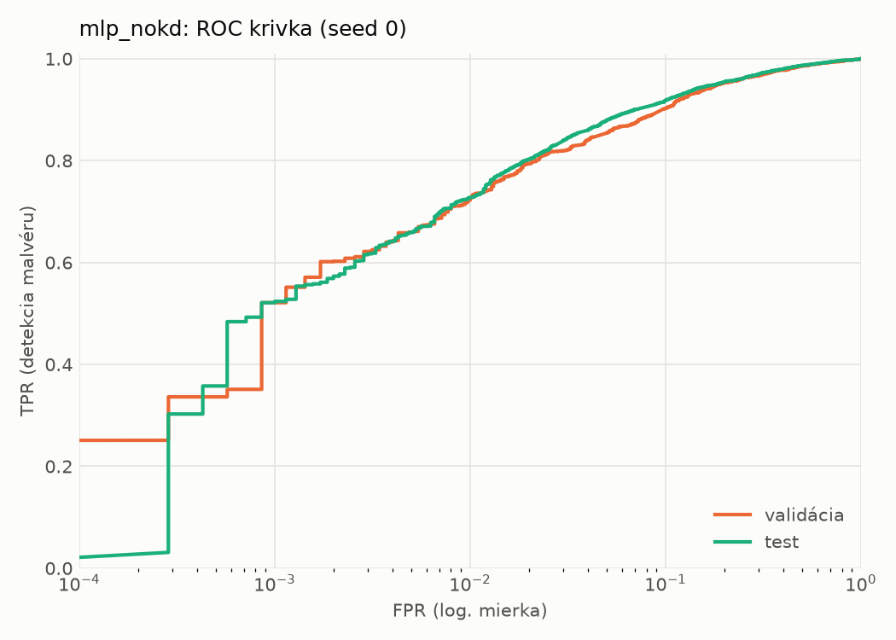
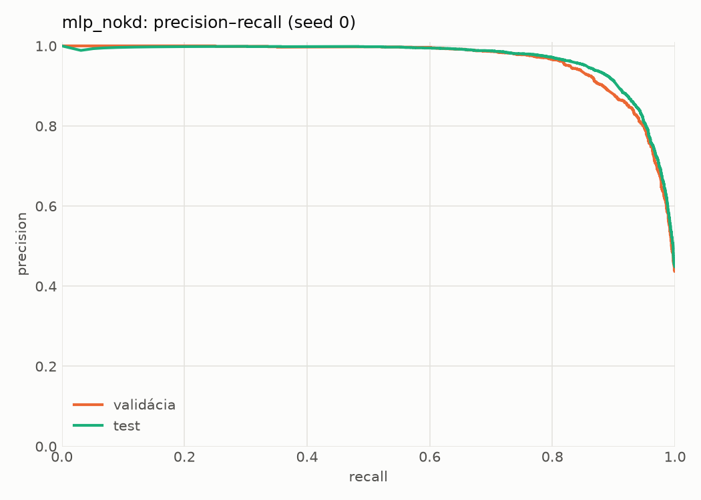
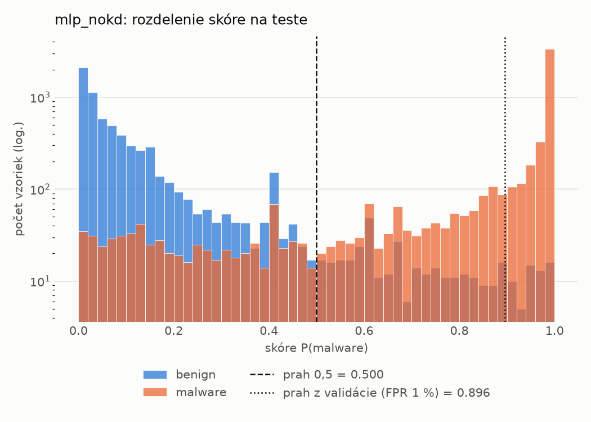
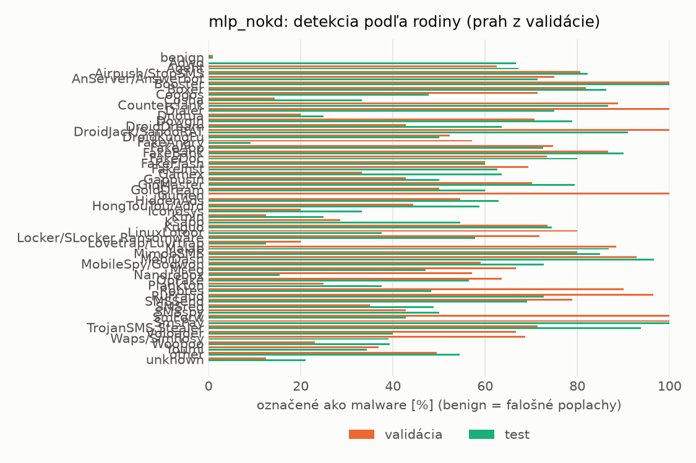
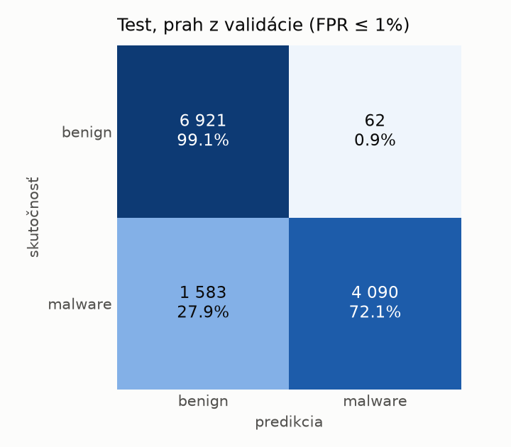
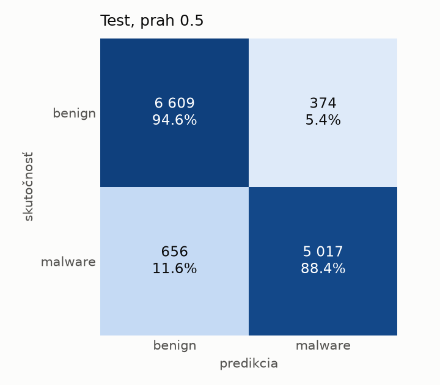
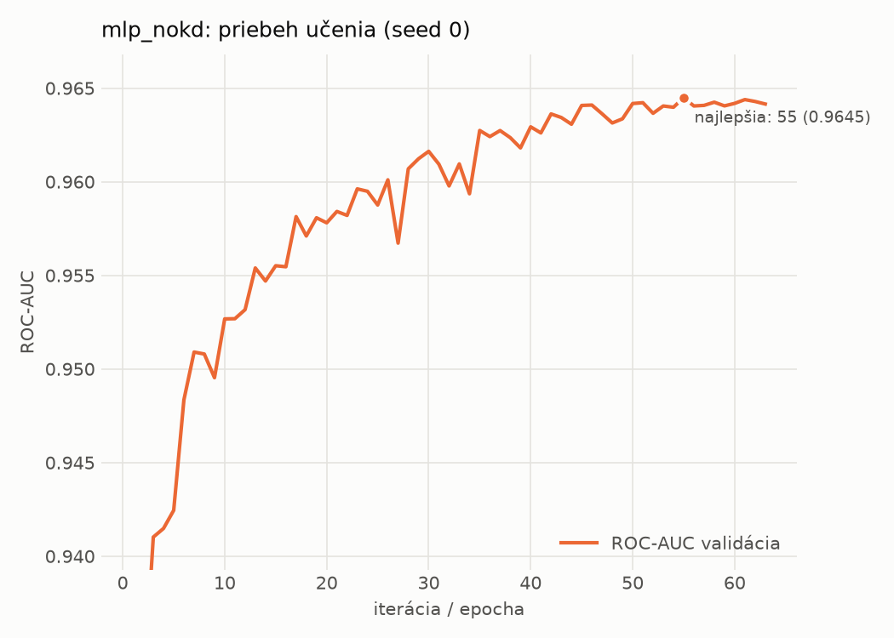

# dynamic/mlp_nokd – beh `20261123-191529`

> Automaticky generované (`src/training/run_tabular.py`). Konfigurácia: `config.yaml`, protokol: `protocol.yaml`.

- **Model:** `mlp` – kontrola – rovnaké malé MLP bez destilácie (iba skutočné označenia)
- **Ladenie:** bez ladenia – hyperparametre prevzaté z `runs_v4/real_p/full/students_dynamic/mlp_nokd/20261123-004046`
- **Finálne modely:** seedy [0, 1, 2]; hodnoty sú priemer ± smerodajná odchýlka cez seedy
- **Najlepšie hyperparametre:** `{"hidden_layers": 1, "max_epochs": 100, "patience": 8, "hidden_width": 64, "dropout": 0.01960392869507369, "lr": 0.0014251751351833603, "weight_decay": 1.336267730425129e-05, "batch_size": 256}`

## Detekčná kvalita (bez prahu)
| metrika | train (podvzorka) | validácia | test |
|---|---|---|---|
| ROC-AUC | 0.9777 ± 0.0008 | 0.9641 ± 0.0005 | 0.9672 ± 0.0005 |
| PR-AUC | 0.9765 ± 0.0008 | 0.9635 ± 0.0004 | 0.9672 ± 0.0004 |
| TPR pri FPR 1 % | 0.8032 ± 0.0076 | 0.7182 ± 0.0106 | 0.7304 ± 0.0024 |
| TPR pri FPR 0,1 % | 0.5734 ± 0.0118 | 0.5141 ± 0.0067 | 0.5013 ± 0.0189 |
| log loss | 0.1845 ± 0.0035 | 0.2342 ± 0.0019 | 0.2232 ± 0.0016 |
| Brier skóre | 0.0531 ± 0.0010 | 0.0680 ± 0.0007 | 0.0633 ± 0.0004 |

Rozdiel ROC-AUC train − validácia: **0.0136** (veľký rozdiel = preučenie).

## Pri prahu z validácie (FPR ≤ 1% na validácii)
| metrika | train (podvzorka) | validácia | test |
|---|---|---|---|
| accuracy | 0.8855 ± 0.0050 | 0.8714 ± 0.0046 | 0.8680 ± 0.0042 |
| balanced accuracy | 0.8681 ± 0.0058 | 0.8542 ± 0.0053 | 0.8537 ± 0.0047 |
| precision | 0.9924 ± 0.0007 | 0.9828 ± 0.0003 | 0.9854 ± 0.0007 |
| recall (TPR) | 0.7405 ± 0.0118 | 0.7182 ± 0.0106 | 0.7161 ± 0.0100 |
| FPR | 0.0043 ± 0.0004 | 0.0097 ± 0.0000 | 0.0086 ± 0.0005 |
| F1 | 0.8481 ± 0.0077 | 0.8299 ± 0.0072 | 0.8294 ± 0.0065 |
| MCC | 0.7804 ± 0.0090 | 0.7537 ± 0.0084 | 0.7507 ± 0.0072 |

## Pri pevnom prahu 0.5
| metrika | train (podvzorka) | validácia | test |
|---|---|---|---|
| accuracy | 0.9306 ± 0.0018 | 0.9069 ± 0.0008 | 0.9185 ± 0.0002 |
| balanced accuracy | 0.9279 ± 0.0015 | 0.9035 ± 0.0012 | 0.9157 ± 0.0003 |
| precision | 0.9297 ± 0.0053 | 0.9071 ± 0.0037 | 0.9264 ± 0.0045 |
| recall (TPR) | 0.9079 ± 0.0029 | 0.8767 ± 0.0053 | 0.8889 ± 0.0047 |
| FPR | 0.0521 ± 0.0043 | 0.0697 ± 0.0035 | 0.0574 ± 0.0041 |
| F1 | 0.9187 ± 0.0018 | 0.8916 ± 0.0013 | 0.9072 ± 0.0003 |
| MCC | 0.8584 ± 0.0036 | 0.8104 ± 0.0016 | 0.8352 ± 0.0005 |

## Výpočtové nároky (seed 0, testovacia množina)
| meranie | hodnota |
|---|---|
| tréning finálneho modelu | 13.1 s (priemer cez seedy) |
| ladenie spolu | 0 s |
| počet parametrov / uzlov | 8 129 |
| veľkosť modelu na disku | 0.04 MB |
| transformácia vstupu – latencia (1 vlákno) | 0.015 ms |
| transformácia vstupu – priepustnosť | 773 032 vzoriek/s |
| CPU latencia modelu (batch 1, 1 vlákno) | 0.153 ms (p95 0.162) |
| CPU priepustnosť (24 vlákien) | 6 043 646 vzoriek/s |
| GPU latencia (batch 1) | 0.443 ms (p95 0.467) |
| GPU priepustnosť | 3 382 962 vzoriek/s |
| GPU špičková pamäť | 77 MB |

## Grafy
| | |
|---|---|
|  |  |
|  |  |
|  |  |
|  |  |

## Súbory
`metrics.json` (všetky metriky po seedoch vrátane rodín), `timing.json`, `hpo_trials.csv`,
`predictions/<časť>_seed<N>.parquet` (sha256, family, label, score), `model/seed_<N>/`, `log.txt`.
