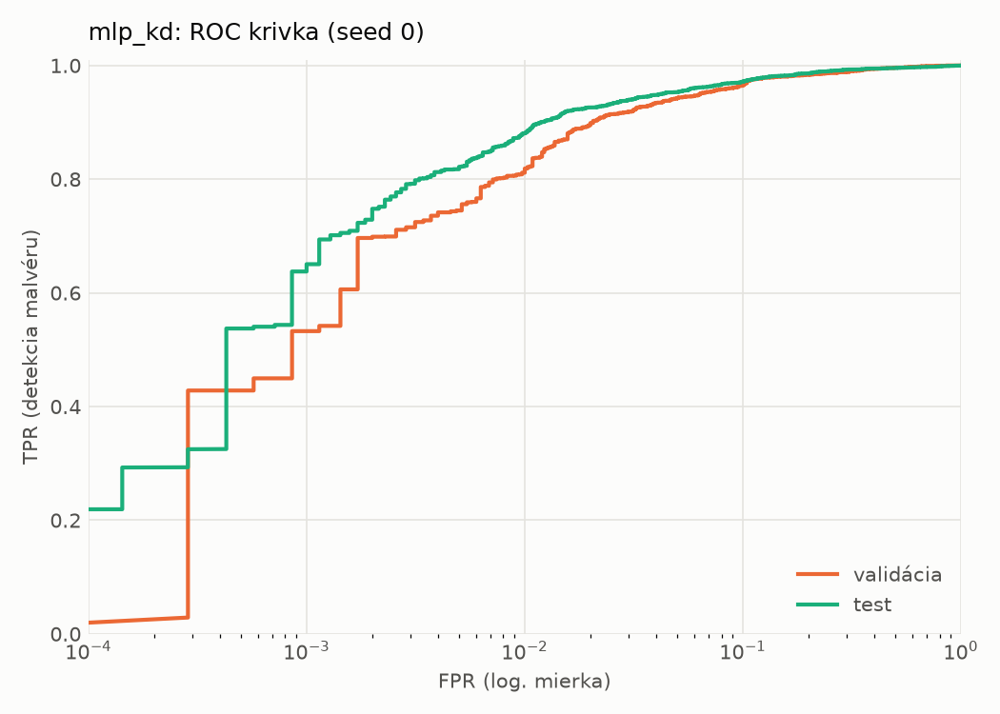
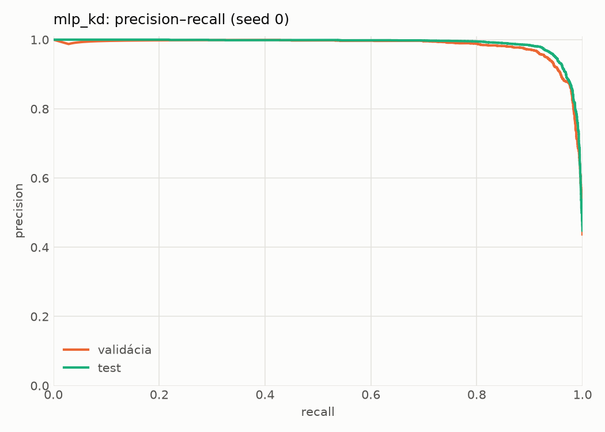
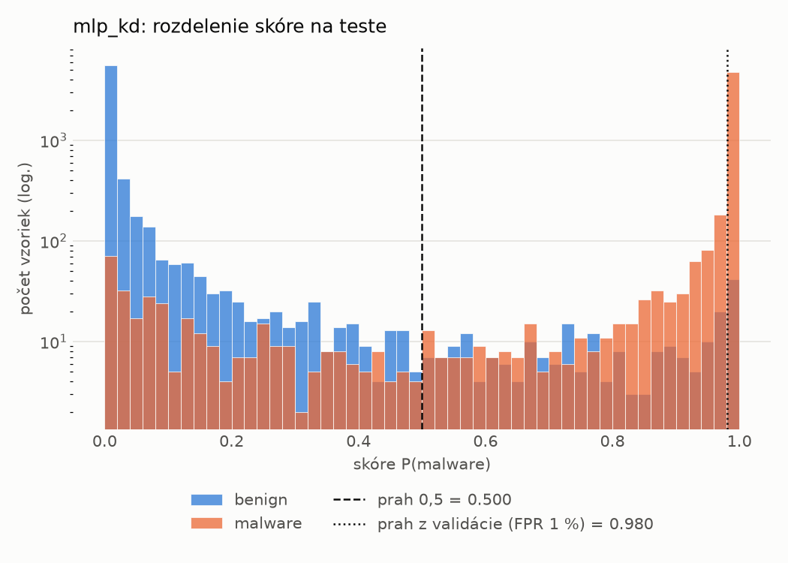
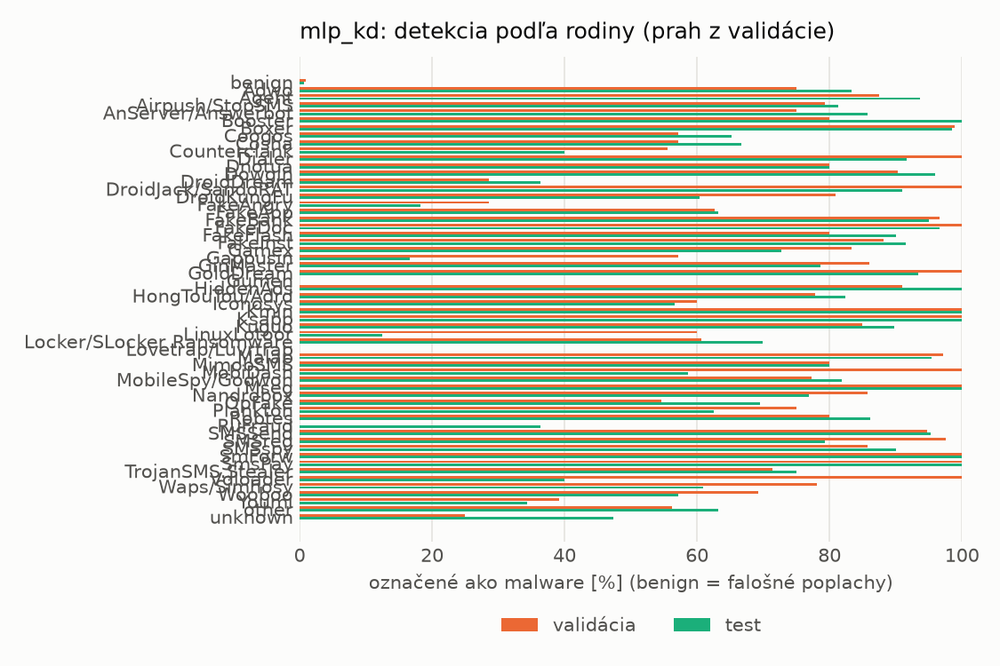
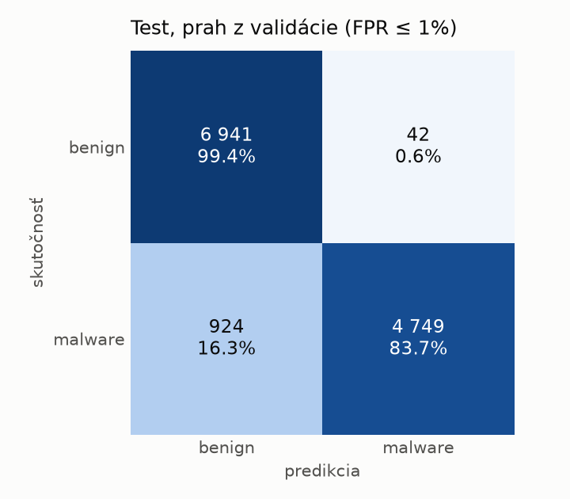
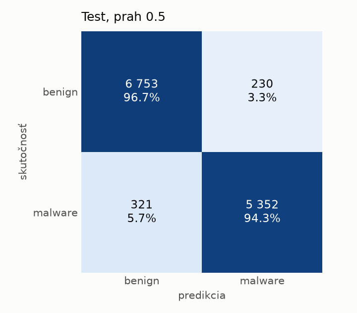
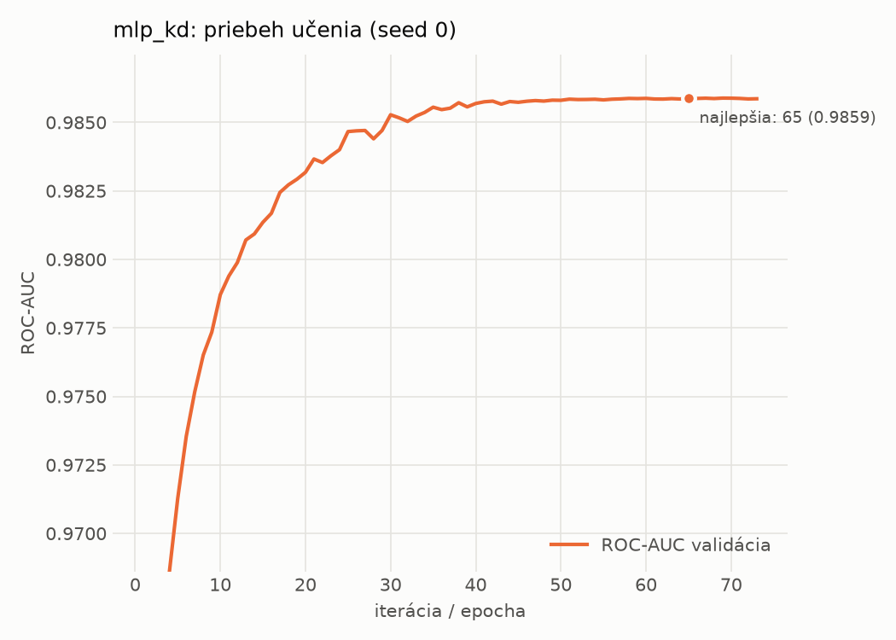

# static/mlp_kd – beh `20261123-191350`

> Automaticky generované (`src/training/run_tabular.py`). Konfigurácia: `config.yaml`, protokol: `protocol.yaml`.

- **Model:** `mlp` – študent – malé MLP učené destiláciou z hybridného učiteľa
- **Ladenie:** bez ladenia – hyperparametre prevzaté z `runs_v4/real_p/full/students_static/mlp_kd/20261123-002115`
- **Finálne modely:** seedy [0, 1, 2]; hodnoty sú priemer ± smerodajná odchýlka cez seedy
- **Najlepšie hyperparametre:** `{"hidden_layers": 1, "max_epochs": 100, "patience": 8, "hidden_width": 64, "dropout": 0.0632721567978865, "lr": 0.0009421311632910299, "weight_decay": 0.0003612082656275497, "batch_size": 1024, "kd_alpha": 0.17546922159086176, "kd_temperature": 1.684481613505065}`

## Detekčná kvalita (bez prahu)
| metrika | train (podvzorka) | validácia | test |
|---|---|---|---|
| ROC-AUC | 0.9910 ± 0.0004 | 0.9864 ± 0.0007 | 0.9884 ± 0.0002 |
| PR-AUC | 0.9907 ± 0.0004 | 0.9838 ± 0.0008 | 0.9881 ± 0.0008 |
| TPR pri FPR 1 % | 0.9121 ± 0.0052 | 0.8256 ± 0.0146 | 0.8840 ± 0.0062 |
| TPR pri FPR 0,1 % | 0.7748 ± 0.0062 | 0.4869 ± 0.0608 | 0.6228 ± 0.0320 |
| log loss | 0.1167 ± 0.0035 | 0.1626 ± 0.0055 | 0.1400 ± 0.0020 |
| Brier skóre | 0.0309 ± 0.0011 | 0.0407 ± 0.0011 | 0.0349 ± 0.0005 |

Rozdiel ROC-AUC train − validácia: **0.0046** (veľký rozdiel = preučenie).

## Pri prahu z validácie (FPR ≤ 1% na validácii)
| metrika | train (podvzorka) | validácia | test |
|---|---|---|---|
| accuracy | 0.9299 ± 0.0053 | 0.9183 ± 0.0064 | 0.9252 ± 0.0046 |
| balanced accuracy | 0.9193 ± 0.0062 | 0.9079 ± 0.0073 | 0.9173 ± 0.0052 |
| precision | 0.9946 ± 0.0001 | 0.9850 ± 0.0003 | 0.9904 ± 0.0008 |
| recall (TPR) | 0.8421 ± 0.0124 | 0.8256 ± 0.0146 | 0.8412 ± 0.0110 |
| FPR | 0.0035 ± 0.0001 | 0.0097 ± 0.0000 | 0.0066 ± 0.0006 |
| F1 | 0.9120 ± 0.0072 | 0.8983 ± 0.0087 | 0.9097 ± 0.0062 |
| MCC | 0.8626 ± 0.0100 | 0.8400 ± 0.0119 | 0.8548 ± 0.0085 |

## Pri pevnom prahu 0.5
| metrika | train (podvzorka) | validácia | test |
|---|---|---|---|
| accuracy | 0.9606 ± 0.0018 | 0.9495 ± 0.0010 | 0.9566 ± 0.0003 |
| balanced accuracy | 0.9584 ± 0.0020 | 0.9478 ± 0.0009 | 0.9553 ± 0.0004 |
| precision | 0.9654 ± 0.0015 | 0.9493 ± 0.0021 | 0.9598 ± 0.0013 |
| recall (TPR) | 0.9424 ± 0.0031 | 0.9344 ± 0.0009 | 0.9427 ± 0.0018 |
| FPR | 0.0256 ± 0.0011 | 0.0388 ± 0.0017 | 0.0321 ± 0.0011 |
| F1 | 0.9538 ± 0.0022 | 0.9418 ± 0.0011 | 0.9511 ± 0.0004 |
| MCC | 0.9196 ± 0.0037 | 0.8973 ± 0.0020 | 0.9122 ± 0.0006 |

## Výpočtové nároky (seed 0, testovacia množina)
| meranie | hodnota |
|---|---|
| tréning finálneho modelu | 5.9 s (priemer cez seedy) |
| ladenie spolu | 0 s |
| počet parametrov / uzlov | 10 625 |
| veľkosť modelu na disku | 0.05 MB |
| transformácia vstupu – latencia (1 vlákno) | 0.006 ms |
| transformácia vstupu – priepustnosť | 1 083 219 vzoriek/s |
| CPU latencia modelu (batch 1, 1 vlákno) | 0.052 ms (p95 0.059) |
| CPU priepustnosť (24 vlákien) | 3 988 403 vzoriek/s |
| GPU latencia (batch 1) | 0.446 ms (p95 0.476) |
| GPU priepustnosť | 2 400 379 vzoriek/s |
| GPU špičková pamäť | 62 MB |

## Grafy
| | |
|---|---|
|  |  |
|  |  |
|  |  |
|  |  |

## Súbory
`metrics.json` (všetky metriky po seedoch vrátane rodín), `timing.json`, `hpo_trials.csv`,
`predictions/<časť>_seed<N>.parquet` (sha256, family, label, score), `model/seed_<N>/`, `log.txt`.
