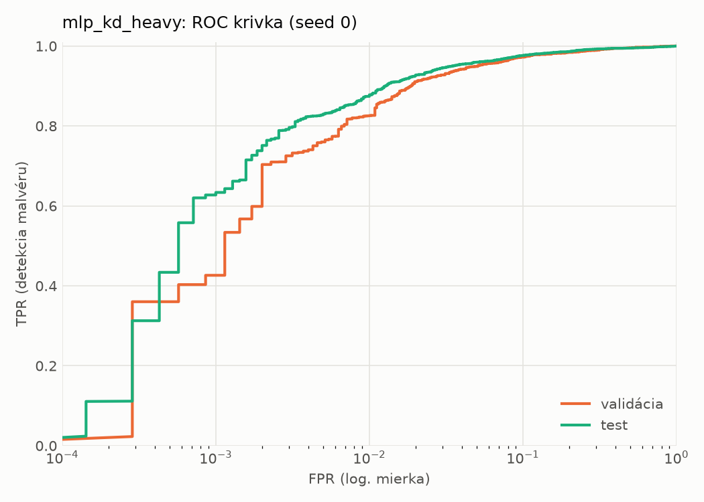
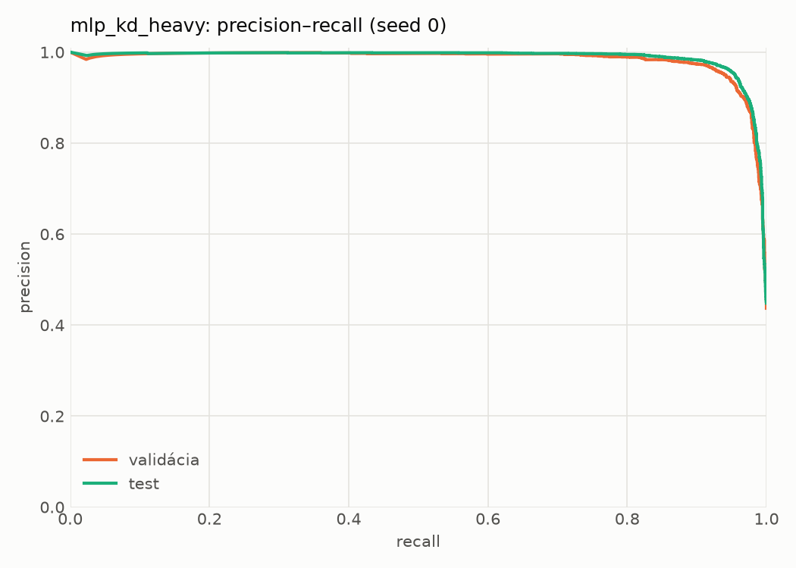
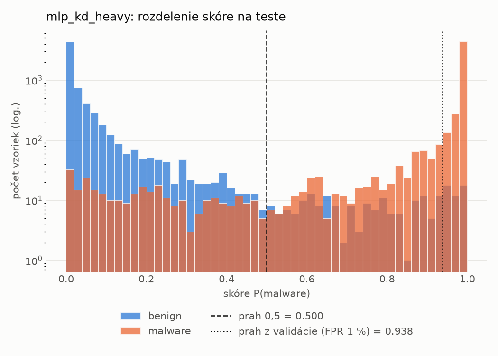
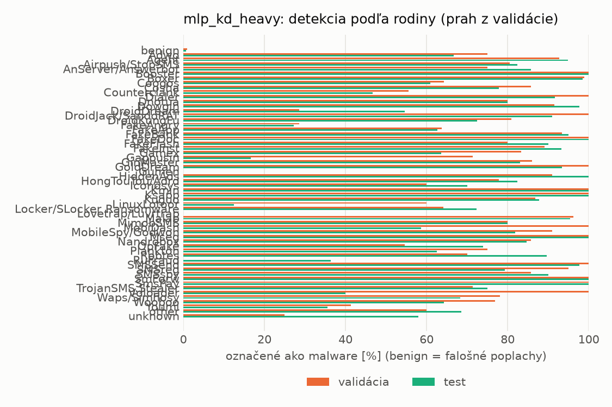
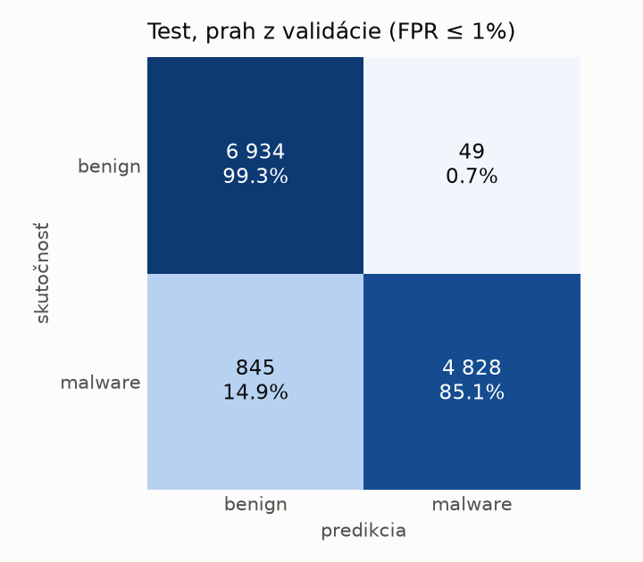
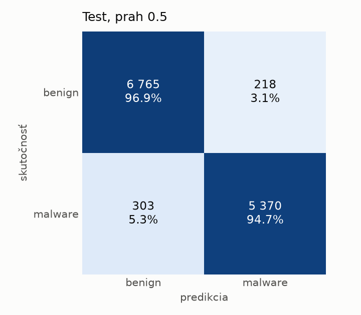
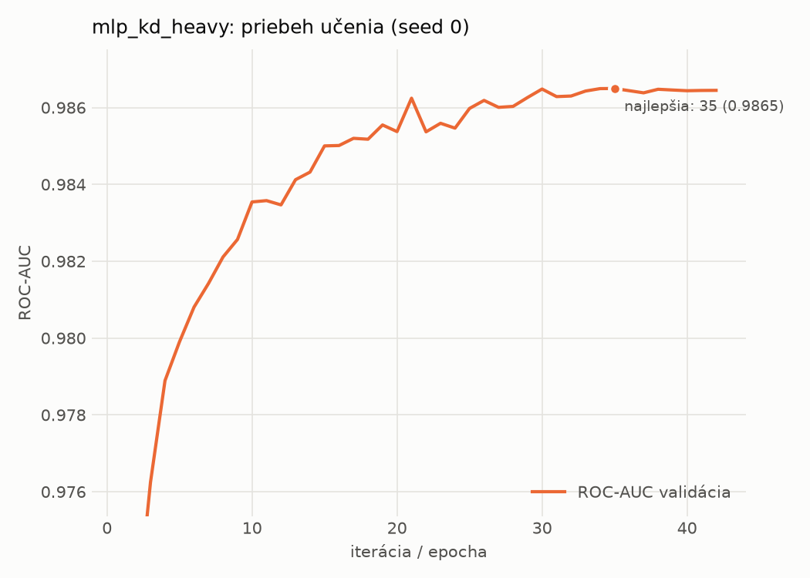

# static/mlp_kd_heavy – beh `20261123-191459`

> Automaticky generované (`src/training/run_tabular.py`). Konfigurácia: `config.yaml`, protokol: `protocol.yaml`.

- **Model:** `mlp` – študent – malé MLP učené destiláciou z mlp_large hybridu (V4)
- **Ladenie:** bez ladenia – hyperparametre prevzaté z `runs_v4/real_p/full/students_static/mlp_kd_heavy/20261123-003302`
- **Finálne modely:** seedy [0, 1, 2]; hodnoty sú priemer ± smerodajná odchýlka cez seedy
- **Najlepšie hyperparametre:** `{"hidden_layers": 1, "max_epochs": 100, "patience": 8, "hidden_width": 64, "dropout": 0.09027280410892091, "lr": 0.002542283406985367, "weight_decay": 5.0021287493134016e-05, "batch_size": 1024, "kd_alpha": 0.49398181049265616, "kd_temperature": 1.0496155846554518}`

## Detekčná kvalita (bez prahu)
| metrika | train (podvzorka) | validácia | test |
|---|---|---|---|
| ROC-AUC | 0.9927 ± 0.0003 | 0.9868 ± 0.0007 | 0.9885 ± 0.0000 |
| PR-AUC | 0.9923 ± 0.0003 | 0.9841 ± 0.0005 | 0.9881 ± 0.0003 |
| TPR pri FPR 1 % | 0.9239 ± 0.0025 | 0.8323 ± 0.0065 | 0.8790 ± 0.0063 |
| TPR pri FPR 0,1 % | 0.7972 ± 0.0228 | 0.5103 ± 0.0825 | 0.6132 ± 0.0147 |
| log loss | 0.0991 ± 0.0017 | 0.1403 ± 0.0025 | 0.1264 ± 0.0005 |
| Brier skóre | 0.0274 ± 0.0004 | 0.0377 ± 0.0004 | 0.0331 ± 0.0003 |

Rozdiel ROC-AUC train − validácia: **0.0059** (veľký rozdiel = preučenie).

## Pri prahu z validácie (FPR ≤ 1% na validácii)
| metrika | train (podvzorka) | validácia | test |
|---|---|---|---|
| accuracy | 0.9366 ± 0.0021 | 0.9212 ± 0.0028 | 0.9300 ± 0.0021 |
| balanced accuracy | 0.9270 ± 0.0024 | 0.9113 ± 0.0033 | 0.9227 ± 0.0023 |
| precision | 0.9957 ± 0.0000 | 0.9851 ± 0.0001 | 0.9896 ± 0.0006 |
| recall (TPR) | 0.8568 ± 0.0048 | 0.8323 ± 0.0065 | 0.8528 ± 0.0044 |
| FPR | 0.0028 ± 0.0000 | 0.0097 ± 0.0000 | 0.0073 ± 0.0004 |
| F1 | 0.9211 ± 0.0028 | 0.9023 ± 0.0039 | 0.9161 ± 0.0027 |
| MCC | 0.8754 ± 0.0039 | 0.8454 ± 0.0053 | 0.8636 ± 0.0040 |

## Pri pevnom prahu 0.5
| metrika | train (podvzorka) | validácia | test |
|---|---|---|---|
| accuracy | 0.9642 ± 0.0005 | 0.9523 ± 0.0004 | 0.9584 ± 0.0004 |
| balanced accuracy | 0.9624 ± 0.0004 | 0.9510 ± 0.0004 | 0.9573 ± 0.0004 |
| precision | 0.9670 ± 0.0018 | 0.9495 ± 0.0013 | 0.9597 ± 0.0012 |
| recall (TPR) | 0.9495 ± 0.0008 | 0.9409 ± 0.0010 | 0.9469 ± 0.0005 |
| FPR | 0.0246 ± 0.0014 | 0.0389 ± 0.0011 | 0.0323 ± 0.0010 |
| F1 | 0.9582 ± 0.0006 | 0.9452 ± 0.0004 | 0.9532 ± 0.0004 |
| MCC | 0.9270 ± 0.0011 | 0.9030 ± 0.0008 | 0.9158 ± 0.0008 |

## Výpočtové nároky (seed 0, testovacia množina)
| meranie | hodnota |
|---|---|
| tréning finálneho modelu | 3.0 s (priemer cez seedy) |
| ladenie spolu | 0 s |
| počet parametrov / uzlov | 10 625 |
| veľkosť modelu na disku | 0.05 MB |
| transformácia vstupu – latencia (1 vlákno) | 0.014 ms |
| transformácia vstupu – priepustnosť | 716 181 vzoriek/s |
| CPU latencia modelu (batch 1, 1 vlákno) | 0.156 ms (p95 0.169) |
| CPU priepustnosť (24 vlákien) | 4 456 966 vzoriek/s |
| GPU latencia (batch 1) | 0.277 ms (p95 0.316) |
| GPU priepustnosť | 2 226 758 vzoriek/s |
| GPU špičková pamäť | 94 MB |

## Grafy
| | |
|---|---|
|  |  |
|  |  |
|  |  |
|  |  |

## Súbory
`metrics.json` (všetky metriky po seedoch vrátane rodín), `timing.json`, `hpo_trials.csv`,
`predictions/<časť>_seed<N>.parquet` (sha256, family, label, score), `model/seed_<N>/`, `log.txt`.
