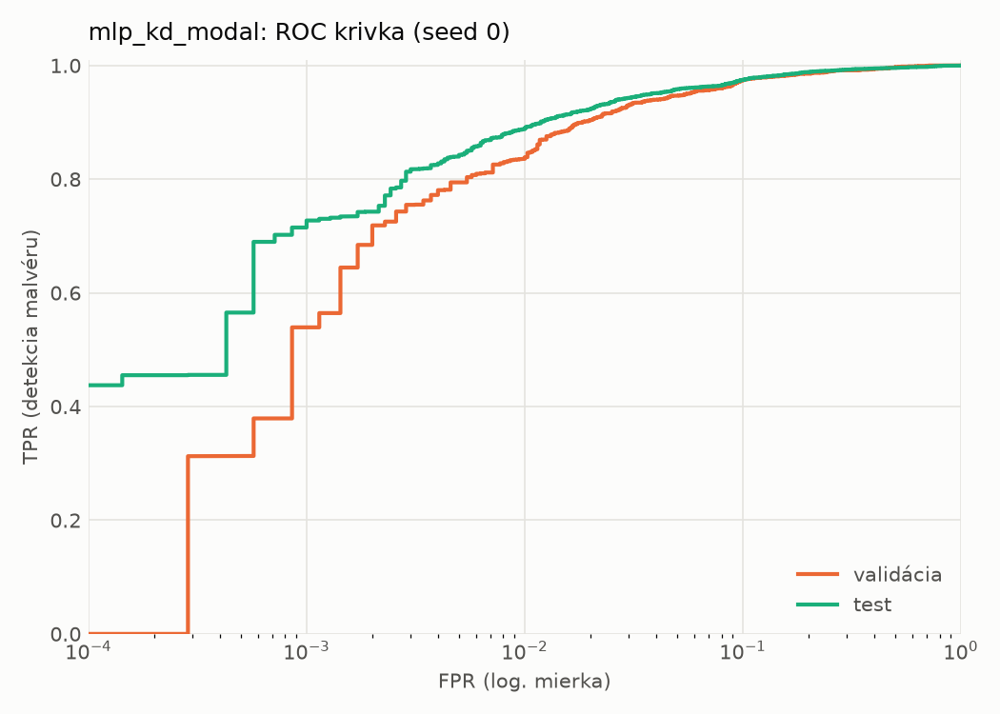
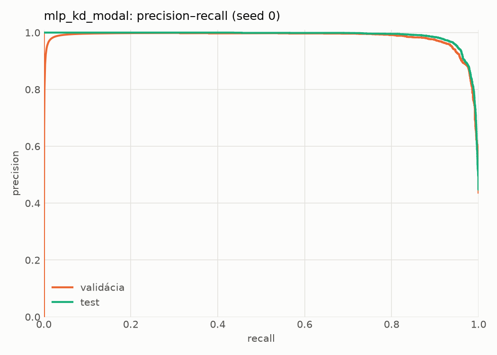
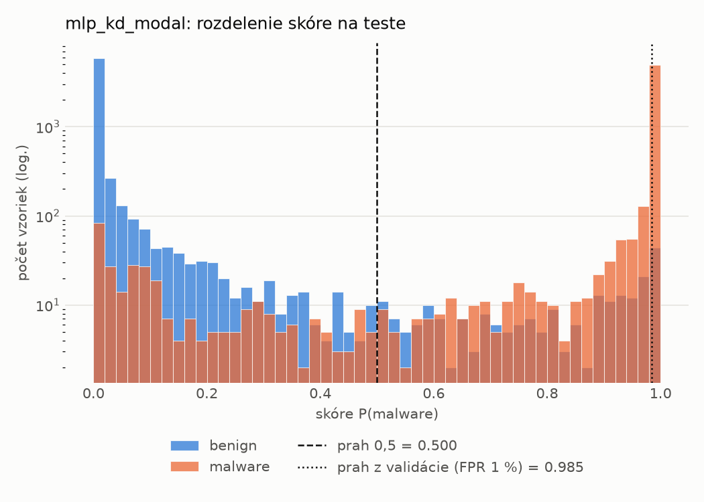
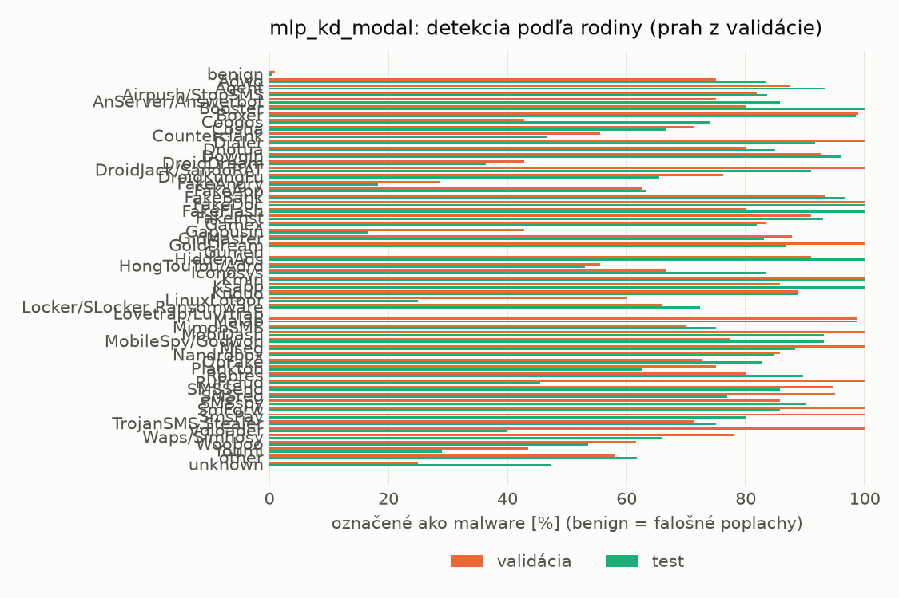
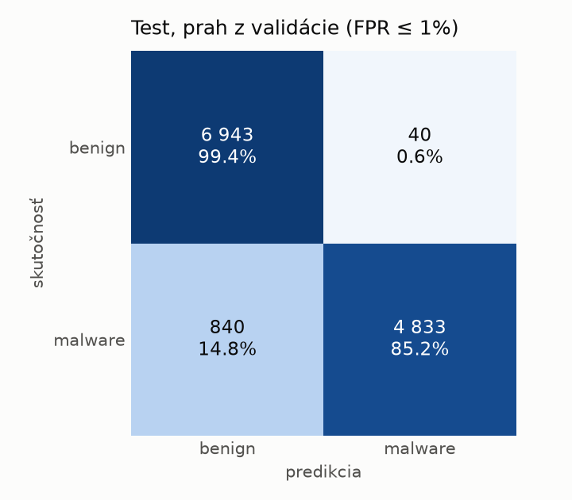
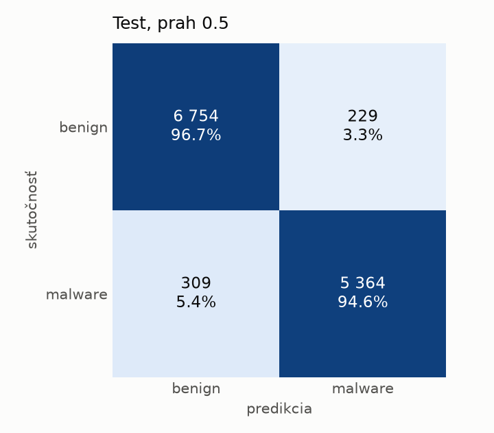
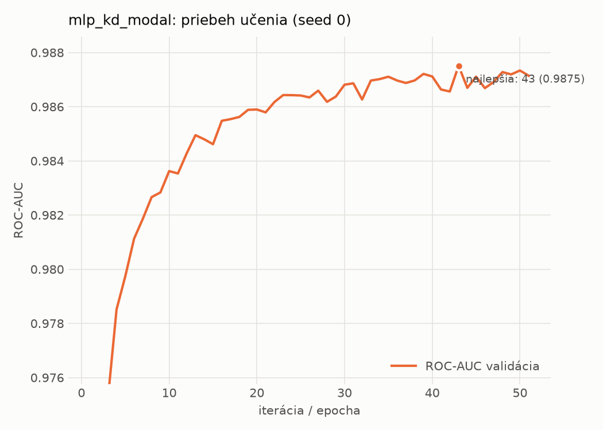

# static/mlp_kd_modal – beh `20261123-191434`

> Automaticky generované (`src/training/run_tabular.py`). Konfigurácia: `config.yaml`, protokol: `protocol.yaml`.

- **Model:** `mlp` – študent – malé MLP učené destiláciou z učiteľa rovnakej modality (variant A)
- **Ladenie:** bez ladenia – hyperparametre prevzaté z `runs_v4/real_p/full/students_static/mlp_kd_modal/20261123-002851`
- **Finálne modely:** seedy [0, 1, 2]; hodnoty sú priemer ± smerodajná odchýlka cez seedy
- **Najlepšie hyperparametre:** `{"hidden_layers": 1, "max_epochs": 100, "patience": 8, "hidden_width": 64, "dropout": 0.037581027791643296, "lr": 0.0019348891318937097, "weight_decay": 9.225533739654786e-05, "batch_size": 512, "kd_alpha": 0.37781550385889523, "kd_temperature": 3.209412682485264}`

## Detekčná kvalita (bez prahu)
| metrika | train (podvzorka) | validácia | test |
|---|---|---|---|
| ROC-AUC | 0.9919 ± 0.0001 | 0.9874 ± 0.0001 | 0.9892 ± 0.0001 |
| PR-AUC | 0.9914 ± 0.0002 | 0.9840 ± 0.0001 | 0.9889 ± 0.0005 |
| TPR pri FPR 1 % | 0.9119 ± 0.0023 | 0.8440 ± 0.0130 | 0.8914 ± 0.0050 |
| TPR pri FPR 0,1 % | 0.7983 ± 0.0119 | 0.6005 ± 0.0546 | 0.6913 ± 0.0419 |
| log loss | 0.1160 ± 0.0010 | 0.1631 ± 0.0012 | 0.1410 ± 0.0008 |
| Brier skóre | 0.0310 ± 0.0003 | 0.0397 ± 0.0005 | 0.0349 ± 0.0003 |

Rozdiel ROC-AUC train − validácia: **0.0046** (veľký rozdiel = preučenie).

## Pri prahu z validácie (FPR ≤ 1% na validácii)
| metrika | train (podvzorka) | validácia | test |
|---|---|---|---|
| accuracy | 0.9358 ± 0.0049 | 0.9263 ± 0.0057 | 0.9312 ± 0.0044 |
| balanced accuracy | 0.9262 ± 0.0059 | 0.9171 ± 0.0065 | 0.9240 ± 0.0051 |
| precision | 0.9947 ± 0.0015 | 0.9853 ± 0.0002 | 0.9905 ± 0.0016 |
| recall (TPR) | 0.8558 ± 0.0127 | 0.8440 ± 0.0130 | 0.8546 ± 0.0112 |
| FPR | 0.0035 ± 0.0011 | 0.0097 ± 0.0000 | 0.0066 ± 0.0012 |
| F1 | 0.9200 ± 0.0067 | 0.9092 ± 0.0076 | 0.9176 ± 0.0058 |
| MCC | 0.8738 ± 0.0092 | 0.8551 ± 0.0108 | 0.8660 ± 0.0080 |

## Pri pevnom prahu 0.5
| metrika | train (podvzorka) | validácia | test |
|---|---|---|---|
| accuracy | 0.9601 ± 0.0006 | 0.9513 ± 0.0016 | 0.9568 ± 0.0007 |
| balanced accuracy | 0.9580 ± 0.0004 | 0.9499 ± 0.0015 | 0.9557 ± 0.0007 |
| precision | 0.9639 ± 0.0020 | 0.9494 ± 0.0024 | 0.9583 ± 0.0018 |
| recall (TPR) | 0.9428 ± 0.0007 | 0.9387 ± 0.0013 | 0.9447 ± 0.0011 |
| FPR | 0.0268 ± 0.0016 | 0.0389 ± 0.0019 | 0.0334 ± 0.0015 |
| F1 | 0.9532 ± 0.0006 | 0.9440 ± 0.0018 | 0.9515 ± 0.0008 |
| MCC | 0.9186 ± 0.0012 | 0.9010 ± 0.0032 | 0.9126 ± 0.0014 |

## Výpočtové nároky (seed 0, testovacia množina)
| meranie | hodnota |
|---|---|
| tréning finálneho modelu | 7.6 s (priemer cez seedy) |
| ladenie spolu | 0 s |
| počet parametrov / uzlov | 10 625 |
| veľkosť modelu na disku | 0.05 MB |
| transformácia vstupu – latencia (1 vlákno) | 0.015 ms |
| transformácia vstupu – priepustnosť | 759 131 vzoriek/s |
| CPU latencia modelu (batch 1, 1 vlákno) | 0.154 ms (p95 0.164) |
| CPU priepustnosť (24 vlákien) | 4 809 607 vzoriek/s |
| GPU latencia (batch 1) | 0.448 ms (p95 0.472) |
| GPU priepustnosť | 2 628 344 vzoriek/s |
| GPU špičková pamäť | 62 MB |

## Grafy
| | |
|---|---|
|  |  |
|  |  |
|  |  |
|  |  |

## Súbory
`metrics.json` (všetky metriky po seedoch vrátane rodín), `timing.json`, `hpo_trials.csv`,
`predictions/<časť>_seed<N>.parquet` (sha256, family, label, score), `model/seed_<N>/`, `log.txt`.
