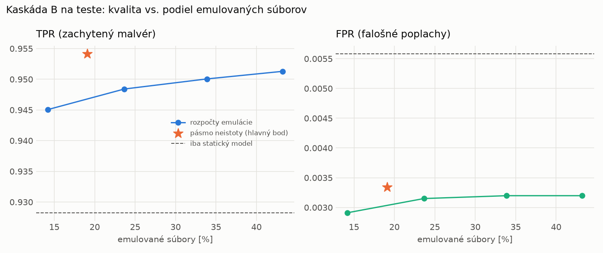

# Kaskáda B `b_baselines` – beh `20261123-184120`

> Generované `src/cascade/evaluate_b.py` (2026-11-23T18:41:20+01:00). Seedy: [0, 1, 2]; hodnoty = priemer ± sm. odchýlka.
> Všetky prahy a pásmo neistoty sú z validácie; test sa na nič nenastavuje. Postup: `docs/09_plan_v2.md`.

| rola | beh |
|---|---|
| static | `runs_v4/real_p/lofo/Boxer/static/lightgbm/20261123-011538` |
| dynamic | `runs_v4/real_p/lofo/Boxer/dynamic/lightgbm/20261123-183231` |
| hybrid | `runs_v4/real_p/lofo/Boxer/hybrid/lightgbm/20261123-183451` |

Druhý stupeň: **dynamic**. Pásmo neistoty statického modelu: FPR ≤ 0.1% nad `hi`,
najviac 1% malvéru validácie pod `lo` (seed 0: lo = 0.0040, hi = 0.9984, seed 1: lo = 0.0066, hi = 0.9967, seed 2: lo = 0.0040, hi = 0.9986).

## Test
| prístup | accuracy | balanced_accuracy | precision | recall_tpr | fpr | f1 | mcc |
|---|---|---|---|---|---|---|---|
| kaskáda B | 0.9776 ± 0.0005 | 0.9754 ± 0.0006 | 0.9957 ± 0.0004 | 0.9542 ± 0.0008 | 0.0033 ± 0.0003 | 0.9745 ± 0.0006 | 0.9553 ± 0.0011 |
| statický | 0.9648 ± 0.0010 | 0.9613 ± 0.0012 | 0.9926 ± 0.0006 | 0.9283 ± 0.0028 | 0.0056 ± 0.0005 | 0.9594 ± 0.0013 | 0.9300 ± 0.0020 |
| dynamický | 0.9015 ± 0.0041 | 0.8910 ± 0.0046 | 0.9883 ± 0.0010 | 0.7896 ± 0.0091 | 0.0076 ± 0.0007 | 0.8779 ± 0.0057 | 0.8112 ± 0.0076 |
| hybrid (každá vzorka) | 0.9786 ± 0.0009 | 0.9769 ± 0.0009 | 0.9914 ± 0.0011 | 0.9605 ± 0.0014 | 0.0067 ± 0.0009 | 0.9757 ± 0.0010 | 0.9570 ± 0.0017 |

- **emulované súbory: 19.10%** (ostatné rozhodne iba statický model); na hybrid ide 5.36% súborov
- chyby pri istom rozhodnutí statického modelu (seed 0): 59
- validácia: emulované 15.81%, na hybrid 3.38%

## Validácia
| prístup | accuracy | balanced_accuracy | precision | recall_tpr | fpr | f1 | mcc |
|---|---|---|---|---|---|---|---|
| kaskáda B | 0.9799 ± 0.0002 | 0.9767 ± 0.0001 | 0.9936 ± 0.0006 | 0.9578 ± 0.0002 | 0.0044 ± 0.0004 | 0.9754 ± 0.0002 | 0.9589 ± 0.0004 |
| statický | 0.9665 ± 0.0010 | 0.9616 ± 0.0012 | 0.9858 ± 0.0003 | 0.9328 ± 0.0024 | 0.0096 ± 0.0002 | 0.9586 ± 0.0013 | 0.9315 ± 0.0021 |
| dynamický | 0.9246 ± 0.0021 | 0.9113 ± 0.0025 | 0.9838 ± 0.0001 | 0.8324 ± 0.0050 | 0.0097 ± 0.0000 | 0.9018 ± 0.0029 | 0.8491 ± 0.0040 |
| hybrid (každá vzorka) | 0.9790 ± 0.0004 | 0.9766 ± 0.0005 | 0.9868 ± 0.0007 | 0.9624 ± 0.0013 | 0.0092 ± 0.0005 | 0.9744 ± 0.0005 | 0.9569 ± 0.0009 |

## Januárové vzorky vynechanej rodiny (iba malvér → TPR)
| prístup | TPR |
|---|---|
| kaskáda B | 0.9235 ± 0.0072 |
| statický | 0.9037 ± 0.0030 |
| dynamický | 0.5195 ± 0.0520 |
| hybrid (každá vzorka) | 0.9423 ± 0.0048 |

Podiel emulovaných: 62.98%

## Krivka rozpočtu emulácie (test, priemer cez seedy)
| budget_val | emulation_rate | hybrid_rate | recall_tpr | fpr | f1 |
|---|---|---|---|---|---|
| 0.1000 | 0.1420 | 0.0584 | 0.9451 | 0.0029 | 0.9700 |
| 0.2000 | 0.2366 | 0.0718 | 0.9484 | 0.0032 | 0.9716 |
| 0.3000 | 0.3387 | 0.0831 | 0.9501 | 0.0032 | 0.9724 |
| 0.4000 | 0.4322 | 0.0920 | 0.9513 | 0.0032 | 0.9731 |

## Výpočtové nároky
Čas dynamickej analýzy (beh v emulátore alebo na zariadení) dataset neuvádza, preto sa neodhaduje. Úspora kaskády B = podiel súborov s dynamickou analýzou: **19.10%** (ostatné prístupy 100 %).

_Chýba benchmark niektorého komponentu (v zero-day behoch sa nemeria)._

