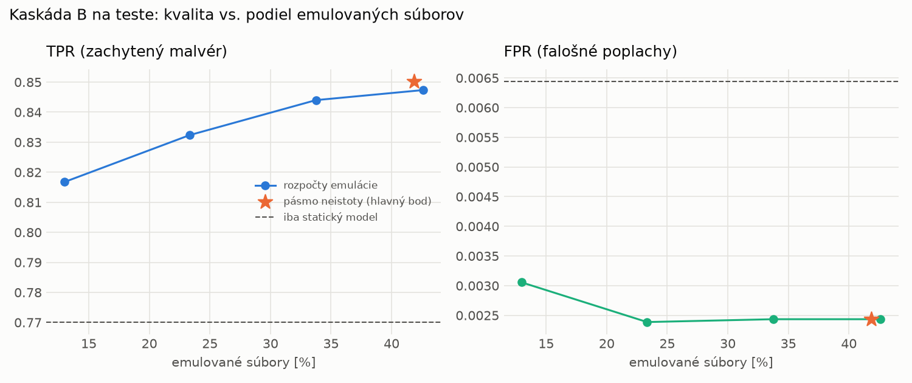

# Kaskáda B `b_heavy` – beh `20261123-184118`

> Generované `src/cascade/evaluate_b.py` (2026-11-23T18:41:18+01:00). Seedy: [0, 1, 2]; hodnoty = priemer ± sm. odchýlka.
> Všetky prahy a pásmo neistoty sú z validácie; test sa na nič nenastavuje. Postup: `docs/09_plan_v2.md`.

| rola | beh |
|---|---|
| static | `runs_v4/real_p/lofo/Boxer/students_static/mlp_kd/20261123-183817` |
| dynamic | `runs_v4/real_p/lofo/Boxer/students_dynamic/mlp_kd/20261123-183926` |
| hybrid | `runs_v4/real_p/lofo/Boxer/hybrid/mlp_large/20261123-183513` |

Druhý stupeň: **dynamic**. Pásmo neistoty statického modelu: FPR ≤ 0.1% nad `hi`,
najviac 1% malvéru validácie pod `lo` (seed 0: lo = 0.0040, hi = 0.9998, seed 1: lo = 0.0050, hi = 0.9998, seed 2: lo = 0.0046, hi = 0.9999).

## Test
| prístup | accuracy | balanced_accuracy | precision | recall_tpr | fpr | f1 | mcc |
|---|---|---|---|---|---|---|---|
| kaskáda B | 0.9315 ± 0.0131 | 0.9239 ± 0.0146 | 0.9965 ± 0.0003 | 0.8503 ± 0.0295 | 0.0024 ± 0.0002 | 0.9174 ± 0.0172 | 0.8677 ± 0.0242 |
| statický | 0.8934 ± 0.0129 | 0.8818 ± 0.0145 | 0.9898 ± 0.0011 | 0.7701 ± 0.0298 | 0.0064 ± 0.0009 | 0.8660 ± 0.0187 | 0.7970 ± 0.0228 |
| dynamický | 0.8389 ± 0.0044 | 0.8212 ± 0.0049 | 0.9851 ± 0.0011 | 0.6504 ± 0.0099 | 0.0080 ± 0.0006 | 0.7835 ± 0.0071 | 0.6999 ± 0.0076 |
| hybrid (každá vzorka) | 0.9654 ± 0.0057 | 0.9622 ± 0.0064 | 0.9906 ± 0.0013 | 0.9316 ± 0.0131 | 0.0072 ± 0.0010 | 0.9602 ± 0.0068 | 0.9310 ± 0.0111 |

- **emulované súbory: 41.86%** (ostatné rozhodne iba statický model); na hybrid ide 10.02% súborov
- chyby pri istom rozhodnutí statického modelu (seed 0): 43
- validácia: emulované 38.37%, na hybrid 8.63%

## Validácia
| prístup | accuracy | balanced_accuracy | precision | recall_tpr | fpr | f1 | mcc |
|---|---|---|---|---|---|---|---|
| kaskáda B | 0.9546 ± 0.0066 | 0.9464 ± 0.0079 | 0.9923 ± 0.0004 | 0.8978 ± 0.0156 | 0.0050 ± 0.0002 | 0.9426 ± 0.0088 | 0.9084 ± 0.0130 |
| statický | 0.9223 ± 0.0058 | 0.9085 ± 0.0070 | 0.9839 ± 0.0005 | 0.8266 ± 0.0139 | 0.0096 ± 0.0002 | 0.8984 ± 0.0084 | 0.8446 ± 0.0112 |
| dynamický | 0.8722 ± 0.0029 | 0.8483 ± 0.0035 | 0.9810 ± 0.0002 | 0.7063 ± 0.0070 | 0.0097 ± 0.0000 | 0.8213 ± 0.0048 | 0.7496 ± 0.0054 |
| hybrid (každá vzorka) | 0.9654 ± 0.0072 | 0.9603 ± 0.0087 | 0.9855 ± 0.0003 | 0.9304 ± 0.0173 | 0.0097 ± 0.0000 | 0.9571 ± 0.0093 | 0.9293 ± 0.0144 |

## Januárové vzorky vynechanej rodiny (iba malvér → TPR)
| prístup | TPR |
|---|---|
| kaskáda B | 0.5151 ± 0.1619 |
| statický | 0.3667 ± 0.1445 |
| dynamický | 0.3412 ± 0.0503 |
| hybrid (každá vzorka) | 0.9060 ± 0.0336 |

Podiel emulovaných: 92.33%

## Krivka rozpočtu emulácie (test, priemer cez seedy)
| budget_val | emulation_rate | hybrid_rate | recall_tpr | fpr | f1 |
|---|---|---|---|---|---|
| 0.1000 | 0.1298 | 0.0572 | 0.8167 | 0.0031 | 0.8970 |
| 0.2000 | 0.2333 | 0.0862 | 0.8324 | 0.0024 | 0.9068 |
| 0.3000 | 0.3375 | 0.1065 | 0.8440 | 0.0024 | 0.9137 |
| 0.4000 | 0.4260 | 0.1179 | 0.8473 | 0.0024 | 0.9157 |

## Výpočtové nároky
Čas dynamickej analýzy (beh v emulátore alebo na zariadení) dataset neuvádza, preto sa neodhaduje. Úspora kaskády B = podiel súborov s dynamickou analýzou: **41.86%** (ostatné prístupy 100 %).

_Chýba benchmark niektorého komponentu (v zero-day behoch sa nemeria)._

