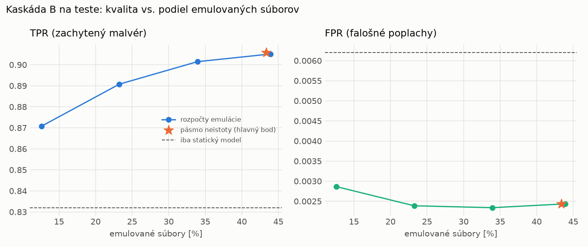

# Kaskáda B `b_heavyteacher` – beh `20261123-184124`

> Generované `src/cascade/evaluate_b.py` (2026-11-23T18:41:24+01:00). Seedy: [0, 1, 2]; hodnoty = priemer ± sm. odchýlka.
> Všetky prahy a pásmo neistoty sú z validácie; test sa na nič nenastavuje. Postup: `docs/09_plan_v2.md`.

| rola | beh |
|---|---|
| static | `runs_v4/real_p/lofo/Boxer/students_static/mlp_kd_heavy/20261123-183913` |
| dynamic | `runs_v4/real_p/lofo/Boxer/students_dynamic/mlp_kd_heavy/20261123-184042` |
| hybrid | `runs_v4/real_p/lofo/Boxer/hybrid/lightgbm/20261123-183451` |

Druhý stupeň: **dynamic**. Pásmo neistoty statického modelu: FPR ≤ 0.1% nad `hi`,
najviac 1% malvéru validácie pod `lo` (seed 0: lo = 0.0423, hi = 0.9978, seed 1: lo = 0.0286, hi = 0.9990, seed 2: lo = 0.0271, hi = 0.9985).

## Test
| prístup | accuracy | balanced_accuracy | precision | recall_tpr | fpr | f1 | mcc |
|---|---|---|---|---|---|---|---|
| kaskáda B | 0.9565 ± 0.0011 | 0.9517 ± 0.0012 | 0.9967 ± 0.0003 | 0.9059 ± 0.0023 | 0.0024 ± 0.0002 | 0.9491 ± 0.0013 | 0.9144 ± 0.0021 |
| statický | 0.9213 ± 0.0014 | 0.9129 ± 0.0015 | 0.9909 ± 0.0005 | 0.8320 ± 0.0031 | 0.0062 ± 0.0004 | 0.9045 ± 0.0018 | 0.8477 ± 0.0026 |
| dynamický | 0.8451 ± 0.0027 | 0.8283 ± 0.0030 | 0.9839 ± 0.0011 | 0.6654 ± 0.0059 | 0.0088 ± 0.0006 | 0.7939 ± 0.0043 | 0.7104 ± 0.0047 |
| hybrid (každá vzorka) | 0.9786 ± 0.0009 | 0.9769 ± 0.0009 | 0.9914 ± 0.0011 | 0.9605 ± 0.0014 | 0.0067 ± 0.0009 | 0.9757 ± 0.0010 | 0.9570 ± 0.0017 |

- **emulované súbory: 43.35%** (ostatné rozhodne iba statický model); na hybrid ide 10.84% súborov
- chyby pri istom rozhodnutí statického modelu (seed 0): 46
- validácia: emulované 39.97%, na hybrid 8.79%

## Validácia
| prístup | accuracy | balanced_accuracy | precision | recall_tpr | fpr | f1 | mcc |
|---|---|---|---|---|---|---|---|
| kaskáda B | 0.9620 ± 0.0010 | 0.9552 ± 0.0012 | 0.9929 ± 0.0007 | 0.9151 ± 0.0020 | 0.0047 ± 0.0004 | 0.9524 ± 0.0013 | 0.9230 ± 0.0021 |
| statický | 0.9246 ± 0.0020 | 0.9113 ± 0.0024 | 0.9838 ± 0.0001 | 0.8323 ± 0.0047 | 0.0097 ± 0.0000 | 0.9017 ± 0.0028 | 0.8490 ± 0.0038 |
| dynamický | 0.8770 ± 0.0016 | 0.8540 ± 0.0019 | 0.9813 ± 0.0001 | 0.7177 ± 0.0039 | 0.0097 ± 0.0000 | 0.8290 ± 0.0026 | 0.7585 ± 0.0030 |
| hybrid (každá vzorka) | 0.9790 ± 0.0004 | 0.9766 ± 0.0005 | 0.9868 ± 0.0007 | 0.9624 ± 0.0013 | 0.0092 ± 0.0005 | 0.9744 ± 0.0005 | 0.9569 ± 0.0009 |

## Januárové vzorky vynechanej rodiny (iba malvér → TPR)
| prístup | TPR |
|---|---|
| kaskáda B | 0.8482 ± 0.0139 |
| statický | 0.8062 ± 0.0100 |
| dynamický | 0.4038 ± 0.0506 |
| hybrid (každá vzorka) | 0.9423 ± 0.0048 |

Podiel emulovaných: 94.92%

## Krivka rozpočtu emulácie (test, priemer cez seedy)
| budget_val | emulation_rate | hybrid_rate | recall_tpr | fpr | f1 |
|---|---|---|---|---|---|
| 0.1000 | 0.1258 | 0.0646 | 0.8707 | 0.0029 | 0.9291 |
| 0.2000 | 0.2325 | 0.0928 | 0.8908 | 0.0024 | 0.9408 |
| 0.3000 | 0.3393 | 0.1107 | 0.9015 | 0.0023 | 0.9467 |
| 0.4000 | 0.4392 | 0.1193 | 0.9051 | 0.0024 | 0.9487 |

## Výpočtové nároky
Čas dynamickej analýzy (beh v emulátore alebo na zariadení) dataset neuvádza, preto sa neodhaduje. Úspora kaskády B = podiel súborov s dynamickou analýzou: **43.35%** (ostatné prístupy 100 %).

_Chýba benchmark niektorého komponentu (v zero-day behoch sa nemeria)._

