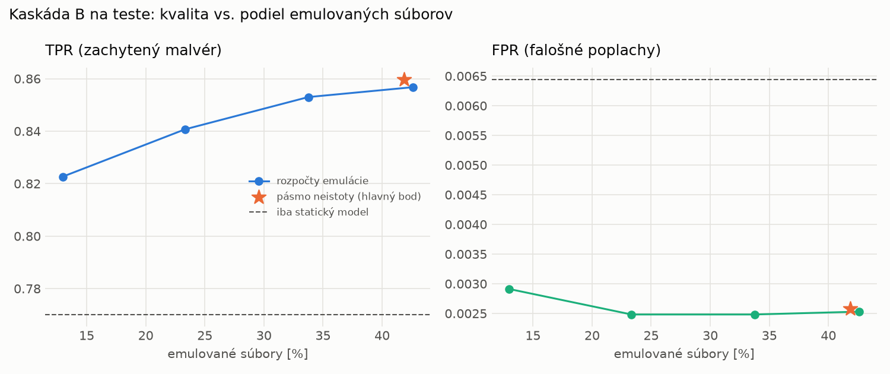

# Kaskáda B `b_main` – beh `20261123-184114`

> Generované `src/cascade/evaluate_b.py` (2026-11-23T18:41:14+01:00). Seedy: [0, 1, 2]; hodnoty = priemer ± sm. odchýlka.
> Všetky prahy a pásmo neistoty sú z validácie; test sa na nič nenastavuje. Postup: `docs/09_plan_v2.md`.

| rola | beh |
|---|---|
| static | `runs_v4/real_p/lofo/Boxer/students_static/mlp_kd/20261123-183817` |
| dynamic | `runs_v4/real_p/lofo/Boxer/students_dynamic/mlp_kd/20261123-183926` |
| hybrid | `runs_v4/real_p/lofo/Boxer/hybrid/lightgbm/20261123-183451` |

Druhý stupeň: **dynamic**. Pásmo neistoty statického modelu: FPR ≤ 0.1% nad `hi`,
najviac 1% malvéru validácie pod `lo` (seed 0: lo = 0.0040, hi = 0.9998, seed 1: lo = 0.0050, hi = 0.9998, seed 2: lo = 0.0046, hi = 0.9999).

## Test
| prístup | accuracy | balanced_accuracy | precision | recall_tpr | fpr | f1 | mcc |
|---|---|---|---|---|---|---|---|
| kaskáda B | 0.9357 ± 0.0113 | 0.9286 ± 0.0127 | 0.9963 ± 0.0005 | 0.8597 ± 0.0256 | 0.0026 ± 0.0004 | 0.9229 ± 0.0147 | 0.8754 ± 0.0210 |
| statický | 0.8934 ± 0.0129 | 0.8818 ± 0.0145 | 0.9898 ± 0.0011 | 0.7701 ± 0.0298 | 0.0064 ± 0.0009 | 0.8660 ± 0.0187 | 0.7970 ± 0.0228 |
| dynamický | 0.8389 ± 0.0044 | 0.8212 ± 0.0049 | 0.9851 ± 0.0011 | 0.6504 ± 0.0099 | 0.0080 ± 0.0006 | 0.7835 ± 0.0071 | 0.6999 ± 0.0076 |
| hybrid (každá vzorka) | 0.9786 ± 0.0009 | 0.9769 ± 0.0009 | 0.9914 ± 0.0011 | 0.9605 ± 0.0014 | 0.0067 ± 0.0009 | 0.9757 ± 0.0010 | 0.9570 ± 0.0017 |

- **emulované súbory: 41.86%** (ostatné rozhodne iba statický model); na hybrid ide 10.02% súborov
- chyby pri istom rozhodnutí statického modelu (seed 0): 43
- validácia: emulované 38.37%, na hybrid 8.63%

## Validácia
| prístup | accuracy | balanced_accuracy | precision | recall_tpr | fpr | f1 | mcc |
|---|---|---|---|---|---|---|---|
| kaskáda B | 0.9608 ± 0.0033 | 0.9536 ± 0.0039 | 0.9947 ± 0.0009 | 0.9106 ± 0.0073 | 0.0034 ± 0.0006 | 0.9508 ± 0.0044 | 0.9208 ± 0.0067 |
| statický | 0.9223 ± 0.0058 | 0.9085 ± 0.0070 | 0.9839 ± 0.0005 | 0.8266 ± 0.0139 | 0.0096 ± 0.0002 | 0.8984 ± 0.0084 | 0.8446 ± 0.0112 |
| dynamický | 0.8722 ± 0.0029 | 0.8483 ± 0.0035 | 0.9810 ± 0.0002 | 0.7063 ± 0.0070 | 0.0097 ± 0.0000 | 0.8213 ± 0.0048 | 0.7496 ± 0.0054 |
| hybrid (každá vzorka) | 0.9790 ± 0.0004 | 0.9766 ± 0.0005 | 0.9868 ± 0.0007 | 0.9624 ± 0.0013 | 0.0092 ± 0.0005 | 0.9744 ± 0.0005 | 0.9569 ± 0.0009 |

## Januárové vzorky vynechanej rodiny (iba malvér → TPR)
| prístup | TPR |
|---|---|
| kaskáda B | 0.5321 ± 0.1653 |
| statický | 0.3667 ± 0.1445 |
| dynamický | 0.3412 ± 0.0503 |
| hybrid (každá vzorka) | 0.9423 ± 0.0048 |

Podiel emulovaných: 92.33%

## Krivka rozpočtu emulácie (test, priemer cez seedy)
| budget_val | emulation_rate | hybrid_rate | recall_tpr | fpr | f1 |
|---|---|---|---|---|---|
| 0.1000 | 0.1298 | 0.0572 | 0.8227 | 0.0029 | 0.9007 |
| 0.2000 | 0.2333 | 0.0862 | 0.8407 | 0.0025 | 0.9118 |
| 0.3000 | 0.3375 | 0.1065 | 0.8530 | 0.0025 | 0.9190 |
| 0.4000 | 0.4260 | 0.1179 | 0.8567 | 0.0025 | 0.9212 |

## Výpočtové nároky
Čas dynamickej analýzy (beh v emulátore alebo na zariadení) dataset neuvádza, preto sa neodhaduje. Úspora kaskády B = podiel súborov s dynamickou analýzou: **41.86%** (ostatné prístupy 100 %).

_Chýba benchmark niektorého komponentu (v zero-day behoch sa nemeria)._

